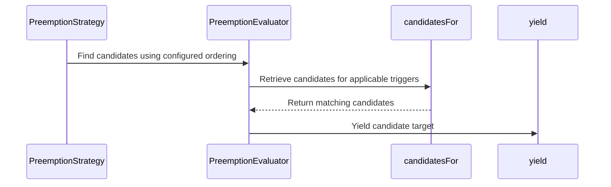

# PR #16271: Address follow-up review comments on configurable preemptions

**Summary**: Address follow-up review comments on configurable preemptions

**Sources**: https://github.com/kubernetes-sigs/kueue/pull/16271

**Last updated**: 2026-09-30T03:28:22Z

---

## Metadata

- **State**: closed (merged)
- **Author**: [@Nilsachy](https://github.com/Nilsachy)
- **Branch**: `configurable-preemptions-review-follow-ups` → `main`
- **Created**: 2026-09-28T10:20:32Z
- **Updated**: 2026-09-30T03:28:22Z
- **Merged**: 2026-09-30T03:28:20Z
- **Closed**: 2026-09-30T03:28:20Z
- **Labels**: `lgtm`, `release-note-none`, `size/XL`, `approved`, `kind/cleanup`, `cncf-cla: yes`
- **Assignees**: [@dkaluza](https://github.com/dkaluza)
- **Requested reviewers**: [@mbobrovskyi](https://github.com/mbobrovskyi), [@dkaluza](https://github.com/dkaluza), [@sohankunkerkar](https://github.com/sohankunkerkar)
- **Changed files**: 7   **+430 / -507**

## Description

<!-- Thank you for contributing! Check CONTRIBUTING.md for details. -->

#### What type of PR is this?
<!-- Choose one of the following kinds:
/kind bug
/kind cleanup
/kind documentation
/kind feature
/kind kep
-->
/kind cleanup

<!-- Optionally choose one or more of the following kinds:
/kind api-change
/kind deprecation
/kind failing-test
/kind flake
/kind regression
-->


<!-- Consider setting the area:
/area tas
/area was
/area integrations
/area multikueue
/area dashboard
/area localization
/area testing
/area website
-->


#### What this PR does / why we need it?

Addresses the follow-up review comments left on #16130 (configurable preemptions) and tracked in #16203, except "Include overlapping TAS flavors for `QuotaFeasibleAndInsufficientTopology`", which is tracked separately in #16141.

`PreemptionEvaluator` (`pkg/scheduler/preemption/config`):
- Clarify the doc comment of `HasRules`.
- Merge `preemption.go` into `evaluator.go`, so that all the methods of `PreemptionEvaluator` live next to the struct.
- Pass `candidatesOrdering` to the constructors and store it on the evaluator, instead of passing it to each method.
- Replace `NewEvaluatorForClusterQueue` with `NewEvaluatorForPreemptionConfig`, which takes the name of the `PreemptionConfig` rather than the whole ClusterQueue snapshot. The feature gate and ClusterQueue checks move to `Preemptor.newConfigurableEvaluator`.
- Drop the redundant `p == nil` checks of `orderedCandidates` and `hasConditionalRules`, which are only called by `FindCandidates` after its `HasRules` guard.
- Only export the constructors, `HasRules` and `FindCandidates`, and document `FindCandidates` as the entry point. `HasRulesFor`, `HasConditionalRules`, `OrderedCandidates` and `Candidates` become unexported.

Tests:
- Explain why `b1`, rather than `a1`, is preempted in "configurable candidates can select workloads in different ClusterQueue within nominal quota" and "fair sharing: configurable candidate in a ClusterQueue within nominal quota is preempted".
- Lower the priority of `b1` in "candidate from another Cohort is given back when it doesn't help", so that it is obviously considered first.
- Reverse the priorities in "InsufficientQuota trigger is not used when the Always trigger is enough", so that the candidate ordering prefers `a2`, only selected by the `InsufficientQuota` rule, while only `a1` is preempted.
- Remove the unused `workloadPriorityClasses` and `priorityClasses` fields.
- Compare the targets as a sorted list, which also reports duplicates, instead of adding a separate length check.
- Replace `TestFindConfigurableCandidates` with `TestPreemptionEvaluatorFindCandidates` in the config package, which exercises `FindCandidates` through its public API rather than through the internal preemption context.
- Verify that the TAS state of the snapshot is restored after `GetTargets`, by comparing the `SerializeFreeCapacityPerDomain()` output of the TAS flavors, which `configurableSnapCmpOpts` skips.

<!--
Use `Fixes #123` for an issue addressed by this PR; it will be closed when the PR merges.
Use `Related:` or `Part of:` to reference an issue without closing it.
-->
Fixes #16203

#### Useful notes for your reviewer

- `findConfigurableCandidates` no longer exists since #16000. Its remaining test, `TestFindConfigurableCandidates`, still drove `FindCandidates` through the preemption context, so it is replaced by a table test of `FindCandidates` in `pkg/scheduler/preemption/config`, with stub fit checks.
- `HasRules` stays exported, as the Fair Sharing strategy (`noCandidates`) uses it. It keeps its nil check, as the evaluator is nil when the feature gate is disabled or the ClusterQueue has no readable `PreemptionConfig`.
- `candidatesFor` is still unit tested directly by `TestPreemptionEvaluatorCandidates`, which lives in the same package.
- The unresolved thread on #16130 asking for e2e tests of the Priority and LabelSelector filters is already covered by #16204.

#### Release note

<!-- Describe the behavior change accurately from the user's perspective. Hints:
- Do not leave this block blank.
- Use "NONE" when there is no user-facing change.
- When feasible use a prefix for the sub-component or feature, e.g. "FairSharing:" or "MultiKueue:".
- If upgrade steps are required, include an "ACTION REQUIRED:" section.
You may consider AI assistance using the skill: cmd/experimental/skills/kueue-release-notes/SKILL.md.
-->
```release-note
NONE
```


<!-- This is an auto-generated comment: release notes by coderabbit.ai -->
## AI summary

Refactored configurable preemption evaluation to store candidate ordering on the evaluator and expose `FindCandidates` as its main entry point. Updated tests to clarify candidate ordering and verify TAS free-capacity restoration after `GetTargets`.

### Suggested release note

NONE. This change refactors internal evaluation and tests without an established user-facing behavior change.
<!-- end of auto-generated comment: release notes by coderabbit.ai -->

## Discussion

### Comment by [@netlify[bot]](https://github.com/apps/netlify) — 2026-09-28T10:20:39Z

### <span aria-hidden="true">✅</span> Deploy Preview for *kubernetes-sigs-kueue* canceled.


|  Name | Link |
|:-:|------------------------|
|<span aria-hidden="true">🔨</span> Latest commit | 07dfd7cc3f80d4e3c3d149db74906d804e05a01a |
|<span aria-hidden="true">🔍</span> Latest deploy log | https://app.netlify.com/projects/kubernetes-sigs-kueue/deploys/6abbd954ffe1430008285f44 |

### Comment by [@coderabbitai[bot]](https://github.com/apps/coderabbitai) — 2026-09-28T10:23:38Z

<!-- This is an auto-generated comment: summarize by coderabbit.ai -->
<!-- review_stack_entry_start -->

<a href="https://app.coderabbit.ai/change-stack/kubernetes-sigs/kueue/pull/16271?cs_source=review_comment"></a>

Navigate logical layers of code changes, visualize relationships, and explore their blast radius.

<!-- review_stack_entry_end -->
<!-- recent_review_start -->

No actionable comments were generated in the recent review. 🎉

<details>
<summary>ℹ️ Recent review info</summary>

<details>
<summary>⚙️ Run configuration</summary>

**Configuration used**: Repository: kubernetes-sigs/kueue/.coderabbit.yaml

**Review profile**: CHILL

**Plan**: Advanced

**Run ID**: `95949499-5f21-4227-889a-6c1cfd099a8d`

</details>

<details>
<summary>📥 Commits</summary>

Reviewing files that changed from the base of the PR and between 3ab3f2cef210ccfd6097e5eb5a2d94ee439aa855 and 07dfd7cc3f80d4e3c3d149db74906d804e05a01a.

</details>

<details>
<summary>📒 Files selected for processing (1)</summary>

* `pkg/scheduler/preemption/preemption_configurable_test.go`

</details>

<details>
<summary>🚧 Files skipped from review as they are similar to previous changes (1)</summary>

* pkg/scheduler/preemption/preemption_configurable_test.go

</details>

**Included review availability:** This review used your included allowance. Your plan provides up to 8 included reviews per hour; 6 remain after this review.

</details>

---


<!-- recent_review_end -->
<!-- walkthrough_start -->

<details>
<summary>📝 Walkthrough</summary>

## Walkthrough

The configurable preemption evaluator now loads a named `PreemptionConfig`, stores candidate ordering, and yields candidates for applicable triggers. Preemption strategies supply the comparator, and tests cover trigger selection, target lists, and TAS capacity restoration.

### Changes

**Configurable preemption evaluation**

|Layer / File(s)|Summary|
|---|---|
|**Evaluator configuration and candidate flow** <br> `pkg/scheduler/preemption/config/evaluator.go`, `pkg/scheduler/preemption/config/preemption.go`, `pkg/scheduler/preemption/config/evaluator_test.go`|The evaluator loads a named configuration, stores a candidate comparator, and yields candidates according to activation triggers and quota-fit checks. Tests cover trigger order, callback interruption, and candidate selection.|
|**Strategy wiring and candidate ordering** <br> `pkg/scheduler/preemption/preemption.go`, `pkg/scheduler/preemption/classical_strategy.go`, `pkg/scheduler/preemption/fair_strategy.go`|The preemptor creates an evaluator for a referenced configuration and supplies candidate ordering. The classical and fair strategies use their updated ordering paths.|
|**Configurable preemption integration tests** <br> `pkg/scheduler/preemption/preemption_configurable_test.go`|Tests clarify candidate-ordering and trigger behavior, compare target lists to detect duplicates, and check TAS free-capacity restoration.|

<!-- change_assessment_start -->
**Priority:** ➖ Normal

**Estimated code review effort:** 3 (Moderate) | ~25 minutes

<!-- change_assessment_commit:"07dfd7cc3f80d4e3c3d149db74906d804e05a01a" -->
**Change:** Refactor
<!-- change_assessment_end -->

### Sequence Diagram(s)



</details>

<!-- walkthrough_end -->
<!-- final_review_risk_start -->
**Merge Risk:** _⚪ Minimal_ · up to `07dfd`
<!-- final_review_risk_coverage:{"sourceCommitId":"07dfd7cc3f80d4e3c3d149db74906d804e05a01a","coveredCommitId":"07dfd7cc3f80d4e3c3d149db74906d804e05a01a","kind":"reviewed"} -->

The reviewed changes have no identified issue that needs resolution before merge.
<!-- final_review_risk_end -->
<!-- architecture_review_start -->
### Security Architecture Review

**Security architecture risk:** _🔵 Low_ · up to `3ab3f`

The observed scheduler paths retain the feature gate, configuration-reference check, candidate filters, and snapshot restoration. No new privilege or broader preemption reach was demonstrated. Compatibility for callers outside the repository and some concurrent-use behavior remain unverified.

**Retained concerns**
No architecture-level concerns identified.

<details>
<summary>Security review details</summary>

**Security Blast Radius**
- _inferred_ — Incorrect candidate selection could affect workloads represented in the scheduler snapshot, including matching ClusterQueues. The observed changes do not establish an expansion of that scope.

**Trust Boundaries and Controls**
- _observed_ — The production path requires the feature gate and a referenced configuration; evaluator rules apply preemptor selectors, candidate filters, and resource-use checks before yielding targets. Authorization to edit those configurations was not established by this review.

**Resilience and Maintainability Implications**
- _observed_ — The observed strategy consumer records yielded targets and restores their snapshot entries on its normal terminal paths. Isolation or synchronization for concurrent direct evaluator use remains unverified.


</details>

<!-- architecture_review_end -->
<!-- pre_merge_checks_walkthrough_start -->

<details>
<summary>🚥 Pre-merge checks | ✅ 4 | ❌ 1</summary>

### ❌ Failed checks (1 warning)

|     Check name     | Status     | Explanation                                                                                                                                                                                 | Resolution                                                                         |
| :----------------: | :--------- | :------------------------------------------------------------------------------------------------------------------------------------------------------------------------------------------ | :--------------------------------------------------------------------------------- |
| Docstring Coverage | ⚠️ Warning | Docstring coverage is 33.33% which is insufficient. The required threshold is 80.00%. Docstring coverage is scoped to functions touched by this diff. Analyzed 12 functions across 5 files. | Write docstrings for the functions missing them to satisfy the coverage threshold. |

<details>
<summary>✅ Passed checks (4 passed)</summary>

|         Check name         | Status   | Explanation                                                                                                                                                                                               |
| :------------------------: | :------- | :-------------------------------------------------------------------------------------------------------------------------------------------------------------------------------------------------------- |
|      Description Check     | ✅ Passed | Check skipped - CodeRabbit’s high-level summary is enabled.                                                                                                                                               |
|         Title check        | ✅ Passed | The title accurately identifies the pull request as follow-up work on configurable preemptions. It matches the refactoring, API changes, and test updates described in the changeset.                     |
|     Linked Issues check    | ✅ Passed | The PR meets the active coding objectives in issue `#16203`. `evaluator.go` co-locates evaluator methods, clarifies `HasRules`, stores candidate ordering, uses a named `PreemptionConfig`, removes redund… |
| Out of Scope Changes check | ✅ Passed | The changes remain within issue `#16203`. Updates to classical and fair-sharing strategy call sites support the evaluator API refactor. Evaluator tests and TAS restoration assertions support the linked … |

</details>

</details>

<!-- pre_merge_checks_walkthrough_end -->

- [ ] <!-- {"checkboxId":"585bb3f6-faf5-4dbf-96d2-74e382adf19a"} --> Fix all pre-merge checks with AI
<!-- finishing_touch_checkbox_start -->

<details>
<summary>✨ Finishing Touches</summary>

<details open>
<summary>🧪 Generate unit tests (beta)</summary>

- [ ] <!-- {"checkboxId": "f47ac10b-58cc-4372-a567-0e02b2c3d479", "radioGroupId": "utg-output-choice-group-unknown_comment_id"} --> Create a new PR

</details>

</details>

<!-- finishing_touch_checkbox_end -->
<!-- tips_start -->

---


<sub>Comment `@coderabbitai help` to get the list of available commands.</sub>

<!-- tips_end -->

### Comment by [@kubernetes-prow[bot]](https://github.com/apps/kubernetes-prow) — 2026-09-28T11:52:22Z

[APPROVALNOTIFIER] This PR is **APPROVED**

This pull-request has been approved by: *<a href="https://github.com/kubernetes-sigs/kueue/pull/16271#pullrequestreview-5338166225" title="Approved">mimowo</a>*, *<a href="https://github.com/kubernetes-sigs/kueue/pull/16271#" title="Author self-approved">Nilsachy</a>*

The full list of commands accepted by this bot can be found [here](https://go.k8s.io/bot-commands?repo=kubernetes-sigs%2Fkueue).

The pull request process is described [here](https://git.k8s.io/community/contributors/guide/owners.md#the-code-review-process)

<details >
Needs approval from an approver in each of these files:

- ~~[OWNERS](https://github.com/kubernetes-sigs/kueue/blob/main/OWNERS)~~ [mimowo]

Approvers can indicate their approval by writing `/approve` in a comment
Approvers can cancel approval by writing `/approve cancel` in a comment
</details>
<!-- META={"approvers":[]} -->

### Comment by [@Nilsachy](https://github.com/Nilsachy) — 2026-09-28T12:41:13Z

/assign @dkaluza

### Comment by [@dkaluza](https://github.com/dkaluza) — 2026-09-29T15:34:15Z

/lgtm

Thank you!

### Comment by [@kubernetes-prow[bot]](https://github.com/apps/kubernetes-prow) — 2026-09-29T15:34:23Z

LGTM label has been added.  <details>Git tree hash: 441877335bdb1f677e0aa0e850124186aea43051</details>

## Reviews

### Review by [@mimowo](https://github.com/mimowo) (commented) — 2026-09-28T11:52:09Z

/approve
leaving lgtm to @dkaluza

### Review by [@dkaluza](https://github.com/dkaluza) (commented) — 2026-09-29T12:27:09Z

- **pkg/scheduler/preemption/config/evaluator.go:99** by [@dkaluza](https://github.com/dkaluza) — 2026-09-29T11:31:05Z
```diff
@@ -28,41 +28,166 @@ import (
 	"k8s.io/apimachinery/pkg/types"
 	"k8s.io/apimachinery/pkg/util/sets"
 	"k8s.io/utils/clock"
+	"sigs.k8s.io/controller-runtime/pkg/client"
 
 	kueuealpha "sigs.k8s.io/kueue/apis/kueue/v1alpha1"
+	kueue "sigs.k8s.io/kueue/apis/kueue/v1beta2"
 	schdcache "sigs.k8s.io/kueue/pkg/cache/scheduler"
 	"sigs.k8s.io/kueue/pkg/resources"
 	"sigs.k8s.io/kueue/pkg/scheduler/preemption/classical"
+	"sigs.k8s.io/kueue/pkg/scheduler/preemption/common"
 	"sigs.k8s.io/kueue/pkg/scheduler/preemption/config/filters"
 	"sigs.k8s.io/kueue/pkg/workload"
 )
 
 // PreemptionEvaluator selects the preemption candidates according to the configuration.
+//
+// FindCandidates is its entry point, yielding the candidates selected by the rules
+// of the PreemptionConfig, while HasRules lets callers check upfront whether it may
+// yield any candidate at all. A nil PreemptionEvaluator holds no rule, and therefore
+// never yields any candidate.
 type PreemptionEvaluator struct {
 	ctx    context.Context
 	log    logr.Logger
 	clock  clock.Clock
 	config kueuealpha.PreemptionConfig
+	// candidatesOrdering orders the candidates of a trigger from the most to the
+	// least preferred one.
+	candidatesOrdering func(a, b *workload.Info) int
 }
 
+// NewPreemptionEvaluator returns the PreemptionEvaluator for the given PreemptionConfig,
+// which yields the candidates of each trigger in the order defined by candidatesOrdering.
 func NewPreemptionEvaluator(
 	ctx context.Context,
 	log logr.Logger,
 	clock clock.Clock,
 	config kueuealpha.PreemptionConfig,
+	candidatesOrdering func(a, b *workload.Info) int,
 ) *PreemptionEvaluator {
 	return &PreemptionEvaluator{
-		ctx:    ctx,
-		log:    log,
-		clock:  clock,
-		config: config,
+		ctx:                ctx,
+		log:                log,
+		clock:              clock,
+		config:             config,
+		candidatesOrdering: candidatesOrdering,
 	}
 }
 
-// HasRulesFor returns whether any rule of the PreemptionConfig is activated by one of
+// NewEvaluatorForPreemptionConfig returns the PreemptionEvaluator for the PreemptionConfig
+// with the given name, or nil if it cannot be read.
+func NewEvaluatorForPreemptionConfig(
+	ctx context.Context,
+	log logr.Logger,
+	clock clock.Clock,
+	cl client.Client,
+	preemptionConfigName string,
+	candidatesOrdering func(a, b *workload.Info) int,
+) *PreemptionEvaluator {
+	preemptionConfig := &kueuealpha.PreemptionConfig{}
+	if err := cl.Get(ctx, client.ObjectKey{Name: preemptionConfigName}, preemptionConfig); err != nil {
+		log.Error(err, "Failed to get PreemptionConfig", "preemptionConfigName", preemptionConfigName)
+		return nil
+	}
+	return NewPreemptionEvaluator(ctx, log, clock, *preemptionConfig, candidatesOrdering)
+}
+
+// HasRules returns whether the PreemptionConfig holds any rule at all. It only
+// inspects the configuration, without evaluating any candidate, so callers can
+// cheaply tell whether FindCandidates may yield any candidate before running it,
+// for example when FindCandidates only runs once other preemption strategies
+// are exhausted.
```

  >// for example when FindCandidates only runs once other preemption strategies
  // are exhausted.
  
  nit: I do not understand this fragment

- **pkg/scheduler/preemption/preemption_configurable_test.go:704** by [@dkaluza](https://github.com/dkaluza) — 2026-09-29T11:48:32Z
```diff
@@ -677,12 +700,17 @@ func TestConfigurablePreemptions(t *testing.T) {
 			config:      withinParentCohortConfig,
 			fairSharing: &config.FairSharing{},
 			admitted: []kueue.Workload{
+				// a doesn't allow preemption within the ClusterQueue, so a1 is not a
+				// Fair Sharing candidate.
```

  So is this fair sharing that does not allow any preemptions? Or am I getting this wrong?

- **pkg/scheduler/preemption/config/evaluator_test.go:847** by [@dkaluza](https://github.com/dkaluza) — 2026-09-29T12:18:34Z
```diff
@@ -775,6 +777,190 @@ func TestPreemptionEvaluatorSelectorIndexes(t *testing.T) {
 	}
 }
 
+func TestPreemptionEvaluatorFindCandidates(t *testing.T) {
+	now := time.Now()
+	unitWl := *utiltestingapi.MakeWorkload("unit", "").Request(corev1.ResourceCPU, "1")
+	clusterQueue := utiltestingapi.MakeClusterQueue("a").
+		ResourceGroup(*utiltestingapi.MakeFlavorQuotas("default").
+			Resource(corev1.ResourceCPU, "3").Obj()).
+		Obj()
+	fr := resources.FlavorResource{Flavor: "default", Resource: corev1.ResourceCPU}
+
+	lowerTierSelector := utiltestingalpha.MakeCandidateSelector(kueuealpha.WithinClusterQueue).
+		NumericLabels(kueuealpha.PreemptionConfigNumericLabelConstraint{
+			Key:        "preemption-tier",
+			Comparison: ptr.To(kueuealpha.LessThan),
+		}).Obj()
+	// multiTriggerConfig allows preempting the workloads of a lower tier unconditionally,
+	// and the remaining workloads of the ClusterQueue only while the quota is insufficient.
+	multiTriggerConfig := *utiltestingalpha.MakePreemptionConfig("test").
+		Rule("tier-rule", kueuealpha.Always, lowerTierSelector).
+		Rule("within-cluster-queue-rule", kueuealpha.InsufficientQuota,
+			utiltestingalpha.MakeCandidateSelector(kueuealpha.WithinClusterQueue).Obj(),
+		).Obj()
+	// topologyTriggerConfig allows preempting the workloads of a lower tier unconditionally,
+	// and the remaining workloads of the ClusterQueue only once the quota is sufficient.
+	topologyTriggerConfig := *utiltestingalpha.MakePreemptionConfig("test").
+		Rule("tier-rule", kueuealpha.Always, lowerTierSelector).
+		Rule("within-cluster-queue-rule", kueuealpha.QuotaFeasibleAndInsufficientTopology,
+			utiltestingalpha.MakeCandidateSelector(kueuealpha.WithinClusterQueue).Obj(),
+		).Obj()
+
+	cases := map[string]struct {
+		// config is the PreemptionConfig of the evaluator; the evaluator is nil when unset.
+		config    *kueuealpha.PreemptionConfig
+		admitted  []kueue.Workload
+		preemptor *kueue.Workload
+		// neverFits makes the preemptor never fit, regardless of the quota, as when
+		// no topology assignment can be found for it.
+		neverFits       bool
+		wantInterrupted bool
+		wantTargets     []string
+	}{
+		"nil evaluator yields no candidates": {
+			admitted: []kueue.Workload{
+				*unitWl.Clone().Name("a1").SimpleReserveQuota("a", "default", now).Obj(),
+			},
+			preemptor:   unitWl.Clone().Name("a_incoming").Request(corev1.ResourceCPU, "3").Obj(),
+			wantTargets: nil,
+		},
+		"evaluator without rules yields no candidates": {
+			config: utiltestingalpha.MakePreemptionConfig("test").Obj(),
+			admitted: []kueue.Workload{
+				*unitWl.Clone().Name("a1").SimpleReserveQuota("a", "default", now).Obj(),
+			},
+			preemptor:   unitWl.Clone().Name("a_incoming").Request(corev1.ResourceCPU, "3").Obj(),
+			wantTargets: nil,
+		},
+		"stops as soon as the yield returns false": {
+			config: &multiTriggerConfig,
+			admitted: []kueue.Workload{
+				*unitWl.Clone().Name("a1").SimpleReserveQuota("a", "default", now).Obj(),
+			},
+			// a1 has no tier, so it is only selected by the InsufficientQuota trigger,
+			// and preempting it frees enough quota for the preemptor to fit.
+			preemptor:       unitWl.Clone().Name("a_incoming").Label("preemption-tier", "5").Request(corev1.ResourceCPU, "3").Obj(),
+			wantInterrupted: true,
+			wantTargets:     []string{"/a1"},
```

  Can we have a second workload? Right now we are nto checking really that this will stop "early"

### Review by [@Nilsachy](https://github.com/Nilsachy) (commented) — 2026-09-29T12:59:47Z

- **pkg/scheduler/preemption/config/evaluator.go:99** by [@Nilsachy](https://github.com/Nilsachy) — 2026-09-29T12:59:47Z
```diff
@@ -28,41 +28,166 @@ import (
 	"k8s.io/apimachinery/pkg/types"
 	"k8s.io/apimachinery/pkg/util/sets"
 	"k8s.io/utils/clock"
+	"sigs.k8s.io/controller-runtime/pkg/client"
 
 	kueuealpha "sigs.k8s.io/kueue/apis/kueue/v1alpha1"
+	kueue "sigs.k8s.io/kueue/apis/kueue/v1beta2"
 	schdcache "sigs.k8s.io/kueue/pkg/cache/scheduler"
 	"sigs.k8s.io/kueue/pkg/resources"
 	"sigs.k8s.io/kueue/pkg/scheduler/preemption/classical"
+	"sigs.k8s.io/kueue/pkg/scheduler/preemption/common"
 	"sigs.k8s.io/kueue/pkg/scheduler/preemption/config/filters"
 	"sigs.k8s.io/kueue/pkg/workload"
 )
 
 // PreemptionEvaluator selects the preemption candidates according to the configuration.
+//
+// FindCandidates is its entry point, yielding the candidates selected by the rules
+// of the PreemptionConfig, while HasRules lets callers check upfront whether it may
+// yield any candidate at all. A nil PreemptionEvaluator holds no rule, and therefore
+// never yields any candidate.
 type PreemptionEvaluator struct {
 	ctx    context.Context
 	log    logr.Logger
 	clock  clock.Clock
 	config kueuealpha.PreemptionConfig
+	// candidatesOrdering orders the candidates of a trigger from the most to the
+	// least preferred one.
+	candidatesOrdering func(a, b *workload.Info) int
 }
 
+// NewPreemptionEvaluator returns the PreemptionEvaluator for the given PreemptionConfig,
+// which yields the candidates of each trigger in the order defined by candidatesOrdering.
 func NewPreemptionEvaluator(
 	ctx context.Context,
 	log logr.Logger,
 	clock clock.Clock,
 	config kueuealpha.PreemptionConfig,
+	candidatesOrdering func(a, b *workload.Info) int,
 ) *PreemptionEvaluator {
 	return &PreemptionEvaluator{
-		ctx:    ctx,
-		log:    log,
-		clock:  clock,
-		config: config,
+		ctx:                ctx,
+		log:                log,
+		clock:              clock,
+		config:             config,
+		candidatesOrdering: candidatesOrdering,
 	}
 }
 
-// HasRulesFor returns whether any rule of the PreemptionConfig is activated by one of
+// NewEvaluatorForPreemptionConfig returns the PreemptionEvaluator for the PreemptionConfig
+// with the given name, or nil if it cannot be read.
+func NewEvaluatorForPreemptionConfig(
+	ctx context.Context,
+	log logr.Logger,
+	clock clock.Clock,
+	cl client.Client,
+	preemptionConfigName string,
+	candidatesOrdering func(a, b *workload.Info) int,
+) *PreemptionEvaluator {
+	preemptionConfig := &kueuealpha.PreemptionConfig{}
+	if err := cl.Get(ctx, client.ObjectKey{Name: preemptionConfigName}, preemptionConfig); err != nil {
+		log.Error(err, "Failed to get PreemptionConfig", "preemptionConfigName", preemptionConfigName)
+		return nil
+	}
+	return NewPreemptionEvaluator(ctx, log, clock, *preemptionConfig, candidatesOrdering)
+}
+
+// HasRules returns whether the PreemptionConfig holds any rule at all. It only
+// inspects the configuration, without evaluating any candidate, so callers can
+// cheaply tell whether FindCandidates may yield any candidate before running it,
+// for example when FindCandidates only runs once other preemption strategies
+// are exhausted.
```

  This is misleading I agree. I removed this last bit.

### Review by [@Nilsachy](https://github.com/Nilsachy) (commented) — 2026-09-29T13:07:31Z

- **pkg/scheduler/preemption/preemption_configurable_test.go:704** by [@Nilsachy](https://github.com/Nilsachy) — 2026-09-29T13:07:30Z
```diff
@@ -677,12 +700,17 @@ func TestConfigurablePreemptions(t *testing.T) {
 			config:      withinParentCohortConfig,
 			fairSharing: &config.FairSharing{},
 			admitted: []kueue.Workload{
+				// a doesn't allow preemption within the ClusterQueue, so a1 is not a
+				// Fair Sharing candidate.
```

  No the comment is about `.spec.preemption` policy of ClusterQueue `a`. But I agree this is misleading. Maybe something like:
  
  `ClusterQueue a has withinClusterQueue policy set to Never (the default), so a1 is not a Fair Sharing candidate`

### Review by [@dkaluza](https://github.com/dkaluza) (commented) — 2026-09-29T14:41:19Z

- **pkg/scheduler/preemption/preemption_configurable_test.go:704** by [@dkaluza](https://github.com/dkaluza) — 2026-09-29T14:41:19Z
```diff
@@ -677,12 +700,17 @@ func TestConfigurablePreemptions(t *testing.T) {
 			config:      withinParentCohortConfig,
 			fairSharing: &config.FairSharing{},
 			admitted: []kueue.Workload{
+				// a doesn't allow preemption within the ClusterQueue, so a1 is not a
+				// Fair Sharing candidate.
```

  But aren't default settings all set to Never? Therefore leading to no fair sharing?

### Review by [@Nilsachy](https://github.com/Nilsachy) (commented) — 2026-09-29T14:58:17Z

- **pkg/scheduler/preemption/config/evaluator_test.go:847** by [@Nilsachy](https://github.com/Nilsachy) — 2026-09-29T14:58:16Z
```diff
@@ -775,6 +777,190 @@ func TestPreemptionEvaluatorSelectorIndexes(t *testing.T) {
 	}
 }
 
+func TestPreemptionEvaluatorFindCandidates(t *testing.T) {
+	now := time.Now()
+	unitWl := *utiltestingapi.MakeWorkload("unit", "").Request(corev1.ResourceCPU, "1")
+	clusterQueue := utiltestingapi.MakeClusterQueue("a").
+		ResourceGroup(*utiltestingapi.MakeFlavorQuotas("default").
+			Resource(corev1.ResourceCPU, "3").Obj()).
+		Obj()
+	fr := resources.FlavorResource{Flavor: "default", Resource: corev1.ResourceCPU}
+
+	lowerTierSelector := utiltestingalpha.MakeCandidateSelector(kueuealpha.WithinClusterQueue).
+		NumericLabels(kueuealpha.PreemptionConfigNumericLabelConstraint{
+			Key:        "preemption-tier",
+			Comparison: ptr.To(kueuealpha.LessThan),
+		}).Obj()
+	// multiTriggerConfig allows preempting the workloads of a lower tier unconditionally,
+	// and the remaining workloads of the ClusterQueue only while the quota is insufficient.
+	multiTriggerConfig := *utiltestingalpha.MakePreemptionConfig("test").
+		Rule("tier-rule", kueuealpha.Always, lowerTierSelector).
+		Rule("within-cluster-queue-rule", kueuealpha.InsufficientQuota,
+			utiltestingalpha.MakeCandidateSelector(kueuealpha.WithinClusterQueue).Obj(),
+		).Obj()
+	// topologyTriggerConfig allows preempting the workloads of a lower tier unconditionally,
+	// and the remaining workloads of the ClusterQueue only once the quota is sufficient.
+	topologyTriggerConfig := *utiltestingalpha.MakePreemptionConfig("test").
+		Rule("tier-rule", kueuealpha.Always, lowerTierSelector).
+		Rule("within-cluster-queue-rule", kueuealpha.QuotaFeasibleAndInsufficientTopology,
+			utiltestingalpha.MakeCandidateSelector(kueuealpha.WithinClusterQueue).Obj(),
+		).Obj()
+
+	cases := map[string]struct {
+		// config is the PreemptionConfig of the evaluator; the evaluator is nil when unset.
+		config    *kueuealpha.PreemptionConfig
+		admitted  []kueue.Workload
+		preemptor *kueue.Workload
+		// neverFits makes the preemptor never fit, regardless of the quota, as when
+		// no topology assignment can be found for it.
+		neverFits       bool
+		wantInterrupted bool
+		wantTargets     []string
+	}{
+		"nil evaluator yields no candidates": {
+			admitted: []kueue.Workload{
+				*unitWl.Clone().Name("a1").SimpleReserveQuota("a", "default", now).Obj(),
+			},
+			preemptor:   unitWl.Clone().Name("a_incoming").Request(corev1.ResourceCPU, "3").Obj(),
+			wantTargets: nil,
+		},
+		"evaluator without rules yields no candidates": {
+			config: utiltestingalpha.MakePreemptionConfig("test").Obj(),
+			admitted: []kueue.Workload{
+				*unitWl.Clone().Name("a1").SimpleReserveQuota("a", "default", now).Obj(),
+			},
+			preemptor:   unitWl.Clone().Name("a_incoming").Request(corev1.ResourceCPU, "3").Obj(),
+			wantTargets: nil,
+		},
+		"stops as soon as the yield returns false": {
+			config: &multiTriggerConfig,
+			admitted: []kueue.Workload{
+				*unitWl.Clone().Name("a1").SimpleReserveQuota("a", "default", now).Obj(),
+			},
+			// a1 has no tier, so it is only selected by the InsufficientQuota trigger,
+			// and preempting it frees enough quota for the preemptor to fit.
+			preemptor:       unitWl.Clone().Name("a_incoming").Label("preemption-tier", "5").Request(corev1.ResourceCPU, "3").Obj(),
+			wantInterrupted: true,
+			wantTargets:     []string{"/a1"},
```

  Done, thanks!

### Review by [@dkaluza](https://github.com/dkaluza) (commented) — 2026-09-29T15:26:37Z

- **pkg/scheduler/preemption/preemption_configurable_test.go:704** by [@dkaluza](https://github.com/dkaluza) — 2026-09-29T15:26:37Z
```diff
@@ -677,12 +700,17 @@ func TestConfigurablePreemptions(t *testing.T) {
 			config:      withinParentCohortConfig,
 			fairSharing: &config.FairSharing{},
 			admitted: []kueue.Workload{
+				// a doesn't allow preemption within the ClusterQueue, so a1 is not a
+				// Fair Sharing candidate.
```

  For me the comment there:
  > 	// b is not borrowing, so the Fair Sharing ordering prunes it.
  
  Is really misleading then, as even if it would be borrowing it would be nit selected as we have Never FS preemption config.
  
  Maybe name like "when default preemption policies (Never) are set  and Fair Sharing is enabled, only the configurable preemption candidates are returned"?

### Review by [@Nilsachy](https://github.com/Nilsachy) (commented) — 2026-09-29T15:29:30Z

- **pkg/scheduler/preemption/preemption_configurable_test.go:704** by [@Nilsachy](https://github.com/Nilsachy) — 2026-09-29T15:29:30Z
```diff
@@ -677,12 +700,17 @@ func TestConfigurablePreemptions(t *testing.T) {
 			config:      withinParentCohortConfig,
 			fairSharing: &config.FairSharing{},
 			admitted: []kueue.Workload{
+				// a doesn't allow preemption within the ClusterQueue, so a1 is not a
+				// Fair Sharing candidate.
```

  That makes sense, done!
