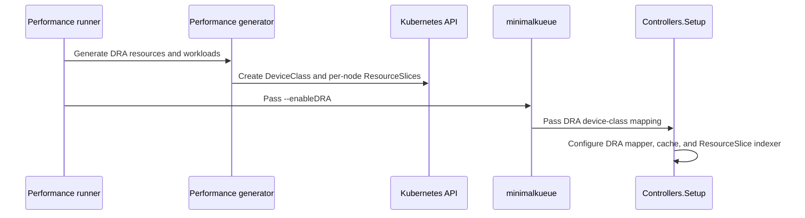

# PR #16317: TAS: add a scheduler performance test for DRA device feasibility

**Summary**: TAS: add a scheduler performance test for DRA device feasibility

**Sources**: https://github.com/kubernetes-sigs/kueue/pull/16317

**Last updated**: 2026-09-29T06:48:16Z

---

## Metadata

- **State**: closed (merged)
- **Author**: [@sohankunkerkar](https://github.com/sohankunkerkar)
- **Branch**: `dra-tas-scheduler-perf` → `main`
- **Created**: 2026-09-28T21:45:07Z
- **Updated**: 2026-09-29T06:48:16Z
- **Merged**: 2026-09-29T06:48:13Z
- **Closed**: 2026-09-29T06:48:13Z
- **Labels**: `kind/feature`, `lgtm`, `release-note-none`, `size/XL`, `approved`, `cncf-cla: yes`, `area/tas`, `area/testing`, `area/dra`
- **Assignees**: [@mimowo](https://github.com/mimowo)
- **Requested reviewers**: [@mbobrovskyi](https://github.com/mbobrovskyi), [@tenzen-y](https://github.com/tenzen-y)
- **Changed files**: 10   **+709 / -15**

## Description

<!-- Thank you for contributing! Check CONTRIBUTING.md for details. -->

#### What type of PR is this?
<!-- Choose one of the following kinds:
/kind bug
/kind cleanup
/kind documentation
/kind feature
/kind kep
-->


<!-- Optionally choose one or more of the following kinds:
/kind api-change
/kind deprecation
/kind failing-test
/kind flake
/kind regression
-->
/kind feature
/area tas
/area testing

<!-- Consider setting the area:
/area tas
/area was
/area integrations
/area multikueue
/area dashboard
/area localization
/area testing
/area website
-->


#### What this PR does / why we need it?
Adds a TAS+DRA scheduler performance config, so we can see what the `KueueDRADeviceFeasibility` check costs in the scheduling cycle.

<!--
Use `Fixes #123` for an issue addressed by this PR; it will be closed when the PR merges.
Use `Related:` or `Part of:` to reference an issue without closing it.
-->
Part of #14994

#### Useful notes for your reviewer


#### Release note

<!-- Describe the behavior change accurately from the user's perspective. Hints:
- Do not leave this block blank.
- Use "NONE" when there is no user-facing change.
- When feasible use a prefix for the sub-component or feature, e.g. "FairSharing:" or "MultiKueue:".
- If upgrade steps are required, include an "ACTION REQUIRED:" section.
You may consider AI assistance using the skill: cmd/experimental/skills/kueue-release-notes/SKILL.md.
-->
```release-note
NONE
```


<!-- This is an auto-generated comment: release notes by coderabbit.ai -->
## AI summary

Adds a TAS+DRA scheduler performance configuration to measure the cost of `KueueDRADeviceFeasibility`. The generator creates DRA devices, device claims, and queue quotas. The performance runner can enable DRA and configure the device-class mapping.

### Suggested release note

NONE. This change adds performance-test tooling and does not change user-facing behavior.
<!-- end of auto-generated comment: release notes by coderabbit.ai -->

## Discussion

### Comment by [@netlify[bot]](https://github.com/apps/netlify) — 2026-09-28T21:45:15Z

### <span aria-hidden="true">✅</span> Deploy Preview for *kubernetes-sigs-kueue* canceled.


|  Name | Link |
|:-:|------------------------|
|<span aria-hidden="true">🔨</span> Latest commit | 8f8cbfda9598f3f15761fe6038057820fbb8746a |
|<span aria-hidden="true">🔍</span> Latest deploy log | https://app.netlify.com/projects/kubernetes-sigs-kueue/deploys/6abae45dc6cb4c000842d8dd |

### Comment by [@coderabbitai[bot]](https://github.com/apps/coderabbitai) — 2026-09-28T21:46:44Z

<!-- This is an auto-generated comment: summarize by coderabbit.ai -->
<!-- review_stack_entry_start -->

<a href="https://app.coderabbit.ai/change-stack/kubernetes-sigs/kueue/pull/16317?cs_source=review_comment"></a>

Navigate logical layers of code changes, visualize relationships, and explore their blast radius.

<!-- review_stack_entry_end -->
<!-- recent_review_start -->

No actionable comments were generated in the recent review. 🎉

<details>
<summary>ℹ️ Recent review info</summary>

<details>
<summary>⚙️ Run configuration</summary>

**Configuration used**: Repository: kubernetes-sigs/kueue/.coderabbit.yaml

**Review profile**: CHILL

**Plan**: Advanced

**Run ID**: `2aea0e0d-ca98-4b15-9f58-ef8e98035187`

</details>

<details>
<summary>📥 Commits</summary>

Reviewing files that changed from the base of the PR and between 94e22d77e511f7e2be248edde0ee8ac800e04229 and 8f8cbfda9598f3f15761fe6038057820fbb8746a.

</details>

<details>
<summary>📒 Files selected for processing (1)</summary>

* `test/performance/scheduler/configs/tas-dra/rangespec.yaml`

</details>

**Included review availability:** This review used your included allowance. Your plan provides up to 8 included reviews per hour; 6 remain after this review.

</details>

---


<!-- recent_review_end -->
<!-- walkthrough_start -->

<details>
<summary>📝 Walkthrough</summary>

## Walkthrough

The performance test generator now creates DRA resources, quotas, and workload claims. The scheduler test runner can enable DRA device-feasibility checking. New TAS+DRA configuration, thresholds, documentation, and targets define the test workload and its run and check commands.

### Changes

**TAS and DRA performance testing**

|Layer / File(s)|Summary|
|---|---|
|**DRA configuration and validation** <br> `test/performance/scheduler/runner/generator/generator.go`, `test/performance/scheduler/runner/generator/dra_generator.go`, `test/performance/scheduler/runner/generator/generator_test.go`|Adds device capacity, workload device counts, and queue device quotas to the generator configuration. Validation checks the required DRA and TAS settings and rejects invalid device counts. Tests cover valid and invalid configurations.|
|**DRA resources, claims, and quotas** <br> `test/performance/scheduler/runner/generator/dra_generator.go`, `test/performance/scheduler/runner/generator/generator.go`|Creates a DeviceClass and per-node ResourceSlices. Generated workloads reference GPU claim templates, queues include device quotas, and cleanup deletes labeled DRA resources.|
|**DRA scheduler setup and runner flag** <br> `test/performance/framework/controllers/setup.go`, `test/performance/scheduler/runner/main.go`, `test/performance/scheduler/minimalkueue/main.go`|Adds conditional DRA mapper, cache, and ResourceSlice indexer setup. The runner passes `--enableDRA` when enabled; minimalkueue enables the feature gate and supplies the device-class mapping.|
|**TAS+DRA workload and test targets** <br> `test/performance/scheduler/configs/tas-dra/*`, `test/performance/scheduler/README.md`, `hack/make/test.mk`|Adds the workload configuration, performance thresholds, run and test documentation, and runner, checker, and retry targets.|

<!-- change_assessment_start -->
**Priority:** ⬇️ Low

**Estimated code review effort:** 3 (Moderate) | ~25 minutes

<!-- change_assessment_commit:"8f8cbfda9598f3f15761fe6038057820fbb8746a" -->
**Change:** Other
<!-- change_assessment_end -->

### Sequence Diagram(s)



</details>

<!-- walkthrough_end -->
<!-- final_review_risk_start -->
**Merge Risk:** _⚪ Minimal_ · up to `8f8cb`
<!-- final_review_risk_coverage:{"sourceCommitId":"8f8cbfda9598f3f15761fe6038057820fbb8746a","coveredCommitId":"8f8cbfda9598f3f15761fe6038057820fbb8746a","kind":"reviewed"} -->

The opt-in TAS+DRA benchmark’s generated resources and thresholds align with scheduler setup and checker expectations. No concrete merge-blocking risk was identified.
<!-- final_review_risk_end -->
<!-- architecture_review_start -->
### Security Architecture Review

**Security architecture risk:** _🟡 Moderate_ · up to `8f8cb`

The new benchmark is opt-in and isolated, but shared cleanup can delete device resources belonging to another run when the runner is used against a cluster.

**Retained concerns**
- **Medium · security · inferred:** Shared cleanup can delete cluster-scoped DRA objects from another run by label alone, including during an in-cluster run that did not generate DRA devices.

<details>
<summary>Security review details</summary>

**Security Blast Radius**
- _inferred_ — The independently affected scope is a cluster reached by an authorized in-cluster runner: matching ResourceSlices or DeviceClasses from another run can be deleted. The new benchmark's default envtest invocation does not reach that cluster.

**Security Findings and Attack Paths**
- _inferred_ — A runner using cluster credentials can carry an existing object's cleanup label through the selector to a cluster-scoped delete operation, even if that run did not create the object. This requires access to run the in-cluster harness and sufficient delete permissions; no unauthenticated route is shown.

**Trust Boundaries and Controls**
- _observed_ — The benchmark's DRA activation is flag- and configuration-gated, and the standard target uses envtest. Those controls limit normal benchmark exposure but do not scope the shared cleanup selector in in-cluster mode.

**Resilience and Maintainability Implications**
- _observed_ — Cleanup reports deletion errors but does not return them, while an earlier runner error exits before in-cluster cleanup. This limits assurance that partially generated cluster objects are removed.

**Hardening Proposals**
- _proposed_ — Scope DRA cleanup to objects owned by the current run, and make partial-failure cleanup explicit for in-cluster execution rather than deleting every object with the shared label.

</details>

<!-- architecture_review_end -->
<!-- pre_merge_checks_walkthrough_start -->

<details>
<summary>🚥 Pre-merge checks | ✅ 4 | ❌ 1</summary>

### ❌ Failed checks (1 warning)

|     Check name     | Status     | Explanation                                                                                                                                                                                               | Resolution                                                                         |
| :----------------: | :--------- | :-------------------------------------------------------------------------------------------------------------------------------------------------------------------------------------------------------- | :--------------------------------------------------------------------------------- |
| Docstring Coverage | ⚠️ Warning | Docstring coverage is 15.00% which is insufficient. The required threshold is 80.00%. Docstring coverage is scoped to functions touched by this diff. Analyzed 20 functions across 6 files. (1 skipped: … | Write docstrings for the functions missing them to satisfy the coverage threshold. |

<details>
<summary>✅ Passed checks (4 passed)</summary>

|         Check name         | Status   | Explanation                                                                                                                    |
| :------------------------: | :------- | :----------------------------------------------------------------------------------------------------------------------------- |
|      Description Check     | ✅ Passed | Check skipped - CodeRabbit’s high-level summary is enabled.                                                                    |
|         Title check        | ✅ Passed | The title clearly and concisely describes the main change: adding a TAS scheduler performance test for DRA device feasibility. |
|     Linked Issues check    | ✅ Passed | Check skipped because no linked issues were found for this pull request.                                                       |
| Out of Scope Changes check | ✅ Passed | Check skipped because no linked issues were found for this pull request.                                                       |

</details>

<details>
<summary>Full details: Docstring Coverage</summary>

**Explanation**

Docstring coverage is 15.00% which is insufficient. The required threshold is 80.00%. Docstring coverage is scoped to functions touched by this diff. Analyzed 20 functions across 6 files. (1 skipped: 1 unsupported.)

</details>

</details>

<!-- pre_merge_checks_walkthrough_end -->

- [ ] <!-- {"checkboxId":"585bb3f6-faf5-4dbf-96d2-74e382adf19a"} --> Fix all pre-merge checks with AI
<!-- finishing_touch_checkbox_start -->

<details>
<summary>✨ Finishing Touches</summary>

<details open>
<summary>🧪 Generate unit tests (beta)</summary>

- [ ] <!-- {"checkboxId": "f47ac10b-58cc-4372-a567-0e02b2c3d479", "radioGroupId": "utg-output-choice-group-unknown_comment_id"} --> Create a new PR

</details>

</details>

<!-- finishing_touch_checkbox_end -->
<!-- tips_start -->

---


<sub>Comment `@coderabbitai help` to get the list of available commands.</sub>

<!-- tips_end -->

### Comment by [@sohankunkerkar](https://github.com/sohankunkerkar) — 2026-09-28T21:57:16Z

/area dra

### Comment by [@kubernetes-prow[bot]](https://github.com/apps/kubernetes-prow) — 2026-09-29T06:04:06Z

LGTM label has been added.  <details>Git tree hash: 3ef79adbc6464d4bad50af9726745c23cc04ff15</details>

### Comment by [@kubernetes-prow[bot]](https://github.com/apps/kubernetes-prow) — 2026-09-29T06:04:11Z

[APPROVALNOTIFIER] This PR is **APPROVED**

This pull-request has been approved by: *<a href="https://github.com/kubernetes-sigs/kueue/pull/16317#pullrequestreview-5348347464" title="Approved">mimowo</a>*, *<a href="https://github.com/kubernetes-sigs/kueue/pull/16317#" title="Author self-approved">sohankunkerkar</a>*

The full list of commands accepted by this bot can be found [here](https://go.k8s.io/bot-commands?repo=kubernetes-sigs%2Fkueue).

The pull request process is described [here](https://git.k8s.io/community/contributors/guide/owners.md#the-code-review-process)

<details >
Needs approval from an approver in each of these files:

- ~~[hack/OWNERS](https://github.com/kubernetes-sigs/kueue/blob/main/hack/OWNERS)~~ [mimowo,sohankunkerkar]
- ~~[test/OWNERS](https://github.com/kubernetes-sigs/kueue/blob/main/test/OWNERS)~~ [mimowo,sohankunkerkar]

Approvers can indicate their approval by writing `/approve` in a comment
Approvers can cancel approval by writing `/approve cancel` in a comment
</details>
<!-- META={"approvers":[]} -->

## Reviews

### Review by [@copilot-pull-request-reviewer[bot]](https://github.com/apps/copilot-pull-request-reviewer) (commented) — 2026-09-28T21:48:59Z

<!-- ccr-overview-v2 -->

## Copilot review overview

### 🟢 Approval recommended

The implementation is coherent and covered by validation tests; only a non-blocking spelling correction remains.

**Review effort:** Balanced  
**Findings:** 1 <picture><source media="(prefers-color-scheme: dark)" srcset="https://github.githubassets.com/static/images/icons/copilot-code-review/low-v2-dark.svg"><source media="(prefers-color-scheme: light)" srcset="https://github.githubassets.com/static/images/icons/copilot-code-review/low-v2-light.svg"></picture>

<details open>
<summary><strong>Open (1)</strong></summary>

- <picture><source media="(prefers-color-scheme: dark)" srcset="https://github.githubassets.com/static/images/icons/copilot-code-review/low-v2-dark.svg"><source media="(prefers-color-scheme: light)" srcset="https://github.githubassets.com/static/images/icons/copilot-code-review/low-v2-light.svg"></picture> [Use “meantime” as one word](#discussion_r4127340958) · New
</details>

<details>
<summary><strong>What changed in this PR</strong></summary>

Adds a TAS+DRA scheduler performance scenario measuring DRA device-feasibility overhead.

**Changes:**
- Generates DRA device classes, slices, claim templates, and quota.
- Enables DRA feasibility in the performance manager.
- Adds configuration, thresholds, documentation, and Make targets.

| File | Description |
| ---- | ----------- |
| `runner/​main.go` | Forwards the DRA flag. |
| `generator/​generator.go` | Generates DRA workloads and quota. |
| `generator/​generator_test.go` | Tests DRA configuration validation. |
| `generator/​dra_generator.go` | Creates simulated DRA devices. |
| `README.md` | Documents TAS+DRA testing. |
| `minimalkueue/​main.go` | Enables DRA feasibility and mappings. |
| `configs/​tas-dra/​rangespec.yaml` | Defines provisional thresholds. |
| `configs/​tas-dra/​generator.yaml` | Defines the benchmark workload. |
| `framework/​controllers/​setup.go` | Wires DRA into performance controllers. |
| `hack/​make/​test.mk` | Adds execution and verification targets. |
</details>

---

💡 <a href="/kubernetes-sigs/kueue/new/main?filename=.github/skills/code-review/SKILL.md" class="Link--inTextBlock" target="_blank" rel="noopener noreferrer">Add a `code-review` agent skill</a> or configure MCP servers for context-aware, tailored reviews. <a href="https://docs.github.com/copilot/how-tos/use-copilot-agents/request-a-code-review/use-code-review?tool=webui#mcp-servers-and-agent-skills" class="Link--inTextBlock" target="_blank" rel="noopener noreferrer">Learn more in the docs.</a>

- **test/performance/scheduler/configs/tas-dra/rangespec.yaml:5** by [@Copilot](https://github.com/apps/copilot-pull-request-reviewer) — 2026-09-28T21:48:59Z
```diff
@@ -0,0 +1,27 @@
+# TAS + DRA Performance Test - Expected Performance Ranges
+#
+# NOTE: the thresholds below are provisional and will be fully specified based on the actual
+# numbers only once we have enough execution history on CI. The provisional thresholds avoid
+# flaky CI failures in the mean time.
```

  Use the standard one-word form “meantime” in this phrase.

### Review by [@mimowo](https://github.com/mimowo) (commented) — 2026-09-29T06:03:57Z

/lgtm
/approve
Thanks, please follow up with a CI job 👍
