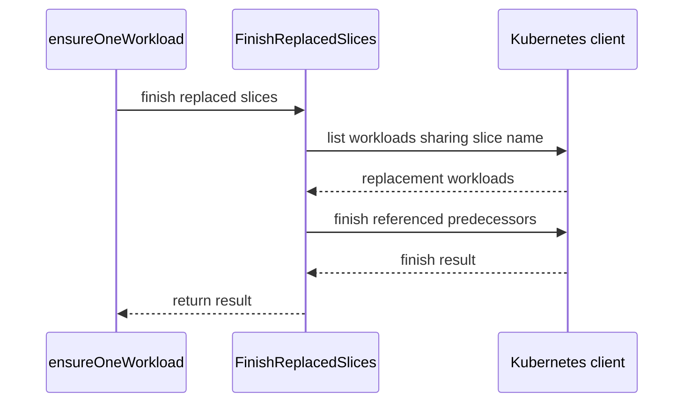

# PR #16458: [DON'T MERGE] Enable SkipChildJobSuspension in Ray autoscaling e2e

**Summary**: [DON'T MERGE] Enable SkipChildJobSuspension in Ray autoscaling e2e

**Sources**: https://github.com/kubernetes-sigs/kueue/pull/16458

**Last updated**: 2026-10-01T07:39:17Z

---

## Metadata

- **State**: closed
- **Author**: [@kevin85421](https://github.com/kevin85421)
- **Branch**: `codex/enable-ray-autoscaling-skip-child-suspension` → `main`
- **Created**: 2026-10-01T02:02:53Z
- **Updated**: 2026-10-01T07:39:17Z
- **Merged**: —
- **Closed**: 2026-10-01T07:39:17Z
- **Labels**: `kind/bug`, `release-note`, `size/L`, `kind/flake`, `cncf-cla: yes`, `area/multikueue`, `area/testing`
- **Assignees**: _none_
- **Requested reviewers**: [@kannon92](https://github.com/kannon92), [@pajakd](https://github.com/pajakd), [@mbobrovskyi](https://github.com/mbobrovskyi), [@kshalot](https://github.com/kshalot)
- **Changed files**: 5   **+153 / -0**

## Description

#### What type of PR is this?

/kind bug
/kind flake
/area multikueue
/area testing

#### What this PR does / why we need it?

Enable `SkipChildJobSuspension` in the MultiKueue Ray autoscaling e2e configuration and recover unfinished workload-slice replacements on workers.

The feature gate introduced in #16370 prevents the generic job reconciler from suspending RayJob children during workload-slice handover. Repeated CI runs with the gate enabled also exposed a separate recovery gap: after admitting a replacement, the worker scheduler can encounter a conflict while finishing the predecessor. Its fallback relies on `EnsureWorkloadSlices`, but worker jobs with prebuilt workloads bypass that path. The leftover slice can retain quota and block a subsequent scale-up.

The prebuilt workload path now finishes predecessors in the same slice chain when their replacements are admitted. Pending or evicted replacements do not trigger cleanup. Errors propagate to the job reconciler for retry, and already-replaced intermediate slices can still identify older predecessors that need cleanup.

Related: #16445

#### Useful notes for your reviewer

The global feature-gate default and autoscaling test sequence are unchanged. No diagnostic delays are included.

Regression coverage includes the prebuilt job reconciliation path, admitted versus pending/evicted replacements, superseded replacements, idempotency, and an injected conflict followed by a successful retry. Focused unit tests for workload slicing, jobframework, RayJob, and RayCluster pass. Local e2e has not been rerun for this fix.

Validation: `make ci-lint` passed. `GOTOOLCHAIN=go1.27.0 make verify` passed; the explicit toolchain avoids building the custom API linter with Go 1.26 against this Go 1.27 repository. Both new regression tests also passed ten consecutive runs.

AI assistance was used to investigate the CI failures, implement the fix and tests, and prepare this PR description.

#### Release note

```release-note
MultiKueue: Recover unfinished workload-slice replacements for prebuilt elastic jobs, preventing stale slices from retaining worker-cluster quota after update conflicts.
```


<!-- This is an auto-generated comment: release notes by coderabbit.ai -->

# AI summary

The Ray autoscaling MultiKueue configuration enables `SkipChildJobSuspension`.

When a worker job uses a prebuilt workload with workload slicing, Kueue now finishes unfinished predecessor slices after a replacement is admitted. Pending or evicted replacements do not trigger cleanup. Errors return for retry.

### Suggested release note

MultiKueue: Fixed a bug that could leave stale workload slices holding worker-cluster quota after an update conflict. Kueue now finishes replaced slices for prebuilt elastic jobs when a replacement is admitted.

<!-- end of auto-generated comment: release notes by coderabbit.ai -->

## Discussion

### Comment by [@netlify[bot]](https://github.com/apps/netlify) — 2026-10-01T02:03:00Z

### <span aria-hidden="true">✅</span> Deploy Preview for *kubernetes-sigs-kueue* canceled.


|  Name | Link |
|:-:|------------------------|
|<span aria-hidden="true">🔨</span> Latest commit | 7fc9af5c43054e280f4e56e81d2bbb35ceaf78e7 |
|<span aria-hidden="true">🔍</span> Latest deploy log | https://app.netlify.com/projects/kubernetes-sigs-kueue/deploys/6abdee7f3753030008c59e4d |

### Comment by [@coderabbitai[bot]](https://github.com/apps/coderabbitai) — 2026-10-01T02:04:29Z

<!-- This is an auto-generated comment: summarize by coderabbit.ai -->
<!-- review_stack_entry_start -->

<a href="https://app.coderabbit.ai/change-stack/kubernetes-sigs/kueue/pull/16458?cs_source=review_comment"></a>

Navigate logical layers of code changes, visualize relationships, and explore their blast radius.

<!-- review_stack_entry_end -->
<!-- recent_review_start -->

No actionable comments were generated in the recent review. 🎉

<details>
<summary>ℹ️ Recent review info</summary>

<details>
<summary>⚙️ Run configuration</summary>

**Configuration used**: Repository: kubernetes-sigs/kueue/.coderabbit.yaml

**Review profile**: CHILL

**Plan**: Advanced

**Run ID**: `71f9e96d-3a36-4588-bc07-26e9efc36e0c`

</details>

<details>
<summary>📥 Commits</summary>

Reviewing files that changed from the base of the PR and between 561bae0473b746154affd5fe86ee06cdc95c7ad6 and 7fc9af5c43054e280f4e56e81d2bbb35ceaf78e7.

</details>

<details>
<summary>📒 Files selected for processing (4)</summary>

* `pkg/controller/jobframework/reconciler.go`
* `pkg/controller/jobframework/reconciler_test.go`
* `pkg/workloadslicing/workloadslicing.go`
* `pkg/workloadslicing/workloadslicing_test.go`

</details>

**Included review availability:** This review used your included allowance. Your plan provides up to 8 included reviews per hour; 7 remain after this review.

</details>

---


<!-- recent_review_end -->
<!-- walkthrough_start -->

<details>
<summary>📝 Walkthrough</summary>

## Walkthrough

Prebuilt workload reconciliation now finishes eligible predecessor slices and returns errors from that operation. The Ray autoscaling MultiKueue controller-manager configuration also enables the `SkipChildJobSuspension` feature gate.

### Changes

**Workload slice replacement**

|Layer / File(s)|Summary|
|---|---|
|**Find and finish replaced predecessors** <br> `pkg/workloadslicing/workloadslicing.go`, `pkg/workloadslicing/workloadslicing_test.go`|`FinishReplacedSlices` identifies predecessors referenced by admitted, non-evicted replacements and finishes unfinished predecessors. Tests cover replacement states, conflicts, retries, and unrelated workloads.|
|**Run slice replacement during reconciliation** <br> `pkg/controller/jobframework/reconciler.go`, `pkg/controller/jobframework/reconciler_test.go`|For workload-slicing-enabled prebuilt workloads, `ensureOneWorkload` calls `FinishReplacedSlices` and returns any error. The reconciliation test checks that an old slice is marked replaced.|

**Ray autoscaling configuration**

|Layer / File(s)|Summary|
|---|---|
|**Enable feature gate** <br> `test/e2e/config/multikueue/ray-autoscaling/controller_manager_config.yaml`|The controller-manager configuration enables `SkipChildJobSuspension`.|

<!-- change_assessment_start -->
**Priority:** ➖ Normal


**Estimated code review effort:** 3 (Moderate) | ~20 minutes

<!-- change_assessment_commit:"7fc9af5c43054e280f4e56e81d2bbb35ceaf78e7" -->
**Change:** Bug fix
<!-- change_assessment_end -->

### Sequence Diagram(s)



**Suggested reviewers:** `mbobrovskyi`

</details>

<!-- walkthrough_end -->
<!-- final_review_risk_start -->
**Merge Risk:** _⚪ Minimal_ · up to `7fc9a`
<!-- final_review_risk_coverage:{"sourceCommitId":"7fc9af5c43054e280f4e56e81d2bbb35ceaf78e7","coveredCommitId":"7fc9af5c43054e280f4e56e81d2bbb35ceaf78e7","kind":"reviewed"} -->

The change recovers unfinished predecessor slices and enables the intended Ray autoscaling gate. No actionable merge-blocking risk is established; normal checks remain appropriate.
<!-- final_review_risk_end -->
<!-- architecture_review_start -->
### Security Architecture Review

**Security architecture risk:** _🟡 Moderate_ · up to `7fc9a`

The recovery fix addresses stranded quota, but it also lets chain metadata determine which workloads are marked complete without independently validating every predecessor’s provenance. Namespace scoping, admission checks, and restricted user permissions constrain exposure. Whether less-trusted users can supply misleading chain metadata remains unestablished.

**Retained concerns**
- **Medium · security · inferred:** The new prebuilt recovery path treats namespace, slice-name membership, and replacement annotations as authority to finish predecessors. It does not independently validate predecessor provenance or require the scheduler’s same-ClusterQueue relationship. Misleading metadata could therefore cause completion of an unrelated workload within the namespace, including one in another queue. This is an inferred authorization and failure-containment concern: attacker reachability depends on permissions and trusted producers that are not fully established.

<details>
<summary>Security review details</summary>

**Security Blast Radius**
- _inferred_ — The newly identified selection risk is bounded to workloads in the selected namespace sharing the indexed slice name. That scope can include different owners and admission queues because the helper does not filter either relationship. Effects concern workload completion and quota accounting; cross-namespace selection is prevented by the list scope.

**Security Findings and Attack Paths**
- _inferred_ — A conditional path exists from forged or corrupted chain annotations on an admitted replacement to controller-authorized predecessor completion. It requires supplying suitable Workload metadata and reaching slicing-enabled prebuilt reconciliation. This is not a verified attack path: ordinary job-user reachability was not established, and existing scheduler annotation-based replacement already exposes related authority within one ClusterQueue.

**Trust Boundaries and Controls**
- _observed_ — Normal slice preparation derives predecessor links from job-associated workloads. The shipped workload-editor role carries the batch-admin aggregation label, already permits workload deletion, and does not grant status writes. These are strong countercontrols against treating the missing predecessor check as a demonstrated privilege escalation. The controller separately holds Workload status-patch authority.

**Resilience and Maintainability Implications**
- _observed_ — Predecessor patches retain individual-object identity and version protections, but replacement eligibility is read from a separate list snapshot. A concurrent replacement eviction is not atomically coupled to predecessor completion. Similar multi-object sequencing exists in the prior replacement flow; the inspected evidence does not establish a newly introduced security outcome from this race.

**Hardening Proposals**
- _proposed_ — Define an authoritative predecessor-chain identity for prebuilt recovery and validate it before completion. Accommodate legitimate worker handovers rather than assuming identical controller UIDs, and explicitly address whether cross-queue predecessors are valid. Exercise forged chain membership and concurrent eviction alongside the existing retry tests.


</details>

<!-- architecture_review_end -->
<!-- pre_merge_checks_walkthrough_start -->

<details>
<summary>🚥 Pre-merge checks | ✅ 4 | ❌ 1</summary>

### ❌ Failed checks (1 warning)

|     Check name     | Status     | Explanation                                                                                                                                                                                | Resolution                                                                         |
| :----------------: | :--------- | :----------------------------------------------------------------------------------------------------------------------------------------------------------------------------------------- | :--------------------------------------------------------------------------------- |
| Docstring Coverage | ⚠️ Warning | Docstring coverage is 33.33% which is insufficient. The required threshold is 80.00%. Docstring coverage is scoped to functions touched by this diff. Analyzed 6 functions across 4 files. | Write docstrings for the functions missing them to satisfy the coverage threshold. |

<details>
<summary>✅ Passed checks (4 passed)</summary>

|         Check name         | Status   | Explanation                                                                                                                                                                                               |
| :------------------------: | :------- | :-------------------------------------------------------------------------------------------------------------------------------------------------------------------------------------------------------- |
|     Linked Issues check    | ✅ Passed | Check skipped because no linked issues were found for this pull request.                                                                                                                                  |
| Out of Scope Changes check | ✅ Passed | Check skipped because no linked issues were found for this pull request.                                                                                                                                  |
|      Description Check     | ✅ Passed | Check skipped - CodeRabbit’s high-level summary is enabled.                                                                                                                                               |
|         Title check        | ✅ Passed | The title accurately identifies the Ray autoscaling e2e feature-gate change. It is specific and related to a real change in the pull request, although it does not mention the workload-slice recovery l… |

</details>

</details>

<!-- pre_merge_checks_walkthrough_end -->

- [ ] <!-- {"checkboxId":"585bb3f6-faf5-4dbf-96d2-74e382adf19a"} --> Fix all pre-merge checks with AI
<!-- finishing_touch_checkbox_start -->

<details>
<summary>✨ Finishing Touches</summary>

<details open>
<summary>🧪 Generate unit tests (beta)</summary>

- [ ] <!-- {"checkboxId": "f47ac10b-58cc-4372-a567-0e02b2c3d479", "radioGroupId": "utg-output-choice-group-unknown_comment_id"} --> Create a new PR

</details>

</details>

<!-- finishing_touch_checkbox_end -->

<!-- autopilot:start -->
- [ ] <!-- {"checkboxId":"2708ad07-9f24-4260-9c11-7dc76a49f2e3"} --> <strong title="Keep fixing CodeRabbit findings and required CI, and resolving merge conflicts">Autopilot</strong> · Keep fixing CodeRabbit findings and required CI, and resolving merge conflicts

> Autopilot is currently an internal CodeRabbit preview.
<!-- autopilot:end -->
<!-- tips_start -->

---


<sub>Comment `@coderabbitai help` to get the list of available commands.</sub>

<!-- tips_end -->

### Comment by [@kevin85421](https://github.com/kevin85421) — 2026-10-01T02:05:24Z

/test pull-kueue-test-e2e-multikueue-extended-ray-autoscaling-main

Autoscaling repeat 1/5, requested by @kevin85421. Posted with AI assistance.

### Comment by [@kevin85421](https://github.com/kevin85421) — 2026-10-01T02:34:47Z

/test pull-kueue-test-e2e-multikueue-extended-ray-autoscaling-main

RayJob verification: run 2/5 (first of four additional sequential runs). The RayJob spec passed in build 2105479174981423104; results will be counted per spec, not by the overall suite status. Requested by @kevin85421; posted with AI assistance.

### Comment by [@kevin85421](https://github.com/kevin85421) — 2026-10-01T02:51:11Z

/test pull-kueue-test-e2e-multikueue-extended-ray-autoscaling-main

RayJob verification: run 3/5. Run 2 (2105486566855020544) has completed; its RayJob spec failed during the second scale-up (expected 1 running worker, found 0). Continuing the four additional sequential runs requested by @kevin85421. Posted with AI assistance.

### Comment by [@kevin85421](https://github.com/kevin85421) — 2026-10-01T03:01:42Z

/test pull-kueue-test-e2e-multikueue-extended-ray-autoscaling-main

RayJob verification: run 4/5. Run 3 (2105490695224561664) completed and its RayJob spec passed. Continuing the sequential verification requested by @kevin85421. Posted with AI assistance.

### Comment by [@kevin85421](https://github.com/kevin85421) — 2026-10-01T03:21:38Z

/test pull-kueue-test-e2e-multikueue-extended-ray-autoscaling-main

RayJob verification: run 5/5 (final run). Run 4 (2105493343772348416) completed; its RayJob spec failed during the second scale-up (expected 1 running worker, found 0). Continuing the sequential verification requested by @kevin85421. Posted with AI assistance.

### Comment by [@kevin85421](https://github.com/kevin85421) — 2026-10-01T04:11:40Z

/test pull-kueue-test-e2e-multikueue-extended-ray-autoscaling-main

RayJob verification batch 2: run 1/5 (five new sequential runs, excluding the prior batch). Requested by @kevin85421; posted with AI assistance. Batch ID: pr16458-batch2-20261001.

### Comment by [@kevin85421](https://github.com/kevin85421) — 2026-10-01T04:28:32Z

/test pull-kueue-test-e2e-multikueue-extended-ray-autoscaling-main

RayJob verification batch 2: run 2/5. Run 1 (2105510951393431552) completed; the RayJob spec failed waiting for one worker after 300 seconds (actual zero). Requested by @kevin85421; posted with AI assistance. Batch ID: pr16458-batch2-20261001.

### Comment by [@kubernetes-prow[bot]](https://github.com/apps/kubernetes-prow) — 2026-10-01T05:24:28Z

[APPROVALNOTIFIER] This PR is **NOT APPROVED**

This pull-request has been approved by: *<a href="https://github.com/kubernetes-sigs/kueue/pull/16458#" title="Author self-approved">kevin85421</a>*
**Once this PR has been reviewed and has the lgtm label**, please assign [tenzen-y](https://github.com/tenzen-y) for approval. For more information see [the Code Review Process](https://git.k8s.io/community/contributors/guide/owners.md#the-code-review-process).

The full list of commands accepted by this bot can be found [here](https://go.k8s.io/bot-commands?repo=kubernetes-sigs%2Fkueue).

<details open>
Needs approval from an approver in each of these files:

- **[OWNERS](https://github.com/kubernetes-sigs/kueue/blob/main/OWNERS)**

Approvers can indicate their approval by writing `/approve` in a comment
Approvers can cancel approval by writing `/approve cancel` in a comment
</details>
<!-- META={"approvers":["tenzen-y"]} -->

### Comment by [@kevin85421](https://github.com/kevin85421) — 2026-10-01T05:24:51Z

/test pull-kueue-test-e2e-multikueue-extended-ray-autoscaling-main

Validate the prebuilt workload-slice recovery fix: worker job reconcilers now retry finishing replaced slices if the scheduler's finish update conflicted. This is a single validation run of the new head, not part of the earlier fixed-head comparison batches.

Posted with AI assistance at the author's request.

### Comment by [@kevin85421](https://github.com/kevin85421) — 2026-10-01T06:22:50Z

/test pull-kueue-test-e2e-multikueue-extended-ray-autoscaling-main

Post-fix autoscaling verification: run 1/3, three new sequential runs on head 7fc9af5c43054e280f4e56e81d2bbb35ceaf78e7. Batch ID: pr16458-recovery-three. Requested by @kevin85421; posted with AI assistance.

### Comment by [@kevin85421](https://github.com/kevin85421) — 2026-10-01T06:34:06Z

/test pull-kueue-test-e2e-multikueue-extended-ray-autoscaling-main

Post-fix autoscaling verification: run 2/3. Run 1 (2105543958015774720) completed successfully, including the RayJob spec. Fixed head 7fc9af5c43054e280f4e56e81d2bbb35ceaf78e7. Batch ID: pr16458-recovery-three. Requested by @kevin85421; posted with AI assistance.

### Comment by [@kevin85421](https://github.com/kevin85421) — 2026-10-01T06:52:02Z

/test pull-kueue-test-e2e-multikueue-extended-ray-autoscaling-main

Post-fix autoscaling verification: run 3/3. Run 2 (2105546798801096704) completed successfully, including the RayJob spec. Fixed head 7fc9af5c43054e280f4e56e81d2bbb35ceaf78e7. Batch ID: pr16458-recovery-three. Requested by @kevin85421; posted with AI assistance.
