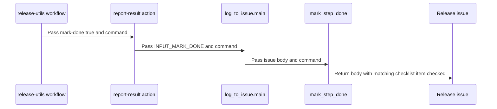

# PR #16711: Release automation: check release checklist items when ChatOps comman…

**Summary**: Release automation: check release checklist items when ChatOps comman…

**Sources**: https://github.com/kubernetes-sigs/kueue/pull/16711

**Last updated**: 2026-10-08T08:03:44Z

---

## Metadata

- **State**: closed (merged)
- **Author**: [@Huangpinhan](https://github.com/Huangpinhan)
- **Branch**: `release-mark-checklist-steps` → `main`
- **Created**: 2026-10-05T13:59:08Z
- **Updated**: 2026-10-08T08:03:44Z
- **Merged**: 2026-10-08T08:02:26Z
- **Closed**: 2026-10-08T08:02:26Z
- **Labels**: `kind/feature`, `size/L`, `lgtm`, `release-note-none`, `approved`, `ok-to-test`, `cncf-cla: yes`, `area/release`
- **Assignees**: [@mbobrovskyi](https://github.com/mbobrovskyi)
- **Requested reviewers**: [@kannon92](https://github.com/kannon92), [@mimowo](https://github.com/mimowo), [@kshalot](https://github.com/kshalot), [@Singularity23x0](https://github.com/Singularity23x0)
- **Changed files**: 5   **+177 / -14**

## Description

#### What type of PR is this?

/kind feature
/area release

#### What this PR does / why we need it?
When a release ChatOps command succeeds, the matching item in the release issue checklist is checked automatically.

- `NEW_RELEASE.md`: add a `<!-- step:<command> -->` marker to each ChatOps checklist item.
- `report-result` action: add a `mark-done` input, set to `true` only in the `Report Success` steps of `release-utils.yml`.
- `log_to_issue.py`: when `mark-done` is set, check the item with the current command's marker.

Fixes #13359

#### Useful notes for your reviewer

Testing:
- Local: `make release-utils-test` (new `log_to_issue_test.py`) verifies that each marker matches a ChatOps command, each command checks only its own item, and only `Report Success` sets `mark-done`.
- GitHub (fork, fake `Release v0.98.0` issue): successful `/create-release-branch`, `/tag-release` and `/create-draft-release` each checked their own item; a re-run changed nothing; a failed command left its item unchecked.

AI disclosure: Part of the code was generated with Claude. I reviewed and tested it.

```release-note
NONE
```

<!-- This is an auto-generated comment: release notes by coderabbit.ai -->

## AI summary

Successful release ChatOps commands now mark their matching checklist items in the release issue. Only success-reporting steps enable this behavior; failed commands do not mark items complete.

### Suggested release note

Release automation: Successful release ChatOps commands now mark the corresponding checklist steps complete in the release issue.

<!-- end of auto-generated comment: release notes by coderabbit.ai -->

## Discussion

### Comment by [@kubernetes-prow[bot]](https://github.com/apps/kubernetes-prow) — 2026-10-05T13:59:19Z

Hi @Huangpinhan. Thanks for your PR.

I'm waiting for a [kubernetes-sigs](https://github.com/orgs/kubernetes-sigs/people) member to verify that this patch is reasonable to test. If it is, they should reply with `/ok-to-test` on its own line. Until that is done, I will not automatically test new commits in this PR, but the usual testing commands by org members will still work.

>[!TIP]
>**We noticed you've done this a few times! Consider [joining the org](https://git.k8s.io/community/community-membership.md#member) to skip this step and gain `/lgtm` and other bot rights.** We recommend asking approvers on your previous PRs to sponsor you.

Once the patch is verified, the new status will be reflected by the `ok-to-test` label.

I understand the commands that are listed [here](https://go.k8s.io/bot-commands?repo=kubernetes-sigs%2Fkueue).

<details>

Instructions for interacting with me using PR comments are available [here](https://git.k8s.io/community/contributors/guide/pull-requests.md).  If you have questions or suggestions related to my behavior, please file an issue against the [kubernetes-sigs/prow](https://github.com/kubernetes-sigs/prow/issues/new?title=Prow%20issue:) repository.
</details>

### Comment by [@netlify[bot]](https://github.com/apps/netlify) — 2026-10-05T13:59:20Z

### <span aria-hidden="true">✅</span> Deploy Preview for *kubernetes-sigs-kueue* ready!


|  Name | Link |
|:-:|------------------------|
|<span aria-hidden="true">🔨</span> Latest commit | 34c4304a9e3975d6d05cd11482bda600e004847b |
|<span aria-hidden="true">🔍</span> Latest deploy log | https://app.netlify.com/projects/kubernetes-sigs-kueue/deploys/6ac3ad30512baf00087c746d |
|<span aria-hidden="true">😎</span> Deploy Preview | [https://deploy-preview-16711--kubernetes-sigs-kueue.netlify.app](https://deploy-preview-16711--kubernetes-sigs-kueue.netlify.app) |
|<span aria-hidden="true">📱</span> Preview on mobile | <details><summary> Toggle QR Code... </summary><br /><br /><br /><br />_Use your smartphone camera to open QR code link._</details> |
---
<!-- [kubernetes-sigs-kueue Preview](https://deploy-preview-16711--kubernetes-sigs-kueue.netlify.app) -->
_To edit notification comments on pull requests, go to your [Netlify project configuration](https://app.netlify.com/projects/kubernetes-sigs-kueue/configuration/notifications#deploy-notifications)._

### Comment by [@coderabbitai[bot]](https://github.com/apps/coderabbitai) — 2026-10-05T13:59:59Z

<!-- This is an auto-generated comment: summarize by coderabbit.ai -->
<!-- review_stack_entry_start -->

<a href="https://app.coderabbit.ai/change-stack/kubernetes-sigs/kueue/pull/16711?scope=ghh_OusAJGA4HG8ljoOV0wJvVx8NmnZIjc2DdjmxOu0xZWA&amp;cs_source=review_comment"></a>

Navigate logical layers of code changes, visualize relationships, and explore their blast radius.

<!-- review_stack_entry_end -->
<!-- recent_review_start -->

No actionable comments were generated in the recent review. 🎉

<details>
<summary>ℹ️ Recent review info</summary>

<details>
<summary>⚙️ Run configuration</summary>

- **Configuration used**: Repository: kubernetes-sigs/kueue/.coderabbit.yaml
- **Review profile**: CHILL
- **Plan**: Advanced
- **Run ID**: `86826b1f-da12-4192-97c8-459de919e074`

</details>

<details>
<summary>📥 Commits</summary>

Reviewing files that changed from the base of the PR and between cbea979fb1bb15a8bdc455aa95f4ad9daa213ca7 and 34c4304a9e3975d6d05cd11482bda600e004847b.

</details>

<details>
<summary>📒 Files selected for processing (5)</summary>

* `.github/ISSUE_TEMPLATE/NEW_RELEASE.md`
* `.github/actions/report-result/action.yml`
* `.github/workflows/release-utils.yml`
* `hack/releasing/log_to_issue.py`
* `hack/releasing/log_to_issue_test.py`

</details>

**Included review availability:** This review used your included allowance. Your plan provides up to 8 included reviews per hour; 7 remain after this review.

</details>

---


<!-- recent_review_end -->
<!-- walkthrough_start -->

<details>
<summary>📝 Walkthrough</summary>

## Walkthrough

Release success reports can now mark the matching step complete in the release issue. The release template adds command-specific markers, and the reporting action passes an opt-in setting to the checklist update logic.

### Changes

**Release checklist completion**

|Layer / File(s)|Summary|
|:---|:---|
|**Add release step markers** <br> `.github/ISSUE_TEMPLATE/NEW_RELEASE.md`|Checklist items for release commands now include `step:` markers. Their instructions remain unchanged.|
|**Enable checklist updates in success reports** <br> `.github/actions/report-result/action.yml`, `.github/workflows/release-utils.yml`|The reporting action adds the optional `mark-done` input, validates its value, and requires a nonempty command when enabled. Eleven release success reports set it to `true`.|
|**Update matching checklist items** <br> `hack/releasing/log_to_issue.py`, `hack/releasing/log_to_issue_test.py`|When enabled, `log_to_issue` checks unchecked checklist items that match the command marker. Tests cover marker matching, release-log preservation, workflow configuration, and opt-in behavior.|

<!-- change_assessment_start -->
**Priority:** ⬇️ Low

**Estimated code review effort:** 2 (Simple) | ~12 minutes

<!-- change_assessment_commit:"34c4304a9e3975d6d05cd11482bda600e004847b" -->
**Change:** Feature
<!-- change_assessment_end -->

### Sequence Diagram(s)



**Suggested reviewers:** `singularity23x0`, `mbobrovskyi`

</details>

<!-- walkthrough_end -->
<!-- final_review_risk_start -->
**Merge Risk:** _⚪ Minimal_ · up to `34c43`
<!-- final_review_risk_coverage:{"sourceCommitId":"34c4304a9e3975d6d05cd11482bda600e004847b","coveredCommitId":"34c4304a9e3975d6d05cd11482bda600e004847b","kind":"reviewed"} -->

Successful release commands will now check their matching checklist item in the release issue. No merge-blocking risk remains.
<!-- final_review_risk_end -->
<!-- architecture_review_start -->
### Security Architecture Review

**Security architecture risk:** _🔵 Low_ · up to `34c43`

The change is narrowly scoped to release-issue bookkeeping and preserves existing authorization and token privileges. Checklist completion remains separate from release operations and can be affected by reporting failures or concurrent issue edits.

**Retained concerns**
No architecture-level concerns identified.

<details>
<summary>Security review details</summary>

**Security Blast Radius**
- _observed_ — The new effect is an issue-body mutation using the existing workflow token and issue-write path. The PR does not change credential selection, repository targeting or release-operation permissions. Its marker selection can affect multiple matching checklist lines within that issue.

**Trust Boundaries and Controls**
- _observed_ — Comment text is parsed into an allowlisted command after actor authorization against configured OWNERS aliases. Completion callers depend on authorization and successful preceding steps. Command matching escapes regex metacharacters, while issue text is passed as data rather than inserted into shell source.

**Resilience and Maintainability Implications**
- _inferred_ — The existing per-issue concurrency group limits overlapping workflow execution, but does not serialize manual or unrelated issue writers. The fetch-then-replace operation can overwrite intervening edits; comparison with the base confirms this limitation predates checklist automation rather than being a newly introduced security concern.


</details>

<!-- architecture_review_end -->
<!-- pre_merge_checks_walkthrough_start -->

<details>
<summary>🚥 Pre-merge checks | ✅ 4 | ❌ 1</summary>

### ❌ Failed checks (1 warning)

|     Check name     | Status     | Explanation                                                                                                                                                                                               | Resolution                                                                         |
| :----------------: | :--------- | :-------------------------------------------------------------------------------------------------------------------------------------------------------------------------------------------------------- | :--------------------------------------------------------------------------------- |
| Docstring Coverage | ⚠️ Warning | Docstring coverage is 9.09% which is insufficient. The required threshold is 80.00%. Docstring coverage is scoped to functions touched by this diff. Analyzed 11 functions across 2 files. (3 skipped: 3… | Write docstrings for the functions missing them to satisfy the coverage threshold. |

<details>
<summary>✅ Passed checks (4 passed)</summary>

|         Check name         | Status   | Explanation                                                                                                                                                                                               |
| :------------------------: | :------- | :-------------------------------------------------------------------------------------------------------------------------------------------------------------------------------------------------------- |
|      Description Check     | ✅ Passed | Check skipped - CodeRabbit’s high-level summary is enabled.                                                                                                                                               |
|         Title check        | ✅ Passed | The title clearly describes the main change: release automation checks matching release checklist items after ChatOps commands succeed.                                                                   |
|     Linked Issues check    | ✅ Passed | Issue `#13359` asks release automation to mark completed steps on the release issue. The PR adds command markers to release checklist items, sets `mark-done: true` in success-reporting steps, and update… |
| Out of Scope Changes check | ✅ Passed | All changes support issue `#13359`. The action input, checklist markers, workflow configuration, implementation, and tests enable or verify checklist updates after successful release commands. No unrela… |

</details>

<details>
<summary>Full details: Docstring Coverage</summary>

**Explanation**

Docstring coverage is 9.09% which is insufficient. The required threshold is 80.00%. Docstring coverage is scoped to functions touched by this diff. Analyzed 11 functions across 2 files. (3 skipped: 3 unsupported.)

</details>

</details>

<!-- pre_merge_checks_walkthrough_end -->

- [ ] <!-- {"checkboxId":"585bb3f6-faf5-4dbf-96d2-74e382adf19a"} --> Fix all pre-merge checks with AI
<!-- finishing_touch_checkbox_start -->

<details>
<summary>✨ Finishing Touches</summary>

<details open>
<summary>🧪 Generate unit tests (beta)</summary>

- [ ] <!-- {"checkboxId": "f47ac10b-58cc-4372-a567-0e02b2c3d479", "radioGroupId": "utg-output-choice-group-unknown_comment_id"} --> Create a new PR

</details>

</details>

<!-- finishing_touch_checkbox_end -->

<!-- autopilot:start -->
- [ ] <!-- {"checkboxId":"2708ad07-9f24-4260-9c11-7dc76a49f2e3"} --> <strong title="Keep fixing CodeRabbit findings and required CI, and resolving merge conflicts">Autopilot</strong> · Keep fixing CodeRabbit findings and required CI, and resolving merge conflicts
<!-- autopilot:end -->
<!-- tips_start -->

---


<sub>Comment `@coderabbitai help` to get the list of available commands.</sub>

<!-- tips_end -->

### Comment by [@mbobrovskyi](https://github.com/mbobrovskyi) — 2026-10-05T14:05:01Z

/ok-to-test

### Comment by [@mbobrovskyi](https://github.com/mbobrovskyi) — 2026-10-07T13:35:15Z

Thank you!

/lgtm

### Comment by [@mbobrovskyi](https://github.com/mbobrovskyi) — 2026-10-07T13:35:26Z

/cc @mimowo @Singularity23x0

### Comment by [@kubernetes-prow[bot]](https://github.com/apps/kubernetes-prow) — 2026-10-07T13:35:28Z

LGTM label has been added.  <details>Git tree hash: a331d0ce62983a264ed058361a250380382e30f1</details>

### Comment by [@Huangpinhan](https://github.com/Huangpinhan) — 2026-10-07T15:33:25Z

@mbobrovskyi thanks for the review ! Have a nice day~

### Comment by [@mbobrovskyi](https://github.com/mbobrovskyi) — 2026-10-08T03:08:18Z

@mimowo need your approval.

### Comment by [@mimowo](https://github.com/mimowo) — 2026-10-08T07:43:02Z

/approve
Thanks 👍

### Comment by [@kubernetes-prow[bot]](https://github.com/apps/kubernetes-prow) — 2026-10-08T07:43:15Z

[APPROVALNOTIFIER] This PR is **APPROVED**

This pull-request has been approved by: *<a href="https://github.com/kubernetes-sigs/kueue/pull/16711#" title="Author self-approved">Huangpinhan</a>*, *<a href="https://github.com/kubernetes-sigs/kueue/pull/16711#issuecomment-6055168771" title="Approved">mimowo</a>*

The full list of commands accepted by this bot can be found [here](https://go.k8s.io/bot-commands?repo=kubernetes-sigs%2Fkueue).

The pull request process is described [here](https://git.k8s.io/community/contributors/guide/owners.md#the-code-review-process)

<details >
Needs approval from an approver in each of these files:

- ~~[OWNERS](https://github.com/kubernetes-sigs/kueue/blob/main/OWNERS)~~ [mimowo]

Approvers can indicate their approval by writing `/approve` in a comment
Approvers can cancel approval by writing `/approve cancel` in a comment
</details>
<!-- META={"approvers":[]} -->

### Comment by [@mimowo](https://github.com/mimowo) — 2026-10-08T07:43:47Z

/cherrypick release-0.20
/cherrypick release-0.19

### Comment by [@k8s-infra-cherrypick-robot](https://github.com/k8s-infra-cherrypick-robot) — 2026-10-08T07:43:51Z

@mimowo: once the present PR merges, I will cherry-pick it on top of `release-0.19`, `release-0.20` in new PRs and assign them to you.

<details>

In response to [this](https://github.com/kubernetes-sigs/kueue/pull/16711#issuecomment-6055182614):

>/cherrypick release-0.20
>/cherrypick release-0.19


Instructions for interacting with me using PR comments are available [here](https://git.k8s.io/community/contributors/guide/pull-requests.md).  If you have questions or suggestions related to my behavior, please file an issue against the [kubernetes-sigs/prow](https://github.com/kubernetes-sigs/prow/issues/new?title=Prow%20issue:) repository.
</details>

### Comment by [@k8s-infra-cherrypick-robot](https://github.com/k8s-infra-cherrypick-robot) — 2026-10-08T08:03:06Z

@mimowo: #16711 failed to apply on top of branch "release-0.20":
```
Applying: Release automation: check release checklist items when ChatOps commands succeed
Using index info to reconstruct a base tree...
M	.github/ISSUE_TEMPLATE/NEW_RELEASE.md
M	.github/workflows/release-utils.yml
Falling back to patching base and 3-way merge...
Auto-merging .github/ISSUE_TEMPLATE/NEW_RELEASE.md
CONFLICT (content): Merge conflict in .github/ISSUE_TEMPLATE/NEW_RELEASE.md
Auto-merging .github/workflows/release-utils.yml
CONFLICT (content): Merge conflict in .github/workflows/release-utils.yml
error: Failed to merge in the changes.
hint: Use 'git am --show-current-patch=diff' to see the failed patch
hint: When you have resolved this problem, run "git am --continue".
hint: If you prefer to skip this patch, run "git am --skip" instead.
hint: To restore the original branch and stop patching, run "git am --abort".
hint: Disable this message with "git config set advice.mergeConflict false"
Patch failed at 0001 Release automation: check release checklist items when ChatOps commands succeed

```

<details>

In response to [this](https://github.com/kubernetes-sigs/kueue/pull/16711#issuecomment-6055182614):

>/cherrypick release-0.20
>/cherrypick release-0.19


Instructions for interacting with me using PR comments are available [here](https://git.k8s.io/community/contributors/guide/pull-requests.md).  If you have questions or suggestions related to my behavior, please file an issue against the [kubernetes-sigs/prow](https://github.com/kubernetes-sigs/prow/issues/new?title=Prow%20issue:) repository.
</details>

### Comment by [@k8s-infra-cherrypick-robot](https://github.com/k8s-infra-cherrypick-robot) — 2026-10-08T08:03:43Z

@mimowo: #16711 failed to apply on top of branch "release-0.19":
```
Applying: Release automation: check release checklist items when ChatOps commands succeed
Using index info to reconstruct a base tree...
M	.github/ISSUE_TEMPLATE/NEW_RELEASE.md
A	.github/actions/report-result/action.yml
M	.github/workflows/release-utils.yml
A	hack/releasing/log_to_issue.py
Falling back to patching base and 3-way merge...
Auto-merging .github/ISSUE_TEMPLATE/NEW_RELEASE.md
CONFLICT (content): Merge conflict in .github/ISSUE_TEMPLATE/NEW_RELEASE.md
CONFLICT (modify/delete): .github/actions/report-result/action.yml deleted in HEAD and modified in Release automation: check release checklist items when ChatOps commands succeed.  Version Release automation: check release checklist items when ChatOps commands succeed of .github/actions/report-result/action.yml left in tree.
Auto-merging .github/workflows/release-utils.yml
CONFLICT (content): Merge conflict in .github/workflows/release-utils.yml
CONFLICT (modify/delete): hack/releasing/log_to_issue.py deleted in HEAD and modified in Release automation: check release checklist items when ChatOps commands succeed.  Version Release automation: check release checklist items when ChatOps commands succeed of hack/releasing/log_to_issue.py left in tree.
error: Failed to merge in the changes.
hint: Use 'git am --show-current-patch=diff' to see the failed patch
hint: When you have resolved this problem, run "git am --continue".
hint: If you prefer to skip this patch, run "git am --skip" instead.
hint: To restore the original branch and stop patching, run "git am --abort".
hint: Disable this message with "git config set advice.mergeConflict false"
Patch failed at 0001 Release automation: check release checklist items when ChatOps commands succeed

```

<details>

In response to [this](https://github.com/kubernetes-sigs/kueue/pull/16711#issuecomment-6055182614):

>/cherrypick release-0.20
>/cherrypick release-0.19


Instructions for interacting with me using PR comments are available [here](https://git.k8s.io/community/contributors/guide/pull-requests.md).  If you have questions or suggestions related to my behavior, please file an issue against the [kubernetes-sigs/prow](https://github.com/kubernetes-sigs/prow/issues/new?title=Prow%20issue:) repository.
</details>
