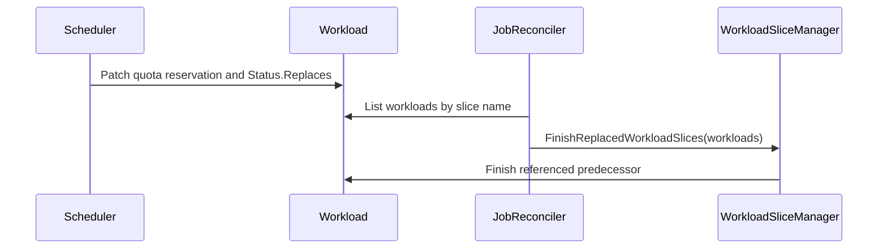

# PR #16778: Record workload slice replacements atomically with admission

**Summary**: Record workload slice replacements atomically with admission

**Sources**: https://github.com/kubernetes-sigs/kueue/pull/16778

**Last updated**: 2026-10-10T00:04:15Z

---

## Metadata

- **State**: open
- **Author**: [@kevin85421](https://github.com/kevin85421)
- **Branch**: `codex/atomic-workload-slice-replacement` → `main`
- **Created**: 2026-10-07T01:10:57Z
- **Updated**: 2026-10-10T00:04:15Z
- **Merged**: —
- **Closed**: —
- **Labels**: `kind/bug`, `release-note`, `size/XL`, `kind/api-change`, `cncf-cla: yes`, `area/multikueue`, `area/integrations`
- **Assignees**: _none_
- **Requested reviewers**: [@kannon92](https://github.com/kannon92), [@pajakd](https://github.com/pajakd), [@mbobrovskyi](https://github.com/mbobrovskyi), [@kshalot](https://github.com/kshalot)
- **Changed files**: 20   **+363 / -156**

## Description

#### What type of PR is this?

/kind bug
/kind api-change
/area integrations
/area multikueue

#### What this PR does / why we need it?

Currently, the scheduler [admits a replacement workload slice](https://github.com/kubernetes-sigs/kueue/blob/14f20bf677dc6e111a4a030a401b821144626431/pkg/scheduler/scheduler.go#L1026) and then [finishes its predecessor](https://github.com/kubernetes-sigs/kueue/blob/14f20bf677dc6e111a4a030a401b821144626431/pkg/scheduler/scheduler.go#L1042). These are separate API operations: admission can succeed while finishing the predecessor fails. Recovery currently depends on different inference paths:

- In the prebuilt/MultiKueue path, [replacementTarget](https://github.com/kubernetes-sigs/kueue/blob/e40277f124786d86c39d25a03811c3c3162495ee/pkg/workloadslicing/workloadslicing.go#L323) uses the replacement annotation and the successor's current quota-reservation, eviction, and finished state to identify predecessors to finish.
- In the single-cluster path, the job reconciler calls [EnsureWorkloadSlices](https://github.com/kubernetes-sigs/kueue/blob/14f20bf677dc6e111a4a030a401b821144626431/pkg/controller/jobframework/reconciler.go#L1202), which delegates multiple active slices to [normalizeActiveSlices](https://github.com/kubernetes-sigs/kueue/blob/14f20bf677dc6e111a4a030a401b821144626431/pkg/workloadslicing/manager.go#L129). It [classifies slices using replacement annotations and current quota/eviction state](https://github.com/kubernetes-sigs/kueue/blob/14f20bf677dc6e111a4a030a401b821144626431/pkg/workloadslicing/workloadslicing.go#L305) and [finishes slices outside the retained set](https://github.com/kubernetes-sigs/kueue/blob/14f20bf677dc6e111a4a030a401b821144626431/pkg/workloadslicing/workloadslicing.go#L366).

These signals are indirect, and current admission state can disappear after eviction or completion.

This PR simplifies that contract by recording the predecessor's name in immutable `Workload.status.replaces` in [the same status patch as quota reservation](https://github.com/kubernetes-sigs/kueue/blob/14f20bf677dc6e111a4a030a401b821144626431/pkg/scheduler/scheduler.go#L1098). A successful reservation therefore atomically commits an explicit replacement signal. The [prebuilt job reconciliation path](https://github.com/kubernetes-sigs/kueue/blob/14f20bf677dc6e111a4a030a401b821144626431/pkg/controller/jobframework/reconciler.go#L1147) calls [FinishReplacedWorkloadSlices](https://github.com/kubernetes-sigs/kueue/blob/14f20bf677dc6e111a4a030a401b821144626431/pkg/workloadslicing/manager.go#L165) to read that signal and finish the referenced predecessor, even if the successor has since been evicted or finished.

The atomic operation is quota reservation plus the replacement record; finishing the predecessor remains a separate, retryable operation. This establishes the contract needed for the job reconciler to eventually become the sole place that finishes replaced slices in both single-cluster and MultiKueue setups.

This PR preserves the scheduler's existing completion path and single-cluster slice selection/[normalization behavior](https://github.com/kubernetes-sigs/kueue/blob/14f20bf677dc6e111a4a030a401b821144626431/pkg/workloadslicing/workloadslicing.go#L295). Moving single-cluster completion to the job reconciler and simplifying its replacement detection are tracked in https://github.com/kubernetes-sigs/kueue/issues/17043.

Update generated API clients, CRDs, Helm manifests, and API reference documentation for the new status field.

#### Useful notes for your reviewer

This change was developed with assistance from OpenAI Codex.

#### Release note

```release-note
ElasticJobsViaWorkloadSlices: Workload slice replacements are recorded atomically with quota reservation. Prebuilt workload reconciliation uses this durable record to finish replaced slices, including after eviction or controller restart.
```


<!-- This is an auto-generated comment: release notes by coderabbit.ai -->

## AI summary

Adds immutable `Workload.status.replaces` to record the predecessor when quota reservation is persisted. This preserves replacement evidence after the successor is evicted or completed. The prebuilt workload reconciler uses this record to finish replaced slices and report replacement events and metrics.

### Suggested release note

ElasticJobsViaWorkloadSlices: Record committed slice replacements so Kueue can finish predecessor workloads even if the successor is later evicted or completed.

<!-- end of auto-generated comment: release notes by coderabbit.ai -->

## Discussion

### Comment by [@kubernetes-prow[bot]](https://github.com/apps/kubernetes-prow) — 2026-10-07T01:11:00Z

Skipping CI for Draft Pull Request.
If you want CI signal for your change, please convert it to an actual PR.
You can still manually trigger a test run with `/test all`

### Comment by [@coderabbitai[bot]](https://github.com/apps/coderabbitai) — 2026-10-07T01:11:06Z

<!-- This is an auto-generated comment: summarize by coderabbit.ai -->
<!-- review_stack_entry_start -->

<a href="https://app.coderabbit.ai/change-stack/kubernetes-sigs/kueue/pull/16778?scope=ghh_OusAJGA4HG8ljoOV0wJvVx8NmnZIjc2DdjmxOu0xZWA&amp;cs_source=review_comment"></a>

<!-- review_stack_entry_end -->
<!-- recent_review_start -->

No actionable comments were generated in the recent review. 🎉

<details>
<summary><strong>ℹ️ Recent review info</strong></summary>

<details>
<summary><strong>⚙️ Run configuration</strong></summary>

- **Configuration used**: Repository: kubernetes-sigs/kueue/.coderabbit.yaml
- **Review profile**: CHILL
- **Plan**: Advanced
- **Run ID**: `5aa9a34c-8b5f-4975-8447-4d541850c920`

<hr>

</details>

<details>
<summary><strong>📥 Commits</strong></summary>

Reviewing files that changed from the base of the PR and between e40277f124786d86c39d25a03811c3c3162495ee and 14f20bf677dc6e111a4a030a401b821144626431.

<hr>

</details>

<details>
<summary><strong>⛔ Files ignored due to path filters (4)</strong></summary>

* `apis/kueue/v1beta2/zz_generated.deepcopy.go` is excluded by `!**/*_generated*.go`, `!**/zz_generated.*.go`
* `client-go/applyconfiguration/kueue/v1beta2/workloadreplacement.go` is excluded by `!client-go/**`
* `client-go/applyconfiguration/kueue/v1beta2/workloadstatus.go` is excluded by `!client-go/**`
* `client-go/applyconfiguration/utils.go` is excluded by `!client-go/**`

<hr>

</details>

<details>
<summary><strong>📒 Files selected for processing (16)</strong></summary>

* `apis/kueue/v1beta2/workload_types.go`
* `charts/kueue/templates/crd/kueue.x-k8s.io_workloads.yaml`
* `config/components/crd/bases/kueue.x-k8s.io_workloads.yaml`
* `pkg/controller/jobframework/reconciler.go`
* `pkg/controller/jobframework/reconciler_test.go`
* `pkg/scheduler/scheduler.go`
* `pkg/scheduler/scheduler_test.go`
* `pkg/util/testing/v1beta2/wrappers.go`
* `pkg/workload/patching/patching.go`
* `pkg/workloadslicing/manager.go`
* `pkg/workloadslicing/workloadslicing.go`
* `pkg/workloadslicing/workloadslicing_test.go`
* `site/content/en/docs/reference/kueue.v1beta2.md`
* `test/integration/multikueue/elasticjob_test.go`
* `test/integration/multikueue/kuberay_test.go`
* `test/integration/singlecluster/controller/jobs/job/job_controller_test.go`

<hr>

</details>

<details>
<summary><strong>💤 Files with no reviewable changes (1)</strong></summary>

* pkg/workloadslicing/workloadslicing.go

<hr>

</details>

**Included review availability:** This review used your included allowance. Your plan provides up to 8 included reviews per hour; 6 remain after this review.

<hr>

</details>

---


<!-- recent_review_end -->
<!-- walkthrough_start -->

<details>
<summary><strong>📝 Walkthrough</strong></summary>

## Walkthrough

Workload status now records which slice a replacement workload replaces. The scheduler writes this reference during admission. The job reconciler passes matching workloads to the slice manager, which finishes referenced predecessors.

### Changes

**Workload slice replacement**

|Layer / File(s)|Summary|
|:---|:---|
|**Replacement status contract** <br> `apis/kueue/v1beta2/workload_types.go`, `charts/kueue/templates/crd/kueue.x-k8s.io_workloads.yaml`, `config/components/crd/bases/kueue.x-k8s.io_workloads.yaml`, `site/content/en/docs/reference/kueue.v1beta2.md`|`WorkloadStatus` gains an optional `replaces` reference to a same-namespace workload. The API types and CRD schemas require a name of 1–253 characters and prevent the reference from being removed or changed once set. The API reference documents the field.|
|**Scheduler replacement commitment** <br> `pkg/scheduler/scheduler.go`, `pkg/workload/patching/patching.go`, `pkg/util/testing/v1beta2/wrappers.go`, `pkg/scheduler/scheduler_test.go`|When elastic workload slices are enabled and an old slice target exists, the scheduler sets `Status.Replaces` if it is unset. Admission status patches copy the field. Tests and the workload test wrapper include replacement references.|
|**Predecessor slice completion** <br> `pkg/workloadslicing/*`, `pkg/controller/jobframework/reconciler.go`, `pkg/controller/jobframework/reconciler_test.go`, `test/integration/multikueue/*`, `test/integration/singlecluster/controller/jobs/job/job_controller_test.go`|The job reconciler lists same-namespace workloads by slice name and passes them to the slice manager. The manager finishes referenced predecessors, records an event, and reports replacement metrics when the predecessor has an admission. Unit and integration tests cover replacement completion and reference immutability.|

<!-- change_assessment_start -->
**Priority:** ➖ Normal


**Estimated code review effort:** 3 (Moderate) | ~25 minutes

<!-- change_assessment_commit:"14f20bf677dc6e111a4a030a401b821144626431" -->
**Change:** Bug fix
<!-- change_assessment_end -->

### Sequence Diagram(s)



**Suggested reviewers:** `mbobrovskyi`

<hr>

</details>

<!-- walkthrough_end -->
<!-- final_review_risk_start -->
**Merge Risk:** **⚪ Minimal** · up to `14f20`
<!-- final_review_risk_coverage:{"sourceCommitId":"14f20bf677dc6e111a4a030a401b821144626431","coveredCommitId":"14f20bf677dc6e111a4a030a401b821144626431","kind":"reviewed"} -->

The replacement-tracking change is mergeable after normal checks.
<!-- final_review_risk_end -->
<!-- architecture_review_start -->
<details>
<summary><h3><strong>Security Architecture Review</strong></h3></summary>

**Security architecture risk:** **🟡 Moderate** · up to `14f20`

The replacement record improves recovery, but two lifecycle gaps remain: historical references can match a reused workload name, and previously admitted slices lack the new recovery record. These can undermine completion ownership and cleanup during recovery or upgrade.

**Retained concerns**
- **Medium · reliability · inferred:** A historical replacement can complete a different Workload after predecessor-name reuse. If predecessor A is deleted while a successor carrying slice-name A and status.replaces=A remains, a newly created A is included in the same index, including through the name fallback. The manager then finishes that current object without comparing its UID or lifecycle identity with the original predecessor. This newly applies even when the historical successor is finished or evicted. Root ownership validation and strict status patches protect the currently observed object, not the identity represented by the historical commitment. The failure requires historical slices to survive name reuse; deployment cleanup guarantees were not established.
- **Medium · reliability · inferred:** The new recovery path skips every successor without status.replaces. An already-reserved replacement created before upgrade lacks that field, even when its annotation and live reservation supplied sufficient recovery evidence in the base implementation. If predecessor completion previously failed, upgrading removes that recovery path until another operation establishes a replacement record. The inspected paths set the field during scheduler admission, not when reconciling legacy commitments. Without a migration or compatibility mechanism, upgrading can strand predecessor completion and cleanup; no such rollout mechanism was supplied.

<dl>
<dd>

<details>
<summary><h4><strong>Security review details</strong></h4></summary>

**Security Blast Radius**
- _observed_ — The completion consumer resolves targets only within the successor's namespace and the supplied slice list. It does not fetch absent named targets. Its direct outcome is a Finished status update on matching predecessors, limiting direct reach while leaving same-namespace lifecycle ownership dependent on list integrity.

**Trust Boundaries and Controls**
- _observed_ — The standard workload-editor role permits Workload creation and metadata updates but only reading Workload status. Controller permissions and the documented MultiKueue worker credential example permit status patch/update. Those privileged identities already control completion status; these permissions do not establish newly gained authority through the replacement field. Actual deployed bindings remain unverified.

**Resilience and Maintainability Implications**
- _observed_ — Completion uses strict status patching by default, and the server-side-apply patch carries the currently observed UID and resource version. This contains concurrent changes to the observed target, but cannot detect that an older commitment originally referred to a different object with the same name.

**Hardening Proposals**
- _proposed_ — Bind durable replacement commitments to the predecessor UID and a stable slice-chain lifecycle identity, while preserving support for ownerless worker slices. Validate those identities before completion, and define a bounded compatibility or migration path for legacy reserved replacements.

<hr>

</details>

</dd>
</dl>

<hr>

</details>
<!-- architecture_review_end -->
<!-- pre_merge_checks_walkthrough_start -->

<details>
<summary><strong>Pre-merge checks | <sup><picture></picture></sup> 4 | <sup><picture></picture></sup> 1</strong></summary>

### ❌ Failed checks (1 warning)

|     Check name     |                                              Status                                              | Explanation                                                                                                                                                                                               | Resolution                                                                         |
| :---------------- | :----------------------------------------------------------------------------------------------: | :-------------------------------------------------------------------------------------------------------------------------------------------------------------------------------------------------------- | :--------------------------------------------------------------------------------- |
| Docstring Coverage |  | Docstring coverage is 14.29% which is insufficient. The required threshold is 80.00%. Docstring coverage is scoped to functions touched by this diff. Analyzed 7 functions across 12 files. (3 skipped: … | Write docstrings for the functions missing them to satisfy the coverage threshold. |

<details>
<summary><strong>✅ Passed checks (4 passed)</strong></summary>

|         Check name         |                                             Status                                             | Explanation                                                                                                                 |
| :------------------------ | :--------------------------------------------------------------------------------------------: | :-------------------------------------------------------------------------------------------------------------------------- |
|     Linked Issues check    |  | Check skipped because no linked issues were found for this pull request.                                                    |
| Out of Scope Changes check |  | Check skipped because no linked issues were found for this pull request.                                                    |
|      Description Check     |  | Check skipped - CodeRabbit’s high-level summary is enabled.                                                                 |
|         Title check        |  | The title clearly and concisely describes the main change: recording workload slice replacements atomically with admission. |

<hr>

</details>

<details>
<summary><strong>Full details: Docstring Coverage</strong></summary>

**Explanation**

Docstring coverage is 14.29% which is insufficient. The required threshold is 80.00%. Docstring coverage is scoped to functions touched by this diff. Analyzed 7 functions across 12 files. (3 skipped: 3 unsupported.)

<hr>

</details>

<hr>

</details>

<!-- pre_merge_checks_walkthrough_end -->

- [ ] <!-- {"checkboxId":"585bb3f6-faf5-4dbf-96d2-74e382adf19a"} --> Fix all pre-merge checks with AI
<!-- finishing_touch_checkbox_start -->

<details>
<summary><strong>✨ Finishing Touches</strong></summary>

<details open>
<summary><strong>🧪 Generate unit tests (beta)</strong></summary>

- [ ] <!-- {"checkboxId": "f47ac10b-58cc-4372-a567-0e02b2c3d479", "radioGroupId": "utg-output-choice-group-unknown_comment_id"} --> Create a new PR

<hr>

</details>

<hr>

</details>

<!-- finishing_touch_checkbox_end -->

<!-- autopilot:start -->
- [ ] <!-- {"checkboxId":"2708ad07-9f24-4260-9c11-7dc76a49f2e3"} --> <strong title="Keep fixing CodeRabbit findings and required CI, and resolving merge conflicts">Autofix</strong> · Keep fixing CodeRabbit findings and required CI, and resolving merge conflicts
<!-- autopilot:end -->
<!-- tips_start -->

---


<sub>Comment `@coderabbitai help` to get the list of available commands.</sub>

<!-- tips_end -->

### Comment by [@netlify[bot]](https://github.com/apps/netlify) — 2026-10-07T01:11:07Z

### <span aria-hidden="true">✅</span> Deploy Preview for *kubernetes-sigs-kueue* canceled.


|  Name | Link |
|:-:|------------------------|
|<span aria-hidden="true">🔨</span> Latest commit | 14f20bf677dc6e111a4a030a401b821144626431 |
|<span aria-hidden="true">🔍</span> Latest deploy log | https://app.netlify.com/projects/kubernetes-sigs-kueue/deploys/6ac938e4aef43d0008a0f1d5 |

### Comment by [@kubernetes-prow[bot]](https://github.com/apps/kubernetes-prow) — 2026-10-07T01:11:15Z

[APPROVALNOTIFIER] This PR is **NOT APPROVED**

This pull-request has been approved by: *<a href="https://github.com/kubernetes-sigs/kueue/pull/16778#" title="Author self-approved">kevin85421</a>*
**Once this PR has been reviewed and has the lgtm label**, please assign [olekzabl](https://github.com/olekzabl), [sohankunkerkar](https://github.com/sohankunkerkar) for approval. For more information see [the Code Review Process](https://git.k8s.io/community/contributors/guide/owners.md#the-code-review-process).

The full list of commands accepted by this bot can be found [here](https://go.k8s.io/bot-commands?repo=kubernetes-sigs%2Fkueue).

<details open>
Needs approval from an approver in each of these files:

- **[OWNERS](https://github.com/kubernetes-sigs/kueue/blob/main/OWNERS)**

Approvers can indicate their approval by writing `/approve` in a comment
Approvers can cancel approval by writing `/approve cancel` in a comment
</details>
<!-- META={"approvers":["olekzabl","sohankunkerkar"]} -->

### Comment by [@kevin85421](https://github.com/kevin85421) — 2026-10-07T05:14:34Z

/test all

This CI trigger was posted with assistance from OpenAI Codex.

### Comment by [@kevin85421](https://github.com/kevin85421) — 2026-10-07T05:27:14Z

/test pull-kueue-test-integration-multikueue-main

Updated the scheduler emulation to commit status.replaces with quota reservation. The previously failing focused integration test, ci-lint, and make verify now pass locally.

This fix and CI trigger were prepared with assistance from OpenAI Codex.
