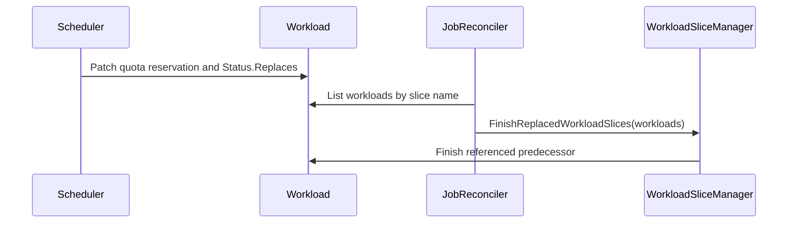

# PR #16778: Record workload slice replacements atomically with admission

**Summary**: Record workload slice replacements atomically with admission

**Sources**: https://github.com/kubernetes-sigs/kueue/pull/16778

**Last updated**: 2026-10-19T11:48:58Z

---

## Metadata

- **State**: open
- **Author**: [@kevin85421](https://github.com/kevin85421)
- **Branch**: `codex/atomic-workload-slice-replacement` → `main`
- **Created**: 2026-10-07T01:10:57Z
- **Updated**: 2026-10-19T11:48:58Z
- **Merged**: —
- **Closed**: —
- **Labels**: `kind/bug`, `release-note`, `size/XL`, `kind/api-change`, `cncf-cla: yes`, `area/multikueue`, `area/integrations`
- **Assignees**: [@apullo777](https://github.com/apullo777)
- **Requested reviewers**: [@kannon92](https://github.com/kannon92), [@pajakd](https://github.com/pajakd), [@mbobrovskyi](https://github.com/mbobrovskyi), [@kshalot](https://github.com/kshalot)
- **Changed files**: 20   **+374 / -153**

## Description

#### What type of PR is this?

/kind bug
/kind api-change
/area integrations
/area multikueue

#### What this PR does / why we need it?

Currently, the scheduler [admits a replacement workload slice](https://github.com/kubernetes-sigs/kueue/blob/14f20bf677dc6e111a4a030a401b821144626431/pkg/scheduler/scheduler.go#L1026) and then [finishes its predecessor](https://github.com/kubernetes-sigs/kueue/blob/14f20bf677dc6e111a4a030a401b821144626431/pkg/scheduler/scheduler.go#L1042). These are separate API operations: admission can succeed while finishing the predecessor fails. Recovery currently depends on different inference paths:

- In the prebuilt/MultiKueue path, [replacementTarget](https://github.com/kubernetes-sigs/kueue/blob/e40277f124786d86c39d25a03811c3c3162495ee/pkg/workloadslicing/workloadslicing.go#L323) uses the replacement annotation and the successor's current quota-reservation, eviction, and finished state to identify predecessors to finish.
- In the single-cluster path, the job reconciler calls [EnsureWorkloadSlices](https://github.com/kubernetes-sigs/kueue/blob/14f20bf677dc6e111a4a030a401b821144626431/pkg/controller/jobframework/reconciler.go#L1202), which delegates multiple active slices to [normalizeActiveSlices](https://github.com/kubernetes-sigs/kueue/blob/14f20bf677dc6e111a4a030a401b821144626431/pkg/workloadslicing/manager.go#L129). It [classifies slices using replacement annotations and current quota/eviction state](https://github.com/kubernetes-sigs/kueue/blob/14f20bf677dc6e111a4a030a401b821144626431/pkg/workloadslicing/workloadslicing.go#L305) and [finishes slices outside the retained set](https://github.com/kubernetes-sigs/kueue/blob/14f20bf677dc6e111a4a030a401b821144626431/pkg/workloadslicing/workloadslicing.go#L366).

These signals are indirect, and current admission state can disappear after eviction or completion.

This PR simplifies that contract by recording the predecessor's name in immutable `Workload.status.replaces` in [the same status patch as quota reservation](https://github.com/kubernetes-sigs/kueue/blob/14f20bf677dc6e111a4a030a401b821144626431/pkg/scheduler/scheduler.go#L1098). A successful reservation therefore atomically commits an explicit replacement signal. The [prebuilt job reconciliation path](https://github.com/kubernetes-sigs/kueue/blob/14f20bf677dc6e111a4a030a401b821144626431/pkg/controller/jobframework/reconciler.go#L1147) calls [FinishReplacedWorkloadSlices](https://github.com/kubernetes-sigs/kueue/blob/14f20bf677dc6e111a4a030a401b821144626431/pkg/workloadslicing/manager.go#L165) to read that signal and finish the referenced predecessor, even if the successor has since been evicted or finished.

The atomic operation is quota reservation plus the replacement record; finishing the predecessor remains a separate, retryable operation. This establishes the contract needed for the job reconciler to eventually become the sole place that finishes replaced slices in both single-cluster and MultiKueue setups.

This PR preserves the scheduler's existing completion path and single-cluster slice selection/[normalization behavior](https://github.com/kubernetes-sigs/kueue/blob/14f20bf677dc6e111a4a030a401b821144626431/pkg/workloadslicing/workloadslicing.go#L295). Moving single-cluster completion to the job reconciler and simplifying its replacement detection are tracked in https://github.com/kubernetes-sigs/kueue/issues/17043.

Update generated API clients, CRDs, Helm manifests, and API reference documentation for the new status field.

#### Useful notes for your reviewer

This change was developed with assistance from OpenAI Codex.

#### Release note

```release-note
ElasticJobsViaWorkloadSlices: Workload slice replacements are recorded atomically with quota reservation. Prebuilt workload reconciliation uses this durable record to finish replaced slices, including after eviction or controller restart.
```


<!-- This is an auto-generated comment: release notes by coderabbit.ai -->
## AI summary

Adds immutable `Workload.status.replaces` and records it with quota reservation. When `ElasticJobsViaWorkloadSlices` is enabled, the prebuilt workload reconciler uses this record to finish the predecessor, even if the successor is later evicted or completed.

### Suggested release note

ElasticJobsViaWorkloadSlices: Record committed slice replacements so Kueue can finish predecessor workloads even if the successor is later evicted or completed.
<!-- end of auto-generated comment: release notes by coderabbit.ai -->

## Discussion

### Comment by [@kubernetes-prow[bot]](https://github.com/apps/kubernetes-prow) — 2026-10-07T01:11:00Z

Skipping CI for Draft Pull Request.
If you want CI signal for your change, please convert it to an actual PR.
You can still manually trigger a test run with `/test all`

### Comment by [@coderabbitai[bot]](https://github.com/apps/coderabbitai) — 2026-10-07T01:11:06Z

<!-- This is an auto-generated comment: summarize by coderabbit.ai -->
<!-- review_stack_entry_start -->

<a href="https://app.coderabbit.ai/change-stack/kubernetes-sigs/kueue/pull/16778?scope=ghh_OusAJGA4HG8ljoOV0wJvVx8NmnZIjc2DdjmxOu0xZWA&amp;cs_source=review_comment"><picture><source media="(prefers-color-scheme: dark)" srcset="https://storage.googleapis.com/coderabbit_public_assets/review-stack-in-coderabbit-ui-dark.svg?v=3"><source media="(prefers-color-scheme: light)" srcset="https://storage.googleapis.com/coderabbit_public_assets/review-stack-in-coderabbit-ui.svg?v=3"></picture></a>

<!-- review_stack_entry_end -->
<!-- recent_review_start -->

No actionable comments were generated in the recent review. 🎉

<details>
<summary><strong>ℹ️ Recent review info</strong></summary>
<dl>
<dd>

<details>
<summary><strong>⚙️ Run configuration</strong></summary>
<dl>
<dd>

- **Configuration used**: Repository: kubernetes-sigs/kueue/.coderabbit.yaml
- **Review profile**: CHILL
- **Plan**: Advanced
- **Run ID**: `a98aa70c-e75c-4567-8972-0c6b1796641b`

</dd>
</dl>
</details>

<details>
<summary><strong>📥 Commits</strong></summary>
<dl>
<dd>

Reviewing files that changed from the base of the PR and between 14f20bf677dc6e111a4a030a401b821144626431 and f7d918d524871cd6424c2a1a24e8f5496ed2a956.

</dd>
</dl>
</details>

<details>
<summary><strong>📒 Files selected for processing: 2</strong></summary>
<dl>
<dd>

* `pkg/controller/jobframework/reconciler.go`
* `pkg/workloadslicing/workloadslicing_test.go`

</dd>
</dl>
</details>

<details>
<summary><strong>🚧 Files skipped from review as they are similar to previous changes: 1</strong></summary>
<dl>
<dd>

* pkg/controller/jobframework/reconciler.go

</dd>
</dl>
</details>

**Included review availability:** This review used your included allowance. Your plan provides up to 8 included reviews per hour; 7 remain after this review.

</dd>
</dl>
</details>


<!-- recent_review_end -->
<!-- walkthrough_start -->

<details>
<summary><strong>📝 Walkthrough</strong></summary>
<dl>
<dd>

Workload status now records which slice a replacement workload replaces. The scheduler writes this reference during admission. The job reconciler passes matching workloads to the slice manager, which finishes referenced predecessors.

**Changes: Workload slice replacement**

|Layer / File(s)|Summary|
|:---|:---|
|**Replacement status contract** <br> `apis/kueue/v1beta2/workload_types.go`, `charts/kueue/templates/crd/kueue.x-k8s.io_workloads.yaml`, `config/components/crd/bases/kueue.x-k8s.io_workloads.yaml`, `site/content/en/docs/reference/kueue.v1beta2.md`|`WorkloadStatus` gains an optional `replaces` reference to a same-namespace workload. The API types and CRD schemas require a name of 1–253 characters and prevent the reference from being removed or changed once set. The API reference documents the field.|
|**Scheduler replacement commitment** <br> `pkg/scheduler/scheduler.go`, `pkg/workload/patching/patching.go`, `pkg/util/testing/v1beta2/wrappers.go`, `pkg/scheduler/scheduler_test.go`|When elastic workload slices are enabled and an old slice target exists, the scheduler sets `Status.Replaces` if it is unset. Admission status patches copy the field. Tests and the workload test wrapper include replacement references.|
|**Predecessor slice completion** <br> `pkg/workloadslicing/*`, `pkg/controller/jobframework/reconciler.go`, `pkg/controller/jobframework/reconciler_test.go`, `test/integration/multikueue/*`, `test/integration/singlecluster/controller/jobs/job/job_controller_test.go`|The job reconciler lists same-namespace workloads by slice name and passes them to the slice manager. The manager finishes referenced predecessors, records an event, and reports replacement metrics when the predecessor has an admission. Unit and integration tests cover replacement completion and reference immutability.|

<!-- change_assessment_start -->
**Priority:** ⬇️ Low

**Estimated code review effort:** 3 (Moderate) | ~25 minutes

<!-- change_assessment_commit:"f7d918d524871cd6424c2a1a24e8f5496ed2a956" -->
**Change:** Bug fix
<!-- change_assessment_end -->

### Sequence Diagram(s)



</dd>
</dl>
</details>

<!-- walkthrough_end -->
<details>
<summary><strong>Merge Risk:</strong> <strong>⚪ Minimal</strong> · up to <code>f7d91</code></summary>
<dl>
<dd>

<!-- final_review_risk_start -->
<!-- final_review_risk_label
**Merge Risk:** **⚪ Minimal** · up to `f7d91`
-->
<!-- final_review_risk_coverage:{"sourceCommitId":"f7d918d524871cd6424c2a1a24e8f5496ed2a956","coveredCommitId":"f7d918d524871cd6424c2a1a24e8f5496ed2a956","kind":"reviewed"} -->

Committed replacement references allow reconciliation to finish predecessor slices even if a successor is later evicted or finished. The supplied lifecycle coverage identifies no material merge-blocking risk.
<!-- final_review_risk_end -->

</dd>
</dl>
</details>

<details>
<summary><strong>Security architecture risk:</strong> <strong>🔵 Low</strong> · up to <code>f7d91</code></summary>
<dl>
<dd>

<!-- architecture_review_start -->
<!-- architecture_review_label
### Security Architecture Review

**Security architecture risk:** **🔵 Low** · up to `f7d91`
-->

Recording replacement intent together with admission improves recovery after interruption or eviction. The main remaining risk is upgrade compatibility: replacements admitted before the new field existed can lose their previous recovery path, leaving predecessor slices and quota behind. The inspected permissions do not grant workload editors new status-write authority.

**Retained concerns**
- **Medium · reliability · inferred:** Prebuilt/MultiKueue recovery no longer handles replacements committed before status.replaces existed. A quota-reserved, non-evicted successor with a replacement annotation and an unfinished predecessor was recoverable at the base. The new manager skips that successor when the new field is absent, and the scheduler populates the field only during admission. Without a transition mechanism, upgrading with this partial-failure state can leave the predecessor unfinished and retaining quota. Successful scheduler completion and single-cluster normalization contain other cases but do not repair this prebuilt recovery path.


<details>
<summary><strong>Security review details</strong></summary>
<dl>
<dd>

**Security Blast Radius**
- _observed_ — The new completion manager resolves targets only within the supplied list and the successor's namespace; it does not fetch arbitrary missing names. The production caller supplies same-namespace workloads sharing the slice-name index. Completion can affect predecessor lifecycle and quota accounting within that set.

**Trust Boundaries and Controls**
- _observed_ — The initially fetched prebuilt workload is ownership-checked, but the listed set is grouped by an annotation-derived index rather than per-member owner validation. That indexed selection also existed at the base. The new reference is immutable and consumed from status, for which the inspected workload-editor role has no write permission. These controls do not establish deployed tenant isolation or prevent every annotation/name-reuse scenario.

**Hardening Proposals**
- _proposed_ — Define a bounded legacy-recovery or backfill transition before relying exclusively on the new field, preserving identity and slice-membership checks so recovery of old commitments does not weaken cleanup containment.

</dd>
</dl>
</details>

<!-- architecture_review_end -->

</dd>
</dl>
</details>
<!-- pre_merge_checks_walkthrough_start -->

<details>
<summary><strong>Pre-merge checks: <sup><picture></picture></sup> 4 · <sup><picture></picture></sup> 1</strong></summary>
<dl>
<dd>

<strong><sup><picture></picture></sup> Failed checks: 1 warning</strong>

|     Check name     |                                              Status                                              | Explanation                                                                                                                                                                                 | Resolution                                                                         |
| :---------------- | :----------------------------------------------------------------------------------------------: | :------------------------------------------------------------------------------------------------------------------------------------------------------------------------------------------ | :--------------------------------------------------------------------------------- |
| Docstring Coverage |  | Docstring coverage is 14.29% which is insufficient. The required threshold is 80.00%. Docstring coverage is scoped to functions touched by this diff. Analyzed 7 functions across 12 files. | Write docstrings for the functions missing them to satisfy the coverage threshold. |

<details>
<summary><strong><sup><picture></picture></sup> Passed checks: 4 passed</strong></summary>
<dl>
<dd>

|         Check name         |                                             Status                                             | Explanation                                                                                                                 |
| :------------------------ | :--------------------------------------------------------------------------------------------: | :-------------------------------------------------------------------------------------------------------------------------- |
|      Description Check     |  | Check skipped - CodeRabbit’s high-level summary is enabled.                                                                 |
|         Title check        |  | The title clearly and concisely describes the main change: recording workload slice replacements atomically with admission. |
|     Linked Issues check    |  | Check skipped because no linked issues were found for this pull request.                                                    |
| Out of Scope Changes check |  | Check skipped because no linked issues were found for this pull request.                                                    |

</dd>
</dl>
</details>

</dd>
</dl>
</details>

<!-- pre_merge_checks_walkthrough_end -->

- [ ] <!-- {"checkboxId":"585bb3f6-faf5-4dbf-96d2-74e382adf19a"} --> Fix all pre-merge checks with AI
<!-- finishing_touch_checkbox_start -->

<details>
<summary><strong>✨ Finishing Touches</strong></summary>
<dl>
<dd>

<details open>
<summary><strong>🧪 Generate unit tests (beta)</strong></summary>
<dl>
<dd>

- [ ] <!-- {"checkboxId": "f47ac10b-58cc-4372-a567-0e02b2c3d479", "radioGroupId": "utg-output-choice-group-unknown_comment_id"} --> Create a new PR

</dd>
</dl>
</details>

</dd>
</dl>
</details>

<!-- finishing_touch_checkbox_end -->

<!-- autopilot:start -->
- [ ] <!-- {"checkboxId":"2708ad07-9f24-4260-9c11-7dc76a49f2e3"} --> <strong title="Keep fixing CodeRabbit findings and required CI, and resolving merge conflicts">Autofix</strong> · Keep fixing CodeRabbit findings and required CI, and resolving merge conflicts
<!-- autopilot:end -->
<!-- tips_start -->


<sub>Comment `@coderabbitai help` to get the list of available commands.</sub>

<!-- tips_end -->

### Comment by [@netlify[bot]](https://github.com/apps/netlify) — 2026-10-07T01:11:07Z

### <span aria-hidden="true">✅</span> Deploy Preview for *kubernetes-sigs-kueue* canceled.


|  Name | Link |
|:-:|------------------------|
|<span aria-hidden="true">🔨</span> Latest commit | f7d918d524871cd6424c2a1a24e8f5496ed2a956 |
|<span aria-hidden="true">🔍</span> Latest deploy log | https://app.netlify.com/projects/kubernetes-sigs-kueue/deploys/6ad586882167bfa2cf337d8b |

### Comment by [@kubernetes-prow[bot]](https://github.com/apps/kubernetes-prow) — 2026-10-07T01:11:15Z

[APPROVALNOTIFIER] This PR is **NOT APPROVED**

This pull-request has been approved by: *<a href="https://github.com/kubernetes-sigs/kueue/pull/16778#" title="Author self-approved">kevin85421</a>*
**Once this PR has been reviewed and has the lgtm label**, please assign [olekzabl](https://github.com/olekzabl), [sohankunkerkar](https://github.com/sohankunkerkar) for approval. For more information see [the Code Review Process](https://git.k8s.io/community/contributors/guide/owners.md#the-code-review-process).

The full list of commands accepted by this bot can be found [here](https://go.k8s.io/bot-commands?repo=kubernetes-sigs%2Fkueue).

<details open>
Needs approval from an approver in each of these files:

- **[OWNERS](https://github.com/kubernetes-sigs/kueue/blob/main/OWNERS)**

Approvers can indicate their approval by writing `/approve` in a comment
Approvers can cancel approval by writing `/approve cancel` in a comment
</details>
<!-- META={"approvers":["olekzabl","sohankunkerkar"]} -->

### Comment by [@kevin85421](https://github.com/kevin85421) — 2026-10-07T05:14:34Z

/test all

This CI trigger was posted with assistance from OpenAI Codex.

### Comment by [@kevin85421](https://github.com/kevin85421) — 2026-10-07T05:27:14Z

/test pull-kueue-test-integration-multikueue-main

Updated the scheduler emulation to commit status.replaces with quota reservation. The previously failing focused integration test, ci-lint, and make verify now pass locally.

This fix and CI trigger were prepared with assistance from OpenAI Codex.

## Reviews

### Review by [@apullo777](https://github.com/apullo777) (commented) — 2026-10-18T10:12:37Z

/assign

- **pkg/workloadslicing/manager.go:174** by [@apullo777](https://github.com/apullo777) — 2026-10-18T08:22:20Z
```diff
@@ -151,3 +156,46 @@ func (r *Manager) EnsureWorkloadSlices(
 		return nil, true, nil
 	}
 }
+
+// FinishReplacedWorkloadSlices finishes predecessors referenced by status.replaces
+// only if they are present in the workloads argument. Referenced workloads absent
+// from the argument are not finished to avoid finishing a slice with the same name
+// that does not belong to this job. The caller is responsible for supplying
+// workload slices belonging to the job being reconciled.
+func (r *Manager) FinishReplacedWorkloadSlices(ctx context.Context, workloads []kueue.Workload) error {
+	byName := make(map[types.NamespacedName]*kueue.Workload, len(workloads))
+	for i := range workloads {
+		wl := &workloads[i]
+		byName[client.ObjectKeyFromObject(wl)] = wl
+	}
+	for i := range workloads {
+		newSlice := &workloads[i]
+		replaces := newSlice.Status.Replaces
+		if replaces == nil || replaces.Name == newSlice.Name {
```

  I reproduced an upgrade regression by removing `Replaces("old")` from `TestReconcilePrebuiltWorkloadFinishesReplacedSlice`. The test passes on main but fails on this PR.
  
  A successor admitted before `status.replaces` existed may still have an unfinished predecessor holding quota. Could we fall back to the previous annotation-based check when the field is unset?

- **pkg/workloadslicing/workloadslicing_test.go:2320** by [@apullo777](https://github.com/apullo777) — 2026-10-18T10:04:04Z
```diff
@@ -2392,3 +2307,56 @@ func TestFindLatestActiveWorkload(t *testing.T) {
 		})
 	}
 }
+
+func TestFinishReplacedWorkloadSlices(t *testing.T) {
+	now := time.Now().Truncate(time.Second)
+	old := utiltestingapi.MakeWorkload("old", "ns")
+	successor := utiltestingapi.MakeWorkload("new", "ns").Replaces("old")
+	for name, tc := range map[string]struct {
+		workloads    []*kueue.Workload
+		wantFinished sets.Set[string]
+	}{
+		"intent alone retains predecessor":                   {workloads: []*kueue.Workload{old.Obj(), utiltestingapi.MakeWorkload("new", "ns").Annotation(WorkloadSliceReplacementFor, "ns/old").Obj()}},
```

  Nit: could we restore the "already finished predecessor" case and assert that no event is emitted? I tried removing the `IsFinished(oldSlice)` guard and the tests still pass, even though repeated reconciles would report duplicate events and metrics.

### Review by [@kevin85421](https://github.com/kevin85421) (commented) — 2026-10-18T16:44:12Z

- **pkg/workloadslicing/manager.go:174** by [@kevin85421](https://github.com/kevin85421) — 2026-10-18T16:44:12Z
```diff
@@ -151,3 +156,46 @@ func (r *Manager) EnsureWorkloadSlices(
 		return nil, true, nil
 	}
 }
+
+// FinishReplacedWorkloadSlices finishes predecessors referenced by status.replaces
+// only if they are present in the workloads argument. Referenced workloads absent
+// from the argument are not finished to avoid finishing a slice with the same name
+// that does not belong to this job. The caller is responsible for supplying
+// workload slices belonging to the job being reconciled.
+func (r *Manager) FinishReplacedWorkloadSlices(ctx context.Context, workloads []kueue.Workload) error {
+	byName := make(map[types.NamespacedName]*kueue.Workload, len(workloads))
+	for i := range workloads {
+		wl := &workloads[i]
+		byName[client.ObjectKeyFromObject(wl)] = wl
+	}
+	for i := range workloads {
+		newSlice := &workloads[i]
+		replaces := newSlice.Status.Replaces
+		if replaces == nil || replaces.Name == newSlice.Name {
```

  One of the main goals of making the operation atomic is to avoid relying on a heuristic to infer whether a slice has been replaced, since I believe that heuristic is error-prone, and retaining it as a fallback may mask underlying issues.
  
  Your point is fair, but I would like to explore whether we can switch MultiKueue directly to the new contract (i.e., `status.replaces`). MultiKueue adoption is still limited, and its support for elastic workloads is relatively new, so I would suggest adopting the new contract directly for MultiKueue while retaining the annotation-based check as a fallback for the single-cluster case, which is outside the scope of this PR.
  
  WDYT?

### Review by [@kevin85421](https://github.com/kevin85421) (commented) — 2026-10-19T03:00:35Z

- **pkg/workloadslicing/workloadslicing_test.go:2320** by [@kevin85421](https://github.com/kevin85421) — 2026-10-19T03:00:35Z
```diff
@@ -2392,3 +2307,56 @@ func TestFindLatestActiveWorkload(t *testing.T) {
 		})
 	}
 }
+
+func TestFinishReplacedWorkloadSlices(t *testing.T) {
+	now := time.Now().Truncate(time.Second)
+	old := utiltestingapi.MakeWorkload("old", "ns")
+	successor := utiltestingapi.MakeWorkload("new", "ns").Replaces("old")
+	for name, tc := range map[string]struct {
+		workloads    []*kueue.Workload
+		wantFinished sets.Set[string]
+	}{
+		"intent alone retains predecessor":                   {workloads: []*kueue.Workload{old.Obj(), utiltestingapi.MakeWorkload("new", "ns").Annotation(WorkloadSliceReplacementFor, "ns/old").Obj()}},
```

  Updated.

### Review by [@apullo777](https://github.com/apullo777) (commented) — 2026-10-19T11:48:58Z

- **pkg/workloadslicing/manager.go:174** by [@apullo777](https://github.com/apullo777) — 2026-10-19T11:48:58Z
```diff
@@ -151,3 +156,46 @@ func (r *Manager) EnsureWorkloadSlices(
 		return nil, true, nil
 	}
 }
+
+// FinishReplacedWorkloadSlices finishes predecessors referenced by status.replaces
+// only if they are present in the workloads argument. Referenced workloads absent
+// from the argument are not finished to avoid finishing a slice with the same name
+// that does not belong to this job. The caller is responsible for supplying
+// workload slices belonging to the job being reconciled.
+func (r *Manager) FinishReplacedWorkloadSlices(ctx context.Context, workloads []kueue.Workload) error {
+	byName := make(map[types.NamespacedName]*kueue.Workload, len(workloads))
+	for i := range workloads {
+		wl := &workloads[i]
+		byName[client.ObjectKeyFromObject(wl)] = wl
+	}
+	for i := range workloads {
+		newSlice := &workloads[i]
+		replaces := newSlice.Status.Replaces
+		if replaces == nil || replaces.Name == newSlice.Name {
```

  Thanks! I see the rationale for dropping the heuristic. My remaining concern is upgrades: before #16473 (first shipped in v0.20.1), MultiKueue had no recovery for a failed predecessor finish. So workers upgrading from earlier versions may already have stuck predecessors that this PR would no longer recover.
  
  Perhaps we could keep a temporary compatibility path, or just document this as an upgrade limitation in the release notes? WDYT?
