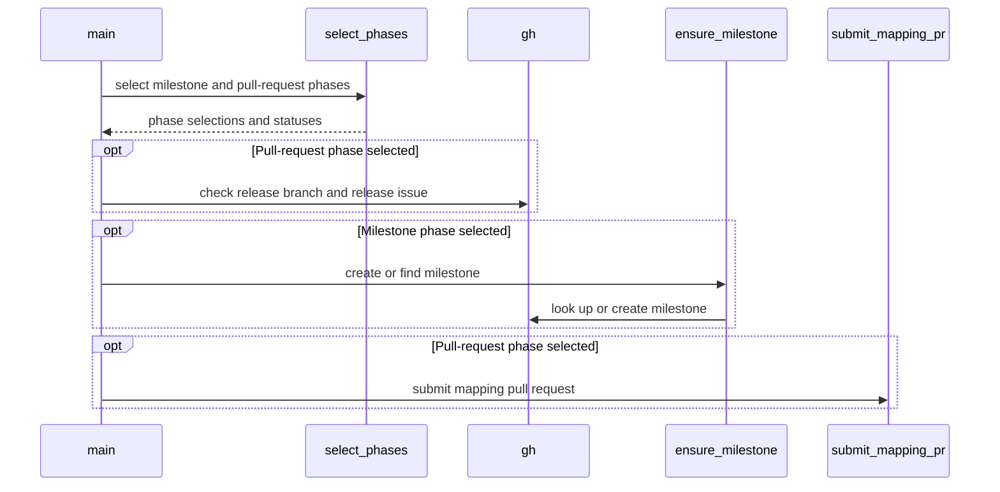

# PR #16927: Splits hack/releasing/milestone_pull.sh into two explicit phases

**Summary**: Splits hack/releasing/milestone_pull.sh into two explicit phases

**Sources**: https://github.com/kubernetes-sigs/kueue/pull/16927

**Last updated**: 2026-10-13T07:03:46Z

---

## Metadata

- **State**: open
- **Author**: [@andrewseif](https://github.com/andrewseif)
- **Branch**: `kueue-issue-16827` → `main`
- **Created**: 2026-10-08T12:37:45Z
- **Updated**: 2026-10-13T07:03:46Z
- **Merged**: —
- **Closed**: —
- **Labels**: `size/L`, `release-note-none`, `kind/cleanup`, `ok-to-test`, `cncf-cla: yes`, `area/release`
- **Assignees**: _none_
- **Requested reviewers**: [@kshalot](https://github.com/kshalot), [@PBundyra](https://github.com/PBundyra)
- **Changed files**: 3   **+296 / -43**

## Description

<!-- Thank you for contributing! Check CONTRIBUTING.md for details. -->

#### What type of PR is this?
/kind cleanup
/area release


<!-- Choose one of the following kinds:
/kind bug
/kind cleanup
/kind documentation
/kind feature
/kind kep
-->


<!-- Optionally choose one or more of the following kinds:
/kind api-change
/kind deprecation
/kind failing-test
/kind flake
/kind regression
-->


<!-- Consider setting the area:
/area tas
/area was
/area integrations
/area multikueue
/area dashboard
/area localization
/area testing
/area website
-->


#### What this PR does / why we need it?
Splits `hack/releasing/milestone_pull.sh` into two explicit phases, as a follow-up to #16714.

- `--create-milestone v0.21.0` only creates the next minor's milestone (`v0.22`). It needs an authenticated `gh` with write access to the Kueue repository and nothing else: no test-infra checkout, no `GITHUB_USER`, no release branch or release issue lookup.
- `--create-pr v0.21.0` only opens the test-infra `milestone_applier` PR, and makes no milestones API calls.
- `v0.21.0` without flags keeps the current PR-only default. Passing both flags runs both phases, the milestone first.

How the flags interact with the existing environment variables:
- Without a flag, `CREATE_MILESTONE` and `SKIP_PR` work as before.
- With a flag, a variable that contradicts it is rejected with exit code 2 before any GitHub call: `CREATE_MILESTONE` without `--create-milestone`, or `SKIP_PR` with `--create-pr`. Combinations that agree, such as `--create-milestone` with `SKIP_PR`, are accepted.
- `DRY_RUN` keeps its meaning in every mode. Milestone idempotency is unchanged: exact-title match across open and closed milestones, and a closed milestone is never reopened.

The New Release template now lists the local `--create-milestone` command as an alternative to `/create-milestone`, and the mapping step uses `--create-pr`.


<!--
Use `Fixes #123` for an issue addressed by this PR; it will be closed when the PR merges.
Use `Related:` or `Part of:` to reference an issue without closing it.
-->
Fixes #16827 

#### Useful notes for your reviewer
- Phase selection lives in a new `select_phases` function, so the full flag and environment variable matrix is unit tested. `ensure_milestone` no longer reads `CREATE_MILESTONE`; `main` only calls it when the milestone phase is selected.

- The release branch and release issue checks now run only when the PR phase is selected. They still run before any phase, so a run with both phases does not create the milestone and then stop on a missing release issue. As a side effect, a no-flag run with `CREATE_MILESTONE` and `SKIP_PR` no longer requires the release issue, which matches what it actually does.

- `ensure_milestone` sets its result to `FAILED` on entry, so a failed lookup or create shows `FAILED` in the summary instead of `not run`.

- Tests: new `select_phases` cases, plus `main`-level cases that run the script in a separate bash process with the existing `gh` stub and a stubbed `submit_mapping_pr`, so no test-infra checkout is needed. They cover milestone-only without test-infra or `GITHUB_USER`, zero milestones calls for `--create-pr` and the default, phase order, DRY_RUN, a failing create, contradictions, and invalid usage. `make milestone-pull-test` passes under bash 5 and the macOS bash 3.2; `make shell-lint` and `make release-utils-test` (which checks the template's step markers) pass.


I will need some input here, and in any case I think another PR would be better than adding it here anyway. 
Sharing milestone logic with the `/create-milestone` action, is evaluated but not changed here.
- The two implementations agree on the milestone title, exact-title lookup across open and closed milestones, and create-if-absent. They differ in a few places. The action fails for patch versions with a message, where the script exits 2 with "Nothing to do". The action reports a closed milestone as "already exists". The action has no dry run. The ChatOps `authorize` job also requires the release to be published before `/create-milestone`.

- Options: (A) keep both as they are; (B) have the action run `milestone_pull.sh --create-milestone "$VERSION"`; (C) extract a shared helper sourced by both.

- Recommendation: B, as a separate follow-up. This PR makes it possible, because milestone-only mode no longer needs a test-infra checkout or the release issue. It would need the repo passed through `KUBERNETES_SIGS_KUEUE_MAIN_REPO_ORG/NAME` (the CI checkout has no `upstream` remote), the exit code mapped to the action's `message` output, a decision on the patch and closed-milestone messages, and the script added to the `validate` job's required files. Authorization, command matching and job permissions would stay as they are. I kept it out of this PR because only a live `/create-milestone` run can validate it, so `release-utils.yml` and the action are untouched here.

AI usage disclosure: this change was developed with AI assistance, all results are reviewed and verified by me.

#### Release note

<!-- Describe the behavior change accurately from the user's perspective. Hints:
- Do not leave this block blank.
- Use "NONE" when there is no user-facing change.
- When feasible use a prefix for the sub-component or feature, e.g. "FairSharing:" or "MultiKueue:".
- If upgrade steps are required, include an "ACTION REQUIRED:" section.
You may consider AI assistance using the skill: cmd/experimental/skills/kueue-release-notes/SKILL.md.
-->
```release-note
NONE
```


<!-- This is an auto-generated comment: release notes by coderabbit.ai -->

## AI summary

`milestone_pull.sh` now supports separate milestone and mapping-PR phases. Without flags, it keeps the PR-only default; passing both flags runs milestone creation first. Each phase checks its own prerequisites, and contradictory environment-variable settings with explicit flags are rejected. The release checklist documents both local commands.

### Suggested release note

NONE

<!-- end of auto-generated comment: release notes by coderabbit.ai -->

## Discussion

### Comment by [@netlify[bot]](https://github.com/apps/netlify) — 2026-10-08T12:37:53Z

### <span aria-hidden="true">✅</span> Deploy Preview for *kubernetes-sigs-kueue* ready!


|  Name | Link |
|:-:|------------------------|
|<span aria-hidden="true">🔨</span> Latest commit | 18f1cce8c34cb84e9f2b88ff45ee02db2b809fd8 |
|<span aria-hidden="true">🔍</span> Latest deploy log | https://app.netlify.com/projects/kubernetes-sigs-kueue/deploys/6ac78e9d8a8fd800086c4e3e |
|<span aria-hidden="true">😎</span> Deploy Preview | [https://deploy-preview-16927--kubernetes-sigs-kueue.netlify.app](https://deploy-preview-16927--kubernetes-sigs-kueue.netlify.app) |
|<span aria-hidden="true">📱</span> Preview on mobile | <details><summary> Toggle QR Code... </summary><br /><br /><br /><br />_Use your smartphone camera to open QR code link._</details> |
---
<!-- [kubernetes-sigs-kueue Preview](https://deploy-preview-16927--kubernetes-sigs-kueue.netlify.app) -->
_To edit notification comments on pull requests, go to your [Netlify project configuration](https://app.netlify.com/projects/kubernetes-sigs-kueue/configuration/notifications#deploy-notifications)._

### Comment by [@kubernetes-prow[bot]](https://github.com/apps/kubernetes-prow) — 2026-10-08T12:37:57Z

Hi @andrewseif. Thanks for your PR.

I'm waiting for a [kubernetes-sigs](https://github.com/orgs/kubernetes-sigs/people) member to verify that this patch is reasonable to test. If it is, they should reply with `/ok-to-test` on its own line. Until that is done, I will not automatically test new commits in this PR, but the usual testing commands by org members will still work.

>[!TIP]
>**We noticed you've done this a few times! Consider [joining the org](https://git.k8s.io/community/community-membership.md#member) to skip this step and gain `/lgtm` and other bot rights.** We recommend asking approvers on your previous PRs to sponsor you.

Once the patch is verified, the new status will be reflected by the `ok-to-test` label.

I understand the commands that are listed [here](https://go.k8s.io/bot-commands?repo=kubernetes-sigs%2Fkueue).

<details>

Instructions for interacting with me using PR comments are available [here](https://git.k8s.io/community/contributors/guide/pull-requests.md).  If you have questions or suggestions related to my behavior, please file an issue against the [kubernetes-sigs/prow](https://github.com/kubernetes-sigs/prow/issues/new?title=Prow%20issue:) repository.
</details>

### Comment by [@kubernetes-prow[bot]](https://github.com/apps/kubernetes-prow) — 2026-10-08T12:38:01Z

[APPROVALNOTIFIER] This PR is **NOT APPROVED**

This pull-request has been approved by: *<a href="https://github.com/kubernetes-sigs/kueue/pull/16927#" title="Author self-approved">andrewseif</a>*
**Once this PR has been reviewed and has the lgtm label**, please assign [sohankunkerkar](https://github.com/sohankunkerkar) for approval. For more information see [the Code Review Process](https://git.k8s.io/community/contributors/guide/owners.md#the-code-review-process).

The full list of commands accepted by this bot can be found [here](https://go.k8s.io/bot-commands?repo=kubernetes-sigs%2Fkueue).

<details open>
Needs approval from an approver in each of these files:

- **[OWNERS](https://github.com/kubernetes-sigs/kueue/blob/main/OWNERS)**

Approvers can indicate their approval by writing `/approve` in a comment
Approvers can cancel approval by writing `/approve cancel` in a comment
</details>
<!-- META={"approvers":["sohankunkerkar"]} -->

### Comment by [@coderabbitai[bot]](https://github.com/apps/coderabbitai) — 2026-10-08T12:38:45Z

<!-- This is an auto-generated comment: summarize by coderabbit.ai -->
<!-- review_stack_entry_start -->

<a href="https://app.coderabbit.ai/change-stack/kubernetes-sigs/kueue/pull/16927?scope=ghh_OusAJGA4HG8ljoOV0wJvVx8NmnZIjc2DdjmxOu0xZWA&amp;cs_source=review_comment"></a>

<!-- review_stack_entry_end -->
<!-- recent_review_start -->

No actionable comments were generated in the recent review. 🎉

<details>
<summary>ℹ️ Recent review info</summary>

<details>
<summary>⚙️ Run configuration</summary>

- **Configuration used**: Repository: kubernetes-sigs/kueue/.coderabbit.yaml
- **Review profile**: CHILL
- **Plan**: Advanced
- **Run ID**: `872b676c-592d-4d18-aa89-3a06841400ee`

</details>

<details>
<summary>📥 Commits</summary>

Reviewing files that changed from the base of the PR and between 90e8f5849eb33c75e5b7d5d4d7bc213396eab4e8 and 18f1cce8c34cb84e9f2b88ff45ee02db2b809fd8.

</details>

<details>
<summary>📒 Files selected for processing (3)</summary>

* `.github/ISSUE_TEMPLATE/NEW_RELEASE.md`
* `hack/releasing/milestone_pull.sh`
* `hack/testing/milestone_pull_test.sh`

</details>

**Included review availability:** This review used your included allowance. Your plan provides up to 8 included reviews per hour; 7 remain after this review.

</details>

---


<!-- recent_review_end -->
<!-- walkthrough_start -->

<details>
<summary>📝 Walkthrough</summary>

## Walkthrough

`milestone_pull.sh` now supports separate milestone-creation and pull-request phases. It selects phases from command-line flags and environment variables, applies checks for the selected operations, and updates the release checklist and tests.

### Changes

**Milestone release phases**

|Layer / File(s)|Summary|
|:---|:---|
|**Phase flags and selection** <br> `.github/ISSUE_TEMPLATE/NEW_RELEASE.md`, `hack/releasing/milestone_pull.sh`, `hack/testing/milestone_pull_test.sh`|The script parses phase flags and a release version, documents environment-variable interactions, and selects phases. The release checklist uses `--create-pr`. Tests cover phase selection and command usage.|
|**Phase execution and checks** <br> `hack/releasing/milestone_pull.sh`, `hack/testing/milestone_pull_test.sh`|Milestone lookup or creation and pull-request submission run only when selected. Release branch and issue checks run only for the pull-request phase. Tests cover each phase, their combined order, milestone behavior, and failures.|

<!-- change_assessment_start -->
**Priority:** ⬇️ Low

**Estimated code review effort:** 3 (Moderate) | ~20 minutes

<!-- change_assessment_commit:"18f1cce8c34cb84e9f2b88ff45ee02db2b809fd8" -->
**Change:** Feature
<!-- change_assessment_end -->

### Sequence Diagram(s)



</details>

<!-- walkthrough_end -->
<!-- final_review_risk_start -->
**Merge Risk:** **⚪ Minimal** · up to `18f1c`
<!-- final_review_risk_coverage:{"sourceCommitId":"18f1cce8c34cb84e9f2b88ff45ee02db2b809fd8","coveredCommitId":"18f1cce8c34cb84e9f2b88ff45ee02db2b809fd8","kind":"reviewed"} -->

The separate milestone and PR commands appear ready to merge after normal checks.
<!-- final_review_risk_end -->
<!-- architecture_review_start -->
### Security Architecture Review

**Security architecture risk:** **⚪ Minimal** · up to `18f1c`

The phase split preserves the existing authenticated GitHub authority and release-state safeguards. Milestone-only execution removes unrelated PR prerequisites, while PR-only execution avoids milestone operations. No material security risk was found introduced or worsened in the reviewed paths.

**Retained concerns**
No architecture-level concerns identified.

<details>
<summary>Security review details</summary>

**Security Blast Radius**
- _observed_ — The inspected mutations are a milestone in the selected Kueue repository, a force-pushed branch on the configured test-infra fork remote, a PR in the upstream-derived test-infra repository, and a checklist update in the selected Kueue release issue. Their reach remains bounded by the operator's configured targets and effective Git/GitHub credentials.

**Security Findings and Attack Paths**
- _inferred_ — The changed CLI does not establish a new unauthenticated execution path in the inspected source. The newly independent milestone path bypasses release-branch, release-issue and checkout prerequisites, but retains the same authenticated milestone sink. The test entrypoints use fixtures and replace PR submission rather than introducing a production caller.

**Trust Boundaries and Controls**
- _observed_ — Operator arguments are validated before phase execution, and conflicting flag/environment selections fail before authentication or API calls. PR-only execution cannot invoke the milestone function through main. The existing PR path still refuses unexpected mapping state and requires affirmative confirmation before pushing.

**Resilience and Maintainability Implications**
- _observed_ — Repeated execution retains existing recovery checks: an existing milestone is left unchanged, an exact-title open PR prevents duplicate submission, and an already-applied mapping produces no new edit. These checks and local branch cleanup are unchanged by phase separation; they do not provide a distributed transaction or guaranteed concurrency safety.


</details>

<!-- architecture_review_end -->
<!-- pre_merge_checks_walkthrough_start -->

<details>
<summary>🚥 Pre-merge checks | ✅ 4 | ❌ 1</summary>

### ❌ Failed checks (1 warning)

|     Check name     | Status     | Explanation                                                                                                                                                                                               | Resolution                                                                         |
| :---------------- | :--------- | :-------------------------------------------------------------------------------------------------------------------------------------------------------------------------------------------------------- | :--------------------------------------------------------------------------------- |
| Docstring Coverage | ⚠️ Warning | Docstring coverage is 46.15% which is insufficient. The required threshold is 80.00%. Docstring coverage is scoped to functions touched by this diff. Analyzed 13 functions across 2 files. (1 skipped: … | Write docstrings for the functions missing them to satisfy the coverage threshold. |

<details>
<summary>✅ Passed checks (4 passed)</summary>

|         Check name         | Status   | Explanation                                                                                                                                                                                               |
| :------------------------ | :------- | :-------------------------------------------------------------------------------------------------------------------------------------------------------------------------------------------------------- |
|      Description Check     | ✅ Passed | Check skipped - CodeRabbit’s high-level summary is enabled.                                                                                                                                               |
|         Title check        | ✅ Passed | The title clearly describes the main change: splitting milestone_pull.sh into explicit milestone-creation and pull-request phases.                                                                        |
|     Linked Issues check    | ✅ Passed | Issue [`#16827`] coding requirements are met. The script adds `--create-milestone`, `--create-pr`, and combined phase selection. The unflagged mode retains the PR-only default and existing environment-v… |
| Out of Scope Changes check | ✅ Passed | The changes stay within issue [`#16827`]. The script changes implement the requested phase split. The test changes verify the new behavior. The release-template changes document the requested workflow. … |

</details>

<details>
<summary>Full details: Docstring Coverage</summary>

**Explanation**

Docstring coverage is 46.15% which is insufficient. The required threshold is 80.00%. Docstring coverage is scoped to functions touched by this diff. Analyzed 13 functions across 2 files. (1 skipped: 1 unsupported.)

</details>

</details>

<!-- pre_merge_checks_walkthrough_end -->

- [ ] <!-- {"checkboxId":"585bb3f6-faf5-4dbf-96d2-74e382adf19a"} --> Fix all pre-merge checks with AI
<!-- finishing_touch_checkbox_start -->

<details>
<summary>✨ Finishing Touches</summary>

<details open>
<summary>🧪 Generate unit tests (beta)</summary>

- [ ] <!-- {"checkboxId": "f47ac10b-58cc-4372-a567-0e02b2c3d479", "radioGroupId": "utg-output-choice-group-unknown_comment_id"} --> Create a new PR

</details>

</details>

<!-- finishing_touch_checkbox_end -->

<!-- autopilot:start -->
- [ ] <!-- {"checkboxId":"2708ad07-9f24-4260-9c11-7dc76a49f2e3"} --> <strong title="Keep fixing CodeRabbit findings and required CI, and resolving merge conflicts">Autopilot</strong> · Keep fixing CodeRabbit findings and required CI, and resolving merge conflicts
<!-- autopilot:end -->
<!-- tips_start -->

---


<sub>Comment `@coderabbitai help` to get the list of available commands.</sub>

<!-- tips_end -->

### Comment by [@mbobrovskyi](https://github.com/mbobrovskyi) — 2026-10-08T12:39:19Z

/ok-to-test

### Comment by [@mimowo](https://github.com/mimowo) — 2026-10-08T12:43:48Z

cc @mbobrovskyi @Singularity23x0

### Comment by [@kubernetes-prow[bot]](https://github.com/apps/kubernetes-prow) — 2026-10-09T17:30:07Z

@andrewseif: The following tests **failed**, say `/retest` to rerun all failed tests or `/retest-required` to rerun all mandatory failed tests:

Test name | Commit | Details | Required | Rerun command
--- | --- | --- | --- | ---
pull-kueue-test-e2e-was-deep-tas-extended-shard-0-main | 18f1cce8c34cb84e9f2b88ff45ee02db2b809fd8 | [link](https://prow.k8s.io/view/gs/kubernetes-ci-logs/pr-logs/pull/kubernetes-sigs_kueue/16927/pull-kueue-test-e2e-was-deep-tas-extended-shard-0-main/2108605701818421248) | true | `/test pull-kueue-test-e2e-was-deep-tas-extended-shard-0-main`
pull-kueue-test-e2e-was-deep-tas-baseline-main | 18f1cce8c34cb84e9f2b88ff45ee02db2b809fd8 | [link](https://prow.k8s.io/view/gs/kubernetes-ci-logs/pr-logs/pull/kubernetes-sigs_kueue/16927/pull-kueue-test-e2e-was-deep-tas-baseline-main/2108605701709369344) | true | `/test pull-kueue-test-e2e-was-deep-tas-baseline-main`
pull-kueue-test-e2e-was-deep-tas-extended-shard-1-main | 18f1cce8c34cb84e9f2b88ff45ee02db2b809fd8 | [link](https://prow.k8s.io/view/gs/kubernetes-ci-logs/pr-logs/pull/kubernetes-sigs_kueue/16927/pull-kueue-test-e2e-was-deep-tas-extended-shard-1-main/2108605701940056064) | true | `/test pull-kueue-test-e2e-was-deep-tas-extended-shard-1-main`

[Full PR test history](https://prow.k8s.io/pr-history?org=kubernetes-sigs&repo=kueue&pr=16927). [Your PR dashboard](https://prow.k8s.io/pr?query=is%3Apr%20state%3Aopen%20author%3Aandrewseif). Please help us cut down on flakes by [linking to](https://git.k8s.io/community/contributors/devel/sig-testing/flaky-tests.md#filing-issues-for-flaky-tests) an [open issue](https://github.com/kubernetes-sigs/kueue/issues?q=is:issue+is:open) when you hit one in your PR.

<details>

Instructions for interacting with me using PR comments are available [here](https://git.k8s.io/community/contributors/guide/pull-requests.md).  If you have questions or suggestions related to my behavior, please file an issue against the [kubernetes-sigs/prow](https://github.com/kubernetes-sigs/prow/issues/new?title=Prow%20issue:) repository. I understand the commands that are listed [here](https://go.k8s.io/bot-commands).
</details>
<!-- test report -->

## Reviews

### Review by [@mbobrovskyi](https://github.com/mbobrovskyi) (commented) — 2026-10-12T11:23:36Z

Please also add a confirmation step for milestone creation.

### Review by [@mbobrovskyi](https://github.com/mbobrovskyi) (commented) — 2026-10-12T11:24:44Z

Can we reuse this in the `/create-milestone` ChatOps command to have a single source of truth?

### Review by [@mbobrovskyi](https://github.com/mbobrovskyi) (commented) — 2026-10-13T07:03:46Z

- **.github/ISSUE_TEMPLATE/NEW_RELEASE.md:63** by [@mbobrovskyi](https://github.com/mbobrovskyi) — 2026-10-13T07:03:46Z
```diff
@@ -59,7 +59,8 @@ Please do not remove items from the checklist
         from the `main` branch have a meaningful version number.
   - [ ] Create a milestone for the next minor release and update prow to set it automatically for new PRs:
     - [ ] Run the ChatOps command `/create-milestone` on this issue to create the `v$MAJ.$(($MIN+1))` milestone. <!-- step:create-milestone -->
-    - [ ] Run `GITHUB_USER=<your-user> ./hack/releasing/milestone_pull.sh $VERSION` to submit the `milestone_applier` PR.
+      - *Alternatively, with write access to the Kueue repository, run `./hack/releasing/milestone_pull.sh --create-milestone $VERSION` locally.*
+    - [ ] Run `GITHUB_USER=<your-user> ./hack/releasing/milestone_pull.sh --create-pr $VERSION` to submit the `milestone_applier` PR.
```

  ```suggestion
      - [ ] Run the ChatOps command `/create-milestone` on this issue to create the `v$MAJ.$(($MIN+1))` milestone, or with write access to the Kueue repository, run `./hack/releasing/milestone_pull.sh --create-milestone $VERSION` locally. <!-- step:create-milestone -->
      - [ ] Run `GITHUB_USER=<your-user> ./hack/releasing/milestone_pull.sh --create-pr $VERSION` locally to submit the `milestone_applier` PR.
  ```
  For consistency with other places.
