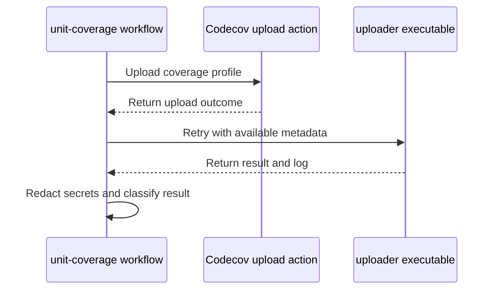

# PR #17039: Publish unit coverage profiles to Codecov

**Summary**: Publish unit coverage profiles to Codecov

**Sources**: https://github.com/kubernetes-sigs/kueue/pull/17039

**Last updated**: 2026-10-19T21:48:38Z

---

## Metadata

- **State**: open
- **Author**: [@vladikkuzn](https://github.com/vladikkuzn)
- **Branch**: `issue/11173-codecov` → `main`
- **Created**: 2026-10-09T21:33:25Z
- **Updated**: 2026-10-19T21:48:38Z
- **Merged**: —
- **Closed**: —
- **Labels**: `kind/feature`, `size/L`, `release-note-none`, `cncf-cla: yes`, `area/testing`
- **Assignees**: [@kannon92](https://github.com/kannon92), [@mimowo](https://github.com/mimowo), [@mbobrovskyi](https://github.com/mbobrovskyi), [@sohankunkerkar](https://github.com/sohankunkerkar), [@tenzen-y](https://github.com/tenzen-y)
- **Requested reviewers**: [@kannon92](https://github.com/kannon92), [@mimowo](https://github.com/mimowo), [@mbobrovskyi](https://github.com/mbobrovskyi), [@olekzabl](https://github.com/olekzabl), [@sohankunkerkar](https://github.com/sohankunkerkar), [@tenzen-y](https://github.com/tenzen-y), [@PBundyra](https://github.com/PBundyra)
- **Changed files**: 5   **+269 / -1**

## Description

#### What type of PR is this?

/kind feature

/area testing

#### What this PR does / why we need it

Publish the unit coverage profile that `make test` already writes to `artifacts/cover.out` to Codecov, as a review aid. Project and patch statuses are informational, so a coverage change does not fail CI.

Part of: https://github.com/kubernetes-sigs/kueue/issues/11173

#### Useful notes for your reviewer

This PR is publishing option (a) from the issue. It does not depend on the separate k8s-style coverage-report PR. Codecov upload on fork PRs may skip when the GitHub App cannot authenticate, and the job still verifies the profile.

`make test` is unchanged. The workflow runs that target on pull requests and on pushes to main, prints `go tool cover -func` into the step summary, and uploads `artifacts/cover.out` with the Codecov GitHub Action. No token is stored in the repo. If the upload fails only because a token, OIDC, or the GitHub App is unavailable, the job stays green.

#### Summary

Unit coverage profiles are uploaded to Codecov from the profile `make test` already produces. Coverage status is informational.

#### Test plan

- [x] Parsed `.github/workflows/unit-coverage.yaml` and `codecov.yml`.
- [x] Smoke-tested the same cover flags on `./pkg/util/priority/...` (`go test -race -coverprofile`). Profile total: 92.2% of statements.
- [ ] GitHub Actions `unit-coverage` produces `artifacts/cover.out`, prints the total, and either uploads to Codecov or records an authentication skip without failing the job.
- [ ] Existing prow jobs stay green. Tide is not a merge signal for this review.

#### AI usage disclosure

This pull request was prepared with AI assistance under the Kubernetes AI Tool Usage Policy.

#### Release note

```release-note
NONE
```

<!-- This is an auto-generated comment: release notes by coderabbit.ai -->
## AI summary

Added a GitHub Actions workflow that runs `make test` on pull requests and pushes to `main`. It validates `artifacts/cover.out`, adds total coverage to the workflow summary, and uploads the profile to Codecov. Authentication-related upload failures are treated as skips; other upload failures fail the job. Project and patch coverage statuses are informational. Added contributor documentation and a verification test for the workflow’s authentication-error matching.

### Suggested release note

NONE
<!-- end of auto-generated comment: release notes by coderabbit.ai -->

## Discussion

### Comment by [@netlify[bot]](https://github.com/apps/netlify) — 2026-10-09T21:33:32Z

### <span aria-hidden="true">✅</span> Deploy Preview for *kubernetes-sigs-kueue* ready!


|  Name | Link |
|:-:|------------------------|
|<span aria-hidden="true">🔨</span> Latest commit | b743c85f03b8780a2eb1ba7b5e9cc6350ba500c5 |
|<span aria-hidden="true">🔍</span> Latest deploy log | https://app.netlify.com/projects/kubernetes-sigs-kueue/deploys/6ad68ce849a40b84612a29cd |
|<span aria-hidden="true">😎</span> Deploy Preview | [https://deploy-preview-17039--kubernetes-sigs-kueue.netlify.app](https://deploy-preview-17039--kubernetes-sigs-kueue.netlify.app) |
|<span aria-hidden="true">📱</span> Preview on mobile | <details><summary> Toggle QR Code... </summary><br /><br /><br /><br />_Use your smartphone camera to open QR code link._</details> |
---
<!-- [kubernetes-sigs-kueue Preview](https://deploy-preview-17039--kubernetes-sigs-kueue.netlify.app) -->
_To edit notification comments on pull requests, go to your [Netlify project configuration](https://app.netlify.com/projects/kubernetes-sigs-kueue/configuration/notifications#deploy-notifications)._

### Comment by [@coderabbitai[bot]](https://github.com/apps/coderabbitai) — 2026-10-09T21:34:22Z

<!-- This is an auto-generated comment: summarize by coderabbit.ai -->
<!-- review_stack_entry_start -->

<a href="https://app.coderabbit.ai/change-stack/kubernetes-sigs/kueue/pull/17039?scope=ghh_OusAJGA4HG8ljoOV0wJvVx8NmnZIjc2DdjmxOu0xZWA&amp;cs_source=review_comment"><picture><source media="(prefers-color-scheme: dark)" srcset="https://storage.googleapis.com/coderabbit_public_assets/review-stack-in-coderabbit-ui-dark.svg?v=3"><source media="(prefers-color-scheme: light)" srcset="https://storage.googleapis.com/coderabbit_public_assets/review-stack-in-coderabbit-ui.svg?v=3"></picture></a>

<!-- review_stack_entry_end -->
<!-- This is an auto-generated comment: review paused by coderabbit.ai -->

> [!NOTE]
> ## Reviews paused
> 
> It looks like this branch is under active development. To avoid overwhelming you with review comments due to an influx of new commits, CodeRabbit has automatically paused this review. You can configure this behavior by changing the `reviews.auto_review.auto_pause_after_reviewed_commits` setting.
> 
> - Last reviewed commit: b743c85f03b8780a2eb1ba7b5e9cc6350ba500c5
> 
> Use the following commands to manage reviews:
> - `@coderabbitai resume` to resume automatic reviews.
> - `@coderabbitai review` to trigger a single review.
> 
> Use the checkboxes below for quick actions:
> - [ ] <!-- {"checkboxId":"7f6cc2e2-2e4e-497a-8c31-c9e4573e93d1"} --> ▶️ Resume reviews
> - [ ] <!-- {"checkboxId":"e9bb8d72-00e8-4f67-9cb2-caf3b22574fe"} --> 🔍 Trigger review

<!-- end of auto-generated comment: review paused by coderabbit.ai -->
<!-- recent_review_start -->

No actionable comments were generated in the recent review. 🎉

<details>
<summary><strong>ℹ️ Recent review info</strong></summary>
<dl>
<dd>

<details>
<summary><strong>⚙️ Run configuration</strong></summary>
<dl>
<dd>

- **Configuration used**: Repository: kubernetes-sigs/kueue/.coderabbit.yaml
- **Review profile**: CHILL
- **Plan**: Advanced
- **Run ID**: `f1916187-fd40-4eec-ba54-31888ad462d7`

</dd>
</dl>
</details>

<details>
<summary><strong>📥 Commits</strong></summary>
<dl>
<dd>

Reviewing files that changed from the base of the PR and between d92766cfdd18337ee84540b10a955f83d7ed9b72 and b743c85f03b8780a2eb1ba7b5e9cc6350ba500c5.

</dd>
</dl>
</details>

<details>
<summary><strong>📒 Files selected for processing: 1</strong></summary>
<dl>
<dd>

* `hack/make/verify.mk`

</dd>
</dl>
</details>

**Included review availability:** This review used your included allowance. Your plan provides up to 8 included reviews per hour; 7 remain after this review.

</dd>
</dl>
</details>


<!-- recent_review_end -->
<!-- walkthrough_start -->

<details>
<summary><strong>📝 Walkthrough</strong></summary>
<dl>
<dd>

A new GitHub Actions workflow runs unit tests, validates the coverage profile, and attempts a Codecov upload. It classifies upload outcomes, including authentication-related skips. Codecov settings, contributor guidance, and verification checks support the workflow.

**Changes: Unit coverage reporting**

|Layer / File(s)|Summary|
|:---|:---|
|**Run tests and validate coverage** <br> `.github/workflows/unit-coverage.yaml`|The workflow runs unit tests on pull requests and pushes to `main`. It checks that `artifacts/cover.out` exists, is nonempty, and contains a total.|
|**Upload coverage and classify outcomes** <br> `.github/workflows/unit-coverage.yaml`, `hack/make/verify.mk`, `hack/testing/unit-coverage-auth-re_test.sh`|The workflow uploads the profile and handles upload results. It retries with available metadata, redacts tokens and JWT-like values, and classifies authentication errors as skips. The verification target runs a Bash test that checks the workflow's authentication-error pattern.|
|**Set coverage policy and document publishing** <br> `codecov.yml`, `site/content/en/community/contribution_guidelines/development.md`|The Codecov configuration sets project and patch statuses to informational and excludes specified paths and files. Contributor guidance describes publishing coverage and local coverage commands.|

<!-- change_assessment_start -->
**Priority:** ⬇️ Low

**Estimated code review effort:** 3 (Moderate) | ~25 minutes

<!-- change_assessment_commit:"b743c85f03b8780a2eb1ba7b5e9cc6350ba500c5" -->
**Change:** Feature
<!-- change_assessment_end -->

### Sequence Diagram(s)



**Possibly related issues**

- [kubernetes-sigs/kueue#11173](https://github.com/kubernetes-sigs/kueue/issues/11173): The issue requests publishing the unit coverage profile produced by `make test`. This change publishes that profile and reports its coverage summary.

</dd>
</dl>
</details>

<!-- walkthrough_end -->
<details>
<summary><strong>Merge Risk:</strong> <strong>⚪ Minimal</strong> · up to <code>b743c</code></summary>
<dl>
<dd>

<!-- final_review_risk_start -->
<!-- final_review_risk_label
**Merge Risk:** **⚪ Minimal** · up to `b743c`
-->
<!-- final_review_risk_coverage:{"sourceCommitId":"b743c85f03b8780a2eb1ba7b5e9cc6350ba500c5","coveredCommitId":"b743c85f03b8780a2eb1ba7b5e9cc6350ba500c5","kind":"reviewed"} -->

The coverage workflow’s validation and upload handling show no established merge-blocking impact; it is ready for normal checks.
<!-- final_review_risk_end -->

</dd>
</dl>
</details>
<!-- architecture_review_start -->
### Architecture Summary

**Architecture risk:** **🔵 Low** · up to `b743c`

The change affects 3 systems.

**Changed systems:** `hack`, `codecov.yml`, `site`

**Architecture concerns**
No architecture-level concerns identified.

<details>
<summary><strong>Review details</strong></summary>
<dl>
<dd>

**Systems and components**
- _observed_ — hack (service) was modified; 2 changed files map to changed impact.
- _observed_ — codecov.yml (service) was modified; 1 changed file maps to changed impact.
- _observed_ — site (service) was modified; 1 changed file maps to changed impact.

**Before / after behavior**
- _observed_ — Modified behavior in codecov.yml: Adds coverage configuration with informational status for the default project and patch checks.
- _observed_ — Modified behavior in codecov.yml: Adds coverage exclusions for vendor and client-go trees, generated files, internal mocks, and kueuectl test-only fakes.
- _observed_ — Modified behavior in site/content/en/community/contribution_guidelines/development.md: Adds a “Publishing to Codecov” heading and describes publishing unit profiles, dashboard availability after successful uploads, and the unchanged local coverage commands.
- _observed_ — Modified behavior in hack/testing/unit-coverage-auth-re_test.sh: Adds strict Bash execution settings and resolves the script and repository paths to locate the unit-coverage workflow.


</dd>
</dl>
</details>

<!-- architecture_review_end -->
<!-- pre_merge_checks_walkthrough_start -->

<details>
<summary><strong>Pre-merge checks: <sup><picture></picture></sup> 4 · <sup><picture></picture></sup> 1</strong></summary>
<dl>
<dd>

<strong><sup><picture></picture></sup> Failed checks: 1 warning</strong>

|     Check name     |                                              Status                                              | Explanation                                                                                                                                                                                               | Resolution                                                                         |
| :---------------- | :----------------------------------------------------------------------------------------------: | :-------------------------------------------------------------------------------------------------------------------------------------------------------------------------------------------------------- | :--------------------------------------------------------------------------------- |
| Docstring Coverage |  | Docstring coverage is 0.00% which is insufficient. The required threshold is 80.00%. Docstring coverage is scoped to functions touched by this diff. Analyzed 2 functions across 1 files. (1 skipped: 1 … | Write docstrings for the functions missing them to satisfy the coverage threshold. |

<details>
<summary><strong><sup><picture></picture></sup> Passed checks: 4 passed</strong></summary>
<dl>
<dd>

|         Check name         |                                             Status                                             | Explanation                                                                                |
| :------------------------ | :--------------------------------------------------------------------------------------------: | :----------------------------------------------------------------------------------------- |
|      Description Check     |  | Check skipped - CodeRabbit’s high-level summary is enabled.                                |
|         Title check        |  | The title clearly describes the main change: publishing unit coverage profiles to Codecov. |
|     Linked Issues check    |  | Check skipped because no linked issues were found for this pull request.                   |
| Out of Scope Changes check |  | Check skipped because no linked issues were found for this pull request.                   |

</dd>
</dl>
</details>

<details>
<summary><strong>Full details: Docstring Coverage</strong></summary>
<dl>
<dd>

**Explanation**

Docstring coverage is 0.00% which is insufficient. The required threshold is 80.00%. Docstring coverage is scoped to functions touched by this diff. Analyzed 2 functions across 1 files. (1 skipped: 1 unsupported.)

**Resolution**

Write docstrings for the functions missing them to satisfy the coverage threshold.

</dd>
</dl>
</details>

</dd>
</dl>
</details>

<!-- pre_merge_checks_walkthrough_end -->

- [ ] <!-- {"checkboxId":"585bb3f6-faf5-4dbf-96d2-74e382adf19a"} --> Fix all pre-merge checks with AI
<!-- finishing_touch_checkbox_start -->

<details>
<summary><strong>✨ Finishing Touches</strong></summary>
<dl>
<dd>

<details open>
<summary><strong>🧪 Generate unit tests (beta)</strong></summary>
<dl>
<dd>

- [ ] <!-- {"checkboxId": "f47ac10b-58cc-4372-a567-0e02b2c3d479", "radioGroupId": "utg-output-choice-group-unknown_comment_id"} --> Create a new PR

</dd>
</dl>
</details>

</dd>
</dl>
</details>

<!-- finishing_touch_checkbox_end -->

<!-- autopilot:start -->
- [ ] <!-- {"checkboxId":"2708ad07-9f24-4260-9c11-7dc76a49f2e3"} --> <strong title="Keep fixing CodeRabbit findings and required CI, and resolving merge conflicts">Autofix</strong> · Keep fixing CodeRabbit findings and required CI, and resolving merge conflicts
<!-- autopilot:end -->
<!-- tips_start -->


<sub>Comment `@coderabbitai help` to get the list of available commands.</sub>

<!-- tips_end -->

### Comment by [@codecov[bot]](https://github.com/apps/codecov) — 2026-10-09T21:50:36Z

## Welcome to [Codecov](https://codecov.io?utm_medium=referral&utm_source=github&utm_content=comment&utm_campaign=pr+comments&utm_term=kubernetes-sigs) :tada:

Once you merge this PR into your default branch, you're all set! Codecov will compare coverage reports and display results in all future pull requests.

Thanks for integrating Codecov - We've got you covered :open_umbrella:

### Comment by [@kubernetes-prow[bot]](https://github.com/apps/kubernetes-prow) — 2026-10-10T00:22:18Z

LGTM label has been added.  <details>Git tree hash: 52690e4b947b1c9577b16abb0a9786cada8a4c3e</details>

### Comment by [@kannon92](https://github.com/kannon92) — 2026-10-12T15:16:11Z

/assign @sohankunkerkar

### Comment by [@kubernetes-prow[bot]](https://github.com/apps/kubernetes-prow) — 2026-10-15T21:03:54Z

New changes are detected. LGTM label has been removed.

### Comment by [@kubernetes-prow[bot]](https://github.com/apps/kubernetes-prow) — 2026-10-15T21:04:06Z

[APPROVALNOTIFIER] This PR is **NOT APPROVED**

This pull-request has been approved by: *<a href="https://github.com/kubernetes-sigs/kueue/pull/17039#" title="Author self-approved">vladikkuzn</a>*
**Once this PR has been reviewed and has the lgtm label**, please ask for approval from [mimowo](https://github.com/mimowo). For more information see [the Code Review Process](https://git.k8s.io/community/contributors/guide/owners.md#the-code-review-process).

The full list of commands accepted by this bot can be found [here](https://go.k8s.io/bot-commands?repo=kubernetes-sigs%2Fkueue).

<details open>
Needs approval from an approver in each of these files:

- **[OWNERS](https://github.com/kubernetes-sigs/kueue/blob/main/OWNERS)**

Approvers can indicate their approval by writing `/approve` in a comment
Approvers can cancel approval by writing `/approve cancel` in a comment
</details>
<!-- META={"approvers":["mimowo"]} -->

## Reviews

### Review by [@kannon92](https://github.com/kannon92) (commented) — 2026-10-10T00:22:07Z

/lgtm

Nice! Worth a try.

/assign @mimowo @tenzen-y @mbobrovskyi

### Review by [@mbobrovskyi](https://github.com/mbobrovskyi) (commented) — 2026-10-14T05:16:51Z

- **.github/workflows/unit-coverage.yaml:4** by [@mbobrovskyi](https://github.com/mbobrovskyi) — 2026-10-14T05:16:51Z
```diff
@@ -0,0 +1,174 @@
+name: Unit coverage
+
+on:
+  pull_request:
```

  ```suggestion
  on:
  ```
  The `pull_request:` trigger looks unnecessary here.

### Review by [@mbobrovskyi](https://github.com/mbobrovskyi) (commented) — 2026-10-14T05:20:30Z

- **.github/workflows/unit-coverage.yaml:11** by [@mbobrovskyi](https://github.com/mbobrovskyi) — 2026-10-14T05:20:30Z
```diff
@@ -0,0 +1,174 @@
+name: Unit coverage
+
+on:
+  pull_request:
+  push:
+    branches:
+      - main
+
+permissions:
+  contents: read
+
```

  ```suggestion
  ```
  We have permissions in job level.

### Review by [@mbobrovskyi](https://github.com/mbobrovskyi) (commented) — 2026-10-14T05:23:04Z

- **.github/workflows/unit-coverage.yaml:15** by [@mbobrovskyi](https://github.com/mbobrovskyi) — 2026-10-14T05:23:04Z
```diff
@@ -0,0 +1,174 @@
+name: Unit coverage
+
+on:
+  pull_request:
+  push:
+    branches:
+      - main
+
+permissions:
+  contents: read
+
+jobs:
+  unit-coverage:
+    runs-on: ubuntu-latest
+    timeout-minutes: 180
```

  ```suggestion
      timeout-minutes: 30
  ```
  I think this is very big timeout.

### Review by [@mbobrovskyi](https://github.com/mbobrovskyi) (commented) — 2026-10-14T05:24:13Z

- **.github/workflows/unit-coverage.yaml:30** by [@mbobrovskyi](https://github.com/mbobrovskyi) — 2026-10-14T05:24:13Z
```diff
@@ -0,0 +1,174 @@
+name: Unit coverage
+
+on:
+  pull_request:
+  push:
+    branches:
+      - main
+
+permissions:
+  contents: read
+
+jobs:
+  unit-coverage:
+    runs-on: ubuntu-latest
+    timeout-minutes: 180
+    permissions:
+      contents: read
+      # codecov/codecov-action documents use_oidc and requires id-token: write.
+      # Fork pull requests often cannot obtain this token; the Record Codecov
+      # upload result step treats that authentication failure as a skip.
+      id-token: write
+    env:
+      # Match the go directive in go.mod. Do not let the toolchain float.
+      GOTOOLCHAIN: local
+      # -race in make test needs cgo. The Makefile default is not exported.
+      CGO_ENABLED: "1"
+    steps:
+      - name: Checkout repository
+        uses: actions/checkout@3d3c42e5aac5ba805825da76410c181273ba90b1 # v7.0.1
+        with:
+          persist-credentials: false
+          # Codecov resolves the commit from the local git history.
+          fetch-depth: 0
```

  Do we really need to fetch full history?

### Review by [@mbobrovskyi](https://github.com/mbobrovskyi) (commented) — 2026-10-14T05:24:53Z

- **.github/workflows/unit-coverage.yaml:36** by [@mbobrovskyi](https://github.com/mbobrovskyi) — 2026-10-14T05:24:54Z
```diff
@@ -0,0 +1,174 @@
+name: Unit coverage
+
+on:
+  pull_request:
+  push:
+    branches:
+      - main
+
+permissions:
+  contents: read
+
+jobs:
+  unit-coverage:
+    runs-on: ubuntu-latest
+    timeout-minutes: 180
+    permissions:
+      contents: read
+      # codecov/codecov-action documents use_oidc and requires id-token: write.
+      # Fork pull requests often cannot obtain this token; the Record Codecov
+      # upload result step treats that authentication failure as a skip.
+      id-token: write
+    env:
+      # Match the go directive in go.mod. Do not let the toolchain float.
+      GOTOOLCHAIN: local
+      # -race in make test needs cgo. The Makefile default is not exported.
+      CGO_ENABLED: "1"
+    steps:
+      - name: Checkout repository
+        uses: actions/checkout@3d3c42e5aac5ba805825da76410c181273ba90b1 # v7.0.1
+        with:
+          persist-credentials: false
+          # Codecov resolves the commit from the local git history.
+          fetch-depth: 0
+
+      - name: Set up Go
+        uses: actions/setup-go@b7ad1dad31e06c5925ef5d2fc7ad053ef454303e # v7.0.0
+        with:
+          go-version-file: go.mod
+          cache: false
```

  Why disable cache?

### Review by [@mbobrovskyi](https://github.com/mbobrovskyi) (commented) — 2026-10-14T05:31:03Z

- **.github/workflows/unit-coverage.yaml:51** by [@mbobrovskyi](https://github.com/mbobrovskyi) — 2026-10-14T05:31:03Z
```diff
@@ -0,0 +1,174 @@
+name: Unit coverage
+
+on:
+  pull_request:
+  push:
+    branches:
+      - main
+
+permissions:
+  contents: read
+
+jobs:
+  unit-coverage:
+    runs-on: ubuntu-latest
+    timeout-minutes: 180
+    permissions:
+      contents: read
+      # codecov/codecov-action documents use_oidc and requires id-token: write.
+      # Fork pull requests often cannot obtain this token; the Record Codecov
+      # upload result step treats that authentication failure as a skip.
+      id-token: write
+    env:
+      # Match the go directive in go.mod. Do not let the toolchain float.
+      GOTOOLCHAIN: local
+      # -race in make test needs cgo. The Makefile default is not exported.
+      CGO_ENABLED: "1"
+    steps:
+      - name: Checkout repository
+        uses: actions/checkout@3d3c42e5aac5ba805825da76410c181273ba90b1 # v7.0.1
+        with:
+          persist-credentials: false
+          # Codecov resolves the commit from the local git history.
+          fetch-depth: 0
+
+      - name: Set up Go
+        uses: actions/setup-go@b7ad1dad31e06c5925ef5d2fc7ad053ef454303e # v7.0.0
+        with:
+          go-version-file: go.mod
+          cache: false
+
+      - name: Run unit tests
+        run: make test
+
+      - name: Summarize unit coverage
+        shell: bash
+        run: |
+          set -euo pipefail
+          profile=artifacts/cover.out
+          if [[ ! -s "${profile}" ]]; then
+            echo "coverage profile ${profile} is missing or empty" >&2
+            exit 1
+          fi
+          go tool cover -func="${profile}" | tee "${RUNNER_TEMP}/cover-func.txt"
+          total="$(awk '/^total:/ { line=$0 } END { print line }' "${RUNNER_TEMP}/cover-func.txt")"
```

  ```suggestion
            total="$(go tool cover -func="${profile}" | awk '/^total:/ { line=$0 } END { print line }')"
  ```

### Review by [@mbobrovskyi](https://github.com/mbobrovskyi) (commented) — 2026-10-14T05:32:42Z

- **.github/workflows/unit-coverage.yaml:71** by [@mbobrovskyi](https://github.com/mbobrovskyi) — 2026-10-14T05:32:42Z
```diff
@@ -0,0 +1,174 @@
+name: Unit coverage
+
+on:
+  pull_request:
+  push:
+    branches:
+      - main
+
+permissions:
+  contents: read
+
+jobs:
+  unit-coverage:
+    runs-on: ubuntu-latest
+    timeout-minutes: 180
+    permissions:
+      contents: read
+      # codecov/codecov-action documents use_oidc and requires id-token: write.
+      # Fork pull requests often cannot obtain this token; the Record Codecov
+      # upload result step treats that authentication failure as a skip.
+      id-token: write
+    env:
+      # Match the go directive in go.mod. Do not let the toolchain float.
+      GOTOOLCHAIN: local
+      # -race in make test needs cgo. The Makefile default is not exported.
+      CGO_ENABLED: "1"
+    steps:
+      - name: Checkout repository
+        uses: actions/checkout@3d3c42e5aac5ba805825da76410c181273ba90b1 # v7.0.1
+        with:
+          persist-credentials: false
+          # Codecov resolves the commit from the local git history.
+          fetch-depth: 0
+
+      - name: Set up Go
+        uses: actions/setup-go@b7ad1dad31e06c5925ef5d2fc7ad053ef454303e # v7.0.0
+        with:
+          go-version-file: go.mod
+          cache: false
+
+      - name: Run unit tests
+        run: make test
+
+      - name: Summarize unit coverage
+        shell: bash
+        run: |
+          set -euo pipefail
+          profile=artifacts/cover.out
+          if [[ ! -s "${profile}" ]]; then
+            echo "coverage profile ${profile} is missing or empty" >&2
+            exit 1
+          fi
+          go tool cover -func="${profile}" | tee "${RUNNER_TEMP}/cover-func.txt"
+          total="$(awk '/^total:/ { line=$0 } END { print line }' "${RUNNER_TEMP}/cover-func.txt")"
+          if [[ -z "${total}" ]]; then
+            echo "coverage profile ${profile} has no total" >&2
+            exit 1
+          fi
+          echo "${total}" >> "${GITHUB_STEP_SUMMARY}"
+
+      - name: Upload coverage to Codecov
+        id: codecov
+        continue-on-error: true
+        uses: codecov/codecov-action@303a32d7a59b442fa8d48b6a1cc6825c09c847a5 # v7.1.1
+        with:
+          disable_search: true
+          fail_ci_if_error: true
+          files: artifacts/cover.out
+          plugins: noop
+          use_oidc: true
+          verbose: true
```

  Do we really need verbose?

### Review by [@mbobrovskyi](https://github.com/mbobrovskyi) (commented) — 2026-10-14T05:32:58Z

- **.github/workflows/unit-coverage.yaml:64** by [@mbobrovskyi](https://github.com/mbobrovskyi) — 2026-10-14T05:32:58Z
```diff
@@ -0,0 +1,174 @@
+name: Unit coverage
+
+on:
+  pull_request:
+  push:
+    branches:
+      - main
+
+permissions:
+  contents: read
+
+jobs:
+  unit-coverage:
+    runs-on: ubuntu-latest
+    timeout-minutes: 180
+    permissions:
+      contents: read
+      # codecov/codecov-action documents use_oidc and requires id-token: write.
+      # Fork pull requests often cannot obtain this token; the Record Codecov
+      # upload result step treats that authentication failure as a skip.
+      id-token: write
+    env:
+      # Match the go directive in go.mod. Do not let the toolchain float.
+      GOTOOLCHAIN: local
+      # -race in make test needs cgo. The Makefile default is not exported.
+      CGO_ENABLED: "1"
+    steps:
+      - name: Checkout repository
+        uses: actions/checkout@3d3c42e5aac5ba805825da76410c181273ba90b1 # v7.0.1
+        with:
+          persist-credentials: false
+          # Codecov resolves the commit from the local git history.
+          fetch-depth: 0
+
+      - name: Set up Go
+        uses: actions/setup-go@b7ad1dad31e06c5925ef5d2fc7ad053ef454303e # v7.0.0
+        with:
+          go-version-file: go.mod
+          cache: false
+
+      - name: Run unit tests
+        run: make test
+
+      - name: Summarize unit coverage
+        shell: bash
+        run: |
+          set -euo pipefail
+          profile=artifacts/cover.out
+          if [[ ! -s "${profile}" ]]; then
+            echo "coverage profile ${profile} is missing or empty" >&2
+            exit 1
+          fi
+          go tool cover -func="${profile}" | tee "${RUNNER_TEMP}/cover-func.txt"
+          total="$(awk '/^total:/ { line=$0 } END { print line }' "${RUNNER_TEMP}/cover-func.txt")"
+          if [[ -z "${total}" ]]; then
+            echo "coverage profile ${profile} has no total" >&2
+            exit 1
+          fi
+          echo "${total}" >> "${GITHUB_STEP_SUMMARY}"
+
+      - name: Upload coverage to Codecov
+        id: codecov
+        continue-on-error: true
+        uses: codecov/codecov-action@303a32d7a59b442fa8d48b6a1cc6825c09c847a5 # v7.1.1
+        with:
+          disable_search: true
+          fail_ci_if_error: true
```

  Does it make sense? You choose `continue-on-error: true` in job.

### Review by [@mbobrovskyi](https://github.com/mbobrovskyi) (commented) — 2026-10-14T05:35:48Z

- **.github/workflows/unit-coverage.yaml:60** by [@mbobrovskyi](https://github.com/mbobrovskyi) — 2026-10-14T05:35:48Z
```diff
@@ -0,0 +1,174 @@
+name: Unit coverage
+
+on:
+  pull_request:
+  push:
+    branches:
+      - main
+
+permissions:
+  contents: read
+
+jobs:
+  unit-coverage:
+    runs-on: ubuntu-latest
+    timeout-minutes: 180
+    permissions:
+      contents: read
+      # codecov/codecov-action documents use_oidc and requires id-token: write.
+      # Fork pull requests often cannot obtain this token; the Record Codecov
+      # upload result step treats that authentication failure as a skip.
+      id-token: write
+    env:
+      # Match the go directive in go.mod. Do not let the toolchain float.
+      GOTOOLCHAIN: local
+      # -race in make test needs cgo. The Makefile default is not exported.
+      CGO_ENABLED: "1"
+    steps:
+      - name: Checkout repository
+        uses: actions/checkout@3d3c42e5aac5ba805825da76410c181273ba90b1 # v7.0.1
+        with:
+          persist-credentials: false
+          # Codecov resolves the commit from the local git history.
+          fetch-depth: 0
+
+      - name: Set up Go
+        uses: actions/setup-go@b7ad1dad31e06c5925ef5d2fc7ad053ef454303e # v7.0.0
+        with:
+          go-version-file: go.mod
+          cache: false
+
+      - name: Run unit tests
+        run: make test
+
+      - name: Summarize unit coverage
+        shell: bash
+        run: |
+          set -euo pipefail
+          profile=artifacts/cover.out
+          if [[ ! -s "${profile}" ]]; then
+            echo "coverage profile ${profile} is missing or empty" >&2
+            exit 1
+          fi
+          go tool cover -func="${profile}" | tee "${RUNNER_TEMP}/cover-func.txt"
+          total="$(awk '/^total:/ { line=$0 } END { print line }' "${RUNNER_TEMP}/cover-func.txt")"
+          if [[ -z "${total}" ]]; then
+            echo "coverage profile ${profile} has no total" >&2
+            exit 1
+          fi
+          echo "${total}" >> "${GITHUB_STEP_SUMMARY}"
+
+      - name: Upload coverage to Codecov
+        id: codecov
+        continue-on-error: true
```

  Actually I think this no need. Due to we still using  if: always() in next step.

### Review by [@mbobrovskyi](https://github.com/mbobrovskyi) (commented) — 2026-10-14T05:39:34Z

- **.github/workflows/unit-coverage.yaml:69** by [@mbobrovskyi](https://github.com/mbobrovskyi) — 2026-10-14T05:39:34Z
```diff
@@ -0,0 +1,174 @@
+name: Unit coverage
+
+on:
+  pull_request:
+  push:
+    branches:
+      - main
+
+permissions:
+  contents: read
+
+jobs:
+  unit-coverage:
+    runs-on: ubuntu-latest
+    timeout-minutes: 180
+    permissions:
+      contents: read
+      # codecov/codecov-action documents use_oidc and requires id-token: write.
+      # Fork pull requests often cannot obtain this token; the Record Codecov
+      # upload result step treats that authentication failure as a skip.
+      id-token: write
+    env:
+      # Match the go directive in go.mod. Do not let the toolchain float.
+      GOTOOLCHAIN: local
+      # -race in make test needs cgo. The Makefile default is not exported.
+      CGO_ENABLED: "1"
+    steps:
+      - name: Checkout repository
+        uses: actions/checkout@3d3c42e5aac5ba805825da76410c181273ba90b1 # v7.0.1
+        with:
+          persist-credentials: false
+          # Codecov resolves the commit from the local git history.
+          fetch-depth: 0
+
+      - name: Set up Go
+        uses: actions/setup-go@b7ad1dad31e06c5925ef5d2fc7ad053ef454303e # v7.0.0
+        with:
+          go-version-file: go.mod
+          cache: false
+
+      - name: Run unit tests
+        run: make test
+
+      - name: Summarize unit coverage
+        shell: bash
+        run: |
+          set -euo pipefail
+          profile=artifacts/cover.out
+          if [[ ! -s "${profile}" ]]; then
+            echo "coverage profile ${profile} is missing or empty" >&2
+            exit 1
+          fi
+          go tool cover -func="${profile}" | tee "${RUNNER_TEMP}/cover-func.txt"
+          total="$(awk '/^total:/ { line=$0 } END { print line }' "${RUNNER_TEMP}/cover-func.txt")"
+          if [[ -z "${total}" ]]; then
+            echo "coverage profile ${profile} has no total" >&2
+            exit 1
+          fi
+          echo "${total}" >> "${GITHUB_STEP_SUMMARY}"
+
+      - name: Upload coverage to Codecov
+        id: codecov
+        continue-on-error: true
+        uses: codecov/codecov-action@303a32d7a59b442fa8d48b6a1cc6825c09c847a5 # v7.1.1
+        with:
+          disable_search: true
+          fail_ci_if_error: true
+          files: artifacts/cover.out
+          plugins: noop
+          use_oidc: true
+          verbose: true
+
+      - name: Record Codecov upload result
```

  Actually, I didn't got this step. Can we drop it?

### Review by [@mbobrovskyi](https://github.com/mbobrovskyi) (commented) — 2026-10-14T05:41:38Z

- **.github/workflows/unit-coverage.yaml:69** by [@mbobrovskyi](https://github.com/mbobrovskyi) — 2026-10-14T05:41:38Z
```diff
@@ -0,0 +1,174 @@
+name: Unit coverage
+
+on:
+  pull_request:
+  push:
+    branches:
+      - main
+
+permissions:
+  contents: read
+
+jobs:
+  unit-coverage:
+    runs-on: ubuntu-latest
+    timeout-minutes: 180
+    permissions:
+      contents: read
+      # codecov/codecov-action documents use_oidc and requires id-token: write.
+      # Fork pull requests often cannot obtain this token; the Record Codecov
+      # upload result step treats that authentication failure as a skip.
+      id-token: write
+    env:
+      # Match the go directive in go.mod. Do not let the toolchain float.
+      GOTOOLCHAIN: local
+      # -race in make test needs cgo. The Makefile default is not exported.
+      CGO_ENABLED: "1"
+    steps:
+      - name: Checkout repository
+        uses: actions/checkout@3d3c42e5aac5ba805825da76410c181273ba90b1 # v7.0.1
+        with:
+          persist-credentials: false
+          # Codecov resolves the commit from the local git history.
+          fetch-depth: 0
+
+      - name: Set up Go
+        uses: actions/setup-go@b7ad1dad31e06c5925ef5d2fc7ad053ef454303e # v7.0.0
+        with:
+          go-version-file: go.mod
+          cache: false
+
+      - name: Run unit tests
+        run: make test
+
+      - name: Summarize unit coverage
+        shell: bash
+        run: |
+          set -euo pipefail
+          profile=artifacts/cover.out
+          if [[ ! -s "${profile}" ]]; then
+            echo "coverage profile ${profile} is missing or empty" >&2
+            exit 1
+          fi
+          go tool cover -func="${profile}" | tee "${RUNNER_TEMP}/cover-func.txt"
+          total="$(awk '/^total:/ { line=$0 } END { print line }' "${RUNNER_TEMP}/cover-func.txt")"
+          if [[ -z "${total}" ]]; then
+            echo "coverage profile ${profile} has no total" >&2
+            exit 1
+          fi
+          echo "${total}" >> "${GITHUB_STEP_SUMMARY}"
+
+      - name: Upload coverage to Codecov
+        id: codecov
+        continue-on-error: true
+        uses: codecov/codecov-action@303a32d7a59b442fa8d48b6a1cc6825c09c847a5 # v7.1.1
+        with:
+          disable_search: true
+          fail_ci_if_error: true
+          files: artifacts/cover.out
+          plugins: noop
+          use_oidc: true
+          verbose: true
+
+      - name: Record Codecov upload result
```

  You can: 
    - Remove `continue-on-error: true` from the upload step                                                                                                   
    - Remove `fail_ci_if_error: true` (redundant with `continue-on-error` anyway)                                                                             
    - Drop the `Record Codecov upload result` step entirely
  
  I think it should be enough.

### Review by [@vladikkuzn](https://github.com/vladikkuzn) (commented) — 2026-10-15T22:15:50Z

- **.github/workflows/unit-coverage.yaml:11** by [@vladikkuzn](https://github.com/vladikkuzn) — 2026-10-15T22:15:49Z
```diff
@@ -0,0 +1,174 @@
+name: Unit coverage
+
+on:
+  pull_request:
+  push:
+    branches:
+      - main
+
+permissions:
+  contents: read
+
```

  Dropped the workflow-level permissions block in `d92766c` (https://github.com/kubernetes-sigs/kueue/pull/17039/commits/d92766cfdd18337ee84540b10a955f83d7ed9b72). The job already sets `contents: read` and `id-token: write`, which replaces the workflow set.

### Review by [@vladikkuzn](https://github.com/vladikkuzn) (commented) — 2026-10-15T22:15:53Z

- **.github/workflows/unit-coverage.yaml:71** by [@vladikkuzn](https://github.com/vladikkuzn) — 2026-10-15T22:15:53Z
```diff
@@ -0,0 +1,174 @@
+name: Unit coverage
+
+on:
+  pull_request:
+  push:
+    branches:
+      - main
+
+permissions:
+  contents: read
+
+jobs:
+  unit-coverage:
+    runs-on: ubuntu-latest
+    timeout-minutes: 180
+    permissions:
+      contents: read
+      # codecov/codecov-action documents use_oidc and requires id-token: write.
+      # Fork pull requests often cannot obtain this token; the Record Codecov
+      # upload result step treats that authentication failure as a skip.
+      id-token: write
+    env:
+      # Match the go directive in go.mod. Do not let the toolchain float.
+      GOTOOLCHAIN: local
+      # -race in make test needs cgo. The Makefile default is not exported.
+      CGO_ENABLED: "1"
+    steps:
+      - name: Checkout repository
+        uses: actions/checkout@3d3c42e5aac5ba805825da76410c181273ba90b1 # v7.0.1
+        with:
+          persist-credentials: false
+          # Codecov resolves the commit from the local git history.
+          fetch-depth: 0
+
+      - name: Set up Go
+        uses: actions/setup-go@b7ad1dad31e06c5925ef5d2fc7ad053ef454303e # v7.0.0
+        with:
+          go-version-file: go.mod
+          cache: false
+
+      - name: Run unit tests
+        run: make test
+
+      - name: Summarize unit coverage
+        shell: bash
+        run: |
+          set -euo pipefail
+          profile=artifacts/cover.out
+          if [[ ! -s "${profile}" ]]; then
+            echo "coverage profile ${profile} is missing or empty" >&2
+            exit 1
+          fi
+          go tool cover -func="${profile}" | tee "${RUNNER_TEMP}/cover-func.txt"
+          total="$(awk '/^total:/ { line=$0 } END { print line }' "${RUNNER_TEMP}/cover-func.txt")"
+          if [[ -z "${total}" ]]; then
+            echo "coverage profile ${profile} has no total" >&2
+            exit 1
+          fi
+          echo "${total}" >> "${GITHUB_STEP_SUMMARY}"
+
+      - name: Upload coverage to Codecov
+        id: codecov
+        continue-on-error: true
+        uses: codecov/codecov-action@303a32d7a59b442fa8d48b6a1cc6825c09c847a5 # v7.1.1
+        with:
+          disable_search: true
+          fail_ci_if_error: true
+          files: artifacts/cover.out
+          plugins: noop
+          use_oidc: true
+          verbose: true
```

  Dropped `verbose: true` in `d92766c` (https://github.com/kubernetes-sigs/kueue/pull/17039/commits/d92766cfdd18337ee84540b10a955f83d7ed9b72). On failure the record step re-runs the uploader and prints that log. The action verbose flag is not what that check uses.

### Review by [@vladikkuzn](https://github.com/vladikkuzn) (commented) — 2026-10-15T22:15:56Z

- **.github/workflows/unit-coverage.yaml:15** by [@vladikkuzn](https://github.com/vladikkuzn) — 2026-10-15T22:15:55Z
```diff
@@ -0,0 +1,174 @@
+name: Unit coverage
+
+on:
+  pull_request:
+  push:
+    branches:
+      - main
+
+permissions:
+  contents: read
+
+jobs:
+  unit-coverage:
+    runs-on: ubuntu-latest
+    timeout-minutes: 180
```

  Set `timeout-minutes` to 30 in `d92766c` (https://github.com/kubernetes-sigs/kueue/pull/17039/commits/d92766cfdd18337ee84540b10a955f83d7ed9b72).

### Review by [@vladikkuzn](https://github.com/vladikkuzn) (commented) — 2026-10-15T22:15:57Z

- **.github/workflows/unit-coverage.yaml:4** by [@vladikkuzn](https://github.com/vladikkuzn) — 2026-10-15T22:15:57Z
```diff
@@ -0,0 +1,174 @@
+name: Unit coverage
+
+on:
+  pull_request:
```

  Keeping `pull_request`. We want this job on the PR so we can see a coverage regression before merge. `push` to `main` only runs after merge.

### Review by [@vladikkuzn](https://github.com/vladikkuzn) (commented) — 2026-10-15T22:16:00Z

- **.github/workflows/unit-coverage.yaml:30** by [@vladikkuzn](https://github.com/vladikkuzn) — 2026-10-15T22:16:00Z
```diff
@@ -0,0 +1,174 @@
+name: Unit coverage
+
+on:
+  pull_request:
+  push:
+    branches:
+      - main
+
+permissions:
+  contents: read
+
+jobs:
+  unit-coverage:
+    runs-on: ubuntu-latest
+    timeout-minutes: 180
+    permissions:
+      contents: read
+      # codecov/codecov-action documents use_oidc and requires id-token: write.
+      # Fork pull requests often cannot obtain this token; the Record Codecov
+      # upload result step treats that authentication failure as a skip.
+      id-token: write
+    env:
+      # Match the go directive in go.mod. Do not let the toolchain float.
+      GOTOOLCHAIN: local
+      # -race in make test needs cgo. The Makefile default is not exported.
+      CGO_ENABLED: "1"
+    steps:
+      - name: Checkout repository
+        uses: actions/checkout@3d3c42e5aac5ba805825da76410c181273ba90b1 # v7.0.1
+        with:
+          persist-credentials: false
+          # Codecov resolves the commit from the local git history.
+          fetch-depth: 0
```

  Full history stays. Codecov needs `fetch-depth` greater than 1, or 0, to resolve the merge commit SHA that `pull_request` checks out. Depth 1 fails SHA detection, and that error is not an auth skip, so the job would fail. Checkout on the last green run was about 9s. `fetch-depth: 2` is the documented minimum if we want to trim later.

### Review by [@vladikkuzn](https://github.com/vladikkuzn) (commented) — 2026-10-15T22:16:03Z

- **.github/workflows/unit-coverage.yaml:36** by [@vladikkuzn](https://github.com/vladikkuzn) — 2026-10-15T22:16:02Z
```diff
@@ -0,0 +1,174 @@
+name: Unit coverage
+
+on:
+  pull_request:
+  push:
+    branches:
+      - main
+
+permissions:
+  contents: read
+
+jobs:
+  unit-coverage:
+    runs-on: ubuntu-latest
+    timeout-minutes: 180
+    permissions:
+      contents: read
+      # codecov/codecov-action documents use_oidc and requires id-token: write.
+      # Fork pull requests often cannot obtain this token; the Record Codecov
+      # upload result step treats that authentication failure as a skip.
+      id-token: write
+    env:
+      # Match the go directive in go.mod. Do not let the toolchain float.
+      GOTOOLCHAIN: local
+      # -race in make test needs cgo. The Makefile default is not exported.
+      CGO_ENABLED: "1"
+    steps:
+      - name: Checkout repository
+        uses: actions/checkout@3d3c42e5aac5ba805825da76410c181273ba90b1 # v7.0.1
+        with:
+          persist-credentials: false
+          # Codecov resolves the commit from the local git history.
+          fetch-depth: 0
+
+      - name: Set up Go
+        uses: actions/setup-go@b7ad1dad31e06c5925ef5d2fc7ad053ef454303e # v7.0.0
+        with:
+          go-version-file: go.mod
+          cache: false
```

  Cache stays off. Tests use the vendor directory, so the module cache does not shorten `make test`. The `-race` build cache is large enough that saving it every run costs more than the setup time we measured (about 9s with cache off).

### Review by [@vladikkuzn](https://github.com/vladikkuzn) (commented) — 2026-10-15T22:16:06Z

- **.github/workflows/unit-coverage.yaml:51** by [@vladikkuzn](https://github.com/vladikkuzn) — 2026-10-15T22:16:06Z
```diff
@@ -0,0 +1,174 @@
+name: Unit coverage
+
+on:
+  pull_request:
+  push:
+    branches:
+      - main
+
+permissions:
+  contents: read
+
+jobs:
+  unit-coverage:
+    runs-on: ubuntu-latest
+    timeout-minutes: 180
+    permissions:
+      contents: read
+      # codecov/codecov-action documents use_oidc and requires id-token: write.
+      # Fork pull requests often cannot obtain this token; the Record Codecov
+      # upload result step treats that authentication failure as a skip.
+      id-token: write
+    env:
+      # Match the go directive in go.mod. Do not let the toolchain float.
+      GOTOOLCHAIN: local
+      # -race in make test needs cgo. The Makefile default is not exported.
+      CGO_ENABLED: "1"
+    steps:
+      - name: Checkout repository
+        uses: actions/checkout@3d3c42e5aac5ba805825da76410c181273ba90b1 # v7.0.1
+        with:
+          persist-credentials: false
+          # Codecov resolves the commit from the local git history.
+          fetch-depth: 0
+
+      - name: Set up Go
+        uses: actions/setup-go@b7ad1dad31e06c5925ef5d2fc7ad053ef454303e # v7.0.0
+        with:
+          go-version-file: go.mod
+          cache: false
+
+      - name: Run unit tests
+        run: make test
+
+      - name: Summarize unit coverage
+        shell: bash
+        run: |
+          set -euo pipefail
+          profile=artifacts/cover.out
+          if [[ ! -s "${profile}" ]]; then
+            echo "coverage profile ${profile} is missing or empty" >&2
+            exit 1
+          fi
+          go tool cover -func="${profile}" | tee "${RUNNER_TEMP}/cover-func.txt"
+          total="$(awk '/^total:/ { line=$0 } END { print line }' "${RUNNER_TEMP}/cover-func.txt")"
```

  Keeping the `tee`. The temp file exists so the full `go tool cover -func` listing stays in the log while awk takes the `total:` line. Inlining that command into `$()` hides the listing, which is the fallback when a fork upload is skipped.

### Review by [@vladikkuzn](https://github.com/vladikkuzn) (commented) — 2026-10-15T22:16:09Z

- **.github/workflows/unit-coverage.yaml:64** by [@vladikkuzn](https://github.com/vladikkuzn) — 2026-10-15T22:16:09Z
```diff
@@ -0,0 +1,174 @@
+name: Unit coverage
+
+on:
+  pull_request:
+  push:
+    branches:
+      - main
+
+permissions:
+  contents: read
+
+jobs:
+  unit-coverage:
+    runs-on: ubuntu-latest
+    timeout-minutes: 180
+    permissions:
+      contents: read
+      # codecov/codecov-action documents use_oidc and requires id-token: write.
+      # Fork pull requests often cannot obtain this token; the Record Codecov
+      # upload result step treats that authentication failure as a skip.
+      id-token: write
+    env:
+      # Match the go directive in go.mod. Do not let the toolchain float.
+      GOTOOLCHAIN: local
+      # -race in make test needs cgo. The Makefile default is not exported.
+      CGO_ENABLED: "1"
+    steps:
+      - name: Checkout repository
+        uses: actions/checkout@3d3c42e5aac5ba805825da76410c181273ba90b1 # v7.0.1
+        with:
+          persist-credentials: false
+          # Codecov resolves the commit from the local git history.
+          fetch-depth: 0
+
+      - name: Set up Go
+        uses: actions/setup-go@b7ad1dad31e06c5925ef5d2fc7ad053ef454303e # v7.0.0
+        with:
+          go-version-file: go.mod
+          cache: false
+
+      - name: Run unit tests
+        run: make test
+
+      - name: Summarize unit coverage
+        shell: bash
+        run: |
+          set -euo pipefail
+          profile=artifacts/cover.out
+          if [[ ! -s "${profile}" ]]; then
+            echo "coverage profile ${profile} is missing or empty" >&2
+            exit 1
+          fi
+          go tool cover -func="${profile}" | tee "${RUNNER_TEMP}/cover-func.txt"
+          total="$(awk '/^total:/ { line=$0 } END { print line }' "${RUNNER_TEMP}/cover-func.txt")"
+          if [[ -z "${total}" ]]; then
+            echo "coverage profile ${profile} has no total" >&2
+            exit 1
+          fi
+          echo "${total}" >> "${GITHUB_STEP_SUMMARY}"
+
+      - name: Upload coverage to Codecov
+        id: codecov
+        continue-on-error: true
+        uses: codecov/codecov-action@303a32d7a59b442fa8d48b6a1cc6825c09c847a5 # v7.1.1
+        with:
+          disable_search: true
+          fail_ci_if_error: true
```

  `fail_ci_if_error: true` stays. The action defaults that flag to false, so upload errors would still report success. `continue-on-error` only lets the next step run. That step reads `steps.codecov.outcome` and fails the job unless the log is an auth miss.

### Review by [@vladikkuzn](https://github.com/vladikkuzn) (commented) — 2026-10-15T22:16:11Z

- **.github/workflows/unit-coverage.yaml:60** by [@vladikkuzn](https://github.com/vladikkuzn) — 2026-10-15T22:16:11Z
```diff
@@ -0,0 +1,174 @@
+name: Unit coverage
+
+on:
+  pull_request:
+  push:
+    branches:
+      - main
+
+permissions:
+  contents: read
+
+jobs:
+  unit-coverage:
+    runs-on: ubuntu-latest
+    timeout-minutes: 180
+    permissions:
+      contents: read
+      # codecov/codecov-action documents use_oidc and requires id-token: write.
+      # Fork pull requests often cannot obtain this token; the Record Codecov
+      # upload result step treats that authentication failure as a skip.
+      id-token: write
+    env:
+      # Match the go directive in go.mod. Do not let the toolchain float.
+      GOTOOLCHAIN: local
+      # -race in make test needs cgo. The Makefile default is not exported.
+      CGO_ENABLED: "1"
+    steps:
+      - name: Checkout repository
+        uses: actions/checkout@3d3c42e5aac5ba805825da76410c181273ba90b1 # v7.0.1
+        with:
+          persist-credentials: false
+          # Codecov resolves the commit from the local git history.
+          fetch-depth: 0
+
+      - name: Set up Go
+        uses: actions/setup-go@b7ad1dad31e06c5925ef5d2fc7ad053ef454303e # v7.0.0
+        with:
+          go-version-file: go.mod
+          cache: false
+
+      - name: Run unit tests
+        run: make test
+
+      - name: Summarize unit coverage
+        shell: bash
+        run: |
+          set -euo pipefail
+          profile=artifacts/cover.out
+          if [[ ! -s "${profile}" ]]; then
+            echo "coverage profile ${profile} is missing or empty" >&2
+            exit 1
+          fi
+          go tool cover -func="${profile}" | tee "${RUNNER_TEMP}/cover-func.txt"
+          total="$(awk '/^total:/ { line=$0 } END { print line }' "${RUNNER_TEMP}/cover-func.txt")"
+          if [[ -z "${total}" ]]; then
+            echo "coverage profile ${profile} has no total" >&2
+            exit 1
+          fi
+          echo "${total}" >> "${GITHUB_STEP_SUMMARY}"
+
+      - name: Upload coverage to Codecov
+        id: codecov
+        continue-on-error: true
```

  The id stays. The next step uses `steps.codecov.outcome`. `if: always()` only makes that step run after a failure. It does not name the upload step.

### Review by [@vladikkuzn](https://github.com/vladikkuzn) (commented) — 2026-10-15T22:16:13Z

- **.github/workflows/unit-coverage.yaml:69** by [@vladikkuzn](https://github.com/vladikkuzn) — 2026-10-15T22:16:13Z
```diff
@@ -0,0 +1,174 @@
+name: Unit coverage
+
+on:
+  pull_request:
+  push:
+    branches:
+      - main
+
+permissions:
+  contents: read
+
+jobs:
+  unit-coverage:
+    runs-on: ubuntu-latest
+    timeout-minutes: 180
+    permissions:
+      contents: read
+      # codecov/codecov-action documents use_oidc and requires id-token: write.
+      # Fork pull requests often cannot obtain this token; the Record Codecov
+      # upload result step treats that authentication failure as a skip.
+      id-token: write
+    env:
+      # Match the go directive in go.mod. Do not let the toolchain float.
+      GOTOOLCHAIN: local
+      # -race in make test needs cgo. The Makefile default is not exported.
+      CGO_ENABLED: "1"
+    steps:
+      - name: Checkout repository
+        uses: actions/checkout@3d3c42e5aac5ba805825da76410c181273ba90b1 # v7.0.1
+        with:
+          persist-credentials: false
+          # Codecov resolves the commit from the local git history.
+          fetch-depth: 0
+
+      - name: Set up Go
+        uses: actions/setup-go@b7ad1dad31e06c5925ef5d2fc7ad053ef454303e # v7.0.0
+        with:
+          go-version-file: go.mod
+          cache: false
+
+      - name: Run unit tests
+        run: make test
+
+      - name: Summarize unit coverage
+        shell: bash
+        run: |
+          set -euo pipefail
+          profile=artifacts/cover.out
+          if [[ ! -s "${profile}" ]]; then
+            echo "coverage profile ${profile} is missing or empty" >&2
+            exit 1
+          fi
+          go tool cover -func="${profile}" | tee "${RUNNER_TEMP}/cover-func.txt"
+          total="$(awk '/^total:/ { line=$0 } END { print line }' "${RUNNER_TEMP}/cover-func.txt")"
+          if [[ -z "${total}" ]]; then
+            echo "coverage profile ${profile} has no total" >&2
+            exit 1
+          fi
+          echo "${total}" >> "${GITHUB_STEP_SUMMARY}"
+
+      - name: Upload coverage to Codecov
+        id: codecov
+        continue-on-error: true
+        uses: codecov/codecov-action@303a32d7a59b442fa8d48b6a1cc6825c09c847a5 # v7.1.1
+        with:
+          disable_search: true
+          fail_ci_if_error: true
+          files: artifacts/cover.out
+          plugins: noop
+          use_oidc: true
+          verbose: true
+
+      - name: Record Codecov upload result
```

  The record step stays, along with `continue-on-error` and `fail_ci_if_error: true`. That step keeps token, OIDC, and GitHub App failures green while still failing other upload errors. Removing `continue-on-error` fails the job when OIDC token minting throws. Removing `fail_ci_if_error` (default false) makes real upload errors look successful once this step is gone. Informational Codecov status does not change the job result. The auth-skip regex in this step is also required by `verify-unit-coverage-auth-re`.
