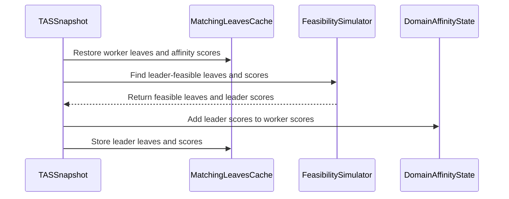

# PR #17051: TAS: rank domains by leader preferred node affinity

**Summary**: TAS: rank domains by leader preferred node affinity

**Sources**: https://github.com/kubernetes-sigs/kueue/pull/17051

**Last updated**: 2026-10-12T16:51:55Z

---

## Metadata

- **State**: open
- **Author**: [@adibmbrk](https://github.com/adibmbrk)
- **Branch**: `tas-leader-preferred-affinity` → `main`
- **Created**: 2026-10-10T11:11:43Z
- **Updated**: 2026-10-12T16:51:55Z
- **Merged**: —
- **Closed**: —
- **Labels**: `kind/bug`, `release-note`, `size/L`, `ok-to-test`, `cncf-cla: yes`, `area/tas`
- **Assignees**: _none_
- **Requested reviewers**: [@amy](https://github.com/amy), [@sohankunkerkar](https://github.com/sohankunkerkar)
- **Changed files**: 2   **+177 / -52**

## Description

#### What type of PR is this?

/kind feature
/area tas

#### What this PR does / why we need it?

With `TASLeaderPodSetFeasibility`, the leader's preferred node affinity was ignored when ranking domains for a PodSet group. Now a leaf's score is the workers' matching preferred weights plus the leader's, on the leaves the leader can run on. Scores still sum up the tree, and ties still fall back to capacity. Required feasibility filtering is unchanged.

It also fixes two existing scoring issues that would skew the combined score:
- With `TASCacheNodeMatchResults`, a cache hit dropped the affinity scores. The cache now stores them.
- The workers' score was counted twice per leaf.

Fixes #15569

#### Useful notes for your reviewer

- `TestLeaderPodSetFeasibilityKeepsWorkerAffinityScores` asserted the old behavior. It is replaced by `TestLeaderPodSetFeasibilityAddsLeaderAffinityScores`.
- `TestLeaderPreferredNodeAffinityRanksDomains` covers leader-only, worker-only and conflicting preferences, plus a leader preference against its required node selector. It runs with the cache on and off, over two cycles.
- Ran `go test ./pkg/cache/... ./pkg/scheduler/...` and `make ci-lint`: both pass. Locally, `make verify` passed everything except `verify-skills-lint` (Docker unavailable) and `kueuectl-docs` / `verify-artifacts` (out of disk space).

AI disclosure: this change was written with help from Claude Code. I reviewed it.

#### Release note

```release-note
TAS: Domain ranking for a PodSet group now adds the leader's preferred node affinity weights to the workers' when `TASLeaderPodSetFeasibility` and `TASRespectNodeAffinityPreferred` are enabled. Also fixed a bug where preferred node affinity could be ignored when `TASCacheNodeMatchResults` reused cached node matches.
```


<!-- This is an auto-generated comment: release notes by coderabbit.ai -->

## AI summary

With `TASLeaderPodSetFeasibility` enabled, TAS now ranks domains using preferred node affinity scores from both workers and the leader. The leader’s score applies only to domains where the leader can run. Required-feasibility filtering remains unchanged.

### Suggested release note

TAS: Fixed domain ranking for PodSet groups using `TASLeaderPodSetFeasibility` so that preferred node affinity scores from feasible leader placements contribute alongside worker scores.

<!-- end of auto-generated comment: release notes by coderabbit.ai -->

## Discussion

### Comment by [@netlify[bot]](https://github.com/apps/netlify) — 2026-10-10T11:11:50Z

### <span aria-hidden="true">✅</span> Deploy Preview for *kubernetes-sigs-kueue* ready!


|  Name | Link |
|:-:|------------------------|
|<span aria-hidden="true">🔨</span> Latest commit | bacc4997c7d2f2cecf7aa9837a4cdfe629cfb97f |
|<span aria-hidden="true">🔍</span> Latest deploy log | https://app.netlify.com/projects/kubernetes-sigs-kueue/deploys/6aca1d72cfef520007fe3356 |
|<span aria-hidden="true">😎</span> Deploy Preview | [https://deploy-preview-17051--kubernetes-sigs-kueue.netlify.app](https://deploy-preview-17051--kubernetes-sigs-kueue.netlify.app) |
|<span aria-hidden="true">📱</span> Preview on mobile | <details><summary> Toggle QR Code... </summary><br /><br /><br /><br />_Use your smartphone camera to open QR code link._</details> |
---
<!-- [kubernetes-sigs-kueue Preview](https://deploy-preview-17051--kubernetes-sigs-kueue.netlify.app) -->
_To edit notification comments on pull requests, go to your [Netlify project configuration](https://app.netlify.com/projects/kubernetes-sigs-kueue/configuration/notifications#deploy-notifications)._

### Comment by [@kubernetes-prow[bot]](https://github.com/apps/kubernetes-prow) — 2026-10-10T11:11:54Z

Hi @adibmbrk. Thanks for your PR.

I'm waiting for a [kubernetes-sigs](https://github.com/orgs/kubernetes-sigs/people) member to verify that this patch is reasonable to test. If it is, they should reply with `/ok-to-test` on its own line. Until that is done, I will not automatically test new commits in this PR, but the usual testing commands by org members will still work.

>[!TIP]
>**We noticed you've done this a few times! Consider [joining the org](https://git.k8s.io/community/community-membership.md#member) to skip this step and gain `/lgtm` and other bot rights.** We recommend asking approvers on your previous PRs to sponsor you.

Once the patch is verified, the new status will be reflected by the `ok-to-test` label.

I understand the commands that are listed [here](https://go.k8s.io/bot-commands?repo=kubernetes-sigs%2Fkueue).

<details>

Instructions for interacting with me using PR comments are available [here](https://git.k8s.io/community/contributors/guide/pull-requests.md).  If you have questions or suggestions related to my behavior, please file an issue against the [kubernetes-sigs/prow](https://github.com/kubernetes-sigs/prow/issues/new?title=Prow%20issue:) repository.
</details>

### Comment by [@kubernetes-prow[bot]](https://github.com/apps/kubernetes-prow) — 2026-10-10T11:12:01Z

[APPROVALNOTIFIER] This PR is **NOT APPROVED**

This pull-request has been approved by: *<a href="https://github.com/kubernetes-sigs/kueue/pull/17051#" title="Author self-approved">adibmbrk</a>*
**Once this PR has been reviewed and has the lgtm label**, please assign [mbobrovskyi](https://github.com/mbobrovskyi), [sohankunkerkar](https://github.com/sohankunkerkar) for approval. For more information see [the Code Review Process](https://git.k8s.io/community/contributors/guide/owners.md#the-code-review-process).

The full list of commands accepted by this bot can be found [here](https://go.k8s.io/bot-commands?repo=kubernetes-sigs%2Fkueue).

<details open>
Needs approval from an approver in each of these files:

- **[OWNERS](https://github.com/kubernetes-sigs/kueue/blob/main/OWNERS)**

Approvers can indicate their approval by writing `/approve` in a comment
Approvers can cancel approval by writing `/approve cancel` in a comment
</details>
<!-- META={"approvers":["mbobrovskyi","sohankunkerkar"]} -->

### Comment by [@coderabbitai[bot]](https://github.com/apps/coderabbitai) — 2026-10-10T11:12:33Z

<!-- This is an auto-generated comment: summarize by coderabbit.ai -->
<!-- review_stack_entry_start -->

<a href="https://app.coderabbit.ai/change-stack/kubernetes-sigs/kueue/pull/17051?scope=ghh_OusAJGA4HG8ljoOV0wJvVx8NmnZIjc2DdjmxOu0xZWA&amp;cs_source=review_comment"><picture><source media="(prefers-color-scheme: dark)" srcset="https://storage.googleapis.com/coderabbit_public_assets/review-stack-in-coderabbit-ui-dark.svg?v=3"><source media="(prefers-color-scheme: light)" srcset="https://storage.googleapis.com/coderabbit_public_assets/review-stack-in-coderabbit-ui.svg?v=3"></picture></a>

<!-- review_stack_entry_end -->
<!-- recent_review_start -->

No actionable comments were generated in the recent review. 🎉

<details>
<summary><strong>ℹ️ Recent review info</strong></summary>
<dl>
<dd>
<dl>
<dd>
<dl>
<dd>
<dl>
<dd>
<dl>
<dd>

<details>
<summary><strong>⚙️ Run configuration</strong></summary>
<dl>
<dd>
<dl>
<dd>
<dl>
<dd>
<dl>
<dd>
<dl>
<dd>

- **Configuration used**: Repository: kubernetes-sigs/kueue/.coderabbit.yaml
- **Review profile**: CHILL
- **Plan**: Advanced
- **Run ID**: `fe61e345-8222-4157-b377-09cdab5411f1`

<hr>

</dd>
</dl>

<hr>

</dd>
</dl>

<hr>

</dd>
</dl>

<hr>

</dd>
</dl>

<hr>

</dd>
</dl>
</details>

<details>
<summary><strong>📥 Commits</strong></summary>
<dl>
<dd>
<dl>
<dd>
<dl>
<dd>
<dl>
<dd>
<dl>
<dd>

Reviewing files that changed from the base of the PR and between b91d0e96a1dd9a9891abdef59cfa0475482b316d and bacc4997c7d2f2cecf7aa9837a4cdfe629cfb97f.

<hr>

</dd>
</dl>

<hr>

</dd>
</dl>

<hr>

</dd>
</dl>

<hr>

</dd>
</dl>

<hr>

</dd>
</dl>
</details>

<details>
<summary><strong>📒 Files selected for processing (2)</strong></summary>
<dl>
<dd>
<dl>
<dd>
<dl>
<dd>
<dl>
<dd>
<dl>
<dd>

* `pkg/cache/scheduler/tas_flavor_snapshot.go`
* `pkg/cache/scheduler/tas_flavor_snapshot_test.go`

<hr>

</dd>
</dl>

<hr>

</dd>
</dl>

<hr>

</dd>
</dl>

<hr>

</dd>
</dl>

<hr>

</dd>
</dl>
</details>

**Included review availability:** This review used your included allowance. Your plan provides up to 8 included reviews per hour; 7 remain after this review.

<hr>

</dd>
</dl>

<hr>

</dd>
</dl>

<hr>

</dd>
</dl>

<hr>

</dd>
</dl>

<hr>

</dd>
</dl>
</details>

---


<!-- recent_review_end -->
<!-- walkthrough_start -->

<details>
<summary><strong>📝 Walkthrough</strong></summary>
<dl>
<dd>

<details>
<summary><strong>📝 Walkthrough</strong></summary>
<dl>
<dd>

<details>
<summary><strong>📝 Walkthrough</strong></summary>
<dl>
<dd>
<dl>
<dd>

<details>
<summary><strong>📝 Walkthrough</strong></summary>
<dl>
<dd>
<dl>
<dd>
<dl>
<dd>

<details>
<summary><strong>📝 Walkthrough</strong></summary>
<dl>
<dd>
<dl>
<dd>
<dl>
<dd>
<dl>
<dd>

## Walkthrough

TAS domain ranking now includes leader preferred-affinity scores alongside worker scores on leader-feasible leaves. The matching cache stores and restores affinity scores. Tests cover combined preference weights, repeated scheduling, cache settings, and required node selectors.

### Changes

**TAS Leader Affinity Ranking**

|Layer / File(s)|Summary|
|:---|:---|
|**Preserve worker affinity scores in matching cache** <br> `pkg/cache/scheduler/tas_flavor_snapshot.go`|Matching cache entries store affinity scores with leaves and exclusion statistics. Cache hits restore the stored scores to leaf state.|
|**Add leader affinity to domain ranking** <br> `pkg/cache/scheduler/tas_flavor_snapshot.go`, `pkg/cache/scheduler/tas_flavor_snapshot_test.go`|Leader-feasible leaves receive leader affinity scores in addition to worker scores. Cached leader results reuse matching leaves and scores. Tests cover preference weights, cache settings, repeated scheduling, and required selectors.|

<!-- change_assessment_start -->
**Priority:** ⬇️ Low


**Estimated code review effort:** 3 (Moderate) | ~20 minutes

<!-- change_assessment_commit:"bacc4997c7d2f2cecf7aa9837a4cdfe629cfb97f" -->
**Change:** Feature
<!-- change_assessment_end -->

### Sequence Diagram(s)



**Suggested reviewers:** `sohankunkerkar`

<hr>

</dd>
</dl>

<hr>

</dd>
</dl>

<hr>

</dd>
</dl>

<hr>

</dd>
</dl>
</details>

<hr>

</dd>
</dl>

<hr>

</dd>
</dl>

<hr>

</dd>
</dl>
</details>

<hr>

</dd>
</dl>

<hr>

</dd>
</dl>
</details>

<hr>

</dd>
</dl>
</details>

<hr>

</dd>
</dl>
</details>

<!-- walkthrough_end -->
<!-- final_review_risk_start -->
**Merge Risk:** **⚪ Minimal** · up to `bacc4`
<!-- final_review_risk_coverage:{"sourceCommitId":"bacc4997c7d2f2cecf7aa9837a4cdfe629cfb97f","coveredCommitId":"bacc4997c7d2f2cecf7aa9837a4cdfe629cfb97f","kind":"reviewed"} -->

No actionable merge-blocking issue was established; this change is mergeable after normal checks.
<!-- final_review_risk_end -->
<!-- pre_merge_checks_walkthrough_start -->

<details>
<summary><strong>Pre-merge checks | <sup><picture></picture></sup> 4 | <sup><picture></picture></sup> 1</strong></summary>
<dl>
<dd>

### ❌ Failed checks (1 warning)

|     Check name     |                                              Status                                              | Explanation                                                                                                                                                                                | Resolution                                                                         |
| :---------------- | :----------------------------------------------------------------------------------------------: | :----------------------------------------------------------------------------------------------------------------------------------------------------------------------------------------- | :--------------------------------------------------------------------------------- |
| Docstring Coverage |  | Docstring coverage is 75.00% which is insufficient. The required threshold is 80.00%. Docstring coverage is scoped to functions touched by this diff. Analyzed 4 functions across 2 files. | Write docstrings for the functions missing them to satisfy the coverage threshold. |

<details>
<summary><strong>✅ Passed checks (4 passed)</strong></summary>
<dl>
<dd>

|         Check name         |                                             Status                                             | Explanation                                                                                                                                                                                               |
| :------------------------ | :--------------------------------------------------------------------------------------------: | :-------------------------------------------------------------------------------------------------------------------------------------------------------------------------------------------------------- |
|     Linked Issues check    |  | Issue [`#15569`] has three coding requirements. `fillLeaderFeasibleLeaves` adds leader affinity scores only on leader-feasible leaves. `domainState.affinityScore` therefore combines worker and leader sc… |
| Out of Scope Changes check |  | The cache changes and the double-counting fix support the ranking behavior required by issue [`#15569`]. The focused source changes update leader scoring, score preservation, and cache reuse. The added … |
|      Description Check     |  | Check skipped - CodeRabbit’s high-level summary is enabled.                                                                                                                                               |
|         Title check        |  | The title clearly and concisely describes the main change: ranking TAS domains by leader preferred node affinity.                                                                                         |

</dd>
</dl>
</details>

<hr>

</dd>
</dl>
</details>

<!-- pre_merge_checks_walkthrough_end -->

- [ ] <!-- {"checkboxId":"585bb3f6-faf5-4dbf-96d2-74e382adf19a"} --> Fix all pre-merge checks with AI
<!-- finishing_touch_checkbox_start -->

<details>
<summary><strong>✨ Finishing Touches</strong></summary>
<dl>
<dd>
<dl>
<dd>
<dl>
<dd>
<dl>
<dd>
<dl>
<dd>

<details open>
<summary><strong>🧪 Generate unit tests (beta)</strong></summary>
<dl>
<dd>
<dl>
<dd>
<dl>
<dd>
<dl>
<dd>
<dl>
<dd>

- [ ] <!-- {"checkboxId": "f47ac10b-58cc-4372-a567-0e02b2c3d479", "radioGroupId": "utg-output-choice-group-unknown_comment_id"} --> Create a new PR

</dd>
</dl>

<hr>

</dd>
</dl>

<hr>

</dd>
</dl>

<hr>

</dd>
</dl>

<hr>

</dd>
</dl>
</details>

<hr>

</dd>
</dl>

<hr>

</dd>
</dl>

<hr>

</dd>
</dl>

<hr>

</dd>
</dl>

<hr>

</dd>
</dl>
</details>

<!-- finishing_touch_checkbox_end -->

<!-- autopilot:start -->
- [ ] <!-- {"checkboxId":"2708ad07-9f24-4260-9c11-7dc76a49f2e3"} --> <strong title="Keep fixing CodeRabbit findings and required CI, and resolving merge conflicts">Autofix</strong> · Keep fixing CodeRabbit findings and required CI, and resolving merge conflicts
<!-- autopilot:end -->
<!-- tips_start -->

---


<sub>Comment `@coderabbitai help` to get the list of available commands.</sub>

<!-- tips_end -->

### Comment by [@thc1006](https://github.com/thc1006) — 2026-10-11T07:37:05Z

/ok-to-test

### Comment by [@mimowo](https://github.com/mimowo) — 2026-10-12T10:54:00Z

I think this should be considered a bug / omission. I think we prioritized workers for the ease of delivery, but skipping leaders seems buggy.

### Comment by [@mimowo](https://github.com/mimowo) — 2026-10-12T10:55:27Z

/remove-kind feature
/kind bug
Let me know if you have another PoV. cc @sohankunkerkar

cc @j-skiba ptal

### Comment by [@sohankunkerkar](https://github.com/sohankunkerkar) — 2026-10-12T16:51:55Z

> /remove-kind feature /kind bug Let me know if you have another PoV. cc @sohankunkerkar
> 
> cc @j-skiba ptal

I agree it's an omission. I asked for this follow-up on #15447 because we left the leader out on purpose there. My only worry with `kind/bug` is the cherry-pick: @j-skiba's example shows we still need to decide how the leader and worker scores combine, and I wouldn't backport a ranking change while that's open. 

The cache fix is a clear bug on its own, since with `TASCacheNodeMatchResults` a cache hit drops the preferred scores. I'd split it into a small PR we can pick to 0.20 and 0.19, and keep this one for the leader scoring.

## Reviews

### Review by [@j-skiba](https://github.com/j-skiba) (commented) — 2026-10-12T13:04:20Z

The general idea to respect leader affinity totally makes sense, though I have some comments.

#### 1. Summing leader and worker affinity scores into a single value
This approach might lead to some non-optimal placements. Let's consider the following setup:

Suppose a rack has 3 nodes (each fitting 1 pod: `podCount=1, leaderCount=1, podCountWithLeader=0`) for a 1 leader + 1 worker group:
- `n1`: matches worker preferences (`workerScore=100, leaderScore=0` -> `affinityScore=100`)
- `n2`: matches leader preference (`workerScore=0, leaderScore=50` -> `affinityScore=50`)
- `n3`: matches neither (`affinityScore=0`)

In phase 2b `sortedDomains` Kueue orders children `[n1 (100), n2(50), n3(0)]`. Because the leader is assigned first to the front of the list the leader takes `n1` with `leaderScore=0` and the worker gets `n2` with `workerScore=0`.

That's why I think we should keep affinity scores for workers and leaders in separate fields.

Multiple workers can spread across many nodes in a domain, so summing worker `affinityScore` across children makes sense. However, a podset group only ever has 1 leader (`fillInCountsHelper` already rolls up `leaderCount` using `max(child.leaderCount, leaderCount)` rather than summing). Keeping `leaderAffinityScore` separate lets us roll it up with `max(leaderAffinityScore, child.leaderAffinityScore)` across leader-eligible children—a a parent domain's leader score reflects the best single node the leader can actually land on, rather than multiplying the leader's preference by the number of nodes in the domain.

#### 2. (if no. `1` makes sense then...) Selecting a domain for the whole group (`sortedDomainsWithLeader`)

The second knob in `sortedDomainsWithLeader` is comparing affinityScores which if we split them generates some problems because leaderScore would be calculated using `max` while worker scores would be calculated using `sum` makes leader score less significant. Maybe we could calculate per pod weight or something like this.

#### 3. Artificial inflated affinity score

This is closely connected to `1`, but worth calling out separately: the current approach artificially inflates a parent domain's `affinityScore`. Because a PodSet group only ever has one leader, the leader can only land on a single node, yet its affinity score is added to every leader-feasible leaf and summed up across all children in the domain.
