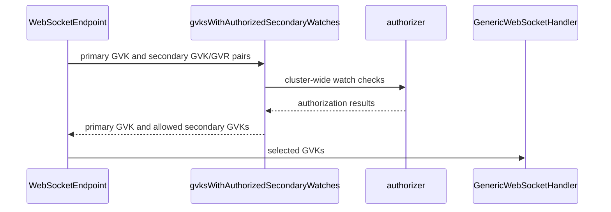

# PR #17207: KueueViz: gate secondary websocket informers on watch access

**Summary**: KueueViz: gate secondary websocket informers on watch access

**Sources**: https://github.com/kubernetes-sigs/kueue/pull/17207

**Last updated**: 2026-10-19T11:49:04Z

---

## Metadata

- **State**: open
- **Author**: [@HarshithaMS005](https://github.com/HarshithaMS005)
- **Branch**: `kueueviz-gate-secondary-websocket-informers` → `main`
- **Created**: 2026-10-14T16:34:24Z
- **Updated**: 2026-10-19T11:49:04Z
- **Merged**: —
- **Closed**: —
- **Labels**: `kind/bug`, `release-note`, `size/XL`, `needs-rebase`, `cncf-cla: yes`, `area/dashboard`
- **Assignees**: _none_
- **Requested reviewers**: [@akram](https://github.com/akram), [@amy](https://github.com/amy)
- **Changed files**: 6   **+530 / -25**

## Description

#### What type of PR is this?
/kind bug

/area dashboard

#### What this PR does / why we need it
Multi-resource KueueViz websockets registered secondary informers without checking cluster-wide `watch` permission. A change to Pods, ClusterQueues, LocalQueues, ResourceFlavors, or Nodes could push a live update to a caller who is not allowed to watch that resource.

Before each secondary GVK is passed to `GenericWebSocketHandler`, the handler now checks `authorizer.Authorize(ctx, identity, middleware.ResourceAccess("watch", gvr, "", ""))`, following `/ws/namespaces`:

- Denied secondary resources do not register informer event handlers.
- Allowed secondary resources still stream live updates.
- Initial snapshots keep the existing list authorization checks.
- Authorization errors fail closed with the WebSocket-aware service-unavailable response.
- Behavior is unchanged when no authorizer is configured.

Fixes #17177

#### Useful notes for your reviewer

This pull request was prepared with AI assistance.

Affected endpoints:

- `/ws/workloads/dashboard` gates Pods, ClusterQueues, LocalQueues, and ResourceFlavors
- `/ws/cohorts` and `/ws/cohort/:cohort_name` gate ClusterQueues
- `/ws/cluster-queue/:cluster_queue_name` gates LocalQueues
- `/ws/resource-flavor/:flavor_name` gates ClusterQueues and Nodes

The primary resource is unchanged: route middleware still requires watch access for it, and its informer stays registered when secondary checks succeed.

#### Release note

```release-note
KueueViz: Fixed a bug where the workloads dashboard, cohort, ClusterQueue, and ResourceFlavor websockets could push live updates when a related resource changed, even if the caller lacked cluster-wide watch permission for that resource. Callers without that permission still receive the initial snapshot filtered by their list permissions.
```

<!-- This is an auto-generated comment: release notes by coderabbit.ai -->
## AI summary

KueueViz now checks cluster-wide `watch` access before registering secondary resource informers on the affected WebSocket endpoints. Users without access no longer receive live updates triggered by those resources. Initial snapshot authorization remains unchanged, and endpoints retain their existing behavior when no authorizer is configured.

### Suggested release note

KueueViz: Fixed a bug where changes to secondary resources could trigger live updates on WebSocket endpoints even when the user lacked cluster-wide `watch` access. KueueViz now checks access before registering secondary informers.
<!-- end of auto-generated comment: release notes by coderabbit.ai -->

## Discussion

### Comment by [@linux-foundation-easycla[bot]](https://github.com/apps/linux-foundation-easycla) — 2026-10-14T16:34:34Z

<a href="https://easycla.lfx.linuxfoundation.org/#/?version=2"></a><br >The committers listed above are authorized under a signed CLA.<ul><li>:white_check_mark: login: HarshithaMS005 / name: Harshitha MS (f12f5ba1f4711b9c7a5f4fdb0b3927df801de408)</li></ul>

### Comment by [@netlify[bot]](https://github.com/apps/netlify) — 2026-10-14T16:34:35Z

### <span aria-hidden="true">✅</span> Deploy Preview for *kubernetes-sigs-kueue* canceled.


|  Name | Link |
|:-:|------------------------|
|<span aria-hidden="true">🔨</span> Latest commit | f12f5ba1f4711b9c7a5f4fdb0b3927df801de408 |
|<span aria-hidden="true">🔍</span> Latest deploy log | https://app.netlify.com/projects/kubernetes-sigs-kueue/deploys/6acfb0aabc132707c6edc5b0 |

### Comment by [@kubernetes-prow[bot]](https://github.com/apps/kubernetes-prow) — 2026-10-14T16:34:41Z

[APPROVALNOTIFIER] This PR is **NOT APPROVED**

This pull-request has been approved by: *<a href="https://github.com/kubernetes-sigs/kueue/pull/17207#" title="Author self-approved">HarshithaMS005</a>*
**Once this PR has been reviewed and has the lgtm label**, please assign [tenzen-y](https://github.com/tenzen-y) for approval. For more information see [the Code Review Process](https://git.k8s.io/community/contributors/guide/owners.md#the-code-review-process).

The full list of commands accepted by this bot can be found [here](https://go.k8s.io/bot-commands?repo=kubernetes-sigs%2Fkueue).

<details open>
Needs approval from an approver in each of these files:

- **[OWNERS](https://github.com/kubernetes-sigs/kueue/blob/main/OWNERS)**

Approvers can indicate their approval by writing `/approve` in a comment
Approvers can cancel approval by writing `/approve cancel` in a comment
</details>
<!-- META={"approvers":["tenzen-y"]} -->

### Comment by [@coderabbitai[bot]](https://github.com/apps/coderabbitai) — 2026-10-14T16:35:21Z

<!-- This is an auto-generated comment: summarize by coderabbit.ai -->
<!-- review_stack_entry_start -->

<a href="https://app.coderabbit.ai/change-stack/kubernetes-sigs/kueue/pull/17207?scope=ghh_OusAJGA4HG8ljoOV0wJvVx8NmnZIjc2DdjmxOu0xZWA&amp;cs_source=review_comment"><picture><source media="(prefers-color-scheme: dark)" srcset="https://storage.googleapis.com/coderabbit_public_assets/review-stack-in-coderabbit-ui-dark.svg?v=3"><source media="(prefers-color-scheme: light)" srcset="https://storage.googleapis.com/coderabbit_public_assets/review-stack-in-coderabbit-ui.svg?v=3"></picture></a>

<!-- review_stack_entry_end -->
<!-- recent_review_start -->

No actionable comments were generated in the recent review. 🎉

<details>
<summary><strong>ℹ️ Recent review info</strong></summary>
<dl>
<dd>

<details>
<summary><strong>⚙️ Run configuration</strong></summary>
<dl>
<dd>

- **Configuration used**: Repository: kubernetes-sigs/kueue/.coderabbit.yaml
- **Review profile**: CHILL
- **Plan**: Advanced
- **Run ID**: `f9e92710-ee6f-4c1e-9464-f9a42583ff6b`

</dd>
</dl>
</details>

<details>
<summary><strong>📥 Commits</strong></summary>
<dl>
<dd>

Reviewing files that changed from the base of the PR and between caa49ac0d1eb75b05d24cc25d989f465d3b3b125 and f12f5ba1f4711b9c7a5f4fdb0b3927df801de408.

</dd>
</dl>
</details>

<details>
<summary><strong>📒 Files selected for processing: 6</strong></summary>
<dl>
<dd>

* `cmd/kueueviz/backend/handlers/cluster_queues.go`
* `cmd/kueueviz/backend/handlers/cohorts.go`
* `cmd/kueueviz/backend/handlers/resource_flavors.go`
* `cmd/kueueviz/backend/handlers/secondary_watch_test.go`
* `cmd/kueueviz/backend/handlers/websocket_handler.go`
* `cmd/kueueviz/backend/handlers/workloads_dashboard.go`

</dd>
</dl>
</details>

**Included review availability:** This review used your included allowance. Your plan provides up to 8 included reviews per hour; 7 remain after this review.

</dd>
</dl>
</details>


<!-- recent_review_end -->
<!-- walkthrough_start -->

<details>
<summary><strong>📝 Walkthrough</strong></summary>
<dl>
<dd>

Secondary informer watches in KueueViz WebSocket handlers now depend on cluster-wide watch authorization. The primary watch remains included. Authorization errors return a WebSocket-aware service-unavailable response. New tests cover authorization outcomes and informer behavior.

**Changes: Secondary watch authorization**

|Layer / File(s)|Summary|
|:---|:---|
|**Select authorized watch kinds** <br> `cmd/kueueviz/backend/handlers/websocket_handler.go`|The helper always includes the primary GVK. It includes secondary GVKs based on watch authorization, and returns a WebSocket-aware 503 if authorization fails.|
|**Apply authorization across WebSocket endpoints** <br> `cmd/kueueviz/backend/handlers/workloads_dashboard.go`, `cmd/kueueviz/backend/handlers/cohorts.go`, `cmd/kueueviz/backend/handlers/cluster_queues.go`, `cmd/kueueviz/backend/handlers/resource_flavors.go`|The dashboard, cohort, cluster-queue detail, and resource-flavor detail handlers now pass secondary watches through the authorization helper.|
|**Verify authorization and informer behavior** <br> `cmd/kueueviz/backend/handlers/secondary_watch_test.go`|Tests cover no authorizer, allowed and denied watches, authorization errors, informer registration, and live updates from allowed secondary informers.|

<!-- change_assessment_start -->
**Priority:** ➖ Normal

**Estimated code review effort:** 3 (Moderate) | ~25 minutes

<!-- change_assessment_commit:"f12f5ba1f4711b9c7a5f4fdb0b3927df801de408" -->
**Change:** Bug fix · **Severity of issue fixed:** Medium
<!-- change_assessment_end -->

### Sequence Diagram(s)



</dd>
</dl>
</details>

<!-- walkthrough_end -->
<details>
<summary><strong>Merge Risk:</strong> <strong>⚪ Minimal</strong> · up to <code>f12f5</code></summary>
<dl>
<dd>

<!-- final_review_risk_start -->
<!-- final_review_risk_label
**Merge Risk:** **⚪ Minimal** · up to `f12f5`
-->
<!-- final_review_risk_coverage:{"sourceCommitId":"f12f5ba1f4711b9c7a5f4fdb0b3927df801de408","coveredCommitId":"f12f5ba1f4711b9c7a5f4fdb0b3927df801de408","kind":"reviewed"} -->

The secondary-watch authorization change is mergeable after normal checks.
<!-- final_review_risk_end -->

</dd>
</dl>
</details>

<details>
<summary><strong>Security architecture risk:</strong> <strong>⚪ Minimal</strong> · up to <code>f12f5</code></summary>
<dl>
<dd>

<!-- architecture_review_start -->
<!-- architecture_review_label
### Security Architecture Review

**Security architecture risk:** **⚪ Minimal** · up to `f12f5`
-->

The new checks narrow secondary live-update access without granting additional permissions or changing snapshot contents. No material security risk introduced or worsened by this change was identified. Existing snapshot and connection-lifetime authorization limitations remain.

**Retained concerns**
No architecture-level concerns identified.


<details>
<summary><strong>Security review details</strong></summary>
<dl>
<dd>

**Security Blast Radius**
- _inferred_ — The changed control applies to cluster-wide secondary event notifications for Pods, ClusterQueues, LocalQueues, ResourceFlavors, and Nodes across five WebSocket endpoints. It narrows which events can cause client-visible refetches; it does not increase caller resource privileges.

**Trust Boundaries and Controls**
- _observed_ — Existing middleware authorizes primary resources before endpoint execution. The new gate uses the request identity to authorize each secondary resource separately. Detail fetchers retain their existing secondary list checks, including namespace-specific LocalQueue and Pod filtering; these content checks are distinct from watch authorization.

**Resilience and Maintainability Implications**
- _observed_ — Secondary watch decisions are made once per connection. Periodic validation checks token validity, not each resource's watch permission. A subsequent watch revocation therefore does not itself remove an existing registration. The PR does not worsen the previous unconditional secondary-registration exposure, but it does not establish immediate revocation enforcement.

**Hardening Proposals**
- _proposed_ — As separate hardening, consider aligning cohort-list snapshot authorization with the detail endpoint's ClusterQueue list checks and defining the intended watch-revocation behavior for long-lived connections. These are pre-existing policy boundaries, not PR-introduced findings.

</dd>
</dl>
</details>

<!-- architecture_review_end -->

</dd>
</dl>
</details>
<!-- pre_merge_checks_walkthrough_start -->

<details>
<summary><strong>Pre-merge checks: <sup><picture></picture></sup> 4 · <sup><picture></picture></sup> 1</strong></summary>
<dl>
<dd>

<strong><sup><picture></picture></sup> Failed checks: 1 warning</strong>

|     Check name     |                                              Status                                              | Explanation                                                                                                                                                                               | Resolution                                                                         |
| :---------------- | :----------------------------------------------------------------------------------------------: | :---------------------------------------------------------------------------------------------------------------------------------------------------------------------------------------- | :--------------------------------------------------------------------------------- |
| Docstring Coverage |  | Docstring coverage is 0.00% which is insufficient. The required threshold is 80.00%. Docstring coverage is scoped to functions touched by this diff. Analyzed 8 functions across 6 files. | Write docstrings for the functions missing them to satisfy the coverage threshold. |

<details>
<summary><strong><sup><picture></picture></sup> Passed checks: 4 passed</strong></summary>
<dl>
<dd>

|         Check name         |                                             Status                                             | Explanation                                                                                                                                                                                               |
| :------------------------ | :--------------------------------------------------------------------------------------------: | :-------------------------------------------------------------------------------------------------------------------------------------------------------------------------------------------------------- |
|      Description Check     |  | Check skipped - CodeRabbit’s high-level summary is enabled.                                                                                                                                               |
|         Title check        |  | The title clearly and concisely summarizes the main change: secondary WebSocket informer watches now require watch authorization.                                                                         |
|     Linked Issues check    |  | Issue [`#17177`] requires watch checks for secondary informers on five KueueViz WebSocket endpoint groups. The PR adds `gvksWithAuthorizedSecondaryWatches`, which checks each secondary GVR with `Resourc… |
| Out of Scope Changes check |  | The changes are limited to secondary informer authorization in the affected KueueViz WebSocket handlers, the shared helper that applies the checks, and regression tests. The endpoint updates support i… |

</dd>
</dl>
</details>

</dd>
</dl>
</details>

<!-- pre_merge_checks_walkthrough_end -->

- [ ] <!-- {"checkboxId":"585bb3f6-faf5-4dbf-96d2-74e382adf19a"} --> Fix all pre-merge checks with AI
<!-- finishing_touch_checkbox_start -->

<details>
<summary><strong>✨ Finishing Touches</strong></summary>
<dl>
<dd>

<details open>
<summary><strong>🧪 Generate unit tests (beta)</strong></summary>
<dl>
<dd>

- [ ] <!-- {"checkboxId": "f47ac10b-58cc-4372-a567-0e02b2c3d479", "radioGroupId": "utg-output-choice-group-unknown_comment_id"} --> Create a new PR

</dd>
</dl>
</details>

</dd>
</dl>
</details>

<!-- finishing_touch_checkbox_end -->

<!-- autopilot:start -->
- [ ] <!-- {"checkboxId":"2708ad07-9f24-4260-9c11-7dc76a49f2e3"} --> <strong title="Keep fixing CodeRabbit findings and required CI, and resolving merge conflicts">Autofix</strong> · Keep fixing CodeRabbit findings and required CI, and resolving merge conflicts
<!-- autopilot:end -->
<!-- tips_start -->


<sub>Comment `@coderabbitai help` to get the list of available commands.</sub>

<!-- tips_end -->

### Comment by [@kubernetes-prow[bot]](https://github.com/apps/kubernetes-prow) — 2026-10-16T07:24:56Z

PR needs rebase.

<details>

Instructions for interacting with me using PR comments are available [here](https://git.k8s.io/community/contributors/guide/pull-requests.md).  If you have questions or suggestions related to my behavior, please file an issue against the [kubernetes-sigs/prow](https://github.com/kubernetes-sigs/prow/issues/new?title=Prow%20issue:) repository.
</details>

## Reviews

### Review by [@danylott](https://github.com/danylott) (commented) — 2026-10-19T11:49:03Z

In https://github.com/kubernetes-sigs/kueue/pull/17088 very similar code is introduced actually.

And I see that here you're using a nice helper gvksWithAuthorizedSecondaryWatches,
wdyt, maybe we somehow can modify it to also support namespaces?

Then we'll be able to remove some boilerplate code from handlers/namespaces.go
