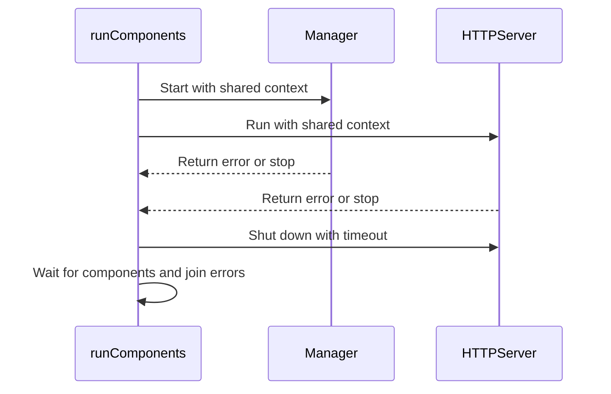

# PR #17230: kueueviz: Gracefully shut down backend components

**Summary**: kueueviz: Gracefully shut down backend components

**Sources**: https://github.com/kubernetes-sigs/kueue/pull/17230

**Last updated**: 2026-10-20T07:40:33Z

---

## Metadata

- **State**: closed (merged)
- **Author**: [@fat-catTW](https://github.com/fat-catTW)
- **Branch**: `fix/kueueviz-graceful-shutdown` → `main`
- **Created**: 2026-10-15T03:41:46Z
- **Updated**: 2026-10-20T07:40:33Z
- **Merged**: 2026-10-20T07:39:09Z
- **Closed**: 2026-10-20T07:39:09Z
- **Labels**: `kind/bug`, `release-note`, `size/L`, `lgtm`, `approved`, `ok-to-test`, `cncf-cla: yes`, `area/dashboard`
- **Assignees**: [@mimowo](https://github.com/mimowo), [@danylott](https://github.com/danylott)
- **Requested reviewers**: [@akram](https://github.com/akram), [@amy](https://github.com/amy), [@danylott](https://github.com/danylott)
- **Changed files**: 2   **+272 / -28**

## Description

<!-- Thank you for contributing! Check CONTRIBUTING.md for details. -->

#### What type of PR is this?

/kind bug
/area dashboard

#### What this PR does / why we need it?

The KueueViz backend currently calls `os.Exit` from background goroutines when the controller manager or HTTP server fails. This immediately terminates the process and skips deferred cleanup and graceful HTTP shutdown.

This change reports component failures to the main control flow, cancels the shared context, gracefully shuts down the HTTP server with a timeout, and waits for both components to stop. It also preserves errors from both components when they fail during the same shutdown sequence.

#### Useful notes for your reviewer

Tests:

- `make test-kueueviz-backend`
- `go test -count=100 .`
- `git diff --check`

AI disclosure: I used Codex to help analyze the shutdown paths, implement the change, draft the tests.

#### Release note

```release-note
KueueViz: Fixed a bug where a backend component failure could prevent graceful HTTP server shutdown. KueueViz now shuts down the server and stops the components before reporting the failure.
```
<!-- Describe the behavior change accurately from the user's perspective. Hints:
- Do not leave this block blank.
- Use "NONE" when there is no user-facing change.
- When feasible use a prefix for the sub-component or feature, e.g. "FairSharing:" or "MultiKueue:".
- If upgrade steps are required, include an "ACTION REQUIRED:" section.
You may consider AI assistance using the skill: cmd/experimental/skills/kueue-release-notes/SKILL.md.
-->


<!-- This is an auto-generated comment: release notes by coderabbit.ai -->
## AI summary
KueueViz now handles backend component failures in the main control flow. It cancels the shared context, shuts down the HTTP server with a timeout, waits for both components to stop, and returns component and shutdown errors.

### Suggested release note
KueueViz: Fixed a bug where a backend component failure could prevent graceful HTTP server shutdown. KueueViz now shuts down the server and stops the components before reporting the failure.
<!-- end of auto-generated comment: release notes by coderabbit.ai -->

## Discussion

### Comment by [@netlify[bot]](https://github.com/apps/netlify) — 2026-10-15T03:41:52Z

### <span aria-hidden="true">✅</span> Deploy Preview for *kubernetes-sigs-kueue* ready!


|  Name | Link |
|:-:|------------------------|
|<span aria-hidden="true">🔨</span> Latest commit | 37252d16e49c2ec95527e427b6f65cc54cbcf867 |
|<span aria-hidden="true">🔍</span> Latest deploy log | https://app.netlify.com/projects/kubernetes-sigs-kueue/deploys/6ad71721133e4f3f72b58ac6 |
|<span aria-hidden="true">😎</span> Deploy Preview | [https://deploy-preview-17230--kubernetes-sigs-kueue.netlify.app](https://deploy-preview-17230--kubernetes-sigs-kueue.netlify.app) |
|<span aria-hidden="true">📱</span> Preview on mobile | <details><summary> Toggle QR Code... </summary><br /><br /><br /><br />_Use your smartphone camera to open QR code link._</details> |
---
<!-- [kubernetes-sigs-kueue Preview](https://deploy-preview-17230--kubernetes-sigs-kueue.netlify.app) -->
_To edit notification comments on pull requests, go to your [Netlify project configuration](https://app.netlify.com/projects/kubernetes-sigs-kueue/configuration/notifications#deploy-notifications)._

### Comment by [@kubernetes-prow[bot]](https://github.com/apps/kubernetes-prow) — 2026-10-15T03:41:57Z

Hi @fat-catTW. Thanks for your PR.

I'm waiting for a [kubernetes-sigs](https://github.com/orgs/kubernetes-sigs/people) member to verify that this patch is reasonable to test. If it is, they should reply with `/ok-to-test` on its own line. Until that is done, I will not automatically test new commits in this PR, but the usual testing commands by org members will still work.

>[!TIP]
>**We noticed you've done this a few times! Consider [joining the org](https://git.k8s.io/community/community-membership.md#member) to skip this step and gain `/lgtm` and other bot rights.** We recommend asking approvers on your previous PRs to sponsor you.

Once the patch is verified, the new status will be reflected by the `ok-to-test` label.

I understand the commands that are listed [here](https://go.k8s.io/bot-commands?repo=kubernetes-sigs%2Fkueue).

<details>

Instructions for interacting with me using PR comments are available [here](https://git.k8s.io/community/contributors/guide/pull-requests.md).  If you have questions or suggestions related to my behavior, please file an issue against the [kubernetes-sigs/prow](https://github.com/kubernetes-sigs/prow/issues/new?title=Prow%20issue:) repository.
</details>

### Comment by [@coderabbitai[bot]](https://github.com/apps/coderabbitai) — 2026-10-15T03:42:48Z

<!-- This is an auto-generated comment: summarize by coderabbit.ai -->
<!-- review_stack_entry_start -->

<a href="https://app.coderabbit.ai/change-stack/kubernetes-sigs/kueue/pull/17230?scope=ghh_OusAJGA4HG8ljoOV0wJvVx8NmnZIjc2DdjmxOu0xZWA&amp;cs_source=review_comment"><picture><source media="(prefers-color-scheme: dark)" srcset="https://storage.googleapis.com/coderabbit_public_assets/review-stack-in-coderabbit-ui-dark.svg?v=3"><source media="(prefers-color-scheme: light)" srcset="https://storage.googleapis.com/coderabbit_public_assets/review-stack-in-coderabbit-ui.svg?v=3"></picture></a>

<!-- review_stack_entry_end -->
<!-- This is an auto-generated comment: review paused by coderabbit.ai -->

> [!NOTE]
> ## Reviews paused
> 
> It looks like this branch is under active development. To avoid overwhelming you with review comments due to an influx of new commits, CodeRabbit has automatically paused this review. You can configure this behavior by changing the `reviews.auto_review.auto_pause_after_reviewed_commits` setting.
> 
> - Last reviewed commit: b64b695416622c2c304ca7c03742eb78d3275883
> - Latest commit, not reviewed: 37252d16e49c2ec95527e427b6f65cc54cbcf867
> 
> Use the following commands to manage reviews:
> - `@coderabbitai resume` to resume automatic reviews.
> - `@coderabbitai review` to trigger a single review.
> 
> Use the checkboxes below for quick actions:
> - [ ] <!-- {"checkboxId":"7f6cc2e2-2e4e-497a-8c31-c9e4573e93d1"} --> ▶️ Resume reviews
> - [ ] <!-- {"checkboxId":"e9bb8d72-00e8-4f67-9cb2-caf3b22574fe"} --> 🔍 Trigger review

<!-- end of auto-generated comment: review paused by coderabbit.ai -->
<!-- recent_review_start -->

No actionable comments were generated in the recent review. 🎉

<details>
<summary><strong>ℹ️ Recent review info</strong></summary>
<dl>
<dd>

<details>
<summary><strong>⚙️ Run configuration</strong></summary>
<dl>
<dd>

- **Configuration used**: Repository: kubernetes-sigs/kueue/.coderabbit.yaml
- **Review profile**: CHILL
- **Plan**: Advanced
- **Run ID**: `d8ebffcd-1b87-42a1-b437-d928c2807c10`

</dd>
</dl>
</details>

<details>
<summary><strong>📥 Commits</strong></summary>
<dl>
<dd>

Reviewing files that changed from the base of the PR and between 28d3d5b99d2ebb2ec9078e0c5c64fe345a47544b and b64b695416622c2c304ca7c03742eb78d3275883.

</dd>
</dl>
</details>

<details>
<summary><strong>📒 Files selected for processing: 1</strong></summary>
<dl>
<dd>

* `cmd/kueueviz/backend/main.go`

</dd>
</dl>
</details>

<details>
<summary><strong>🚧 Files skipped from review as they are similar to previous changes: 1</strong></summary>
<dl>
<dd>

* cmd/kueueviz/backend/main.go

</dd>
</dl>
</details>

**Included review availability:** This review used your included allowance. Your plan provides up to 8 included reviews per hour; 6 remain after this review.

</dd>
</dl>
</details>


<!-- recent_review_end -->
<!-- walkthrough_start -->

<details>
<summary><strong>📝 Walkthrough</strong></summary>
<dl>
<dd>

The backend returns setup errors to `main` and coordinates manager and HTTP server execution through a shared context. It collects component and shutdown errors, then waits for both components with a bounded timeout. Tests cover error aggregation and shutdown behavior.

**Changes: Backend lifecycle**

|Layer / File(s)|Summary|
|:---|:---|
|**Startup error handling** <br> `cmd/kueueviz/backend/main.go`|`main` calls `run` and exits with status 1 if it returns an error. `run` returns contextual Kubernetes-client and Gin-engine setup errors.|
|**Component lifecycle and shutdown** <br> `cmd/kueueviz/backend/main.go`, `cmd/kueueviz/backend/main_test.go`|`runComponents` runs the manager and HTTP server with a shared context. Component failures or unexpected stops trigger cancellation. It shuts down the HTTP server, waits for both components, and joins errors. Tests cover component outcomes, cleanup failures, timeouts, and completed components when the context is canceled.|

<!-- change_assessment_start -->
**Priority:** ⬇️ Low


**Estimated code review effort:** 3 (Moderate) | ~20 minutes

<!-- change_assessment_commit:"b64b695416622c2c304ca7c03742eb78d3275883" -->
**Change:** Bug fix
<!-- change_assessment_end -->

### Sequence Diagram(s)



</dd>
</dl>
</details>

<!-- walkthrough_end -->
<details>
<summary><strong>Merge Risk:</strong> <strong>⚪ Minimal</strong> · up to <code>b64b6</code></summary>
<dl>
<dd>

<!-- final_review_risk_start -->
<!-- final_review_risk_label
**Merge Risk:** **⚪ Minimal** · up to `b64b6`
-->
<!-- final_review_risk_coverage:{"sourceCommitId":"b64b695416622c2c304ca7c03742eb78d3275883","coveredCommitId":"b64b695416622c2c304ca7c03742eb78d3275883","kind":"reviewed"} -->

The change makes the KueueViz backend shut down gracefully when the manager or HTTP server fails, instead of exiting abruptly. No actionable merge-blocking risk remains.
<!-- final_review_risk_end -->

</dd>
</dl>
</details>

<details>
<summary><strong>Security architecture risk:</strong> <strong>🔵 Low</strong> · up to <code>28d3d</code></summary>
<dl>
<dd>

<!-- architecture_review_start -->
<!-- architecture_review_label
### Security Architecture Review

**Security architecture risk:** **🔵 Low** · up to `28d3d`
-->

The coordinated shutdown improves failure containment without changing route protection or component authority. No introduced security vulnerability was established. Remaining uncertainty concerns real connection draining and manager shutdown behavior, which the interface-level tests do not exercise.

**Retained concerns**
No architecture-level concerns identified.


<details>
<summary><strong>Security review details</strong></summary>
<dl>
<dd>

**Security Blast Radius**
- _inferred_ — The changed failure-containment scope is one backend process and its existing manager and HTTP server. The inspected comparison does not add client identities, route exposure, or infrastructure authority.

**Trust Boundaries and Controls**
- _observed_ — The existing TokenReview-mode rate limiter, authenticator, authorizer construction, and protected-route wiring remain unchanged. The lifecycle refactor does not introduce a route around these controls.

**Resilience and Maintainability Implications**
- _inferred_ — Centralized shutdown improves containment compared with immediate background exits. If cleanup exceeds its deadline, the production caller exits with an error, containing remaining goroutines within the terminating process. Fake-based tests do not establish real HTTP connection draining or termination of every manager-owned runnable.

</dd>
</dl>
</details>
<!-- architecture_review_end -->

</dd>
</dl>
</details>
<!-- pre_merge_checks_walkthrough_start -->

<details>
<summary><strong>Pre-merge checks: <sup><picture></picture></sup> 4 · <sup><picture></picture></sup> 1</strong></summary>
<dl>
<dd>

<strong><sup><picture></picture></sup> Failed checks: 1 warning</strong>

|     Check name     |                                              Status                                              | Explanation                                                                                                                                                                               | Resolution                                                                         |
| :---------------- | :----------------------------------------------------------------------------------------------: | :---------------------------------------------------------------------------------------------------------------------------------------------------------------------------------------- | :--------------------------------------------------------------------------------- |
| Docstring Coverage |  | Docstring coverage is 0.00% which is insufficient. The required threshold is 80.00%. Docstring coverage is scoped to functions touched by this diff. Analyzed 6 functions across 2 files. | Write docstrings for the functions missing them to satisfy the coverage threshold. |

<details>
<summary><strong><sup><picture></picture></sup> Passed checks: 4 passed</strong></summary>
<dl>
<dd>

|         Check name         |                                             Status                                             | Explanation                                                                                                   |
| :------------------------ | :--------------------------------------------------------------------------------------------: | :------------------------------------------------------------------------------------------------------------ |
|      Description Check     |  | Check skipped - CodeRabbit’s high-level summary is enabled.                                                   |
|         Title check        |  | The title clearly and concisely describes the main change: graceful shutdown handling for backend components. |
|     Linked Issues check    |  | Check skipped because no linked issues were found for this pull request.                                      |
| Out of Scope Changes check |  | Check skipped because no linked issues were found for this pull request.                                      |

</dd>
</dl>
</details>

</dd>
</dl>
</details>

<!-- pre_merge_checks_walkthrough_end -->
<!-- finishing_touch_checkbox_start -->

<details>
<summary><strong>✨ Finishing Touches: 💡 1</strong></summary>
<dl>
<dd>

<!-- finishing_touch_suggestion:fix_ci -->
<details open>
<summary><strong>🛠️ Fix failing CI checks: 💡</strong></summary>
<dl>
<dd>

- [ ] <!-- {"checkboxId": "9f0d24fb-b419-4f01-baf0-8b26b6424f34", "radioGroupId": "fix-ci-output-choice-group-unknown_comment_id"} --> Commit to this branch
- [ ] <!-- {"checkboxId": "6d21cfe8-ec3f-40e2-9222-b8318b64d3b0", "radioGroupId": "fix-ci-output-choice-group-unknown_comment_id"} --> Create a new PR

</dd>
</dl>
</details>
<details open>
<summary><strong>🧪 Generate unit tests (beta)</strong></summary>
<dl>
<dd>

- [ ] <!-- {"checkboxId": "f47ac10b-58cc-4372-a567-0e02b2c3d479", "radioGroupId": "utg-output-choice-group-unknown_comment_id"} --> Create a new PR

</dd>
</dl>
</details>

</dd>
</dl>
</details>

<!-- finishing_touch_checkbox_end -->

<!-- autopilot:start -->
- [ ] <!-- {"checkboxId":"2708ad07-9f24-4260-9c11-7dc76a49f2e3"} --> <strong title="Keep fixing CodeRabbit findings and required CI, and resolving merge conflicts">Autofix</strong> · Keep fixing CodeRabbit findings and required CI, and resolving merge conflicts
<!-- autopilot:end -->
<!-- tips_start -->


<sub>Comment `@coderabbitai help` to get the list of available commands.</sub>

<!-- tips_end -->

### Comment by [@tenzen-y](https://github.com/tenzen-y) — 2026-10-15T03:43:10Z

/ok-to-test

### Comment by [@mimowo](https://github.com/mimowo) — 2026-10-15T06:37:53Z

cc @danylott

### Comment by [@kubernetes-prow[bot]](https://github.com/apps/kubernetes-prow) — 2026-10-15T13:12:14Z

LGTM label has been added.  <details>Git tree hash: f4f21fa2c124a7f31ae7eac5ed585d466f7f161d</details>

### Comment by [@danylott](https://github.com/danylott) — 2026-10-19T11:54:52Z

Please fix or rerun tests

Other than that /lgtm

### Comment by [@mimowo](https://github.com/mimowo) — 2026-10-19T17:30:56Z

/approve
/cherrypick release-0.20
/cherrypick release-0.19
Thanks 👍

### Comment by [@k8s-infra-cherrypick-robot](https://github.com/k8s-infra-cherrypick-robot) — 2026-10-19T17:30:59Z

@mimowo: once the present PR merges, I will cherry-pick it on top of `release-0.19`, `release-0.20` in new PRs and assign them to you.

<details>

In response to [this](https://github.com/kubernetes-sigs/kueue/pull/17230#issuecomment-6273212335):

>/approve
>/cherrypick release-0.20
>/cherrypick release-0.19
>Thanks 👍 


Instructions for interacting with me using PR comments are available [here](https://git.k8s.io/community/contributors/guide/pull-requests.md).  If you have questions or suggestions related to my behavior, please file an issue against the [kubernetes-sigs/prow](https://github.com/kubernetes-sigs/prow/issues/new?title=Prow%20issue:) repository.
</details>

### Comment by [@kubernetes-prow[bot]](https://github.com/apps/kubernetes-prow) — 2026-10-19T17:31:09Z

[APPROVALNOTIFIER] This PR is **APPROVED**

This pull-request has been approved by: *<a href="https://github.com/kubernetes-sigs/kueue/pull/17230#pullrequestreview-5533599960" title="Approved">danylott</a>*, *<a href="https://github.com/kubernetes-sigs/kueue/pull/17230#" title="Author self-approved">fat-catTW</a>*, *<a href="https://github.com/kubernetes-sigs/kueue/pull/17230#issuecomment-6273212335" title="Approved">mimowo</a>*

The full list of commands accepted by this bot can be found [here](https://go.k8s.io/bot-commands?repo=kubernetes-sigs%2Fkueue).

The pull request process is described [here](https://git.k8s.io/community/contributors/guide/owners.md#the-code-review-process)

<details >
Needs approval from an approver in each of these files:

- ~~[OWNERS](https://github.com/kubernetes-sigs/kueue/blob/main/OWNERS)~~ [mimowo]

Approvers can indicate their approval by writing `/approve` in a comment
Approvers can cancel approval by writing `/approve cancel` in a comment
</details>
<!-- META={"approvers":[]} -->

### Comment by [@mbobrovskyi](https://github.com/mbobrovskyi) — 2026-10-19T18:20:56Z

/set-release-note
KueueViz: Fixed a bug where a backend component failure could prevent graceful HTTP server shutdown. KueueViz now shuts down the server and stops the components before reporting the failure.

### Comment by [@github-actions[bot]](https://github.com/apps/github-actions) — 2026-10-19T18:21:24Z

✅ The release note was updated.

### Comment by [@mimowo](https://github.com/mimowo) — 2026-10-20T07:33:51Z

/lgtm

### Comment by [@kubernetes-prow[bot]](https://github.com/apps/kubernetes-prow) — 2026-10-20T07:33:59Z

LGTM label has been added.  <details>Git tree hash: 7f6c09b4dae97173c7287c12a1d9d1faaae757f2</details>

### Comment by [@k8s-infra-cherrypick-robot](https://github.com/k8s-infra-cherrypick-robot) — 2026-10-20T07:39:54Z

@mimowo: new pull request created: #17471

<details>

In response to [this](https://github.com/kubernetes-sigs/kueue/pull/17230#issuecomment-6273212335):

>/approve
>/cherrypick release-0.20
>/cherrypick release-0.19
>Thanks 👍 


Instructions for interacting with me using PR comments are available [here](https://git.k8s.io/community/contributors/guide/pull-requests.md).  If you have questions or suggestions related to my behavior, please file an issue against the [kubernetes-sigs/prow](https://github.com/kubernetes-sigs/prow/issues/new?title=Prow%20issue:) repository.
</details>

### Comment by [@k8s-infra-cherrypick-robot](https://github.com/k8s-infra-cherrypick-robot) — 2026-10-20T07:40:33Z

@mimowo: new pull request created: #17472

<details>

In response to [this](https://github.com/kubernetes-sigs/kueue/pull/17230#issuecomment-6273212335):

>/approve
>/cherrypick release-0.20
>/cherrypick release-0.19
>Thanks 👍 


Instructions for interacting with me using PR comments are available [here](https://git.k8s.io/community/contributors/guide/pull-requests.md).  If you have questions or suggestions related to my behavior, please file an issue against the [kubernetes-sigs/prow](https://github.com/kubernetes-sigs/prow/issues/new?title=Prow%20issue:) repository.
</details>

## Reviews

### Review by [@danylott](https://github.com/danylott) (approved) — 2026-10-15T13:12:02Z

Great change to graceful draining!

/lgtm

Comments are nit, so I'm fine with merging

- **cmd/kueueviz/backend/main.go:134** by [@danylott](https://github.com/danylott) — 2026-10-15T13:09:38Z
```diff
@@ -105,33 +121,70 @@ func main() {
 	// Set up controller-runtime logging with slog
 	ctrllog.SetLogger(logr.FromSlogHandler(slog.Default().Handler()))
 
-	// Start manager in a separate goroutine
-	go func() {
-		if err = manager.Start(ctx); err != nil {
-			slog.Error("Failed to start manager", "error", err)
-			cancel()
-			os.Exit(1)
+	slog.Info("Starting server", "address", srv.Addr)
+	return runComponents(ctx, manager, srv, shutdownTimeout)
+}
+
+func runComponents(parentCtx context.Context, manager managerRunner, srv httpServer, shutdownTimeout time.Duration) error {
+	ctx, cancel := context.WithCancel(parentCtx)
+	defer cancel()
+
+	managerErrCh := routine.NewErrorChannel()
+	serverErrCh := routine.NewErrorChannel()
+	componentDone := make(chan struct{}, 2)
```

  nit: can we make this "2" a constant?

- **cmd/kueueviz/backend/main.go:166** by [@danylott](https://github.com/danylott) — 2026-10-15T13:10:02Z
```diff
@@ -105,33 +121,70 @@ func main() {
 	// Set up controller-runtime logging with slog
 	ctrllog.SetLogger(logr.FromSlogHandler(slog.Default().Handler()))
 
-	// Start manager in a separate goroutine
-	go func() {
-		if err = manager.Start(ctx); err != nil {
-			slog.Error("Failed to start manager", "error", err)
-			cancel()
-			os.Exit(1)
+	slog.Info("Starting server", "address", srv.Addr)
+	return runComponents(ctx, manager, srv, shutdownTimeout)
+}
+
+func runComponents(parentCtx context.Context, manager managerRunner, srv httpServer, shutdownTimeout time.Duration) error {
+	ctx, cancel := context.WithCancel(parentCtx)
+	defer cancel()
+
+	managerErrCh := routine.NewErrorChannel()
+	serverErrCh := routine.NewErrorChannel()
+	componentDone := make(chan struct{}, 2)
+	wrapper := routine.NewWrapper(nil, func() {
+		componentDone <- struct{}{}
+	})
+
+	wrapper.Run(func() {
+		err := manager.Start(ctx)
+		if err != nil {
+			managerErrCh.SendErrorWithCancel(fmt.Errorf("running manager: %w", err), cancel)
+		} else if ctx.Err() == nil {
+			managerErrCh.SendErrorWithCancel(errors.New("manager stopped unexpectedly"), cancel)
 		}
-	}()
-
-	// Start HTTP server in a separate goroutine
-	go func() {
-		slog.Info("Starting server", "address", srv.Addr)
-		if err := srv.ListenAndServe(); err != nil && !errors.Is(err, http.ErrServerClosed) {
-			slog.Error("Failed to start HTTP server", "error", err)
-			cancel()
-			os.Exit(1)
+	})
+
+	wrapper.Run(func() {
+		err := srv.ListenAndServe()
+		if err != nil && !errors.Is(err, http.ErrServerClosed) {
+			serverErrCh.SendErrorWithCancel(fmt.Errorf("running HTTP server: %w", err), cancel)
+		} else if ctx.Err() == nil {
+			serverErrCh.SendErrorWithCancel(errors.New("HTTP server stopped unexpectedly"), cancel)
 		}
-	}()
+	})
 
 	<-ctx.Done()
-
-	// Shutdown the server gracefully
+	var runErr error
 	shutdownCtx, shutdownCancel := context.WithTimeout(context.Background(), shutdownTimeout)
 	defer shutdownCancel()
+
 	if err := srv.Shutdown(shutdownCtx); err != nil {
-		slog.Error("Server forced to shutdown", "error", err)
-		cancel()
-		os.Exit(1)
+		runErr = errors.Join(runErr, fmt.Errorf("shutting down HTTP server: %w", err))
+	}
+
+	if err := waitForShutdown(shutdownCtx, componentDone, 2); err != nil {
```

  nit: Same here, "2" can be a constant

### Review by [@fat-catTW](https://github.com/fat-catTW) (commented) — 2026-10-16T05:39:02Z

- **cmd/kueueviz/backend/main.go:134** by [@fat-catTW](https://github.com/fat-catTW) — 2026-10-16T05:39:02Z
```diff
@@ -105,33 +121,70 @@ func main() {
 	// Set up controller-runtime logging with slog
 	ctrllog.SetLogger(logr.FromSlogHandler(slog.Default().Handler()))
 
-	// Start manager in a separate goroutine
-	go func() {
-		if err = manager.Start(ctx); err != nil {
-			slog.Error("Failed to start manager", "error", err)
-			cancel()
-			os.Exit(1)
+	slog.Info("Starting server", "address", srv.Addr)
+	return runComponents(ctx, manager, srv, shutdownTimeout)
+}
+
+func runComponents(parentCtx context.Context, manager managerRunner, srv httpServer, shutdownTimeout time.Duration) error {
+	ctx, cancel := context.WithCancel(parentCtx)
+	defer cancel()
+
+	managerErrCh := routine.NewErrorChannel()
+	serverErrCh := routine.NewErrorChannel()
+	componentDone := make(chan struct{}, 2)
```

  Sure!

### Review by [@fat-catTW](https://github.com/fat-catTW) (commented) — 2026-10-16T05:53:06Z

- **cmd/kueueviz/backend/main.go:166** by [@fat-catTW](https://github.com/fat-catTW) — 2026-10-16T05:53:06Z
```diff
@@ -105,33 +121,70 @@ func main() {
 	// Set up controller-runtime logging with slog
 	ctrllog.SetLogger(logr.FromSlogHandler(slog.Default().Handler()))
 
-	// Start manager in a separate goroutine
-	go func() {
-		if err = manager.Start(ctx); err != nil {
-			slog.Error("Failed to start manager", "error", err)
-			cancel()
-			os.Exit(1)
+	slog.Info("Starting server", "address", srv.Addr)
+	return runComponents(ctx, manager, srv, shutdownTimeout)
+}
+
+func runComponents(parentCtx context.Context, manager managerRunner, srv httpServer, shutdownTimeout time.Duration) error {
+	ctx, cancel := context.WithCancel(parentCtx)
+	defer cancel()
+
+	managerErrCh := routine.NewErrorChannel()
+	serverErrCh := routine.NewErrorChannel()
+	componentDone := make(chan struct{}, 2)
+	wrapper := routine.NewWrapper(nil, func() {
+		componentDone <- struct{}{}
+	})
+
+	wrapper.Run(func() {
+		err := manager.Start(ctx)
+		if err != nil {
+			managerErrCh.SendErrorWithCancel(fmt.Errorf("running manager: %w", err), cancel)
+		} else if ctx.Err() == nil {
+			managerErrCh.SendErrorWithCancel(errors.New("manager stopped unexpectedly"), cancel)
 		}
-	}()
-
-	// Start HTTP server in a separate goroutine
-	go func() {
-		slog.Info("Starting server", "address", srv.Addr)
-		if err := srv.ListenAndServe(); err != nil && !errors.Is(err, http.ErrServerClosed) {
-			slog.Error("Failed to start HTTP server", "error", err)
-			cancel()
-			os.Exit(1)
+	})
+
+	wrapper.Run(func() {
+		err := srv.ListenAndServe()
+		if err != nil && !errors.Is(err, http.ErrServerClosed) {
+			serverErrCh.SendErrorWithCancel(fmt.Errorf("running HTTP server: %w", err), cancel)
+		} else if ctx.Err() == nil {
+			serverErrCh.SendErrorWithCancel(errors.New("HTTP server stopped unexpectedly"), cancel)
 		}
-	}()
+	})
 
 	<-ctx.Done()
-
-	// Shutdown the server gracefully
+	var runErr error
 	shutdownCtx, shutdownCancel := context.WithTimeout(context.Background(), shutdownTimeout)
 	defer shutdownCancel()
+
 	if err := srv.Shutdown(shutdownCtx); err != nil {
-		slog.Error("Server forced to shutdown", "error", err)
-		cancel()
-		os.Exit(1)
+		runErr = errors.Join(runErr, fmt.Errorf("shutting down HTTP server: %w", err))
+	}
+
+	if err := waitForShutdown(shutdownCtx, componentDone, 2); err != nil {
```

  Updated! Thanks for review!
