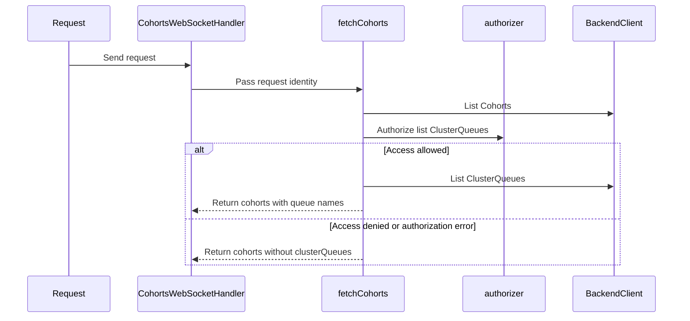

# PR #17246: KueueViz: Enforce ClusterQueue list access in /ws/cohorts

**Summary**: KueueViz: Enforce ClusterQueue list access in /ws/cohorts

**Sources**: https://github.com/kubernetes-sigs/kueue/pull/17246

**Last updated**: 2026-10-16T12:38:06Z

---

## Metadata

- **State**: closed (merged)
- **Author**: [@henry3260](https://github.com/henry3260)
- **Branch**: `kueueviz-cohorts-cq-authz` → `main`
- **Created**: 2026-10-15T05:48:43Z
- **Updated**: 2026-10-16T12:38:06Z
- **Merged**: 2026-10-16T07:16:10Z
- **Closed**: 2026-10-16T07:16:10Z
- **Labels**: `kind/bug`, `release-note`, `size/L`, `lgtm`, `approved`, `cncf-cla: yes`, `area/dashboard`
- **Assignees**: [@danylott](https://github.com/danylott)
- **Requested reviewers**: [@akram](https://github.com/akram), [@mimowo](https://github.com/mimowo)
- **Changed files**: 3   **+92 / -28**

## Description

#### What type of PR is this?

/kind bug
/area dashboard

#### What this PR does / why we need it?

`/ws/cohorts` lists every ClusterQueue with the KueueViz backend client and returns their names in each cohort's `clusterQueues` field, without checking whether the requesting user may list ClusterQueues.
This PR checks `list` access on ClusterQueues for the requesting identity, as `/ws/cohort/:cohort_name` already does, and omits the `clusterQueues` field when access is denied or the check fails.

Fixes #17178

#### Useful notes for your reviewer


#### Release note

```release-note
KueueViz: Fixed a bug where the cohorts list exposed ClusterQueue names to users without permission to list ClusterQueues.
```


<!-- This is an auto-generated comment: release notes by coderabbit.ai -->

## AI summary

`/ws/cohorts` now checks whether the requesting identity can list ClusterQueues before including ClusterQueue names. If authorization is denied or returns an error, the response omits `clusterQueues`. When no authorizer is configured, existing behavior is preserved.

### Suggested release note

KueueViz: Fixed a bug that exposed ClusterQueue names in `/ws/cohorts` to users who could view cohorts but could not list ClusterQueues. KueueViz now omits `clusterQueues` when authorization is denied or fails.

<!-- end of auto-generated comment: release notes by coderabbit.ai -->

## Discussion

### Comment by [@netlify[bot]](https://github.com/apps/netlify) — 2026-10-15T05:48:50Z

### <span aria-hidden="true">✅</span> Deploy Preview for *kubernetes-sigs-kueue* ready!


|  Name | Link |
|:-:|------------------------|
|<span aria-hidden="true">🔨</span> Latest commit | 52ff09e9342161e7d78c8df0bcc49c6fd3aae59d |
|<span aria-hidden="true">🔍</span> Latest deploy log | https://app.netlify.com/projects/kubernetes-sigs-kueue/deploys/6ad0693e65ed98dd45123309 |
|<span aria-hidden="true">😎</span> Deploy Preview | [https://deploy-preview-17246--kubernetes-sigs-kueue.netlify.app](https://deploy-preview-17246--kubernetes-sigs-kueue.netlify.app) |
|<span aria-hidden="true">📱</span> Preview on mobile | <details><summary> Toggle QR Code... </summary><br /><br /><br /><br />_Use your smartphone camera to open QR code link._</details> |
---
<!-- [kubernetes-sigs-kueue Preview](https://deploy-preview-17246--kubernetes-sigs-kueue.netlify.app) -->
_To edit notification comments on pull requests, go to your [Netlify project configuration](https://app.netlify.com/projects/kubernetes-sigs-kueue/configuration/notifications#deploy-notifications)._

### Comment by [@coderabbitai[bot]](https://github.com/apps/coderabbitai) — 2026-10-15T05:49:45Z

<!-- This is an auto-generated comment: summarize by coderabbit.ai -->
<!-- review_stack_entry_start -->

<a href="https://app.coderabbit.ai/change-stack/kubernetes-sigs/kueue/pull/17246?scope=ghh_OusAJGA4HG8ljoOV0wJvVx8NmnZIjc2DdjmxOu0xZWA&amp;cs_source=review_comment"><picture><source media="(prefers-color-scheme: dark)" srcset="https://storage.googleapis.com/coderabbit_public_assets/review-stack-in-coderabbit-ui-dark.svg?v=3"><source media="(prefers-color-scheme: light)" srcset="https://storage.googleapis.com/coderabbit_public_assets/review-stack-in-coderabbit-ui.svg?v=3"></picture></a>

<!-- review_stack_entry_end -->
<!-- recent_review_start -->

No actionable comments were generated in the recent review. 🎉

<details>
<summary><strong>ℹ️ Recent review info</strong></summary>
<dl>
<dd>

<details>
<summary><strong>⚙️ Run configuration</strong></summary>
<dl>
<dd>

- **Configuration used**: Repository: kubernetes-sigs/kueue/.coderabbit.yaml
- **Review profile**: CHILL
- **Plan**: Advanced
- **Run ID**: `5143309d-8459-4b2a-849f-41f1d5db2559`

</dd>
</dl>
</details>

<details>
<summary><strong>📥 Commits</strong></summary>
<dl>
<dd>

Reviewing files that changed from the base of the PR and between 1849ee9872687a452b821fabbd7347d7a6fb0109 and 52ff09e9342161e7d78c8df0bcc49c6fd3aae59d.

</dd>
</dl>
</details>

<details>
<summary><strong>📒 Files selected for processing: 3</strong></summary>
<dl>
<dd>

* `cmd/kueueviz/backend/handlers/cohorts.go`
* `cmd/kueueviz/backend/handlers/cohorts_test.go`
* `cmd/kueueviz/backend/handlers/resource_lists_test.go`

</dd>
</dl>
</details>

**Included review availability:** This review used your included allowance. Your plan provides up to 8 included reviews per hour; 6 remain after this review.

</dd>
</dl>
</details>


<!-- recent_review_end -->
<!-- walkthrough_start -->

<details>
<summary><strong>📝 Walkthrough</strong></summary>
<dl>
<dd>

The cohorts WebSocket handler now passes request identity to `fetchCohorts`. The function checks authorization before listing ClusterQueues and omits the `clusterQueues` field when access is denied or authorization fails.

**Changes: Cohort ClusterQueue authorization**

|Layer / File(s)|Summary|
|:---|:---|
|**Authorize ClusterQueue listing** <br> `cmd/kueueviz/backend/handlers/cohorts.go`, `cmd/kueueviz/backend/handlers/cohorts_test.go`, `cmd/kueueviz/backend/handlers/resource_lists_test.go`|The handler passes request identity to `fetchCohorts`. The function authorizes ClusterQueue listing before fetching queues and omits `clusterQueues` when authorization is denied or errors. Tests cover allowed, denied, and error cases. The resource-list test now passes an empty identity.|

<!-- change_assessment_start -->
**Priority:** ⬆️ High

**Estimated code review effort:** 2 (Simple) | ~10 minutes

<!-- change_assessment_commit:"52ff09e9342161e7d78c8df0bcc49c6fd3aae59d" -->
**Change:** Bug fix · **Severity of issue fixed:** Medium
<!-- change_assessment_end -->

### Sequence Diagram(s)



**Suggested reviewers:** `weizhoublue`

</dd>
</dl>
</details>

<!-- walkthrough_end -->
<details>
<summary><strong>Merge Risk:</strong> <strong>⚪ Minimal</strong> · up to <code>52ff0</code></summary>
<dl>
<dd>

<!-- final_review_risk_start -->
<!-- final_review_risk_label
**Merge Risk:** **⚪ Minimal** · up to `52ff0`
-->
<!-- final_review_risk_coverage:{"sourceCommitId":"52ff09e9342161e7d78c8df0bcc49c6fd3aae59d","coveredCommitId":"52ff09e9342161e7d78c8df0bcc49c6fd3aae59d","kind":"reviewed"} -->

Users without ClusterQueue list permission no longer receive ClusterQueue names through the cohorts WebSocket. No actionable merge-blocking risk remains.
<!-- final_review_risk_end -->

</dd>
</dl>
</details>

<details>
<summary><strong>Security architecture risk:</strong> <strong>⚪ Minimal</strong> · up to <code>52ff0</code></summary>
<dl>
<dd>

<!-- architecture_review_start -->
<!-- architecture_review_label
### Security Architecture Review

**Security architecture risk:** **⚪ Minimal** · up to `52ff0`
-->

The change closes the identified ClusterQueue-name disclosure by checking permission before fetching queue data. Denied or failed checks omit the queue field while preserving cohort results. No material security risk introduced or worsened by the reviewed change was identified.

**Retained concerns**
No architecture-level concerns identified.


<details>
<summary><strong>Security review details</strong></summary>
<dl>
<dd>

**Security Blast Radius**
- _inferred_ — The affected disclosure scope is ClusterQueue names and their association with returned cohorts across the connected cluster. In authorization-enabled mode, the relevant caller can list/watch Cohorts but lacks ClusterQueue list permission. The change narrows that caller’s response without granting resource-write authority.

**Security Findings and Attack Paths**
- _inferred_ — The base permitted a Cohort-authorized caller to receive queue names through backend-client enrichment without a queue-specific authorization decision. The head interrupts that path before the ClusterQueue list and omits the queue field when access is denied or the check errors.

**Trust Boundaries and Controls**
- _observed_ — In TokenReview mode, authentication middleware precedes protected routes and rejects missing, invalid, or failed credentials before handler execution. It stores the identity obtained from Kubernetes TokenReview; queue authorization uses that identity’s username, groups, UID, and extra attributes rather than the backend client’s identity.

**Resilience and Maintainability Implications**
- _observed_ — Queue authorization is recomputed through the existing authorizer on each fetch, but decisions may be served from its configured cache. The cache keys include identity and requested resource attributes; positive and negative decisions use their existing configured lifetimes.

</dd>
</dl>
</details>

<!-- architecture_review_end -->

</dd>
</dl>
</details>
<!-- pre_merge_checks_walkthrough_start -->

<details>
<summary><strong>Pre-merge checks: <sup><picture></picture></sup> 4 · <sup><picture></picture></sup> 1</strong></summary>
<dl>
<dd>

<strong><sup><picture></picture></sup> Failed checks: 1 warning</strong>

|     Check name     |                                              Status                                              | Explanation                                                                                                                                                                               | Resolution                                                                         |
| :---------------- | :----------------------------------------------------------------------------------------------: | :---------------------------------------------------------------------------------------------------------------------------------------------------------------------------------------- | :--------------------------------------------------------------------------------- |
| Docstring Coverage |  | Docstring coverage is 0.00% which is insufficient. The required threshold is 80.00%. Docstring coverage is scoped to functions touched by this diff. Analyzed 2 functions across 3 files. | Write docstrings for the functions missing them to satisfy the coverage threshold. |

<details>
<summary><strong><sup><picture></picture></sup> Passed checks: 4 passed</strong></summary>
<dl>
<dd>

|         Check name         |                                             Status                                             | Explanation                                                                                                                                                                                               |
| :------------------------ | :--------------------------------------------------------------------------------------------: | :-------------------------------------------------------------------------------------------------------------------------------------------------------------------------------------------------------- |
|      Description Check     |  | Check skipped - CodeRabbit’s high-level summary is enabled.                                                                                                                                               |
|         Title check        |  | The title clearly and concisely describes the main change: enforcing ClusterQueue list authorization for the /ws/cohorts endpoint.                                                                        |
|     Linked Issues check    |  | The changes satisfy the coding requirements in [`#17178`]. `CohortsWebSocketHandler` obtains the request identity and passes it to `fetchCohorts`. When an authorizer exists, `fetchCohorts` checks `list`… |
| Out of Scope Changes check |  | The changes stay within [`#17178`]. The handler update supplies the required identity. The `fetchCohorts` update enforces the required authorization behavior. The test updates verify the required outcom… |

</dd>
</dl>
</details>

</dd>
</dl>
</details>

<!-- pre_merge_checks_walkthrough_end -->

- [ ] <!-- {"checkboxId":"585bb3f6-faf5-4dbf-96d2-74e382adf19a"} --> Fix all pre-merge checks with AI
<!-- finishing_touch_checkbox_start -->

<details>
<summary><strong>✨ Finishing Touches</strong></summary>
<dl>
<dd>

<details open>
<summary><strong>🧪 Generate unit tests (beta)</strong></summary>
<dl>
<dd>

- [ ] <!-- {"checkboxId": "f47ac10b-58cc-4372-a567-0e02b2c3d479", "radioGroupId": "utg-output-choice-group-unknown_comment_id"} --> Create a new PR

</dd>
</dl>
</details>

</dd>
</dl>
</details>

<!-- finishing_touch_checkbox_end -->

<!-- autopilot:start -->
- [ ] <!-- {"checkboxId":"2708ad07-9f24-4260-9c11-7dc76a49f2e3"} --> <strong title="Keep fixing CodeRabbit findings and required CI, and resolving merge conflicts">Autofix</strong> · Keep fixing CodeRabbit findings and required CI, and resolving merge conflicts
<!-- autopilot:end -->
<!-- tips_start -->


<sub>Comment `@coderabbitai help` to get the list of available commands.</sub>

<!-- tips_end -->

### Comment by [@mimowo](https://github.com/mimowo) — 2026-10-15T06:33:57Z

Cc @danylott

### Comment by [@kubernetes-prow[bot]](https://github.com/apps/kubernetes-prow) — 2026-10-15T13:06:03Z

LGTM label has been added.  <details>Git tree hash: e1963b5801edf8035e2b20c442fa47a7a25ad51e</details>

### Comment by [@mimowo](https://github.com/mimowo) — 2026-10-16T06:59:50Z

/approve
/cherrypick release-0.20
/cherrypick release-0.19
thank you 👍

### Comment by [@k8s-infra-cherrypick-robot](https://github.com/k8s-infra-cherrypick-robot) — 2026-10-16T06:59:52Z

@mimowo: once the present PR merges, I will cherry-pick it on top of `release-0.19`, `release-0.20` in new PRs and assign them to you.

<details>

In response to [this](https://github.com/kubernetes-sigs/kueue/pull/17246#issuecomment-6209973279):

>/approve
>/cherrypick release-0.20
>/cherrypick release-0.19
>thank you 👍 


Instructions for interacting with me using PR comments are available [here](https://git.k8s.io/community/contributors/guide/pull-requests.md).  If you have questions or suggestions related to my behavior, please file an issue against the [kubernetes-sigs/prow](https://github.com/kubernetes-sigs/prow/issues/new?title=Prow%20issue:) repository.
</details>

### Comment by [@kubernetes-prow[bot]](https://github.com/apps/kubernetes-prow) — 2026-10-16T07:00:03Z

[APPROVALNOTIFIER] This PR is **APPROVED**

This pull-request has been approved by: *<a href="https://github.com/kubernetes-sigs/kueue/pull/17246#pullrequestreview-5533551786" title="Approved">danylott</a>*, *<a href="https://github.com/kubernetes-sigs/kueue/pull/17246#" title="Author self-approved">henry3260</a>*, *<a href="https://github.com/kubernetes-sigs/kueue/pull/17246#issuecomment-6209973279" title="Approved">mimowo</a>*

The full list of commands accepted by this bot can be found [here](https://go.k8s.io/bot-commands?repo=kubernetes-sigs%2Fkueue).

The pull request process is described [here](https://git.k8s.io/community/contributors/guide/owners.md#the-code-review-process)

<details >
Needs approval from an approver in each of these files:

- ~~[OWNERS](https://github.com/kubernetes-sigs/kueue/blob/main/OWNERS)~~ [mimowo]

Approvers can indicate their approval by writing `/approve` in a comment
Approvers can cancel approval by writing `/approve cancel` in a comment
</details>
<!-- META={"approvers":[]} -->

### Comment by [@k8s-infra-cherrypick-robot](https://github.com/k8s-infra-cherrypick-robot) — 2026-10-16T07:16:56Z

@mimowo: new pull request created: #17300

<details>

In response to [this](https://github.com/kubernetes-sigs/kueue/pull/17246#issuecomment-6209973279):

>/approve
>/cherrypick release-0.20
>/cherrypick release-0.19
>thank you 👍 


Instructions for interacting with me using PR comments are available [here](https://git.k8s.io/community/contributors/guide/pull-requests.md).  If you have questions or suggestions related to my behavior, please file an issue against the [kubernetes-sigs/prow](https://github.com/kubernetes-sigs/prow/issues/new?title=Prow%20issue:) repository.
</details>

### Comment by [@k8s-infra-cherrypick-robot](https://github.com/k8s-infra-cherrypick-robot) — 2026-10-16T07:17:33Z

@mimowo: #17246 failed to apply on top of branch "release-0.19":
```
Applying: KueueViz: Enforce ClusterQueue list access in /ws/cohorts
Using index info to reconstruct a base tree...
M	cmd/kueueviz/backend/handlers/cohorts.go
M	cmd/kueueviz/backend/handlers/cohorts_test.go
M	cmd/kueueviz/backend/handlers/resource_lists_test.go
Falling back to patching base and 3-way merge...
Auto-merging cmd/kueueviz/backend/handlers/cohorts.go
CONFLICT (content): Merge conflict in cmd/kueueviz/backend/handlers/cohorts.go
Auto-merging cmd/kueueviz/backend/handlers/cohorts_test.go
CONFLICT (content): Merge conflict in cmd/kueueviz/backend/handlers/cohorts_test.go
Auto-merging cmd/kueueviz/backend/handlers/resource_lists_test.go
CONFLICT (content): Merge conflict in cmd/kueueviz/backend/handlers/resource_lists_test.go
error: Failed to merge in the changes.
hint: Use 'git am --show-current-patch=diff' to see the failed patch
hint: When you have resolved this problem, run "git am --continue".
hint: If you prefer to skip this patch, run "git am --skip" instead.
hint: To restore the original branch and stop patching, run "git am --abort".
hint: Disable this message with "git config set advice.mergeConflict false"
Patch failed at 0001 KueueViz: Enforce ClusterQueue list access in /ws/cohorts

```

<details>

In response to [this](https://github.com/kubernetes-sigs/kueue/pull/17246#issuecomment-6209973279):

>/approve
>/cherrypick release-0.20
>/cherrypick release-0.19
>thank you 👍 


Instructions for interacting with me using PR comments are available [here](https://git.k8s.io/community/contributors/guide/pull-requests.md).  If you have questions or suggestions related to my behavior, please file an issue against the [kubernetes-sigs/prow](https://github.com/kubernetes-sigs/prow/issues/new?title=Prow%20issue:) repository.
</details>

### Comment by [@mimowo](https://github.com/mimowo) — 2026-10-16T10:16:44Z

@henry3260 is it feasible to CP for 0.19?

### Comment by [@henry3260](https://github.com/henry3260) — 2026-10-16T10:48:22Z

> @henry3260 is it feasible to CP for 0.19?

Not needed for 0.19, per-user authorization in KueueViz came with #13810, which is only in 0.20. In 0.19 KueueViz only authenticates the token and no endpoint checks the user's access, so there is nothing for /ws/cohorts to align with.

### Comment by [@mimowo](https://github.com/mimowo) — 2026-10-16T12:38:06Z

Thanks for checking 👍

## Reviews

### Review by [@danylott](https://github.com/danylott) (approved) — 2026-10-15T13:05:52Z

LGTM! Thanks for fixing the authorisation issue!
/lgtm
