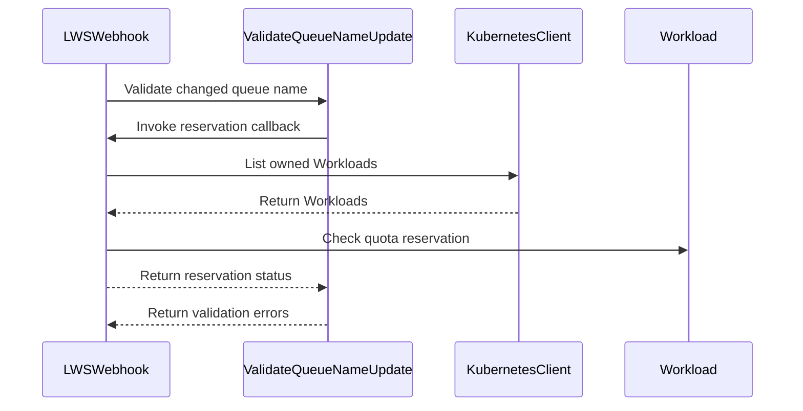

# PR #17257: Reject Zero-Ready LWS Queue Updates When Workloads Reserve Quota

**Summary**: Reject Zero-Ready LWS Queue Updates When Workloads Reserve Quota

**Sources**: https://github.com/kubernetes-sigs/kueue/pull/17257

**Last updated**: 2026-10-15T14:48:43Z

---

## Metadata

- **State**: closed
- **Author**: [@weizhoublue](https://github.com/weizhoublue)
- **Branch**: `fix/alone-20260928212015` → `main`
- **Created**: 2026-10-15T10:47:23Z
- **Updated**: 2026-10-15T14:48:43Z
- **Merged**: —
- **Closed**: 2026-10-15T11:38:37Z
- **Labels**: `kind/bug`, `release-note`, `size/L`, `cncf-cla: yes`
- **Assignees**: _none_
- **Requested reviewers**: [@kannon92](https://github.com/kannon92), [@pajakd](https://github.com/pajakd), [@olekzabl](https://github.com/olekzabl)
- **Changed files**: 7   **+317 / -12**

## Description

<!-- Thank you for contributing! Check CONTRIBUTING.md for details. -->

#### What type of PR is this?
/kind bug

<!-- Choose one of the following kinds:
/kind bug
/kind cleanup
/kind documentation
/kind feature
/kind kep
-->


<!-- Optionally choose one or more of the following kinds:
/kind api-change
/kind deprecation
/kind failing-test
/kind flake
/kind regression
-->


<!-- Consider setting the area:
/area tas
/area was
/area integrations
/area multikueue
/area dashboard
/area localization
/area testing
/area website
-->


#### What this PR does / why we need it?

A user creates a  LeaderWorkerSet  with  `replicas: 2`  and  `kueue.x-k8s.io/queue-name: lq-a`. Kueue creates a Workload for each replica group. A Workload may reserve quota before any replica becomes Ready. For example, while its Pods are still pulling images, so  readyReplicas  can remain  0 .

The existing  LeaderWorkerSet  webhook rejects queue changes when  `readyReplicas > 0` . When it is  0 , however, the webhook allows a change to another non-empty LocalQueue even if an existing Workload still holds quota.
If the queue changes to  lq-b , the reconciler attempts to update the existing Workloads’  `spec.queueName` . The Workload CRD rejects updates to Workloads that still reserve quota because  queueName  is immutable while quota is reserved. Reconciliation then fails and retries with backoff.

The fix rejects the  LeaderWorkerSet  queue change whenever one of its existing Workloads holds a quota reservation, including when  readyReplicas  is  0 .

<!--
Use `Fixes #123` for an issue addressed by this PR; it will be closed when the PR merges.
Use `Related:` or `Part of:` to reference an issue without closing it.
-->
Fixes #

#### Useful notes for your reviewer


#### Release note

<!-- Describe the behavior change accurately from the user's perspective. Hints:
- Do not leave this block blank.
- Use "NONE" when there is no user-facing change.
- When feasible use a prefix for the sub-component or feature, e.g. "FairSharing:" or "MultiKueue:".
- If upgrade steps are required, include an "ACTION REQUIRED:" section.
You may consider AI assistance using the skill: cmd/experimental/skills/kueue-release-notes/SKILL.md.
-->
```release-note
Fix: Reject Zero-Ready LWS Queue Updates When Workloads Reserve Quota
```


<!-- This is an auto-generated comment: release notes by coderabbit.ai -->
## AI summary

Queue-name updates for LeaderWorkerSet and StatefulSet workloads are now rejected when an associated Workload has a quota reservation, even if the job has no ready replicas. Updates remain allowed when no reservation exists. Unit and integration tests cover these cases.

### Suggested release note

LeaderWorkerSet & StatefulSet: Fixed a bug that allowed queue changes while an associated Workload held a quota reservation and the job had no ready replicas. Kueue now rejects those changes.
<!-- end of auto-generated comment: release notes by coderabbit.ai -->

## Discussion

### Comment by [@kubernetes-prow[bot]](https://github.com/apps/kubernetes-prow) — 2026-10-15T10:47:26Z

Skipping CI for Draft Pull Request.
If you want CI signal for your change, please convert it to an actual PR.
You can still manually trigger a test run with `/test all`

### Comment by [@netlify[bot]](https://github.com/apps/netlify) — 2026-10-15T10:47:30Z

### <span aria-hidden="true">✅</span> Deploy Preview for *kubernetes-sigs-kueue* canceled.


|  Name | Link |
|:-:|------------------------|
|<span aria-hidden="true">🔨</span> Latest commit | c01d60f33a7f1a6d674f8f2953c1704c516fd547 |
|<span aria-hidden="true">🔍</span> Latest deploy log | https://app.netlify.com/projects/kubernetes-sigs-kueue/deploys/6ad0af3f3991da006b1c525b |

### Comment by [@coderabbitai[bot]](https://github.com/apps/coderabbitai) — 2026-10-15T10:47:33Z

<!-- This is an auto-generated comment: summarize by coderabbit.ai -->
<!-- review_stack_entry_start -->

<a href="https://app.coderabbit.ai/change-stack/kubernetes-sigs/kueue/pull/17257?scope=ghh_OusAJGA4HG8ljoOV0wJvVx8NmnZIjc2DdjmxOu0xZWA&amp;cs_source=review_comment"><picture><source media="(prefers-color-scheme: dark)" srcset="https://storage.googleapis.com/coderabbit_public_assets/review-stack-in-coderabbit-ui-dark.svg?v=3"><source media="(prefers-color-scheme: light)" srcset="https://storage.googleapis.com/coderabbit_public_assets/review-stack-in-coderabbit-ui.svg?v=3"></picture></a>

<!-- review_stack_entry_end -->
<!-- recent_review_start -->

No actionable comments were generated in the recent review. 🎉

<details>
<summary><strong>ℹ️ Recent review info</strong></summary>
<dl>
<dd>

<details>
<summary><strong>⚙️ Run configuration</strong></summary>
<dl>
<dd>

- **Configuration used**: Repository: kubernetes-sigs/kueue/.coderabbit.yaml
- **Review profile**: CHILL
- **Plan**: Advanced
- **Run ID**: `399262fe-03c9-4641-ada4-eeae45fae92e`

</dd>
</dl>
</details>

<details>
<summary><strong>📥 Commits</strong></summary>
<dl>
<dd>

Reviewing files that changed from the base of the PR and between 1849ee9872687a452b821fabbd7347d7a6fb0109 and c01d60f33a7f1a6d674f8f2953c1704c516fd547.

</dd>
</dl>
</details>

<details>
<summary><strong>📒 Files selected for processing: 7</strong></summary>
<dl>
<dd>

* `pkg/controller/jobframework/validation.go`
* `pkg/controller/jobframework/validation_test.go`
* `pkg/controller/jobs/leaderworkerset/leaderworkerset_webhook.go`
* `pkg/controller/jobs/leaderworkerset/leaderworkerset_webhook_test.go`
* `pkg/controller/jobs/statefulset/statefulset_webhook.go`
* `test/integration/singlecluster/controller/jobs/leaderworkerset/leaderworkerset_controller_test.go`
* `test/integration/singlecluster/controller/jobs/statefulset/statefulset_controller_test.go`

</dd>
</dl>
</details>

**Included review availability:** This review used your included allowance. Your plan provides up to 8 included reviews per hour; 7 remain after this review.

</dd>
</dl>
</details>


<!-- recent_review_end -->
<!-- walkthrough_start -->

<details>
<summary><strong>📝 Walkthrough</strong></summary>
<dl>
<dd>

Queue-name updates for LeaderWorkerSet and StatefulSet jobs now use shared validation. A suspended job can change to a non-empty queue name only when the relevant Workload has no quota reservation. Webhook and integration tests cover allowed and rejected updates.

**Changes: Queue Name Updates**

|Layer / File(s)|Summary|
|:---|:---|
|**Shared queue validation** <br> `pkg/controller/jobframework/validation.go`, `pkg/controller/jobframework/validation_test.go`|Adds `ValidateQueueNameUpdate`. It rejects changes when the job is not suspended, the new name is empty, or a quota reservation exists. Unit tests cover accepted and rejected changes and reservation lookup errors.|
|**Webhook validation and tests** <br> `pkg/controller/jobs/leaderworkerset/leaderworkerset_webhook.go`, `pkg/controller/jobs/leaderworkerset/leaderworkerset_webhook_test.go`, `pkg/controller/jobs/statefulset/statefulset_webhook.go`|Both webhooks use the shared helper and check for quota reservations on the relevant Workloads. LeaderWorkerSet webhook tests cover reserved and unreserved Workloads, including Workloads owned by another LeaderWorkerSet.|
|**Controller integration tests** <br> `test/integration/singlecluster/controller/jobs/leaderworkerset/leaderworkerset_controller_test.go`, `test/integration/singlecluster/controller/jobs/statefulset/statefulset_controller_test.go`|Tests verify that queue changes are rejected when a Workload has a quota reservation. A LeaderWorkerSet queue change succeeds when its Workload has no reservation.|

<!-- change_assessment_start -->
**Priority:** ⬇️ Low

**Estimated code review effort:** 3 (Moderate) | ~25 minutes

<!-- change_assessment_commit:"c01d60f33a7f1a6d674f8f2953c1704c516fd547" -->
**Change:** Bug fix
<!-- change_assessment_end -->

### Sequence Diagram(s)



**Suggested reviewers:** `maysamacedo`

</dd>
</dl>
</details>

<!-- walkthrough_end -->
<details>
<summary><strong>Merge Risk:</strong> <strong>⚪ Minimal</strong> · up to <code>c01d6</code></summary>
<dl>
<dd>

<!-- final_review_risk_start -->
<!-- final_review_risk_label
**Merge Risk:** **⚪ Minimal** · up to `c01d6`
-->
<!-- final_review_risk_coverage:{"sourceCommitId":"c01d60f33a7f1a6d674f8f2953c1704c516fd547","coveredCommitId":"c01d60f33a7f1a6d674f8f2953c1704c516fd547","kind":"reviewed"} -->

The queue-update checks and coverage show no identified issue that needs resolution before merge.
<!-- final_review_risk_end -->

</dd>
</dl>
</details>

<details>
<summary><strong>Security architecture risk:</strong> <strong>🔵 Low</strong> · up to <code>c01d6</code></summary>
<dl>
<dd>

<!-- architecture_review_start -->
<!-- architecture_review_label
### Security Architecture Review

**Security architecture risk:** **🔵 Low** · up to `c01d6`
-->

The change tightens queue reassignment while preserving the quota-reservation safeguard. The check uses a separate state read, so concurrent changes can still cause a later update to be rejected and retried. No introduced security bypass was established.

**Retained concerns**
No architecture-level concerns identified.


<details>
<summary><strong>Security review details</strong></summary>
<dl>
<dd>

**Security Blast Radius**
- _observed_ — The reservation checks read Workloads in the updated job's namespace. LeaderWorkerSet examines all owner-UID-matched groups and rejects if any is reserved; StatefulSet examines the current-name or legacy-name Workload returned by its existing lookup.

**Security Findings and Attack Paths**
- _inferred_ — A caller able to change a LeaderWorkerSet queue label can trigger the new read, but cannot make a lookup error count as an unreserved result. The newly blocked path is a zero-ready job changing queues while a matched Workload still reserves quota; the reviewed change tightens rather than bypasses that control.

**Trust Boundaries and Controls**
- _observed_ — Admission is explicitly non-atomic with quota reservation and later Workload updates. The unchanged checked-in Workload CRD independently requires queueName to remain identical when both old and new Workload states have QuotaReserved=True. Thus, admitting a parent-job update does not itself authorize repointing a still-reserved Workload.

**Resilience and Maintainability Implications**
- _inferred_ — A reservation appearing after admission can still leave the job and Workload temporarily naming different queues. Reconciliation compares desired and existing queue names and propagates update failures, preserving retry behavior rather than overriding the reserved Workload. This residual race predates the new gate; the PR reduces its admission window but does not make the transition atomic.

</dd>
</dl>
</details>

<!-- architecture_review_end -->

</dd>
</dl>
</details>
<!-- pre_merge_checks_walkthrough_start -->

<details>
<summary><strong>Pre-merge checks: <sup><picture></picture></sup> 4 · <sup><picture></picture></sup> 1</strong></summary>
<dl>
<dd>

<strong><sup><picture></picture></sup> Failed checks: 1 warning</strong>

|     Check name     |                                              Status                                              | Explanation                                                                                                                                                                                | Resolution                                                                         |
| :---------------- | :----------------------------------------------------------------------------------------------: | :----------------------------------------------------------------------------------------------------------------------------------------------------------------------------------------- | :--------------------------------------------------------------------------------- |
| Docstring Coverage |  | Docstring coverage is 16.67% which is insufficient. The required threshold is 80.00%. Docstring coverage is scoped to functions touched by this diff. Analyzed 6 functions across 7 files. | Write docstrings for the functions missing them to satisfy the coverage threshold. |

<details>
<summary><strong><sup><picture></picture></sup> Passed checks: 4 passed</strong></summary>
<dl>
<dd>

|         Check name         |                                             Status                                             | Explanation                                                                                                                                                              |
| :------------------------ | :--------------------------------------------------------------------------------------------: | :----------------------------------------------------------------------------------------------------------------------------------------------------------------------- |
|      Description Check     |  | Check skipped - CodeRabbit’s high-level summary is enabled.                                                                                                              |
|         Title check        |  | The title clearly and concisely describes the main change: rejecting LeaderWorkerSet queue updates when workloads reserve quota, including when zero replicas are ready. |
|     Linked Issues check    |  | Check skipped because no linked issues were found for this pull request.                                                                                                 |
| Out of Scope Changes check |  | Check skipped because no linked issues were found for this pull request.                                                                                                 |

</dd>
</dl>
</details>

</dd>
</dl>
</details>

<!-- pre_merge_checks_walkthrough_end -->

- [ ] <!-- {"checkboxId":"585bb3f6-faf5-4dbf-96d2-74e382adf19a"} --> Fix all pre-merge checks with AI
<!-- finishing_touch_checkbox_start -->

<details>
<summary><strong>✨ Finishing Touches</strong></summary>
<dl>
<dd>

<details open>
<summary><strong>🧪 Generate unit tests (beta)</strong></summary>
<dl>
<dd>

- [ ] <!-- {"checkboxId": "f47ac10b-58cc-4372-a567-0e02b2c3d479", "radioGroupId": "utg-output-choice-group-unknown_comment_id"} --> Create a new PR

</dd>
</dl>
</details>

</dd>
</dl>
</details>

<!-- finishing_touch_checkbox_end -->

<!-- autopilot:start -->
- [ ] <!-- {"checkboxId":"2708ad07-9f24-4260-9c11-7dc76a49f2e3"} --> <strong title="Keep fixing CodeRabbit findings and required CI, and resolving merge conflicts">Autofix</strong> · Keep fixing CodeRabbit findings and required CI, and resolving merge conflicts
<!-- autopilot:end -->
<!-- tips_start -->


<sub>Comment `@coderabbitai help` to get the list of available commands.</sub>

<!-- tips_end -->

### Comment by [@kubernetes-prow[bot]](https://github.com/apps/kubernetes-prow) — 2026-10-15T10:47:36Z

[APPROVALNOTIFIER] This PR is **NOT APPROVED**

This pull-request has been approved by: *<a href="https://github.com/kubernetes-sigs/kueue/pull/17257#" title="Author self-approved">weizhoublue</a>*
**Once this PR has been reviewed and has the lgtm label**, please assign [mimowo](https://github.com/mimowo) for approval. For more information see [the Code Review Process](https://git.k8s.io/community/contributors/guide/owners.md#the-code-review-process).

The full list of commands accepted by this bot can be found [here](https://go.k8s.io/bot-commands?repo=kubernetes-sigs%2Fkueue).

<details open>
Needs approval from an approver in each of these files:

- **[OWNERS](https://github.com/kubernetes-sigs/kueue/blob/main/OWNERS)**

Approvers can indicate their approval by writing `/approve` in a comment
Approvers can cancel approval by writing `/approve cancel` in a comment
</details>
<!-- META={"approvers":["mimowo"]} -->

### Comment by [@Andrushika](https://github.com/Andrushika) — 2026-10-15T11:24:41Z

Hi! I think it is duplicate with #17255

### Comment by [@weizhoublue](https://github.com/weizhoublue) — 2026-10-15T11:38:37Z

> Hi! I think it is duplicate with #17255

What a coincidence!
I actually reopened this PR, as a follow-up to the earlier PR #16327. 

I'll close this one in favor of yours.
@thc1006 hi, we could pay attention to #17255

### Comment by [@thc1006](https://github.com/thc1006) — 2026-10-15T14:48:43Z

Hi @weizhoublue, thank you for picking this back up so quickly, and sorry for the trouble. I hadn't noticed #17251 when I asked you on #16327. On #17255, I've suggested bringing over your shared helper, with you as co-author.
