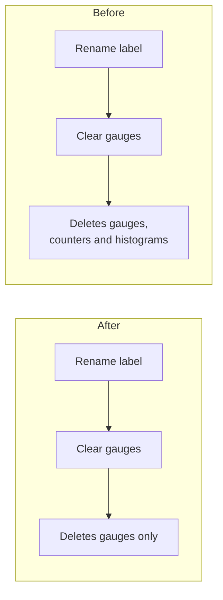

# PR #17260: Preserve ClusterQueue and LocalQueue counters and histograms on custom label change

**Summary**: Preserve ClusterQueue and LocalQueue counters and histograms on custom label change

**Sources**: https://github.com/kubernetes-sigs/kueue/pull/17260

**Last updated**: 2026-10-19T14:07:26Z

---

## Metadata

- **State**: open
- **Author**: [@Andrushika](https://github.com/Andrushika)
- **Branch**: `fix/cq-label-change-preserve-counters` → `main`
- **Created**: 2026-10-15T12:07:34Z
- **Updated**: 2026-10-19T14:07:26Z
- **Merged**: —
- **Closed**: —
- **Labels**: `kind/bug`, `release-note`, `size/L`, `do-not-merge/hold`, `ok-to-test`, `cncf-cla: yes`, `area/observability`
- **Assignees**: [@thc1006](https://github.com/thc1006)
- **Requested reviewers**: [@pajakd](https://github.com/pajakd), [@mbobrovskyi](https://github.com/mbobrovskyi), [@thc1006](https://github.com/thc1006)
- **Changed files**: 8   **+198 / -13**

## Description

#### What type of PR is this?

/kind bug
/area observability

#### What this PR does / why we need it?

**Why**

When a ClusterQueue or LocalQueue custom metric label value changes, Kueue clears the queue's old series and records the gauges again under the new value. The clear it uses also deletes counters and histograms, so metrics like `kueue_admitted_workloads_total` go back to zero. The Cohort path already clears only gauges.




**What**

Clear only gauges on a label change. Queue deletion still clears everything. Old counters keep their history under the old label value. The docs now note that old series stay, and suggest `trackedValues` for LocalQueue labels.

This takes over #15010.

Fixes #14478

#### Useful notes for your reviewer

Counter checks are in the existing `Update` unit tables and in the custom label integration specs.

I used AI assistance for this PR and reviewed everything myself.

#### Release note

```release-note
Observability: Fixed a bug where changing a custom metric label value on a ClusterQueue or LocalQueue could reset that queue's counter and histogram metrics to zero.
```

🤖 Generated with [Claude Code](https://claude.com/claude-code)


<!-- This is an auto-generated comment: release notes by coderabbit.ai -->
## AI summary

When custom labels change on a ClusterQueue or LocalQueue, Kueue now clears and refreshes gauge metrics without deleting counter and histogram series. Those series retain their history under the old label values. Full metric cleanup still occurs when the queue is deleted or a LocalQueue stops exposing metrics. The documentation recommends `trackedValues` for LocalQueue labels that non-admin users can edit.

### Suggested release note

Observability: Fixed a bug where changing a ClusterQueue or LocalQueue custom metric label deleted counter and histogram series. Kueue now preserves their history under the old label values while gauges reflect the new values.
<!-- end of auto-generated comment: release notes by coderabbit.ai -->

## Discussion

### Comment by [@netlify[bot]](https://github.com/apps/netlify) — 2026-10-15T12:07:44Z

### <span aria-hidden="true">✅</span> Deploy Preview for *kubernetes-sigs-kueue* canceled.


|  Name | Link |
|:-:|------------------------|
|<span aria-hidden="true">🔨</span> Latest commit | 1ff38ccb4ce832167e010e1cf11a6bc9c09f56ed |
|<span aria-hidden="true">🔍</span> Latest deploy log | https://app.netlify.com/projects/kubernetes-sigs-kueue/deploys/6ad18252aa0f141b878e9a5a |

### Comment by [@kubernetes-prow[bot]](https://github.com/apps/kubernetes-prow) — 2026-10-15T12:07:47Z

Hi @Andrushika. Thanks for your PR.

I'm waiting for a [kubernetes-sigs](https://github.com/orgs/kubernetes-sigs/people) member to verify that this patch is reasonable to test. If it is, they should reply with `/ok-to-test` on its own line. Until that is done, I will not automatically test new commits in this PR, but the usual testing commands by org members will still work.

>[!TIP]
>**We noticed you've done this a few times! Consider [joining the org](https://git.k8s.io/community/community-membership.md#member) to skip this step and gain `/lgtm` and other bot rights.** We recommend asking approvers on your previous PRs to sponsor you.

Once the patch is verified, the new status will be reflected by the `ok-to-test` label.

I understand the commands that are listed [here](https://go.k8s.io/bot-commands?repo=kubernetes-sigs%2Fkueue).

<details>

Instructions for interacting with me using PR comments are available [here](https://git.k8s.io/community/contributors/guide/pull-requests.md).  If you have questions or suggestions related to my behavior, please file an issue against the [kubernetes-sigs/prow](https://github.com/kubernetes-sigs/prow/issues/new?title=Prow%20issue:) repository.
</details>

### Comment by [@Andrushika](https://github.com/Andrushika) — 2026-10-15T12:08:39Z

cc @thc1006
Could you please take a look at this when you have a chance? Thanks!

### Comment by [@coderabbitai[bot]](https://github.com/apps/coderabbitai) — 2026-10-15T12:08:42Z

<!-- This is an auto-generated comment: summarize by coderabbit.ai -->
<!-- review_stack_entry_start -->

<a href="https://app.coderabbit.ai/change-stack/kubernetes-sigs/kueue/pull/17260?scope=ghh_OusAJGA4HG8ljoOV0wJvVx8NmnZIjc2DdjmxOu0xZWA&amp;cs_source=review_comment"><picture><source media="(prefers-color-scheme: dark)" srcset="https://storage.googleapis.com/coderabbit_public_assets/review-stack-in-coderabbit-ui-dark.svg?v=3"><source media="(prefers-color-scheme: light)" srcset="https://storage.googleapis.com/coderabbit_public_assets/review-stack-in-coderabbit-ui.svg?v=3"></picture></a>

<!-- review_stack_entry_end -->
<!-- recent_review_start -->

No actionable comments were generated in the recent review. 🎉

<details>
<summary><strong>ℹ️ Recent review info</strong></summary>
<dl>
<dd>

<details>
<summary><strong>⚙️ Run configuration</strong></summary>
<dl>
<dd>

- **Configuration used**: Repository: kubernetes-sigs/kueue/.coderabbit.yaml
- **Review profile**: CHILL
- **Plan**: Advanced
- **Run ID**: `85d2feba-7960-4933-9644-fc939de8b1d6`

</dd>
</dl>
</details>

<details>
<summary><strong>📥 Commits</strong></summary>
<dl>
<dd>

Reviewing files that changed from the base of the PR and between 42123dc39c73baebf4192314ef577a69dcb27141 and 1ff38ccb4ce832167e010e1cf11a6bc9c09f56ed.

</dd>
</dl>
</details>

<details>
<summary><strong>📒 Files selected for processing: 1</strong></summary>
<dl>
<dd>

* `pkg/metrics/metrics.go`

</dd>
</dl>
</details>

**Included review availability:** This review used your included allowance. Your plan provides up to 8 included reviews per hour; 7 remain after this review.

</dd>
</dl>
</details>


<!-- recent_review_end -->
<!-- walkthrough_start -->

<details>
<summary><strong>📝 Walkthrough</strong></summary>
<dl>
<dd>

Custom-label changes now refresh queue gauge metrics without deleting accumulated counters and histograms. Full cleanup remains available when a LocalQueue stops being exposed. Controller tests, integration tests, and documentation cover retained old-label series and selector-based exposure.

**Changes: Queue metric label updates**

|Layer / File(s)|Summary|
|:---|:---|
|**Gauge-only cleanup contract** <br> `pkg/metrics/metrics.go`, `pkg/metrics/metrics_test.go`|New gauge-only cleanup functions remove ClusterQueue- and LocalQueue-scoped gauges. Full cleanup continues to remove counters and histograms. Tests verify which metric series each operation removes or retains.|
|**Queue label reconciliation and coverage** <br> `pkg/controller/core/clusterqueue_controller.go`, `pkg/controller/core/localqueue_controller.go`, `pkg/controller/core/clusterqueue_controller_test.go`, `pkg/controller/core/localqueue_controller_test.go`, `test/integration/singlecluster/controller/core/custom_labels_test.go`, `site/content/en/docs/tasks/manage/observability/configure_custom_metric_labels.md`|Custom-label updates refresh queue gauges while preserving cumulative metric series. LocalQueue updates clear all metrics when exposure is disabled. Tests cover retained old-label series and selector-based exposure. Documentation describes old-label counters and histograms and `trackedValues` for editable LocalQueue labels.|

<!-- change_assessment_start -->
**Priority:** ➖ Normal

**Estimated code review effort:** 3 (Moderate) | ~20 minutes

<!-- change_assessment_commit:"1ff38ccb4ce832167e010e1cf11a6bc9c09f56ed" -->
**Change:** Bug fix · **Severity of issue fixed:** Medium
<!-- change_assessment_end -->

**Suggested reviewers:** `henry3260`

</dd>
</dl>
</details>

<!-- walkthrough_end -->
<details>
<summary><strong>Merge Risk:</strong> <strong>⚪ Minimal</strong> · up to <code>1ff38</code></summary>
<dl>
<dd>

<!-- final_review_risk_start -->
<!-- final_review_risk_label
**Merge Risk:** **⚪ Minimal** · up to `1ff38`
-->
<!-- final_review_risk_coverage:{"sourceCommitId":"1ff38ccb4ce832167e010e1cf11a6bc9c09f56ed","coveredCommitId":"1ff38ccb4ce832167e010e1cf11a6bc9c09f56ed","kind":"reviewed"} -->

Custom-label updates refresh queue gauges while preserving accumulated counter and histogram history under old label values. Queue removal and LocalQueue de-exposure still perform full cleanup; no actionable merge-blocking risk is established.
<!-- final_review_risk_end -->

</dd>
</dl>
</details>

<details>
<summary><strong>Security architecture risk:</strong> <strong>🟡 Moderate</strong> · up to <code>1ff38</code></summary>
<dl>
<dd>

<!-- architecture_review_start -->
<!-- architecture_review_label
### Security Architecture Review

**Security architecture risk:** **🟡 Moderate** · up to `1ff38`
-->

Preserving metric history fixes counter resets, but unrestricted custom-label values can now accumulate historical series within a single queue. Where non-admin users can edit those values, repeated changes and workload activity could exhaust shared controller or monitoring resources. The feature is opt-in, and value allowlists and full cleanup constrain the exposure.

**Retained concerns**
- **Medium · security · inferred:** For an exposed LocalQueue with an unrestricted custom-label source, a user permitted to edit that metadata can repeatedly choose fresh values while workload events create counters and histograms. Gauge-only refresh now retains every previously recorded identity instead of deleting it at the next label change. This permits growth without a configured historical-series bound within one queue and could degrade the shared controller and its monitoring. trackedValues prevents unrestricted value growth when configured, but remains optional; the new documentation recommendation is not enforcement.


<details>
<summary><strong>Security review details</strong></summary>
<dl>
<dd>

**Security Blast Radius**
- _inferred_ — The concern starts with editable metadata on an exposed queue, but retained metric vectors live in the shared controller process and are exposed to monitoring. Resource pressure could therefore affect other queues served by that controller and its metrics consumers. The evidence does not establish deployed tenant permissions, cross-cluster reach, or an exhaustion threshold.

**Security Findings and Attack Paths**
- _inferred_ — The conditional attack sequence is to change an unrestricted configured LocalQueue metadata value, allow a metric-generating admission under that value, and repeat with fresh values while keeping the queue exposed. Label edits alone do not generate the demonstrated admission counters and histograms. Unlike the base behavior, subsequent label changes no longer discard the accumulated identities.

**Trust Boundaries and Controls**
- _observed_ — The existing configuration selects which metadata becomes metric labels. The value allowlist is the relevant cardinality control, while exposure selectors decide whether a queue reports metrics. The documentation explicitly recommends trackedValues when non-admin users can edit LocalQueue labels, but extraction still permits unrestricted values when that list is empty.

**Resilience and Maintainability Implications**
- _observed_ — Normal queue-removal paths retain full-cleanup calls, and disabling LocalQueue exposure also clears all series. These provide cleanup boundaries, but ordinary exposed label changes deliberately do not invoke them.

**Hardening Proposals**
- _proposed_ — For tenant-editable queue metadata, require finite trackedValues or an explicit historical-series budget before enabling retention, preserving counter history within that bounded set rather than relying solely on operator guidance.

</dd>
</dl>
</details>

<!-- architecture_review_end -->

</dd>
</dl>
</details>
<!-- pre_merge_checks_walkthrough_start -->

<details>
<summary><strong>Pre-merge checks: <sup><picture></picture></sup> 4 · <sup><picture></picture></sup> 1</strong></summary>
<dl>
<dd>

<strong><sup><picture></picture></sup> Failed checks: 1 warning</strong>

|     Check name     |                                              Status                                              | Explanation                                                                                                                                                                                 | Resolution                                                                         |
| :---------------- | :----------------------------------------------------------------------------------------------: | :------------------------------------------------------------------------------------------------------------------------------------------------------------------------------------------ | :--------------------------------------------------------------------------------- |
| Docstring Coverage |  | Docstring coverage is 46.15% which is insufficient. The required threshold is 80.00%. Docstring coverage is scoped to functions touched by this diff. Analyzed 13 functions across 7 files. | Write docstrings for the functions missing them to satisfy the coverage threshold. |

<details>
<summary><strong><sup><picture></picture></sup> Passed checks: 4 passed</strong></summary>
<dl>
<dd>

|         Check name         |                                             Status                                             | Explanation                                                                                                                                                                                               |
| :------------------------ | :--------------------------------------------------------------------------------------------: | :-------------------------------------------------------------------------------------------------------------------------------------------------------------------------------------------------------- |
|      Description Check     |  | Check skipped - CodeRabbit’s high-level summary is enabled.                                                                                                                                               |
|         Title check        |  | The title clearly and concisely describes the main change: preserving ClusterQueue and LocalQueue counters and histograms when custom labels change.                                                      |
|     Linked Issues check    |  | [ `#14478` ] `resyncClusterQueueGaugeMetrics` now uses gauge-only cleanup. `ClearClusterQueueMetrics` still performs full cleanup for deletion. The ClusterQueue unit and integration tests preserve the o… |
| Out of Scope Changes check |  | The LocalQueue changes, gauge-only metric helpers, tests, and documentation support the custom-label preservation behavior. Full metric cleanup remains for disabled exposure or deletion. No unrelated … |

</dd>
</dl>
</details>

</dd>
</dl>
</details>

<!-- pre_merge_checks_walkthrough_end -->

- [ ] <!-- {"checkboxId":"585bb3f6-faf5-4dbf-96d2-74e382adf19a"} --> Fix all pre-merge checks with AI
<!-- finishing_touch_checkbox_start -->

<details>
<summary><strong>✨ Finishing Touches</strong></summary>
<dl>
<dd>

<details open>
<summary><strong>🧪 Generate unit tests (beta)</strong></summary>
<dl>
<dd>

- [ ] <!-- {"checkboxId": "f47ac10b-58cc-4372-a567-0e02b2c3d479", "radioGroupId": "utg-output-choice-group-unknown_comment_id"} --> Create a new PR

</dd>
</dl>
</details>

</dd>
</dl>
</details>

<!-- finishing_touch_checkbox_end -->

<!-- autopilot:start -->
- [ ] <!-- {"checkboxId":"2708ad07-9f24-4260-9c11-7dc76a49f2e3"} --> <strong title="Keep fixing CodeRabbit findings and required CI, and resolving merge conflicts">Autofix</strong> · Keep fixing CodeRabbit findings and required CI, and resolving merge conflicts
<!-- autopilot:end -->
<!-- tips_start -->


<sub>Comment `@coderabbitai help` to get the list of available commands.</sub>

<!-- tips_end -->

### Comment by [@kubernetes-prow[bot]](https://github.com/apps/kubernetes-prow) — 2026-10-16T05:40:30Z

[APPROVALNOTIFIER] This PR is **NOT APPROVED**

This pull-request has been approved by: *<a href="https://github.com/kubernetes-sigs/kueue/pull/17260#" title="Author self-approved">Andrushika</a>*, *<a href="https://github.com/kubernetes-sigs/kueue/pull/17260#pullrequestreview-5543516837" title="Approved">thc1006</a>*
**Once this PR has been reviewed and has the lgtm label**, please assign [tenzen-y](https://github.com/tenzen-y) for approval. For more information see [the Code Review Process](https://git.k8s.io/community/contributors/guide/owners.md#the-code-review-process).

The full list of commands accepted by this bot can be found [here](https://go.k8s.io/bot-commands?repo=kubernetes-sigs%2Fkueue).

<details open>
Needs approval from an approver in each of these files:

- **[OWNERS](https://github.com/kubernetes-sigs/kueue/blob/main/OWNERS)**

Approvers can indicate their approval by writing `/approve` in a comment
Approvers can cancel approval by writing `/approve cancel` in a comment
</details>
<!-- META={"approvers":["tenzen-y"]} -->

### Comment by [@thc1006](https://github.com/thc1006) — 2026-10-16T05:49:41Z

Dear @tenzen-y, a note for when this gets approved: release-0.20 and release-0.19 have the same resync code, since #16653 and #17046 were picked to both, so they lose these counters too. The two commits apply cleanly to release-0.20, and its unit tests pass there. release-0.19 lacks `ClearPendingWorkloads`, so the robot would hit a conflict on that branch and it would need a manual pick. Would it be worth cherry-picking to both?

### Comment by [@mimowo](https://github.com/mimowo) — 2026-10-19T09:49:15Z

@thc1006 I'm not totally sure about this fix, because the KEP specifies that the counters and histograms are also cleaned up: "For cumulative metrics (counters and histograms), removing and re-creating a series resets it to zero. This is expected; rate() and increase() handle counter resets correctly.": https://github.com/kubernetes-sigs/kueue/tree/main/keps/7066-custom-metric-labels#implementation-approach

Still, the feature is still Alpha and this is rather corner case, so I'm happy to adjust the approach, but I would suggest to consider: 
1. cleanup counters and histograms when `trackedValues` is not specified
2. preserve counters and histograms when `trackedValues` is specified

This rule would:
1. prevent any sort of leaks, because the memory would be bounded by `trackedValues`
2. would make the rules cleanup / not cleanup independent of the SourceKind (Cohort/CQ/Workload)

cc @Singularity23x0 @olekzabl @tenzen-y , any opinions here?

In any case I would suggest @thc1006 to make the behavior explicit in the KEP, and then we handle the bugfixes.

### Comment by [@mimowo](https://github.com/mimowo) — 2026-10-19T09:51:20Z

/hold
for the approach alignment per https://github.com/kubernetes-sigs/kueue/pull/17260#issuecomment-6264416364

### Comment by [@Singularity23x0](https://github.com/Singularity23x0) — 2026-10-19T10:06:39Z


> 1. prevent any sort of leaks, because the memory would be bounded by `trackedValues`
> 2. would make the rules cleanup / not cleanup independent of the SourceKind (Cohort/CQ/Workload)
> 
> cc @Singularity23x0 @olekzabl @tenzen-y , any opinions here?

Unless we enforce the rule of limiting available values for a label on a CQ, we risk someone being able to re-label a CQ ad-infinitum, flooding us with entries for the CQ for each value, no?

If we enforce this rule, then we could indeed allow this metric to count the data we send as  the number of combinations will be limited by the config.

## Reviews

### Review by [@thc1006](https://github.com/thc1006) (commented) — 2026-10-15T14:47:09Z

Hi @Andrushika, thank you so much for taking this over and fixing both the ClusterQueue and LocalQueue paths! I ran the tests locally, and the new ones fail without the fix and pass with it. I left one question about a comment below.

/ok-to-test

- **pkg/metrics/metrics.go:1365** by [@thc1006](https://github.com/thc1006) — 2026-10-15T14:47:10Z
```diff
@@ -1362,10 +1362,20 @@ func ClearPendingWorkloads(cqName kueue.ClusterQueueReference, pendingStatus str
 	PendingWorkloads.DeleteLabelValues(labels...)
 }
 
+// ClearClusterQueueGaugeMetrics removes the gauges that the queue manager
```

  Nit: this also clears `AdmissionCyclePreemptionSkips`, which comes from the scheduler, so "the gauges that the queue manager reports" isn't quite accurate. Would it be OK to keep the old wording, "the cluster_queue-scoped gauges"? The same goes for `ClearClusterQueueMetrics` and the LocalQueue comments.

### Review by [@Andrushika](https://github.com/Andrushika) (commented) — 2026-10-16T05:10:57Z

- **pkg/metrics/metrics.go:1365** by [@Andrushika](https://github.com/Andrushika) — 2026-10-16T05:10:57Z
```diff
@@ -1362,10 +1362,20 @@ func ClearPendingWorkloads(cqName kueue.ClusterQueueReference, pendingStatus str
 	PendingWorkloads.DeleteLabelValues(labels...)
 }
 
+// ClearClusterQueueGaugeMetrics removes the gauges that the queue manager
```

  Reworded, thanks

### Review by [@thc1006](https://github.com/thc1006) (approved) — 2026-10-16T05:40:12Z

Hi @Andrushika, thank you for rewording all four comments, including the LocalQueue ones! The new wording matches what each function clears.

/lgtm

### Review by [@thc1006](https://github.com/thc1006) (commented) — 2026-10-19T14:07:15Z

Thank you for pointing to the KEP, @mimowo. I missed that paragraph when I filed #14478 and when I suggested this approach, sorry about that.

I opened #17413 to put your rule in the KEP. Could you take a look when you have time? A SourceKind can mix labels with and without `trackedValues`, so I wrote it to keep counters and histograms only when every label of that kind has `trackedValues`. That way the config alone decides whether a label change keeps them, which also covers the relabel case @Singularity23x0 raised.

The Cohort path changes too. It has kept `kueue_cohort_subtree_admitted_workloads_total` on every label change since #10088, and would delete it again unless every Cohort label has `trackedValues`.

@Andrushika, thank you for fixing both queue paths, and sorry for the extra work this causes. Once the KEP PR merges, would it be OK to bring the full clear back when any label of that queue kind has no `trackedValues`? @tenzen-y, my cherry-pick question can wait until then.

/lgtm cancel
