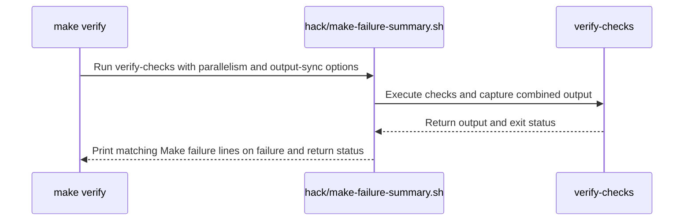

# PR #17283: Show e2e-common test output only on failure

**Summary**: Show e2e-common test output only on failure

**Sources**: https://github.com/kubernetes-sigs/kueue/pull/17283

**Last updated**: 2026-10-16T09:40:40Z

---

## Metadata

- **State**: closed (merged)
- **Author**: [@ivnovakov](https://github.com/ivnovakov)
- **Branch**: `cleanup/verify-failure-visibility` → `main`
- **Created**: 2026-10-15T14:44:18Z
- **Updated**: 2026-10-16T09:40:40Z
- **Merged**: 2026-10-16T09:16:09Z
- **Closed**: 2026-10-16T09:16:09Z
- **Labels**: `lgtm`, `release-note-none`, `approved`, `kind/cleanup`, `cncf-cla: yes`, `size/S`, `area/testing`
- **Assignees**: [@mbobrovskyi](https://github.com/mbobrovskyi)
- **Requested reviewers**: [@kannon92](https://github.com/kannon92), [@kshalot](https://github.com/kshalot)
- **Changed files**: 1   **+11 / -2**

## Description

<!-- Thank you for contributing! Check CONTRIBUTING.md for details. -->

#### What type of PR is this?
<!-- Choose one of the following kinds:
/kind bug
/kind cleanup
/kind documentation
/kind feature
/kind kep
-->
/kind cleanup

<!-- Optionally choose one or more of the following kinds:
/kind api-change
/kind deprecation
/kind failing-test
/kind flake
/kind regression
-->


<!-- Consider setting the area:
/area tas
/area was
/area integrations
/area multikueue
/area dashboard
/area localization
/area testing
/area website
-->
/area testing

#### What this PR does / why we need it?

`hack/testing/e2e-common_test.sh` fakes `docker` and `kind` to test the retries in `e2e-common.sh`, and it prints their errors even when it passes, including `net/http: TLS handshake timeout` for `registry.example.com`. That line is in every `pull-kueue-verify-*` log, green or red. On #15006, #16940, #16945 and #16956 it was read as a registry problem and the job was retested as infra. The real failures were a lint error, two typecheck errors and a release-utils assertion.

This PR makes `e2e-common_test.sh` write its output to a log in its temp directory and print that log only when the test fails. A passing run prints only `e2e-common tests passed`.

<!--
Use `Fixes #123` for an issue addressed by this PR; it will be closed when the PR merges.
Use `Related:` or `Part of:` to reference an issue without closing it.
-->
Fixes #16959

#### Useful notes for your reviewer

- The `make verify` failure summary from the first version of this PR moved to #17304, as asked in review. Without it, this PR applies cleanly to `release-0.19` and `release-0.20`, and it should be cherry-picked to both, since the misread failures were on release branches.
- Tested with `make verify-e2e-common-test`, which prints only `e2e-common tests passed`, and with a broken retry assertion, which prints the captured log and exits 1. A full `make verify` passes, and its log no longer contains `TLS handshake timeout`.
- This PR was written in part with the assistance of generative AI.

#### Release note

<!-- Describe the behavior change accurately from the user's perspective. Hints:
- Do not leave this block blank.
- Use "NONE" when there is no user-facing change.
- When feasible use a prefix for the sub-component or feature, e.g. "FairSharing:" or "MultiKueue:".
- If upgrade steps are required, include an "ACTION REQUIRED:" section.
You may consider AI assistance using the skill: cmd/experimental/skills/kueue-release-notes/SKILL.md.
-->
```release-note
NONE
```

## Discussion

### Comment by [@netlify[bot]](https://github.com/apps/netlify) — 2026-10-15T14:44:28Z

### <span aria-hidden="true">✅</span> Deploy Preview for *kubernetes-sigs-kueue* canceled.


|  Name | Link |
|:-:|------------------------|
|<span aria-hidden="true">🔨</span> Latest commit | 1932e93e68f388516ddea18bc5f9369dbe3d5d04 |
|<span aria-hidden="true">🔍</span> Latest deploy log | https://app.netlify.com/projects/kubernetes-sigs-kueue/deploys/6ad1d4345dc1de7350545fd1 |

### Comment by [@coderabbitai[bot]](https://github.com/apps/coderabbitai) — 2026-10-15T14:45:30Z

<!-- This is an auto-generated comment: summarize by coderabbit.ai -->
<!-- review_stack_entry_start -->

<a href="https://app.coderabbit.ai/change-stack/kubernetes-sigs/kueue/pull/17283?scope=ghh_OusAJGA4HG8ljoOV0wJvVx8NmnZIjc2DdjmxOu0xZWA&amp;cs_source=review_comment"><picture><source media="(prefers-color-scheme: dark)" srcset="https://storage.googleapis.com/coderabbit_public_assets/review-stack-in-coderabbit-ui-dark.svg?v=3"><source media="(prefers-color-scheme: light)" srcset="https://storage.googleapis.com/coderabbit_public_assets/review-stack-in-coderabbit-ui.svg?v=3"></picture></a>

<!-- review_stack_entry_end -->
<!-- recent_review_start -->

No actionable comments were generated in the recent review. 🎉

<details>
<summary><strong>ℹ️ Recent review info</strong></summary>
<dl>
<dd>

<details>
<summary><strong>⚙️ Run configuration</strong></summary>
<dl>
<dd>

- **Configuration used**: Repository: kubernetes-sigs/kueue/.coderabbit.yaml
- **Review profile**: CHILL
- **Plan**: Advanced
- **Run ID**: `ef315b34-61a0-493b-9424-59262b05e338`

</dd>
</dl>
</details>

<details>
<summary><strong>📥 Commits</strong></summary>
<dl>
<dd>

Reviewing files that changed from the base of the PR and between bb3556530dbcd0eca94b3e90fb5b98d0998aefd8 and 19218003af3942ca01cc1882784288518d5f5d58.

</dd>
</dl>
</details>

<details>
<summary><strong>📒 Files selected for processing: 4</strong></summary>
<dl>
<dd>

* `hack/make-failure-summary.sh`
* `hack/make/verify.mk`
* `hack/testing/e2e-common_test.sh`
* `hack/testing/make-failure-summary_test.sh`

</dd>
</dl>
</details>

**Included review availability:** This review used your included allowance. Your plan provides up to 8 included reviews per hour; 6 remain after this review.

</dd>
</dl>
</details>


<!-- recent_review_end -->
<!-- walkthrough_start -->

<details>
<summary><strong>📝 Walkthrough</strong></summary>
<dl>
<dd>

`make verify` runs its checks through a new output-capturing wrapper. On failure, the wrapper prints matching Make failure lines and returns the command’s status. Tests cover failure and success behavior.

**Changes: Make failure summary**

|Layer / File(s)|Summary|
|:---|:---|
|**Capture and summarize verification failures** <br> `hack/make-failure-summary.sh`, `hack/make/verify.mk`|The wrapper captures combined output and prints matching Make failure lines when the command fails. `make verify` uses the wrapper, and its documentation notes that failed targets appear again at the end.|
|**Validate failure handling** <br> `hack/make/verify.mk`, `hack/testing/make-failure-summary_test.sh`, `hack/testing/e2e-common_test.sh`|`verify-checks` runs the new wrapper test. The test checks failure status, repeated failure lines, and successful output. The e2e test helper prints its captured log on failure and writes its success message to the original stdout.|

<!-- change_assessment_start -->
**Priority:** ⬇️ Low


**Estimated code review effort:** 2 (Simple) | ~10 minutes

<!-- change_assessment_commit:"19218003af3942ca01cc1882784288518d5f5d58" -->
**Change:** Other
<!-- change_assessment_end -->

### Sequence Diagram(s)



**Suggested reviewers:** `yuluo-yx`

</dd>
</dl>
</details>

<!-- walkthrough_end -->
<details>
<summary><strong>Merge Risk:</strong> <strong>⚪ Minimal</strong> · up to <code>19218</code></summary>
<dl>
<dd>

<!-- final_review_risk_start -->
<!-- final_review_risk_label
**Merge Risk:** **⚪ Minimal** · up to `19218`
-->
<!-- final_review_risk_coverage:{"sourceCommitId":"19218003af3942ca01cc1882784288518d5f5d58","coveredCommitId":"19218003af3942ca01cc1882784288518d5f5d58","kind":"reviewed"} -->

The verify-log changes appear ready to merge after normal checks.
<!-- final_review_risk_end -->

</dd>
</dl>
</details>
<!-- pre_merge_checks_walkthrough_start -->

<details>
<summary><strong>Pre-merge checks: <sup><picture></picture></sup> 3 · <sup><picture></picture></sup> 2</strong></summary>
<dl>
<dd>

<strong><sup><picture></picture></sup> Failed checks: 2 warnings</strong>

|      Check name     |                                              Status                                              | Explanation                                                                                                                                                                                               | Resolution                                                                                                                                                                                                                                        |
| :----------------- | :----------------------------------------------------------------------------------------------: | :-------------------------------------------------------------------------------------------------------------------------------------------------------------------------------------------------------- | :------------------------------------------------------------------------------------------------------------------------------------------------------------------------------------------------------------------------------------------------ |
| Linked Issues check |  | Issue `#16959` requires investigation of the affected Prow image-pull job, the cause and mitigation for transient registry TLS timeouts, and confirmation of a successful image retrieval rerun. The diff … | Investigate and identify the affected Prow job. Implement or reference a concrete mitigation for the transient registry timeout. Add tests for that mitigation when applicable. Document the cause and mitigation, and provide evidence of succe… |
|  Docstring Coverage |  | Docstring coverage is 0.00% which is insufficient. The required threshold is 80.00%. Docstring coverage is scoped to functions touched by this diff. Analyzed 1 functions across 3 files. (1 skipped: 1 … | Write docstrings for the functions missing them to satisfy the coverage threshold.                                                                                                                                                                |

<details>
<summary><strong><sup><picture></picture></sup> Passed checks: 3 passed</strong></summary>
<dl>
<dd>

|         Check name         |                                             Status                                             | Explanation                                                                                                                                                                                               |
| :------------------------ | :--------------------------------------------------------------------------------------------: | :-------------------------------------------------------------------------------------------------------------------------------------------------------------------------------------------------------- |
| Out of Scope Changes check |  | The changes are limited to verification and test tooling. They address the misleading registry-like output from the fake `docker`/`kind` test and improve visibility of failed verification targets. The… |
|      Description Check     |  | Check skipped - CodeRabbit’s high-level summary is enabled.                                                                                                                                               |
|         Title check        |  | The title accurately describes the change to show e2e-common test output only when the test fails. It covers a real part of the pull request, although it does not mention the added make failure summar… |

<details>
<summary><strong>Full details: Out of Scope Changes check</strong></summary>
<dl>
<dd>

**Explanation**

The changes are limited to verification and test tooling. They address the misleading registry-like output from the fake `docker`/`kind` test and improve visibility of failed verification targets. The new test supports this behavior. These changes are connected to the CI-diagnosis problem in issue `#16959` and do not show unrelated product changes.

</dd>
</dl>
</details>

<details>
<summary><strong>Full details: Title check</strong></summary>
<dl>
<dd>

**Explanation**

The title accurately describes the change to show e2e-common test output only when the test fails. It covers a real part of the pull request, although it does not mention the added make failure summary.

</dd>
</dl>
</details>

</dd>
</dl>
</details>

<details>
<summary><strong>Full details: Linked Issues check</strong></summary>
<dl>
<dd>

**Explanation**

Issue `#16959` requires investigation of the affected Prow image-pull job, the cause and mitigation for transient registry TLS timeouts, and confirmation of a successful image retrieval rerun. The diff only captures output from the fake `docker`/`kind` test and summarizes failed `make` targets. It adds no registry connectivity or retry/recovery implementation. The added test covers summary output and exit status, not image retrieval. The PR provides no reviewable evidence for the affected job, registry cause, or successful rerun.

**Resolution**

Investigate and identify the affected Prow job. Implement or reference a concrete mitigation for the transient registry timeout. Add tests for that mitigation when applicable. Document the cause and mitigation, and provide evidence of successful image retrieval on a rerun.

</dd>
</dl>
</details>

<details>
<summary><strong>Full details: Docstring Coverage</strong></summary>
<dl>
<dd>

**Explanation**

Docstring coverage is 0.00% which is insufficient. The required threshold is 80.00%. Docstring coverage is scoped to functions touched by this diff. Analyzed 1 functions across 3 files. (1 skipped: 1 unsupported.)

**Resolution**

Write docstrings for the functions missing them to satisfy the coverage threshold.

</dd>
</dl>
</details>

</dd>
</dl>
</details>

<!-- pre_merge_checks_walkthrough_end -->

- [ ] <!-- {"checkboxId":"585bb3f6-faf5-4dbf-96d2-74e382adf19a"} --> Fix all pre-merge checks with AI
<!-- finishing_touch_checkbox_start -->

<details>
<summary><strong>✨ Finishing Touches</strong></summary>
<dl>
<dd>

<details open>
<summary><strong>🧪 Generate unit tests (beta)</strong></summary>
<dl>
<dd>

- [ ] <!-- {"checkboxId": "f47ac10b-58cc-4372-a567-0e02b2c3d479", "radioGroupId": "utg-output-choice-group-unknown_comment_id"} --> Create a new PR

</dd>
</dl>
</details>

</dd>
</dl>
</details>

<!-- finishing_touch_checkbox_end -->

<!-- autopilot:start -->
- [ ] <!-- {"checkboxId":"2708ad07-9f24-4260-9c11-7dc76a49f2e3"} --> <strong title="Keep fixing CodeRabbit findings and required CI, and resolving merge conflicts">Autofix</strong> · Keep fixing CodeRabbit findings and required CI, and resolving merge conflicts
<!-- autopilot:end -->
<!-- tips_start -->


<sub>Comment `@coderabbitai help` to get the list of available commands.</sub>

<!-- tips_end -->

### Comment by [@mbobrovskyi](https://github.com/mbobrovskyi) — 2026-10-16T08:48:23Z

Thank you!

/lgtm
/approve

### Comment by [@kubernetes-prow[bot]](https://github.com/apps/kubernetes-prow) — 2026-10-16T08:48:31Z

LGTM label has been added.  <details>Git tree hash: 2f4934220ade00ae356eaccd65a4f278e0405524</details>

### Comment by [@kubernetes-prow[bot]](https://github.com/apps/kubernetes-prow) — 2026-10-16T08:48:36Z

[APPROVALNOTIFIER] This PR is **APPROVED**

This pull-request has been approved by: *<a href="https://github.com/kubernetes-sigs/kueue/pull/17283#" title="Author self-approved">ivnovakov</a>*, *<a href="https://github.com/kubernetes-sigs/kueue/pull/17283#issuecomment-6211744190" title="Approved">mbobrovskyi</a>*

The full list of commands accepted by this bot can be found [here](https://go.k8s.io/bot-commands?repo=kubernetes-sigs%2Fkueue).

The pull request process is described [here](https://git.k8s.io/community/contributors/guide/owners.md#the-code-review-process)

<details >
Needs approval from an approver in each of these files:

- ~~[hack/testing/OWNERS](https://github.com/kubernetes-sigs/kueue/blob/main/hack/testing/OWNERS)~~ [mbobrovskyi]

Approvers can indicate their approval by writing `/approve` in a comment
Approvers can cancel approval by writing `/approve cancel` in a comment
</details>
<!-- META={"approvers":[]} -->

### Comment by [@mbobrovskyi](https://github.com/mbobrovskyi) — 2026-10-16T08:48:46Z

/cherry-pick release-0.20
/cherry-pick release-0.19

### Comment by [@k8s-infra-cherrypick-robot](https://github.com/k8s-infra-cherrypick-robot) — 2026-10-16T08:48:49Z

@mbobrovskyi: once the present PR merges, I will cherry-pick it on top of `release-0.19`, `release-0.20` in new PRs and assign them to you.

<details>

In response to [this](https://github.com/kubernetes-sigs/kueue/pull/17283#issuecomment-6211751113):

>/cherry-pick release-0.20
>/cherry-pick release-0.19


Instructions for interacting with me using PR comments are available [here](https://git.k8s.io/community/contributors/guide/pull-requests.md).  If you have questions or suggestions related to my behavior, please file an issue against the [kubernetes-sigs/prow](https://github.com/kubernetes-sigs/prow/issues/new?title=Prow%20issue:) repository.
</details>

### Comment by [@mbobrovskyi](https://github.com/mbobrovskyi) — 2026-10-16T08:51:17Z

It would be great also to hide this:


### Comment by [@k8s-infra-cherrypick-robot](https://github.com/k8s-infra-cherrypick-robot) — 2026-10-16T09:16:52Z

@mbobrovskyi: new pull request created: #17315

<details>

In response to [this](https://github.com/kubernetes-sigs/kueue/pull/17283#issuecomment-6211751113):

>/cherry-pick release-0.20
>/cherry-pick release-0.19


Instructions for interacting with me using PR comments are available [here](https://git.k8s.io/community/contributors/guide/pull-requests.md).  If you have questions or suggestions related to my behavior, please file an issue against the [kubernetes-sigs/prow](https://github.com/kubernetes-sigs/prow/issues/new?title=Prow%20issue:) repository.
</details>

### Comment by [@k8s-infra-cherrypick-robot](https://github.com/k8s-infra-cherrypick-robot) — 2026-10-16T09:17:32Z

@mbobrovskyi: new pull request created: #17316

<details>

In response to [this](https://github.com/kubernetes-sigs/kueue/pull/17283#issuecomment-6211751113):

>/cherry-pick release-0.20
>/cherry-pick release-0.19


Instructions for interacting with me using PR comments are available [here](https://git.k8s.io/community/contributors/guide/pull-requests.md).  If you have questions or suggestions related to my behavior, please file an issue against the [kubernetes-sigs/prow](https://github.com/kubernetes-sigs/prow/issues/new?title=Prow%20issue:) repository.
</details>

## Reviews

### Review by [@mimowo](https://github.com/mimowo) (commented) — 2026-10-15T15:53:41Z

/assign @mbobrovskyi

### Review by [@mbobrovskyi](https://github.com/mbobrovskyi) (commented) — 2026-10-16T04:02:59Z

- **hack/make/verify.mk:82** by [@mbobrovskyi](https://github.com/mbobrovskyi) — 2026-10-16T04:02:59Z
```diff
@@ -78,7 +79,7 @@ PATHS_TO_VERIFY := config/components apis charts/kueue client-go keps site/ netl
 ##   or in another included fragment (`hack/make/test.mk`, etc.) if it logically belongs there.
 ## - Then, wire it into the appropriate aggregator target below.
 verify: ## Ensure repo is clean after generation/formatting.
-	$(MAKE) -j $(VERIFY_NPROCS) $(if $(VERIFY_OUTPUT_SYNC),--output-sync=$(VERIFY_OUTPUT_SYNC)) verify-checks
+	$(PROJECT_DIR)/hack/make-failure-summary.sh $(MAKE) -j $(VERIFY_NPROCS) $(if $(VERIFY_OUTPUT_SYNC),--output-sync=$(VERIFY_OUTPUT_SYNC)) verify-checks
```

  It looks like these changes are independent, right? Could we move them to a separate PR?

### Review by [@mbobrovskyi](https://github.com/mbobrovskyi) (commented) — 2026-10-16T04:19:44Z

Thanks for the PR! The two changes are independent, so could we split them into two PRs?

  1. `make verify` failure summary: `hack/make-failure-summary.sh`, its test, and the `hack/make/verify.mk` changes.                                              
  2. Quieter `hack/testing/e2e-common_test.sh`, which fixes #16959.                                                                                           
                                                                                                                                                            
That way each PR has one purpose and can be reviewed and cherry-picked on its own.

### Review by [@ivnovakov](https://github.com/ivnovakov) (commented) — 2026-10-16T07:42:08Z

- **hack/make/verify.mk:82** by [@ivnovakov](https://github.com/ivnovakov) — 2026-10-16T07:42:08Z
```diff
@@ -78,7 +79,7 @@ PATHS_TO_VERIFY := config/components apis charts/kueue client-go keps site/ netl
 ##   or in another included fragment (`hack/make/test.mk`, etc.) if it logically belongs there.
 ## - Then, wire it into the appropriate aggregator target below.
 verify: ## Ensure repo is clean after generation/formatting.
-	$(MAKE) -j $(VERIFY_NPROCS) $(if $(VERIFY_OUTPUT_SYNC),--output-sync=$(VERIFY_OUTPUT_SYNC)) verify-checks
+	$(PROJECT_DIR)/hack/make-failure-summary.sh $(MAKE) -j $(VERIFY_NPROCS) $(if $(VERIFY_OUTPUT_SYNC),--output-sync=$(VERIFY_OUTPUT_SYNC)) verify-checks
```

  Good point, added https://github.com/kubernetes-sigs/kueue/pull/17304.
