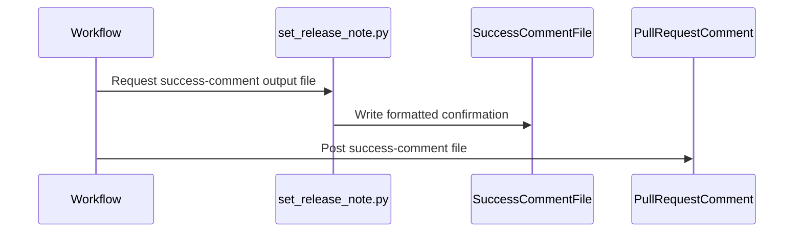

# PR #17606: Show the release note in the /set-release-note success comment

**Summary**: Show the release note in the /set-release-note success comment

**Sources**: https://github.com/kubernetes-sigs/kueue/pull/17606

**Last updated**: 2026-10-23T10:44:08Z

---

## Metadata

- **State**: closed (merged)
- **Author**: [@onkar717](https://github.com/onkar717)
- **Branch**: `set-release-note-show-note` → `main`
- **Created**: 2026-10-22T09:17:04Z
- **Updated**: 2026-10-23T10:44:08Z
- **Merged**: 2026-10-23T10:44:05Z
- **Closed**: 2026-10-23T10:44:05Z
- **Labels**: `kind/feature`, `lgtm`, `release-note-none`, `approved`, `size/M`, `ok-to-test`, `cncf-cla: yes`
- **Assignees**: [@mbobrovskyi](https://github.com/mbobrovskyi)
- **Requested reviewers**: [@kannon92](https://github.com/kannon92), [@tenzen-y](https://github.com/tenzen-y)
- **Changed files**: 3   **+32 / -5**

## Description

#### What type of PR is this?

/kind feature

#### What this PR does / why we need it?

Follow-up from the review of #17101. `/set-release-note` ends the note at the next Prow command, so text after a command is not part of the note. The bot only replied "✅ The release note was updated.", so the author could not see what was kept.

The success comment now shows the note that was set, in a `release-note` block. A small `release_note_block` helper builds that block for both the PR body and the comment. `set_release_note.py` writes the comment to a file passed with `--success-comment-file`, and the workflow posts it with `--body-file`.

Part of #17085

#### Useful notes for your reviewer

- The note never contains a fence, since the parser rejects fenced code blocks, so the block in the comment cannot break.
- Ran the release-utils suite the same way `make verify` does: 33 tests pass. Doctests pass.

#### Release note

```release-note
NONE
```


<!-- This is an auto-generated comment: release notes by coderabbit.ai -->
<!-- coderabbit-ai-generated:v1 -->

## AI summary

The release-note bot now accepts `/set-release-note` at the start of a comment or on its own line after other text. It includes the parsed release note in the success comment. The parser uses the last command when a comment contains repeated commands and rejects comments that also contain `/release-note-edit` or `/release-note-none`.

## Suggested release note

NONE
<!-- end of auto-generated comment: release notes by coderabbit.ai -->

## Discussion

### Comment by [@netlify[bot]](https://github.com/apps/netlify) — 2026-10-22T09:17:10Z

### <span aria-hidden="true">✅</span> Deploy Preview for *kubernetes-sigs-kueue* ready!


|  Name | Link |
|:-:|------------------------|
|<span aria-hidden="true">🔨</span> Latest commit | 3e094808412434fc12daa1fb9b97530b052768c8 |
|<span aria-hidden="true">🔍</span> Latest deploy log | https://app.netlify.com/projects/kubernetes-sigs-kueue/deploys/6ada1e4a8dcd57c55f4eaf10 |
|<span aria-hidden="true">😎</span> Deploy Preview | [https://deploy-preview-17606--kubernetes-sigs-kueue.netlify.app](https://deploy-preview-17606--kubernetes-sigs-kueue.netlify.app) |
|<span aria-hidden="true">📱</span> Preview on mobile | <details><summary> Toggle QR Code... </summary><br /><br /><br /><br />_Use your smartphone camera to open QR code link._</details> |
---
<!-- [kubernetes-sigs-kueue Preview](https://deploy-preview-17606--kubernetes-sigs-kueue.netlify.app) -->
_To edit notification comments on pull requests, go to your [Netlify project configuration](https://app.netlify.com/projects/kubernetes-sigs-kueue/configuration/notifications#deploy-notifications)._

### Comment by [@kubernetes-prow[bot]](https://github.com/apps/kubernetes-prow) — 2026-10-22T09:17:15Z

Hi @onkar717. Thanks for your PR.

I'm waiting for a [kubernetes-sigs](https://github.com/orgs/kubernetes-sigs/people) member to verify that this patch is reasonable to test. If it is, they should reply with `/ok-to-test` on its own line. Until that is done, I will not automatically test new commits in this PR, but the usual testing commands by org members will still work.

>[!TIP]
>**We noticed you've done this a few times! Consider [joining the org](https://git.k8s.io/community/community-membership.md#member) to skip this step and gain `/lgtm` and other bot rights.** We recommend asking approvers on your previous PRs to sponsor you.

Once the patch is verified, the new status will be reflected by the `ok-to-test` label.

I understand the commands that are listed [here](https://go.k8s.io/bot-commands?repo=kubernetes-sigs%2Fkueue).

<details>

Instructions for interacting with me using PR comments are available [here](https://git.k8s.io/community/contributors/guide/pull-requests.md).  If you have questions or suggestions related to my behavior, please file an issue against the [kubernetes-sigs/prow](https://github.com/kubernetes-sigs/prow/issues/new?title=Prow%20issue:) repository.
</details>

### Comment by [@coderabbitai[bot]](https://github.com/apps/coderabbitai) — 2026-10-22T09:17:27Z

<!-- coderabbit-ai-generated:v1 -->

<!-- This is an auto-generated comment: summarize by coderabbit.ai -->
<!-- review_stack_entry_start -->

<a href="https://app.coderabbit.ai/change-stack/kubernetes-sigs/kueue/pull/17606?scope=ghh_OusAJGA4HG8ljoOV0wJvVx8NmnZIjc2DdjmxOu0xZWA&amp;cs_source=review_comment"><picture><source media="(prefers-color-scheme: dark)" srcset="https://storage.googleapis.com/coderabbit_public_assets/review-stack-in-coderabbit-ui-dark.svg?v=3"><source media="(prefers-color-scheme: light)" srcset="https://storage.googleapis.com/coderabbit_public_assets/review-stack-in-coderabbit-ui.svg?v=3"></picture></a>

<!-- review_stack_entry_end -->
<!-- recent_review_start -->

No actionable comments were generated in the recent review. 🎉

<details>
<summary><strong>ℹ️ Recent review info</strong></summary>
<dl>
<dd>

<details>
<summary><strong>⚙️ Run configuration</strong></summary>
<dl>
<dd>

- **Source mode**: Auto
- **Repository**: [kubernetes-sigs/kueue](<https://github.com/kubernetes-sigs/kueue>)
- **Branch**: [main](<https://github.com/kubernetes-sigs/kueue/tree/main>)
- **File**: [.coderabbit.yaml](<https://github.com/kubernetes-sigs/kueue/blob/504213adc39d83f709f0c45420ff4830f90c86a7/.coderabbit.yaml>)
- **Commit**: [504213a](<https://github.com/kubernetes-sigs/kueue/commit/504213adc39d83f709f0c45420ff4830f90c86a7>)
- **Layers**: Repository YAML
- **Review profile**: CHILL
- **Plan**: Advanced
- **Run ID**: `478b4696-e49d-4ebe-8978-82dee2a1c030`

</dd>
</dl>
</details>

<details>
<summary><strong>📥 Commits</strong></summary>
<dl>
<dd>

Reviewing files that changed from the base of the PR and between 061a900a5251a93e4e3a00cd1b9ea4bfad8da547 and 3e094808412434fc12daa1fb9b97530b052768c8.

</dd>
</dl>
</details>

<details>
<summary><strong>📒 Files selected for processing: 2</strong></summary>
<dl>
<dd>

* `hack/releasing/set_release_note.py`
* `hack/releasing/set_release_note_test.py`

</dd>
</dl>
</details>

**Included review availability:** This review used your included allowance. Your plan provides up to 8 included reviews per hour; 7 remain after this review.

</dd>
</dl>
</details>


<!-- recent_review_end -->
<!-- walkthrough_start -->

<details>
<summary><strong>📝 Walkthrough</strong></summary>
<dl>
<dd>

The release-note workflow accepts `/set-release-note` after a newline. The script formats the release-note block and can write a success comment containing it to a file. The workflow posts that generated comment.

**Changes: Release-note workflow**

|Layer / File(s)|Summary|
|:---|:---|
|**Recognize the command after a newline** <br> `.github/workflows/set-release-note.yml`|The workflow condition also matches `/set-release-note` when it immediately follows a newline.|
|**Generate and post the confirmation** <br> `hack/releasing/set_release_note.py`, `hack/releasing/set_release_note_test.py`, `.github/workflows/set-release-note.yml`|The script formats the release-note block and optionally writes a success comment to a file. The workflow posts that file. Tests verify the updated body and confirmation for a two-line note.|

<!-- change_assessment_start -->
**Priority:** ⬇️ Low

**Estimated code review effort:** 2 (Simple) | ~10 minutes

<!-- change_assessment_commit:"3e094808412434fc12daa1fb9b97530b052768c8" -->
**Change:** Feature
<!-- change_assessment_end -->

### Sequence Diagram(s)



**Possibly related PRs**

- [kubernetes-sigs/kueue#17101](https://github.com/kubernetes-sigs/kueue/pull/17101): This PR changes the parser and workflow trigger used to obtain the release note. This change formats the parsed note in the success comment.

**Suggested reviewers:** `yuluo-yx`

</dd>
</dl>
</details>

<!-- walkthrough_end -->
<details>
<summary><strong>Merge Risk:</strong> <strong>⚪ Minimal</strong> · up to <code>3e094</code></summary>
<dl>
<dd>

<!-- final_review_risk_start -->
<!-- final_review_risk_label
**Merge Risk:** **⚪ Minimal** · up to `3e094`
-->
<!-- final_review_risk_coverage:{"sourceCommitId":"3e094808412434fc12daa1fb9b97530b052768c8","coveredCommitId":"3e094808412434fc12daa1fb9b97530b052768c8","kind":"reviewed"} -->

No current-head merge-blocking risk is established.
<!-- final_review_risk_end -->

</dd>
</dl>
</details>
<!-- pre_merge_checks_walkthrough_start -->

<details>
<summary><strong>Pre-merge checks: <sup><picture></picture></sup> 4 · <sup><picture></picture></sup> 1</strong></summary>
<dl>
<dd>

<strong><sup><picture></picture></sup> Failed checks: 1 warning</strong>

|     Check name     |                                              Status                                              | Explanation                                                                                                                                                                                | Resolution                                                                         |
| :---------------- | :----------------------------------------------------------------------------------------------: | :----------------------------------------------------------------------------------------------------------------------------------------------------------------------------------------- | :--------------------------------------------------------------------------------- |
| Docstring Coverage |  | Docstring coverage is 66.67% which is insufficient. The required threshold is 80.00%. Docstring coverage is scoped to functions touched by this diff. Analyzed 6 functions across 2 files. | Write docstrings for the functions missing them to satisfy the coverage threshold. |

<details>
<summary><strong><sup><picture></picture></sup> Passed checks: 4 passed</strong></summary>
<dl>
<dd>

|         Check name         |                                             Status                                             | Explanation                                                                                                                       |
| :------------------------ | :--------------------------------------------------------------------------------------------: | :-------------------------------------------------------------------------------------------------------------------------------- |
|      Description Check     |  | Check skipped - CodeRabbit’s high-level summary is enabled.                                                                       |
|         Title check        |  | The title clearly and concisely describes the main change: including the release note in the `/set-release-note` success comment. |
|     Linked Issues check    |  | Check skipped because no linked issues were found for this pull request.                                                          |
| Out of Scope Changes check |  | Check skipped because no linked issues were found for this pull request.                                                          |

</dd>
</dl>
</details>

</dd>
</dl>
</details>

<!-- pre_merge_checks_walkthrough_end -->
<!-- finishing_touch_checkbox_start -->

<details>
<summary><strong>✨ Finishing Touches</strong></summary>
<dl>
<dd>

<details open>
<summary><strong>🧪 Generate unit tests (beta)</strong></summary>
<dl>
<dd>

- [ ] <!-- {"checkboxId": "f47ac10b-58cc-4372-a567-0e02b2c3d479", "radioGroupId": "utg-output-choice-group-unknown_comment_id"} --> Create a new PR

</dd>
</dl>
</details>

</dd>
</dl>
</details>

<!-- finishing_touch_checkbox_end -->

<!-- autopilot:start -->
- [ ] <!-- {"checkboxId":"2708ad07-9f24-4260-9c11-7dc76a49f2e3"} --> <strong title="Keep fixing CodeRabbit findings and required CI, and resolving merge conflicts">Autofix</strong> · Keep fixing CodeRabbit findings and required CI, and resolving merge conflicts
<!-- autopilot:end -->
<!-- tips_start -->


<sub>Comment `@coderabbitai help` to get the list of available commands.</sub>

<!-- tips_end -->

### Comment by [@mbobrovskyi](https://github.com/mbobrovskyi) — 2026-10-22T09:34:09Z

/ok-to-test

### Comment by [@mbobrovskyi](https://github.com/mbobrovskyi) — 2026-10-22T13:06:16Z

@onkar717 could you please rebase PR?

### Comment by [@onkar717](https://github.com/onkar717) — 2026-10-22T14:36:06Z

@mbobrovskyi rebased on main and applied all three: the comment now says "updated to:", the `release-note` block comes from a small `release_note_block` helper used for both the PR body and the comment, and `SuccessCommentTest` is dropped in favor of a multi-line note in `MainTest`.

### Comment by [@kubernetes-prow[bot]](https://github.com/apps/kubernetes-prow) — 2026-10-22T14:47:37Z

LGTM label has been added.  <details>Git tree hash: e805b350084b123d075142fc401a74439fdeb0ac</details>

### Comment by [@kubernetes-prow[bot]](https://github.com/apps/kubernetes-prow) — 2026-10-22T14:47:40Z

[APPROVALNOTIFIER] This PR is **APPROVED**

This pull-request has been approved by: *<a href="https://github.com/kubernetes-sigs/kueue/pull/17606#pullrequestreview-5616105989" title="Approved">mbobrovskyi</a>*, *<a href="https://github.com/kubernetes-sigs/kueue/pull/17606#" title="Author self-approved">onkar717</a>*

The full list of commands accepted by this bot can be found [here](https://go.k8s.io/bot-commands?repo=kubernetes-sigs%2Fkueue).

The pull request process is described [here](https://git.k8s.io/community/contributors/guide/owners.md#the-code-review-process)

<details >
Needs approval from an approver in each of these files:

- ~~[.github/workflows/OWNERS](https://github.com/kubernetes-sigs/kueue/blob/main/.github/workflows/OWNERS)~~ [mbobrovskyi]
- ~~[hack/OWNERS](https://github.com/kubernetes-sigs/kueue/blob/main/hack/OWNERS)~~ [mbobrovskyi]

Approvers can indicate their approval by writing `/approve` in a comment
Approvers can cancel approval by writing `/approve cancel` in a comment
</details>
<!-- META={"approvers":[]} -->

### Comment by [@mimowo](https://github.com/mimowo) — 2026-10-23T10:08:04Z

/unhold

## Reviews

### Review by [@mbobrovskyi](https://github.com/mbobrovskyi) (commented) — 2026-10-22T13:28:34Z

- **hack/releasing/set_release_note.py:297** by [@mbobrovskyi](https://github.com/mbobrovskyi) — 2026-10-22T13:28:34Z
```diff
@@ -166,12 +288,22 @@ def set_release_note(pr_body: str, release_note: str) -> str:
     return updated_body
 
 
+def success_comment(release_note: str) -> str:
+    """Build the confirmation comment, showing the note that was set.
+
+    Text after another command is not part of the note, so the author can
+    check here what was kept. The note never contains a fence.
+    """
+    return f"✅ The release note was updated:\n\n```release-note\n{release_note}\n```\n"
```

  ```suggestion
      return f"✅ The release note was updated to:\n\n```release-note\n{release_note}\n```\n"
  ```
  nit

### Review by [@mbobrovskyi](https://github.com/mbobrovskyi) (commented) — 2026-10-22T13:33:22Z

- **hack/releasing/set_release_note.py:296** by [@mbobrovskyi](https://github.com/mbobrovskyi) — 2026-10-22T13:33:23Z
```diff
@@ -166,12 +288,22 @@ def set_release_note(pr_body: str, release_note: str) -> str:
     return updated_body
 
 
+def success_comment(release_note: str) -> str:
```

  The `` ```release-note `` block is now built in two places: here and in `set_release_note` (`new_block`). Could we extract a small helper, so the comment 
    and the PR body cannot drift apart?                                                                                                                       
                                                                                                                                                              
    ```python                                                                                                                                                 
    def _release_note_block(release_note: str) -> str:                                                                                                        
        """Format the note as a release-note fenced block."""                                                                                                 
        return f"```release-note\n{release_note}\n```"                                                                                                        
    ```                                                                                                                                                       
                                                                                                                                                              
    Then use `new_block = _release_note_block(release_note)` in `set_release_note`, and here:                                                                 
                                                                                                                                                              
    ```python                                                                                                                                                 
        return f"✅ The release note was updated to:\n\n{_release_note_block(release_note)}\n"                                                                
    ```

### Review by [@mbobrovskyi](https://github.com/mbobrovskyi) (commented) — 2026-10-22T13:34:38Z

- **hack/releasing/set_release_note_test.py:273** by [@mbobrovskyi](https://github.com/mbobrovskyi) — 2026-10-22T13:34:38Z
```diff
@@ -213,13 +270,22 @@ def test_enforces_updated_body_length_limit(self) -> None:
                 set_release_note.set_release_note(pr_body, release_note)
 
 
+class SuccessCommentTest(unittest.TestCase):
```

  `MainTest.test_writes_updated_body` already checks the full content of `success_comment.md`, so this class mostly repeats that assertion. The only extra case here is a multi-line note. Could we drop `SuccessCommentTest` and use a multi-line note in `MainTest` instead (`"/set-release-note\nFirst line\nSecond line"`)? Then one test covers both the format and the CLI wiring.

### Review by [@mbobrovskyi](https://github.com/mbobrovskyi) (commented) — 2026-10-22T13:34:47Z

Otherwise LGTM

### Review by [@mbobrovskyi](https://github.com/mbobrovskyi) (commented) — 2026-10-22T14:47:26Z

Awesome! Thank you!

/lgtm
/approve

/hold if @mimowo want to add something
