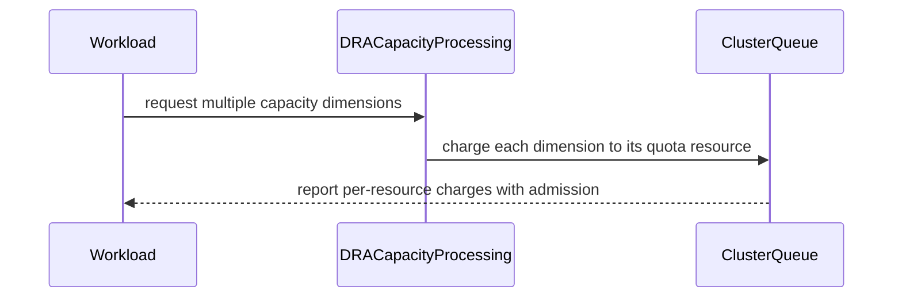

# PR #17642: DRA: separate quota per capacity dimension and log rounded charges

**Summary**: DRA: separate quota per capacity dimension and log rounded charges

**Sources**: https://github.com/kubernetes-sigs/kueue/pull/17642

**Last updated**: 2026-10-23T19:31:04Z

---

## Metadata

- **State**: open
- **Author**: [@sohankunkerkar](https://github.com/sohankunkerkar)
- **Branch**: `dra-cc-capacity-dimensions` → `main`
- **Created**: 2026-10-22T17:40:08Z
- **Updated**: 2026-10-23T19:31:04Z
- **Merged**: —
- **Closed**: —
- **Labels**: `kind/feature`, `release-note`, `size/XL`, `approved`, `cncf-cla: yes`, `area/dra`
- **Assignees**: _none_
- **Requested reviewers**: [@kannon92](https://github.com/kannon92), [@olekzabl](https://github.com/olekzabl)
- **Changed files**: 14   **+672 / -53**

## Description


<!-- Thank you for contributing! Check CONTRIBUTING.md for details. -->

#### What type of PR is this?
<!-- Choose one of the following kinds:
/kind bug
/kind cleanup
/kind documentation
/kind feature
/kind kep
-->
/kind feature
/area dra

<!-- Optionally choose one or more of the following kinds:
/kind api-change
/kind deprecation
/kind failing-test
/kind flake
/kind regression
-->


<!-- Consider setting the area:
/area tas
/area was
/area integrations
/area multikueue
/area dashboard
/area localization
/area testing
/area website
-->


#### What this PR does / why we need it?

Lets one DeviceClass map capacity dimensions with different names to separate quota resources, logs when RequestPolicy rounding raises an explicit capacity request, and records how KEP-2941 meets each Beta criterion.

<!--
Use `Fixes #123` for an issue addressed by this PR; it will be closed when the PR merges.
Use `Related:` or `Part of:` to reference an issue without closing it.
-->
Fixes https://github.com/kubernetes-sigs/kueue/issues/17635

#### Useful notes for your reviewer


#### Release note

<!-- Describe the behavior change accurately from the user's perspective. Hints:
- Do not leave this block blank.
- Use "NONE" when there is no user-facing change.
- When feasible use a prefix for the sub-component or feature, e.g. "FairSharing:" or "MultiKueue:".
- If upgrade steps are required, include an "ACTION REQUIRED:" section.
You may consider AI assistance using the skill: cmd/experimental/skills/kueue-release-notes/SKILL.md.
-->
```release-note
DRA: Allow one DeviceClass to have separate quota for each consumable capacity dimension.
```


<!-- This is an auto-generated comment: release notes by coderabbit.ai -->
<!-- coderabbit-ai-generated:v1 -->

## AI summary

A DRA `DeviceClass` can map distinct capacity dimensions to separate quota resources. Kueue charges each dimension independently and logs when `RequestPolicy` rounding increases an explicit request. The PR also updates KEP-2941, documentation, and tests. This behavior is controlled by the `KueueDRAIntegrationConsumableCapacity` feature gate.

### Suggested release note

DRA: Allow distinct capacity dimensions from one `DeviceClass` to use separate quota resources, so users can track and charge each dimension independently. When `RequestPolicy` rounding increases an explicit capacity request, Kueue logs the rounded charge. This behavior is controlled by the `KueueDRAIntegrationConsumableCapacity` feature gate.
<!-- end of auto-generated comment: release notes by coderabbit.ai -->

## Discussion

### Comment by [@netlify[bot]](https://github.com/apps/netlify) — 2026-10-22T17:40:21Z

### <span aria-hidden="true">✅</span> Deploy Preview for *kubernetes-sigs-kueue* ready!


|  Name | Link |
|:-:|------------------------|
|<span aria-hidden="true">🔨</span> Latest commit | 8d79b776b777864eae187154a3470baaf55ee1ec |
|<span aria-hidden="true">🔍</span> Latest deploy log | https://app.netlify.com/projects/kubernetes-sigs-kueue/deploys/6adbb4c4b4cdca643015f335 |
|<span aria-hidden="true">😎</span> Deploy Preview | [https://deploy-preview-17642--kubernetes-sigs-kueue.netlify.app](https://deploy-preview-17642--kubernetes-sigs-kueue.netlify.app) |
|<span aria-hidden="true">📱</span> Preview on mobile | <details><summary> Toggle QR Code... </summary><br /><br /><br /><br />_Use your smartphone camera to open QR code link._</details> |
---
<!-- [kubernetes-sigs-kueue Preview](https://deploy-preview-17642--kubernetes-sigs-kueue.netlify.app) -->
_To edit notification comments on pull requests, go to your [Netlify project configuration](https://app.netlify.com/projects/kubernetes-sigs-kueue/configuration/notifications#deploy-notifications)._

### Comment by [@kubernetes-prow[bot]](https://github.com/apps/kubernetes-prow) — 2026-10-22T17:40:29Z

[APPROVALNOTIFIER] This PR is **APPROVED**

This pull-request has been approved by: *<a href="https://github.com/kubernetes-sigs/kueue/pull/17642#" title="Author self-approved">sohankunkerkar</a>*

The full list of commands accepted by this bot can be found [here](https://go.k8s.io/bot-commands?repo=kubernetes-sigs%2Fkueue).

The pull request process is described [here](https://git.k8s.io/community/contributors/guide/owners.md#the-code-review-process)

<details >
Needs approval from an approver in each of these files:

- ~~[OWNERS](https://github.com/kubernetes-sigs/kueue/blob/main/OWNERS)~~ [sohankunkerkar]

Approvers can indicate their approval by writing `/approve` in a comment
Approvers can cancel approval by writing `/approve cancel` in a comment
</details>
<!-- META={"approvers":[]} -->

### Comment by [@coderabbitai[bot]](https://github.com/apps/coderabbitai) — 2026-10-22T17:40:31Z

<!-- coderabbit-ai-generated:v1 -->

<!-- This is an auto-generated comment: summarize by coderabbit.ai -->
<!-- review_stack_entry_start -->

<a href="https://app.coderabbit.ai/change-stack/kubernetes-sigs/kueue/pull/17642?scope=ghh_OusAJGA4HG8ljoOV0wJvVx8NmnZIjc2DdjmxOu0xZWA&amp;cs_source=review_comment"><picture><source media="(prefers-color-scheme: dark)" srcset="https://storage.googleapis.com/coderabbit_public_assets/review-stack-in-coderabbit-ui-dark.svg?v=3"><source media="(prefers-color-scheme: light)" srcset="https://storage.googleapis.com/coderabbit_public_assets/review-stack-in-coderabbit-ui.svg?v=3"></picture></a>

<!-- review_stack_entry_end -->
<!-- recent_review_start -->

No actionable comments were generated in the recent review. 🎉

<details>
<summary><strong>ℹ️ Recent review info</strong></summary>
<dl>
<dd>

<details>
<summary><strong>⚙️ Run configuration</strong></summary>
<dl>
<dd>

- **Source mode**: Auto
- **Repository**: [kubernetes-sigs/kueue](<https://github.com/kubernetes-sigs/kueue>)
- **Branch**: [main](<https://github.com/kubernetes-sigs/kueue/tree/main>)
- **File**: [.coderabbit.yaml](<https://github.com/kubernetes-sigs/kueue/blob/d98cde105dd753bec5d8a83ee51f274c098761cd/.coderabbit.yaml>)
- **Commit**: [d98cde1](<https://github.com/kubernetes-sigs/kueue/commit/d98cde105dd753bec5d8a83ee51f274c098761cd>)
- **Layers**: Repository YAML
- **Review profile**: CHILL
- **Plan**: Advanced
- **Run ID**: `a7910592-91f0-4074-93d9-a3fa48adfd59`

</dd>
</dl>
</details>

<details>
<summary><strong>📥 Commits</strong></summary>
<dl>
<dd>

Reviewing files that changed from the base of the PR and between 6d14629a0ef7934188c7d5cda8bf587322906a30 and 8d79b776b777864eae187154a3470baaf55ee1ec.

</dd>
</dl>
</details>

<details>
<summary><strong>📒 Files selected for processing: 4</strong></summary>
<dl>
<dd>

* `keps/2941-DRA/README.md`
* `pkg/cache/scheduler/dra/checker_test.go`
* `pkg/dra/extended_resources_test.go`
* `site/content/en/docs/tasks/manage/setup_dra.md`

</dd>
</dl>
</details>

<details>
<summary><strong>🚧 Files skipped from review as they are similar to previous changes: 2</strong></summary>
<dl>
<dd>

* site/content/en/docs/tasks/manage/setup_dra.md
* keps/2941-DRA/README.md

</dd>
</dl>
</details>

**Included review availability:** This review used your included allowance. Your plan provides up to 8 included reviews per hour; 7 remain after this review.

</dd>
</dl>
</details>


<!-- recent_review_end -->
<!-- walkthrough_start -->

<details>
<summary><strong>📝 Walkthrough</strong></summary>
<dl>
<dd>

The PR allows a DeviceClass to map to separate quota resources for distinct capacity dimensions. Validation rejects repeated capacity names and counter-capacity overlap. Capacity processing charges each dimension to its configured resource. Tests and documentation cover the mapping, charging, and reporting behavior.

**Changes: Capacity dimension quota mapping**

|Layer / File(s)|Summary|
|:---|:---|
|**Validate and store dimension mappings** <br> `pkg/config/validation.go`, `pkg/config/validation_test.go`, `pkg/dra/mapper.go`, `pkg/dra/mapper_test.go`, `pkg/dra/extended_resources_test.go`|Configuration accepts separate mappings for distinct capacity names on one DeviceClass. It rejects repeated capacity names and counter-capacity overlap. Each capacity config stores its quota resource. Tests also cover capacity-source extended-resource rejection.|
|**Charge and report capacity dimensions** <br> `pkg/dra/capacity.go`, `pkg/dra/capacity_test.go`, `pkg/cache/scheduler/dra/checker_test.go`|Capacity processing charges each source to its configured quota resource and logs when rounding changes an explicit request. Tests cover rounded charges, capacity determination benchmarks, and feasibility with shared-device capacity consumption.|
|**Verify separate quota charges** <br> `test/e2e/config/dra/capacity/controller_manager_config.yaml`, `test/e2e/dra/capacity/dra_test.go`, `test/integration/singlecluster/controller/dra/dra_cc_test.go`|End-to-end and integration tests configure separate quota resources for one DeviceClass and verify charges for each requested capacity dimension.|
|**Document capacity mapping and reporting** <br> `keps/2941-DRA/README.md`, `site/content/en/docs/concepts/dynamic_resource_allocation.md`, `site/content/en/docs/tasks/manage/setup_dra.md`|The KEP and documentation describe separate capacity mappings, charge reporting, MultiKueue ResourceSlice requirements, and Beta and GA criteria.|

<!-- change_assessment_start -->
**Priority:** ➖ Normal

**Estimated code review effort:** 3 (Moderate) | ~25 minutes

<!-- change_assessment_commit:"8d79b776b777864eae187154a3470baaf55ee1ec" -->
**Change:** Feature
<!-- change_assessment_end -->

### Sequence Diagram(s)



**Possibly related PRs**
- [kubernetes-sigs/kueue#17636](https://github.com/kubernetes-sigs/kueue/pull/17636): Both PRs cover Beta graduation of `KueueDRAIntegrationConsumableCapacity`; this PR implements separate quota resources and rounding logs.
- [kubernetes-sigs/kueue#17584](https://github.com/kubernetes-sigs/kueue/pull/17584): Both PRs concern mapping DRA capacity sources to quota resources.
- [kubernetes-sigs/kueue#17388](https://github.com/kubernetes-sigs/kueue/pull/17388): Both PRs affect DRA capacity mappings and quota charge data flow.

**Suggested reviewers:** `thc1006`

</dd>
</dl>
</details>

<!-- walkthrough_end -->
<details>
<summary><strong>Merge Risk:</strong> <strong>⚪ Minimal</strong> · up to <code>8d79b</code></summary>
<dl>
<dd>

<!-- final_review_risk_start -->
<!-- final_review_risk_label
**Merge Risk:** **⚪ Minimal** · up to `8d79b`
-->
<!-- final_review_risk_coverage:{"sourceCommitId":"8d79b776b777864eae187154a3470baaf55ee1ec","coveredCommitId":"8d79b776b777864eae187154a3470baaf55ee1ec","kind":"reviewed"} -->

No merge-blocking issue is identified; the change is ready for normal checks.
<!-- final_review_risk_end -->

</dd>
</dl>
</details>
<!-- pre_merge_checks_walkthrough_start -->

<details>
<summary><strong>Pre-merge checks: <sup><picture></picture></sup> 3 · <sup><picture></picture></sup> 1 · <sup><picture></picture></sup> 1</strong></summary>
<dl>
<dd>

<strong><sup><picture></picture></sup> Failed checks: 1 warning · 1 inconclusive</strong>

|      Check name     |                                                   Status                                                   | Explanation                                                                                                                                                                                               | Resolution                                                                                                                                   |
| :----------------- | :--------------------------------------------------------------------------------------------------------: | :-------------------------------------------------------------------------------------------------------------------------------------------------------------------------------------------------------- | :------------------------------------------------------------------------------------------------------------------------------------------- |
|  Docstring Coverage |            | Docstring coverage is 25.00% which is insufficient. The required threshold is 80.00%. Docstring coverage is scoped to functions touched by this diff. Analyzed 16 functions across 10 files. (2 skipped:… | Write docstrings for the functions missing them to satisfy the coverage threshold.                                                           |
| Linked Issues check |  | Issue [`#17635`] requires separate quota resources for distinct capacity dimensions, a log when RequestPolicy rounding increases an explicit request, and KEP/docs updates. The changes implement the mapp… | Confirm the reviewed head's feature-gate registration for `KueueDRAIntegrationConsumableCapacity`, including its maturity and default value. |

<details>
<summary><strong><sup><picture></picture></sup> Passed checks: 3 passed</strong></summary>
<dl>
<dd>

|         Check name         |                                             Status                                             | Explanation                                                                                                                                                                                               |
| :------------------------ | :--------------------------------------------------------------------------------------------: | :-------------------------------------------------------------------------------------------------------------------------------------------------------------------------------------------------------- |
|      Description Check     |  | Check skipped - CodeRabbit’s high-level summary is enabled.                                                                                                                                               |
|         Title check        |  | The title clearly and concisely describes the two main changes: separate quota resources for capacity dimensions and logging rounded charges.                                                             |
| Out of Scope Changes check |  | The changed validation, charging logic, tests, benchmark, KEP, and DRA documentation all support the [`#17635`] graduation requirements. The MultiKueue, feasibility, and extended-resource test changes d… |

<details>
<summary><strong>Full details: Out of Scope Changes check</strong></summary>
<dl>
<dd>

**Explanation**

The changed validation, charging logic, tests, benchmark, KEP, and DRA documentation all support the [`#17635`] graduation requirements. The MultiKueue, feasibility, and extended-resource test changes document or verify related consumable-capacity behavior. No unrelated change is demonstrated.

</dd>
</dl>
</details>

</dd>
</dl>
</details>

<details>
<summary><strong>Full details: Docstring Coverage</strong></summary>
<dl>
<dd>

**Explanation**

Docstring coverage is 25.00% which is insufficient. The required threshold is 80.00%. Docstring coverage is scoped to functions touched by this diff. Analyzed 16 functions across 10 files. (2 skipped: 2 unsupported.)

**Resolution**

Write docstrings for the functions missing them to satisfy the coverage threshold.

</dd>
</dl>
</details>

<details>
<summary><strong>Full details: Linked Issues check</strong></summary>
<dl>
<dd>

**Explanation**

Issue [`#17635`] requires separate quota resources for distinct capacity dimensions, a log when RequestPolicy rounding increases an explicit request, and KEP/docs updates. The changes implement the mapping validation and per-source quota charging, add the rounding log, add unit/integration/e2e coverage, and update the KEP and user documentation. The reviewed diff does not change the feature-gate declaration, and the available evidence does not establish that `KueueDRAIntegrationConsumableCapacity` is Beta and enabled by default at the reviewed head.

**Resolution**

Confirm the reviewed head's feature-gate registration for `KueueDRAIntegrationConsumableCapacity`, including its maturity and default value.

</dd>
</dl>
</details>

</dd>
</dl>
</details>

<!-- pre_merge_checks_walkthrough_end -->
<!-- finishing_touch_checkbox_start -->

<details>
<summary><strong>✨ Finishing Touches</strong></summary>
<dl>
<dd>

<details open>
<summary><strong>🧪 Generate unit tests (beta)</strong></summary>
<dl>
<dd>

- [ ] <!-- {"checkboxId": "f47ac10b-58cc-4372-a567-0e02b2c3d479", "radioGroupId": "utg-output-choice-group-unknown_comment_id"} --> Create a new PR

</dd>
</dl>
</details>

</dd>
</dl>
</details>

<!-- finishing_touch_checkbox_end -->

<!-- autopilot:start -->
- [ ] <!-- {"checkboxId":"2708ad07-9f24-4260-9c11-7dc76a49f2e3"} --> <strong title="Keep fixing CodeRabbit findings and required CI, and resolving merge conflicts">Autofix</strong> · Keep fixing CodeRabbit findings and required CI, and resolving merge conflicts
<!-- autopilot:end -->
<!-- tips_start -->


<sub>Comment `@coderabbitai help` to get the list of available commands.</sub>

<!-- tips_end -->

## Reviews

### Review by [@copilot-pull-request-reviewer[bot]](https://github.com/apps/copilot-pull-request-reviewer) (commented) — 2026-10-22T17:40:16Z

Copilot was unable to review this pull request because the user who requested the review has reached their quota limit.
