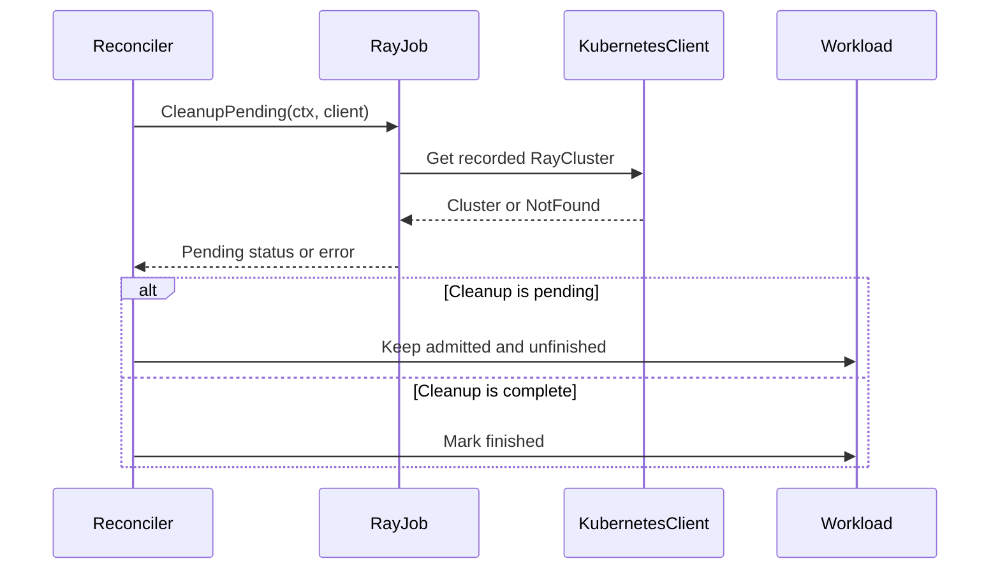

# PR #17646: Keep a RayJob's quota reserved while its RayCluster is retained

**Summary**: Keep a RayJob's quota reserved while its RayCluster is retained

**Sources**: https://github.com/kubernetes-sigs/kueue/pull/17646

**Last updated**: 2026-10-28T00:29:19Z

---

## Metadata

- **State**: open
- **Author**: [@nataliekung](https://github.com/nataliekung)
- **Branch**: `fix/rayjob-hold-quota-until-cluster-deleted` → `main`
- **Created**: 2026-10-22T23:13:34Z
- **Updated**: 2026-10-28T00:29:19Z
- **Merged**: —
- **Closed**: —
- **Labels**: `kind/bug`, `release-note`, `size/L`, `needs-rebase`, `ok-to-test`, `cncf-cla: yes`, `area/integrations`
- **Assignees**: _none_
- **Requested reviewers**: [@amy](https://github.com/amy), [@mbobrovskyi](https://github.com/mbobrovskyi)
- **Changed files**: 7   **+173 / -1**

## Description

#### What type of PR is this?

/kind bug
/area integrations

#### What this PR does / why we need it?

With `shutdownAfterJobFinishes: true` (which the Kueue webhook requires) and a nonzero `ttlSecondsAfterFinished`, KubeRay keeps the RayCluster and all of its Pods running after the RayJob reports Complete or Failed, and only deletes the cluster once the TTL has elapsed. Kueue finished the Workload as soon as the RayJob reported completion, so the quota was released while those Pods were still running, and another Workload could be admitted against capacity that was still in use.

This PR adds an optional `JobWithPendingCleanup` interface to the job framework. When a finished job implements it and reports that its resources still exist, the reconciler keeps the Workload admitted instead of finishing it. The RayJob integration reports pending cleanup while the RayCluster named in `status.rayClusterName` still exists. The existing watch on RayClusters (enqueued by controller owner) triggers the reconcile that finishes the Workload once the cluster is deleted.

RayJobs that never created a cluster, or that run on an existing cluster through `clusterSelector`, are unaffected.

Fixes #16985

#### Useful notes for your reviewer

- On the question in the issue of whether this belongs in Kueue or KubeRay: KubeRay's `handleShutdownAfterJobFinishes` requeues until `endTime + ttlSecondsAfterFinished` and then deletes the cluster without changing the RayJob status, so the RayJob carries no signal for "Pods are gone". The RayCluster object itself is the signal, and Kueue already watches it, so the fix can live in Kueue without a KubeRay API change. If KubeRay later adds an explicit status for this, `CleanupPending` is the single place to switch to it.
- I made the hook a generic optional interface rather than a RayJob special case in the reconciler, since other integrations with a TTL-after-finish cleanup could use it. Happy to narrow it if you prefer.
- Edge case worth a decision: with the `RayJobDeletionPolicy` feature gate enabled in KubeRay, the legacy `deletionStrategy.onSuccess/onFailure` can be set together with `shutdownAfterJobFinishes: true`, and it takes precedence. With `DeleteNone` the cluster is kept, so the Workload now stays admitted until the cluster is removed; with `DeleteWorkers` the head Pod is kept, so the full quota stays reserved until then. Both reflect Pods that are still running, but I can treat those policies differently if you think that is better.
- Tests: unit tests for `RayJob.CleanupPending` (cluster exists, cluster deleted, `clusterSelector`, no cluster created), and an integration spec that finishes a RayJob with a TTL and checks the Workload is not finished while the RayCluster exists and is finished after it is deleted. Without the reconciler change, the integration spec fails at the "not finished while the RayCluster exists" assertion. The full RayJob integration suite passes locally (16/16).

#### Release note

```release-note
RayJob: Keep the Workload admitted, and its quota reserved, while the RayCluster of a finished RayJob is retained for ttlSecondsAfterFinished. The quota is released once KubeRay deletes the RayCluster.
```


<!-- This is an auto-generated comment: release notes by coderabbit.ai -->

<!-- coderabbit-ai-generated:v1 -->

## AI summary

Adds an optional cleanup-pending interface so a finished job can remain admitted until its resources are cleaned up. RayJobs use this behavior while their managed RayCluster still exists; jobs using `clusterSelector` or without a recorded RayCluster are unaffected. The change includes unit and integration coverage and documents the quota-retention behavior.

### Suggested release note

**Detailed:** RayJob: Fixed a bug where a completed RayJob could release quota while its managed RayCluster remained. Kueue now keeps the Workload admitted until that RayCluster is deleted.

**Concise:** RayJob: Keep quota reserved until a retained RayCluster is deleted.

**Balanced (recommended):** RayJob: Fixed a bug where a completed RayJob could release quota while its managed RayCluster remained. Kueue now retains the Workload’s quota until the RayCluster is deleted.

**Rationale:** `RayJob:` is the narrowest scope. This is a bug fix because quota could be released while the RayCluster still existed. No upgrade action is indicated.

<!-- end of auto-generated comment: release notes by coderabbit.ai -->

## Discussion

### Comment by [@linux-foundation-easycla[bot]](https://github.com/apps/linux-foundation-easycla) — 2026-10-22T23:13:43Z

<a href="https://easycla.lfx.linuxfoundation.org/#/?version=2"></a><br >The committers listed above are authorized under a signed CLA.<ul><li>:white_check_mark: login: nataliekung / name: nataliekung (66d30fa8a3b777258bff5801c09405ab56417fdc)</li></ul>

### Comment by [@netlify[bot]](https://github.com/apps/netlify) — 2026-10-22T23:13:44Z

### <span aria-hidden="true">✅</span> Deploy Preview for *kubernetes-sigs-kueue* ready!


|  Name | Link |
|:-:|------------------------|
|<span aria-hidden="true">🔨</span> Latest commit | 66d30fa8a3b777258bff5801c09405ab56417fdc |
|<span aria-hidden="true">🔍</span> Latest deploy log | https://app.netlify.com/projects/kubernetes-sigs-kueue/deploys/6ada98a158a06b3a5114e9f8 |
|<span aria-hidden="true">😎</span> Deploy Preview | [https://deploy-preview-17646--kubernetes-sigs-kueue.netlify.app](https://deploy-preview-17646--kubernetes-sigs-kueue.netlify.app) |
|<span aria-hidden="true">📱</span> Preview on mobile | <details><summary> Toggle QR Code... </summary><br /><br /><br /><br />_Use your smartphone camera to open QR code link._</details> |
---
<!-- [kubernetes-sigs-kueue Preview](https://deploy-preview-17646--kubernetes-sigs-kueue.netlify.app) -->
_To edit notification comments on pull requests, go to your [Netlify project configuration](https://app.netlify.com/projects/kubernetes-sigs-kueue/configuration/notifications#deploy-notifications)._

### Comment by [@kubernetes-prow[bot]](https://github.com/apps/kubernetes-prow) — 2026-10-22T23:13:44Z

Welcome @nataliekung! <br><br>It looks like this is your first PR to <a href='https://github.com/kubernetes-sigs/kueue'>kubernetes-sigs/kueue</a> 🎉. Please refer to our [pull request process documentation](https://www.kubernetes.dev/docs/guide/pull-requests/) to help your PR have a smooth ride to approval. <br><br>You will be prompted by a bot to use commands during the review process. Do not be afraid to follow the prompts! It is okay to experiment. [Here is the bot commands documentation](https://go.k8s.io/bot-commands). <br><br>You can also check if kubernetes-sigs/kueue has [its own contribution guidelines](https://github.com/kubernetes-sigs/kueue/tree/master/CONTRIBUTING.md). <br><br>You may want to refer to our [testing guide](https://git.k8s.io/community/contributors/devel/sig-testing/testing.md) if you run into trouble with your tests not passing. <br><br>If you are having difficulty getting your pull request seen, please follow the [recommended escalation practices](https://www.kubernetes.dev/docs/guide/pull-requests/#why-is-my-pull-request-not-getting-reviewed). Also, for tips and tricks in the contribution process you may want to read the [Kubernetes contributor cheat sheet](https://www.kubernetes.dev/docs/contributor-cheatsheet/). We want to make sure your contribution gets all the attention it needs! <br><br>Thank you, and welcome to Kubernetes. :smiley:

### Comment by [@kubernetes-prow[bot]](https://github.com/apps/kubernetes-prow) — 2026-10-22T23:13:46Z

Hi @nataliekung. Thanks for your PR.

I'm waiting for a [kubernetes-sigs](https://github.com/orgs/kubernetes-sigs/people) member to verify that this patch is reasonable to test. If it is, they should reply with `/ok-to-test` on its own line. Until that is done, I will not automatically test new commits in this PR, but the usual testing commands by org members will still work.

Regular contributors should [join the org](https://git.k8s.io/community/community-membership.md#member) to skip this step.

Once the patch is verified, the new status will be reflected by the `ok-to-test` label.

I understand the commands that are listed [here](https://go.k8s.io/bot-commands?repo=kubernetes-sigs%2Fkueue).

<details>

Instructions for interacting with me using PR comments are available [here](https://git.k8s.io/community/contributors/guide/pull-requests.md).  If you have questions or suggestions related to my behavior, please file an issue against the [kubernetes-sigs/prow](https://github.com/kubernetes-sigs/prow/issues/new?title=Prow%20issue:) repository.
</details>

### Comment by [@kubernetes-prow[bot]](https://github.com/apps/kubernetes-prow) — 2026-10-22T23:13:56Z

[APPROVALNOTIFIER] This PR is **NOT APPROVED**

This pull-request has been approved by: *<a href="https://github.com/kubernetes-sigs/kueue/pull/17646#" title="Author self-approved">nataliekung</a>*
**Once this PR has been reviewed and has the lgtm label**, please assign [tenzen-y](https://github.com/tenzen-y) for approval. For more information see [the Code Review Process](https://git.k8s.io/community/contributors/guide/owners.md#the-code-review-process).

The full list of commands accepted by this bot can be found [here](https://go.k8s.io/bot-commands?repo=kubernetes-sigs%2Fkueue).

<details open>
Needs approval from an approver in each of these files:

- **[OWNERS](https://github.com/kubernetes-sigs/kueue/blob/main/OWNERS)**

Approvers can indicate their approval by writing `/approve` in a comment
Approvers can cancel approval by writing `/approve cancel` in a comment
</details>
<!-- META={"approvers":["tenzen-y"]} -->

### Comment by [@coderabbitai[bot]](https://github.com/apps/coderabbitai) — 2026-10-22T23:14:01Z

<!-- coderabbit-ai-generated:v1 -->

<!-- This is an auto-generated comment: summarize by coderabbit.ai -->
<!-- review_stack_entry_start -->

<a href="https://app.coderabbit.ai/change-stack/kubernetes-sigs/kueue/pull/17646?scope=ghh_OusAJGA4HG8ljoOV0wJvVx8NmnZIjc2DdjmxOu0xZWA&amp;cs_source=review_comment"><picture><source media="(prefers-color-scheme: dark)" srcset="https://storage.googleapis.com/coderabbit_public_assets/review-stack-in-coderabbit-ui-dark.svg?v=3"><source media="(prefers-color-scheme: light)" srcset="https://storage.googleapis.com/coderabbit_public_assets/review-stack-in-coderabbit-ui.svg?v=3"></picture></a>

<!-- review_stack_entry_end -->
<!-- recent_review_start -->

No actionable comments were generated in the recent review. 🎉

<details>
<summary><strong>ℹ️ Recent review info</strong></summary>
<dl>
<dd>

<details>
<summary><strong>⚙️ Run configuration</strong></summary>
<dl>
<dd>

- **Source mode**: Auto
- **Repository**: [kubernetes-sigs/kueue](<https://github.com/kubernetes-sigs/kueue>)
- **Branch**: [main](<https://github.com/kubernetes-sigs/kueue/tree/main>)
- **File**: [.coderabbit.yaml](<https://github.com/kubernetes-sigs/kueue/blob/d98cde105dd753bec5d8a83ee51f274c098761cd/.coderabbit.yaml>)
- **Commit**: [d98cde1](<https://github.com/kubernetes-sigs/kueue/commit/d98cde105dd753bec5d8a83ee51f274c098761cd>)
- **Layers**: Repository YAML
- **Review profile**: CHILL
- **Plan**: Advanced
- **Run ID**: `dd484ab8-7610-4b4f-9ea6-72cad9561587`

</dd>
</dl>
</details>

<details>
<summary><strong>📥 Commits</strong></summary>
<dl>
<dd>

Reviewing files that changed from the base of the PR and between d98cde105dd753bec5d8a83ee51f274c098761cd and 66d30fa8a3b777258bff5801c09405ab56417fdc.

</dd>
</dl>
</details>

<details>
<summary><strong>📒 Files selected for processing: 7</strong></summary>
<dl>
<dd>

* `pkg/controller/jobframework/interface.go`
* `pkg/controller/jobframework/reconciler.go`
* `pkg/controller/jobs/rayjob/rayjob_controller.go`
* `pkg/controller/jobs/rayjob/rayjob_controller_test.go`
* `pkg/util/testingjobs/rayjob/wrappers.go`
* `site/content/en/docs/tasks/run/rayjobs.md`
* `test/integration/singlecluster/controller/jobs/rayjob/rayjob_controller_test.go`

</dd>
</dl>
</details>

**Included review availability:** This review used your included allowance. Your plan provides up to 8 included reviews per hour; 7 remain after this review.

</dd>
</dl>
</details>


<!-- recent_review_end -->
<!-- walkthrough_start -->

<details>
<summary><strong>📝 Walkthrough</strong></summary>
<dl>
<dd>

Reconciliation now checks for pending cleanup before it finishes a Workload for a completed job. RayJob reports cleanup as pending while its recorded RayCluster exists. Tests cover this behavior, and the RayJob documentation describes the effect of TTL-based cluster retention.

**Changes: RayJob cleanup-aware completion**

|Layer / File(s)|Summary|
|:---|:---|
|**Cleanup contract and reconciliation** <br> `pkg/controller/jobframework/interface.go`, `pkg/controller/jobframework/reconciler.go`|The optional `JobWithPendingCleanup` interface reports whether cleanup remains pending. Reconciliation keeps the Workload admitted when cleanup is pending and finishes it when cleanup is complete.|
|**RayJob cleanup detection** <br> `pkg/controller/jobs/rayjob/rayjob_controller.go`, `pkg/controller/jobs/rayjob/rayjob_controller_test.go`|RayJob reports cleanup as pending while its recorded RayCluster exists. Unit tests cover existing, missing, selector-based, and unrecorded clusters.|
|**Integration coverage and documentation** <br> `pkg/util/testingjobs/rayjob/wrappers.go`, `test/integration/singlecluster/controller/jobs/rayjob/rayjob_controller_test.go`, `site/content/en/docs/tasks/run/rayjobs.md`|The integration test checks that the Workload remains admitted until RayCluster deletion. The test wrapper sets TTL-after-finished, and the documentation describes retained admission and quota.|

<!-- change_assessment_start -->
**Priority:** ➖ Normal

**Estimated code review effort:** 3 (Moderate) | ~20 minutes

<!-- change_assessment_commit:"66d30fa8a3b777258bff5801c09405ab56417fdc" -->
**Change:** Bug fix · **Severity of issue fixed:** Medium
<!-- change_assessment_end -->

### Sequence Diagram(s)



**Possibly related PRs**
- [kubernetes-sigs/kueue#17581](https://github.com/kubernetes-sigs/kueue/pull/17581): Keeps quota reserved for a StatefulSet while owned Pods remain active or terminate.
- [kubernetes-sigs/kueue#16044](https://github.com/kubernetes-sigs/kueue/pull/16044): Delays StatefulSet quota release until owned Pods stop.

**Suggested labels:** `kind/bug`, `area/integrations`, `release-note`, `size/L`

**Suggested reviewers:** `amirialy`, `kannon92`

</dd>
</dl>
</details>

<!-- walkthrough_end -->
<details>
<summary><strong>Merge Risk:</strong> <strong>🔵 Low</strong> · up to <code>66d30</code></summary>
<dl>
<dd>

<!-- final_review_risk_start -->
<!-- final_review_risk_label
**Merge Risk:** **🔵 Low** · up to `66d30`
-->
<!-- final_review_risk_coverage:{"sourceCommitId":"66d30fa8a3b777258bff5801c09405ab56417fdc","coveredCommitId":"66d30fa8a3b777258bff5801c09405ab56417fdc","kind":"reviewed"} -->

This change keeps a finished RayJob's quota reserved while its RayCluster exists, which addresses the requested behavior. A brief window remains after the RayCluster is deleted: its Pods may still be terminating while quota has already been released. The overcommit is short-lived and bounded. It is worth knowing about but should not block the merge.
<!-- final_review_risk_end -->

</dd>
</dl>
</details>
<!-- pre_merge_checks_walkthrough_start -->

<details>
<summary><strong>Pre-merge checks: <sup><picture></picture></sup> 3 · <sup><picture></picture></sup> 2</strong></summary>
<dl>
<dd>

<strong><sup><picture></picture></sup> Failed checks: 2 warnings</strong>

|         Check name         |                                              Status                                              | Explanation                                                                                                                                                                                               | Resolution                                                                                                                                                                                   |
| :------------------------ | :----------------------------------------------------------------------------------------------: | :-------------------------------------------------------------------------------------------------------------------------------------------------------------------------------------------------------- | :------------------------------------------------------------------------------------------------------------------------------------------------------------------------------------------- |
| Out of Scope Changes check |  | The new `RayJob.CleanupPending` behavior applies whenever the owned RayCluster object exists. It therefore also retains the full Workload reservation for KubeRay policies such as `DeleteWorkers`, wher… | Restrict the new cleanup accounting to the full-RayCluster-retention case, or explicitly exclude the partial-deletion policies from this change. Add tests for the selected policy behavior. |
|     Docstring Coverage     |  | Docstring coverage is 0.00% which is insufficient. The required threshold is 80.00%. Docstring coverage is scoped to functions touched by this diff. Analyzed 3 functions across 6 files. (1 skipped: 1 … | Write docstrings for the functions missing them to satisfy the coverage threshold.                                                                                                           |

<details>
<summary><strong><sup><picture></picture></sup> Passed checks: 3 passed</strong></summary>
<dl>
<dd>

|      Check name     |                                             Status                                             | Explanation                                                                                                                                                                                               |
| :----------------- | :--------------------------------------------------------------------------------------------: | :-------------------------------------------------------------------------------------------------------------------------------------------------------------------------------------------------------- |
|  Description Check  |  | Check skipped - CodeRabbit’s high-level summary is enabled.                                                                                                                                               |
|     Title check     |  | The title clearly and concisely describes the main change: retaining a RayJob's quota while its RayCluster remains after job completion.                                                                  |
| Linked Issues check |  | Issue [`#16985`] requires quota retention while a completed RayJob's full RayCluster remains, and quota release after deletion. `JobWithPendingCleanup` keeps the Workload unfinished when cleanup is pend… |

<details>
<summary><strong>Full details: Linked Issues check</strong></summary>
<dl>
<dd>

**Explanation**

Issue [`#16985`] requires quota retention while a completed RayJob's full RayCluster remains, and quota release after deletion. `JobWithPendingCleanup` keeps the Workload unfinished when cleanup is pending. `RayJob.CleanupPending` checks the owned `status.rayClusterName` object and clears the pending state after `NotFound`. The existing RayCluster owner watch triggers reconciliation after deletion. The supplied tests cover cluster existence, deletion, no created cluster, and `clusterSelector`. The issue's excluded partial-deletion policy work is not required for this assessment.

</dd>
</dl>
</details>

</dd>
</dl>
</details>

<details>
<summary><strong>Full details: Out of Scope Changes check</strong></summary>
<dl>
<dd>

**Explanation**

The new `RayJob.CleanupPending` behavior applies whenever the owned RayCluster object exists. It therefore also retains the full Workload reservation for KubeRay policies such as `DeleteWorkers`, where workers can be deleted while the head remains. Issue [`#16985`] explicitly excludes this partial-cleanup case and identifies separate accounting as required. The PR description acknowledges this behavior but does not resolve the scope boundary.

**Resolution**

Restrict the new cleanup accounting to the full-RayCluster-retention case, or explicitly exclude the partial-deletion policies from this change. Add tests for the selected policy behavior.

</dd>
</dl>
</details>

<details>
<summary><strong>Full details: Docstring Coverage</strong></summary>
<dl>
<dd>

**Explanation**

Docstring coverage is 0.00% which is insufficient. The required threshold is 80.00%. Docstring coverage is scoped to functions touched by this diff. Analyzed 3 functions across 6 files. (1 skipped: 1 unsupported.)

**Resolution**

Write docstrings for the functions missing them to satisfy the coverage threshold.

</dd>
</dl>
</details>

</dd>
</dl>
</details>

<!-- pre_merge_checks_walkthrough_end -->
<!-- finishing_touch_checkbox_start -->

<details>
<summary><strong>✨ Finishing Touches: 💡 1</strong></summary>
<dl>
<dd>

<!-- finishing_touch_suggestion:fix_ci -->
<details open>
<summary><strong>🛠️ Fix failing CI checks: 💡</strong></summary>
<dl>
<dd>

- [ ] <!-- {"checkboxId": "9f0d24fb-b419-4f01-baf0-8b26b6424f34", "radioGroupId": "fix-ci-output-choice-group-unknown_comment_id"} --> Commit to this branch
- [ ] <!-- {"checkboxId": "6d21cfe8-ec3f-40e2-9222-b8318b64d3b0", "radioGroupId": "fix-ci-output-choice-group-unknown_comment_id"} --> Create a new PR

</dd>
</dl>
</details>
<details open>
<summary><strong>🧪 Generate unit tests (beta)</strong></summary>
<dl>
<dd>

- [ ] <!-- {"checkboxId": "f47ac10b-58cc-4372-a567-0e02b2c3d479", "radioGroupId": "utg-output-choice-group-unknown_comment_id"} --> Create a new PR

</dd>
</dl>
</details>

</dd>
</dl>
</details>

<!-- finishing_touch_checkbox_end -->

<!-- autopilot:start -->
- [ ] <!-- {"checkboxId":"2708ad07-9f24-4260-9c11-7dc76a49f2e3"} --> <strong title="Keep fixing CodeRabbit findings and required CI, and resolving merge conflicts">Autofix</strong> · Keep fixing CodeRabbit findings and required CI, and resolving merge conflicts
<!-- autopilot:end -->
<!-- tips_start -->


<sub>Comment `@coderabbitai help` to get the list of available commands.</sub>

<!-- tips_end -->

### Comment by [@kannon92](https://github.com/kannon92) — 2026-10-23T00:16:05Z

There wasn't really any consesus on this issue. https://github.com/kubernetes-sigs/kueue/issues/16985

I would wait on tackling this issue until there is more discussion there.

### Comment by [@mimowo](https://github.com/mimowo) — 2026-10-23T06:35:12Z

/ok-to-test

### Comment by [@marina-gonzalez-alvarez](https://github.com/marina-gonzalez-alvarez) — 2026-10-23T19:52:45Z

This issue is also relevant for us at Wayve. I'm working on integrating RayJobs in prod and just encountered this. cc: @mukund-wayve, @kannon92

### Comment by [@nataliekung](https://github.com/nataliekung) — 2026-10-23T21:35:24Z

/easycla

### Comment by [@kubernetes-prow[bot]](https://github.com/apps/kubernetes-prow) — 2026-10-28T00:29:19Z

PR needs rebase.

<details>

Instructions for interacting with me using PR comments are available [here](https://git.k8s.io/community/contributors/guide/pull-requests.md).  If you have questions or suggestions related to my behavior, please file an issue against the [kubernetes-sigs/prow](https://github.com/kubernetes-sigs/prow/issues/new?title=Prow%20issue:) repository.
</details>
