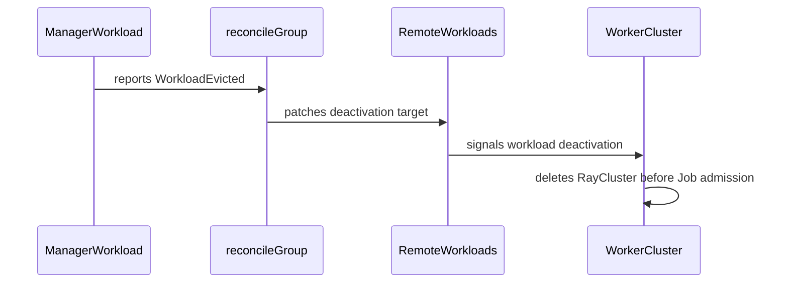

# PR #18012: MultiKueue: deactivate remote workloads evicted on the manager before a worker admits them

**Summary**: MultiKueue: deactivate remote workloads evicted on the manager before a worker admits them

**Sources**: https://github.com/kubernetes-sigs/kueue/pull/18012

**Last updated**: 2026-11-19T07:54:23Z

---

## Metadata

- **State**: open
- **Author**: [@kevin85421](https://github.com/kevin85421)
- **Branch**: `mk-evicted-unadmitted-remote` → `main`
- **Created**: 2026-10-30T03:50:13Z
- **Updated**: 2026-11-19T07:54:23Z
- **Merged**: —
- **Closed**: —
- **Labels**: `kind/bug`, `release-note`, `size/L`, `cncf-cla: yes`, `area/multikueue`, `area/integrations`
- **Assignees**: _none_
- **Requested reviewers**: [@mykysha](https://github.com/mykysha), [@mimowo](https://github.com/mimowo), [@kshalot](https://github.com/kshalot), [@j-skiba](https://github.com/j-skiba)
- **Changed files**: 3   **+331 / -0**

## Description

<!-- Thank you for contributing! Check CONTRIBUTING.md for details. -->

#### What type of PR is this?

/kind bug

/area multikueue
/area integrations

#### What this PR does / why we need it?

With `ElasticJobsViaWorkloadSlices` and `MultiKueueRayInTreeAutoscaling`, a manager-side eviction of a scale-up slice can get stuck:

1. An elastic RayCluster runs on a worker under the Workload `slice-old`. The Ray autoscaler scales it up.
2. The manager creates a replacement Workload `slice-new`, reserves quota for it, and dispatches it. The worker has no free quota, so `slice-new` stays pending there, and the remote RayCluster still points at `slice-old`.
3. The manager evicts `slice-new`, for example through preemption.
4. MultiKueue tells a worker about a manager-side eviction (`DeactivationTarget`) only when the remote workload is admitted. `slice-new` is pending, so the worker keeps running the RayCluster under `slice-old`.
5. The manager RayCluster is suspended, but its status copied from the worker still says `ready`. So it stays active, the manager never releases `slice-new`'s quota, and the preemptor stays pending until the worker happens to free enough quota for `slice-new`.

This PR adds a step after step 4 of `reconcileGroup`: when the manager workload is evicted, MultiKueue sets `DeactivationTarget` (reason `EvictedOnManagerCluster`) on every remote workload, admitted or pending, and returns. The worker evicts `slice-new`, step 4 syncs and repoints the remote RayCluster (#17719), the worker stops it, and the manager releases the quota.

#### Useful notes for your reviewer

- Claude Code assisted with the implementation and tests. I reviewed the change.

#### Release note

<!-- Describe the behavior change accurately from the user's perspective. Hints:
- Do not leave this block blank.
- Use "NONE" when there is no user-facing change.
- When feasible use a prefix for the sub-component or feature, e.g. "FairSharing:" or "MultiKueue:".
- If upgrade steps are required, include an "ACTION REQUIRED:" section.
You may consider AI assistance using the skill: cmd/experimental/skills/kueue-release-notes/SKILL.md.
-->
```release-note
MultiKueue: Fixed a bug where a workload evicted on the manager before a worker admitted it was never deactivated on the worker. For an elastic Ray job, this could keep the job running on the worker and keep the quota held on the manager, so the preempting workload stayed pending.
```

🤖 Generated with [Claude Code](https://claude.com/claude-code)


<!-- This is an auto-generated comment: release notes by coderabbit.ai -->

<!-- coderabbit-ai-generated:v1 -->

## AI summary

This PR makes MultiKueue deactivate remote workloads when the manager workload is evicted. Before worker admission, a pending remote slice can stay running and keep manager quota held.

- `reconcileGroup` in `pkg/controller/admissionchecks/multikueue/workload.go` checks the local `WorkloadEvicted` condition.
- When the condition is true, the controller sets `DeactivationTarget` with reason `WorkloadEvictedOnManagerCluster` on every existing remote workload. The message is `Evicted on manager: <message>`, truncated.
- The controller collects patch errors and logs each one.
- If at least one remote workload exists, the step returns the joined errors. The later step that deletes out-of-sync remotes does not run. This prevents deletion of a remote that the worker has not yet evicted.
- If no remote workload exists, reconciliation continues.

Tests:
- `workload_test.go` adds `TestWlReconcile` cases. They cover eviction before worker admission, and eviction when a remote is already admitted. In the admitted case, the admitted remote stays admitted and its Job is kept.
- `test/e2e/multikueue/extended/ray_autoscaling_test.go` adds a Ray scale-up case. A high-priority Job preempts the scale-up slice before worker admission. The test checks that the RayCluster is deleted from worker1 and the Job is admitted there.

Diff size: 3 files, 331 lines added, 0 removed. Review findings and CI results are not available.

### Suggested release note

```text
MultiKueue: Fixed a bug that kept manager quota held when a workload was evicted on the manager cluster before worker admission. Now Kueue deactivates the remote workloads, so the worker stops the pending replacement slice and releases the quota.
```

<!-- end of auto-generated comment: release notes by coderabbit.ai -->

## Discussion

### Comment by [@kubernetes-prow[bot]](https://github.com/apps/kubernetes-prow) — 2026-10-30T03:50:16Z

Skipping CI for Draft Pull Request.
If you want CI signal for your change, please convert it to an actual PR.
You can still manually trigger a test run with `/test all`

### Comment by [@netlify[bot]](https://github.com/apps/netlify) — 2026-10-30T03:50:20Z

### <span aria-hidden="true">👷</span> Deploy request for *kubernetes-sigs-kueue* pending review.
[Visit the deploys page to approve it](https://app.netlify.com/projects/kubernetes-sigs-kueue/deploys)

|  Name | Link |
|:-:|------------------------|
|<span aria-hidden="true">🔨</span> Latest commit | 8a1c4a31010b736f8b6e29be8159b4c31ccbd33b |

### Comment by [@coderabbitai[bot]](https://github.com/apps/coderabbitai) — 2026-10-30T03:50:21Z

<!-- coderabbit-ai-generated:v1 -->

<!-- This is an auto-generated comment: summarize by coderabbit.ai -->
<!-- review_stack_entry_start -->

<a href="https://app.coderabbit.ai/change-stack/kubernetes-sigs/kueue/pull/18012?scope=ghh_OusAJGA4HG8ljoOV0wJvVx8NmnZIjc2DdjmxOu0xZWA&amp;cs_source=review_comment"><picture><source media="(prefers-color-scheme: dark)" srcset="https://storage.googleapis.com/coderabbit_public_assets/review-stack-buttons-v1/explain-change-dark.svg"><source media="(prefers-color-scheme: light)" srcset="https://storage.googleapis.com/coderabbit_public_assets/review-stack-buttons-v1/explain-change.svg"></picture></a>

<!-- review_stack_entry_end -->
<!-- recent_review_status_start -->

No actionable comments were generated in the recent review.

<!-- recent_review_status_end -->
<!-- walkthrough_start -->

<details>
<summary><strong>Walkthrough</strong></summary>
<dl>
<dd>
<br>

When the manager workload is evicted, `reconcileGroup` marks existing remote workloads for deactivation and returns before out-of-sync cleanup. Unit tests cover remote admission states. A Ray autoscaling end-to-end test covers preemption before worker admission.

**Changes: Manager-side eviction**

|Layer / File(s)|Summary|
|:---|:---|
|**Reconciliation and unit coverage** <br> `pkg/controller/admissionchecks/multikueue/workload.go`, `pkg/controller/admissionchecks/multikueue/workload_test.go`|`reconcileGroup` sets a deactivation target and an eviction message on each existing remote workload. It collects patch errors and returns them before out-of-sync cleanup when a remote workload exists. Tests cover remotes before and after worker admission.|
|**Ray scale-up preemption coverage** <br> `test/e2e/multikueue/extended/ray_autoscaling_test.go`|The end-to-end test checks a scale-up slice with a manager quota reservation but no worker reservation. It then verifies that preemption deletes the RayCluster from worker1 before the higher-priority Job is admitted.|

<!-- change_assessment_start -->
**Estimated code review effort:** 3 (Moderate) | ~25 minutes

<!-- change_assessment_commit:"8a1c4a31010b736f8b6e29be8159b4c31ccbd33b" -->
<!-- change_assessment_priority:{"version":1,"urgency":"p2","manual":false} -->
**Change:** Bug fix
<!-- change_assessment_end -->

### Sequence Diagram(s)



**Possibly related issues**

- kubernetes-sigs/kueue issue 18549: The end-to-end test covers a pending Ray scale-up slice under worker quota pressure, but the issue describes a replacement slice whose RayJob still references the old slice. The shared state is related; the trigger differs.

**Suggested reviewers:** `mbobrovskyi`

</dd>
</dl>
</details>

<!-- walkthrough_end -->
<details>
<summary><strong>Merge Risk:</strong> <strong><picture></picture> Minimal</strong> · up to <code>8a1c4</code></summary>
<dl>
<dd>
<br>

<!-- final_review_risk_start -->
<!-- final_review_risk_label
**Merge Risk:** **⚪ Minimal** · up to `8a1c4`
-->
<!-- final_review_risk_coverage:{"sourceCommitId":"8a1c4a31010b736f8b6e29be8159b4c31ccbd33b","coveredCommitId":"8a1c4a31010b736f8b6e29be8159b4c31ccbd33b","kind":"reviewed"} -->

This change deactivates remote workloads when a manager workload is evicted, so a pending Ray replacement slice no longer holds manager quota. No concrete merge-blocking defect was found. A transient patch failure on one remote clears once the manager releases its quota reservation.
<!-- final_review_risk_end -->

</dd>
</dl>
</details>
<!-- pre_merge_checks_walkthrough_start -->

<details>
<summary><strong>Pre-merge checks: <sup><picture></picture></sup> 4</strong></summary>
<dl>
<dd>
<br>

|         Check name         |                                             Status                                             | Explanation                                                                                                                                                                                               |
| :------------------------ | :--------------------------------------------------------------------------------------------: | :-------------------------------------------------------------------------------------------------------------------------------------------------------------------------------------------------------- |
|      Description Check     |  | Check skipped - CodeRabbit’s high-level summary is enabled.                                                                                                                                               |
|         Title check        |  | The title names the main change: MultiKueue deactivates remote workloads that were evicted on the manager before a worker admits them. The raw summary says reconcileGroup marks each remote workload's … |
|     Linked Issues check    |  | Check skipped because no linked issues were found for this pull request.                                                                                                                                  |
| Out of Scope Changes check |  | Check skipped because no linked issues were found for this pull request.                                                                                                                                  |

<details>
<summary><strong>Full details: Title check</strong></summary>
<dl>
<dd>
<br>

**Explanation**

The title names the main change: MultiKueue deactivates remote workloads that were evicted on the manager before a worker admits them. The raw summary says reconcileGroup marks each remote workload's deactivation target with WorkloadEvictedOnManagerCluster when the local WorkloadEvicted condition is true. The workload_test.go changes cover this path. The e2e Ray autoscaling case is a supporting test and is not the title's focus. The title is specific and matches the objectives.

</dd>
</dl>
</details>

</dd>
</dl>
</details>

<!-- pre_merge_checks_walkthrough_end -->
<!-- finishing_touch_checkbox_start -->

<details>
<summary><strong>Finishing Touches</strong></summary>
<dl>
<dd>
<br>

<details open>
<summary><strong>Generate unit tests (beta)</strong></summary>
<dl>
<dd>
<br>

- [ ] <!-- {"checkboxId": "f47ac10b-58cc-4372-a567-0e02b2c3d479", "radioGroupId": "utg-output-choice-group-unknown_comment_id"} --> Create a new PR

</dd>
</dl>
</details>

</dd>
</dl>
</details>

<!-- finishing_touch_checkbox_end -->

<!-- autopilot:start -->
- [ ] <!-- {"checkboxId":"2708ad07-9f24-4260-9c11-7dc76a49f2e3"} --> <strong title="Keep fixing CodeRabbit findings and required CI, and resolving merge conflicts">Autofix</strong> · Keep fixing CodeRabbit findings and required CI, and resolving merge conflicts
<!-- autopilot:end -->
<!-- recent_review_start -->

<h6>
<details>
<summary><strong><picture></picture> Recent review info</strong></summary>
<dl>
<dd>
<br>

<!-- review_info_content -->
<details>
<summary><strong><picture><source media="(prefers-color-scheme: dark)" srcset="https://storage.googleapis.com/coderabbit_public_assets/review-comment-icons-v1/cog-dark.svg"></picture> Run configuration</strong></summary>
<dl>
<dd>
<br>

- **Source mode**: Auto
- **Repository**: [kubernetes-sigs/kueue](<https://github.com/kubernetes-sigs/kueue>)
- **Branch**: [main](<https://github.com/kubernetes-sigs/kueue/tree/main>)
- **File**: [.coderabbit.yaml](<https://github.com/kubernetes-sigs/kueue/blob/1fa7c3eabf6ebfa9c32f0514ec617f204bf85818/.coderabbit.yaml>)
- **Commit**: [1fa7c3e](<https://github.com/kubernetes-sigs/kueue/commit/1fa7c3eabf6ebfa9c32f0514ec617f204bf85818>)
- **Layers**: Repository YAML
- **Review profile**: CHILL
- **Plan**: Advanced
- **Run ID**: `105b74ee-89ec-4ad5-a751-bfd5d72cfe48`

</dd>
</dl>
</details>

<details>
<summary><strong><picture><source media="(prefers-color-scheme: dark)" srcset="https://storage.googleapis.com/coderabbit_public_assets/review-comment-icons-v1/git-commit-horizontal-dark.svg"></picture> Commits</strong></summary>
<dl>
<dd>
<br>

Reviewing files that changed from the base of the PR and between 1fa7c3eabf6ebfa9c32f0514ec617f204bf85818 and 8a1c4a31010b736f8b6e29be8159b4c31ccbd33b.

</dd>
</dl>
</details>

<details>
<summary><strong><picture><source media="(prefers-color-scheme: dark)" srcset="https://storage.googleapis.com/coderabbit_public_assets/review-comment-icons-v1/file-plus-corner-dark.svg"></picture> Files selected for processing: 3</strong></summary>
<dl>
<dd>
<br>

* `pkg/controller/admissionchecks/multikueue/workload.go`
* `pkg/controller/admissionchecks/multikueue/workload_test.go`
* `test/e2e/multikueue/extended/ray_autoscaling_test.go`

</dd>
</dl>
</details>

**Included review availability:** This review used your included allowance. Your plan provides up to 8 included reviews per hour; 7 remain after this review.

</dd>
</dl>
</details>
</h6>

<!-- recent_review_end -->

### Comment by [@kubernetes-prow[bot]](https://github.com/apps/kubernetes-prow) — 2026-11-18T23:16:36Z

[APPROVALNOTIFIER] This PR is **NOT APPROVED**

This pull-request has been approved by: *<a href="https://github.com/kubernetes-sigs/kueue/pull/18012#" title="Author self-approved">kevin85421</a>*
**Once this PR has been reviewed and has the lgtm label**, please assign [olekzabl](https://github.com/olekzabl) for approval. For more information see [the Code Review Process](https://git.k8s.io/community/contributors/guide/owners.md#the-code-review-process).

The full list of commands accepted by this bot can be found [here](https://go.k8s.io/bot-commands?repo=kubernetes-sigs%2Fkueue).

<details open>
Needs approval from an approver in each of these files:

- **[pkg/controller/admissionchecks/multikueue/OWNERS](https://github.com/kubernetes-sigs/kueue/blob/main/pkg/controller/admissionchecks/multikueue/OWNERS)**
- **[test/OWNERS](https://github.com/kubernetes-sigs/kueue/blob/main/test/OWNERS)**

Approvers can indicate their approval by writing `/approve` in a comment
Approvers can cancel approval by writing `/approve cancel` in a comment
</details>
<!-- META={"approvers":["olekzabl"]} -->
