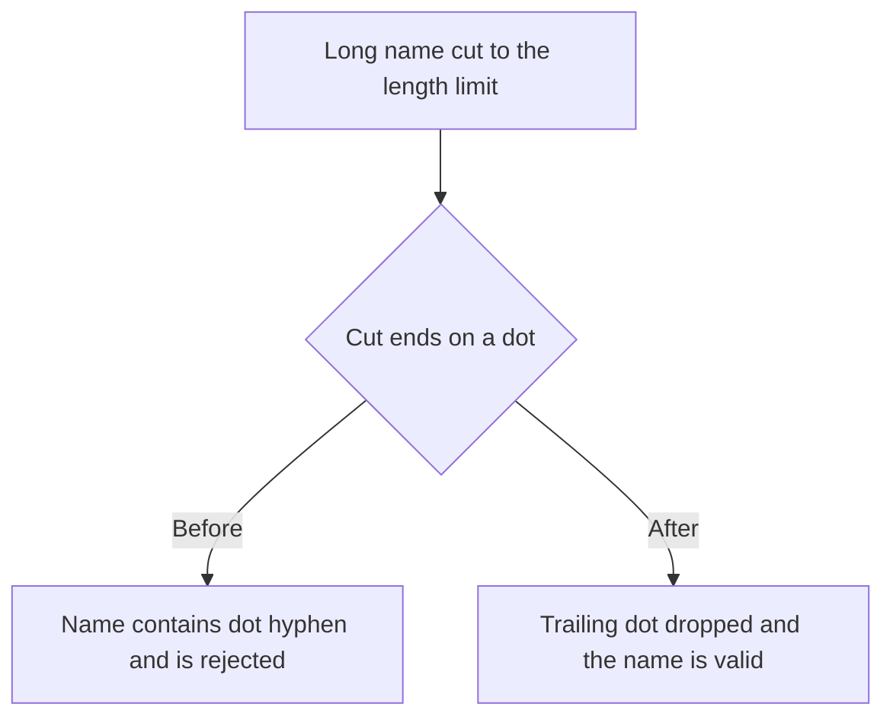

# PR #18803: Drop a trailing dot when truncating generated object names

**Summary**: Drop a trailing dot when truncating generated object names

**Sources**: https://github.com/kubernetes-sigs/kueue/pull/18803

**Last updated**: 2026-11-19T05:21:22Z

---

## Metadata

- **State**: closed (merged)
- **Author**: [@burrows99](https://github.com/burrows99)
- **Branch**: `fix-name-sanitizer-trailing-dot` → `main`
- **Created**: 2026-11-15T13:57:53Z
- **Updated**: 2026-11-19T05:21:22Z
- **Merged**: 2026-11-16T18:45:45Z
- **Closed**: 2026-11-16T18:45:45Z
- **Labels**: `kind/bug`, `release-note`, `size/L`, `lgtm`, `approved`, `ok-to-test`, `cncf-cla: yes`
- **Assignees**: [@mimowo](https://github.com/mimowo), [@alien1403](https://github.com/alien1403)
- **Requested reviewers**: [@tenzen-y](https://github.com/tenzen-y), [@apullo777](https://github.com/apullo777)
- **Changed files**: 8   **+123 / -17**

## Description

<!-- Thank you for contributing! Check CONTRIBUTING.md for details. -->

#### What type of PR is this?
<!-- Choose one of the following kinds:
/kind bug
/kind cleanup
/kind documentation
/kind feature
/kind kep
-->
/kind bug

<!-- Optionally choose one or more of the following kinds:
/kind api-change
/kind deprecation
/kind failing-test
/kind flake
/kind regression
-->


<!-- Consider setting the area:
/area tas
/area was
/area integrations
/area multikueue
/area dashboard
/area localization
/area testing
/area website
-->


#### What this PR does / why we need it?

Kueue shortens long generated names by cutting a prefix to a length limit and appending `-<hash>`. When the cut ends on a `.`, the name contains `.-`, which is not a valid DNS subdomain, so the API server rejects the Workload or ProvisioningRequest (HTTP 422).

This adds `utilstrings.TruncateNamePrefix`, which cuts the prefix and then drops any trailing `.`, and uses it in the three sanitizers named in the issue:

- `GenerateWorkloadNameWithExtra` (and `GetWorkloadNameForVariant`, which shares `generateWorkloadNameWithHash`); `GenerateWorkloadNamePrefix` uses it too, so the prefix still matches the name, and the local `truncate` helper is removed
- `limitObjectNameWithReservedSuffix` (ProvisioningRequest and its PodTemplate names)
- `virtualPodName`



<!--
Use `Fixes #123` for an issue addressed by this PR; it will be closed when the PR merges.
Use `Related:` or `Part of:` to reference an issue without closing it.
-->
Fixes #16929

#### Useful notes for your reviewer

Only a trailing `.` is trimmed, not a trailing `-`. A cut that ends on `-` gives `--<hash>`, which is valid, and Workloads and ProvisioningRequests with such names may already exist. Kueue finds them by recomputing the name (for example `ProvisioningRequestName` and `matchesWorkloadAndCheck`, or the Pod group and StatefulSet webhooks), so trimming `-` would rename them on upgrade. With only `.` trimmed, every name that changes was previously invalid, so no existing object is affected.

Out of scope: `virtualGroupName` already trims `.-` since #16904 and is unchanged. The broader unification of the sanitizers (point 2 of the issue) and the hash-length discussion in the comments are not attempted here.

| Behavior | Level | Command and result | Not run and why |
| --- | --- | --- | --- |
| Workload name (including variant names) is valid when the cut ends on `.`, with `ShortWorkloadNames` on and off | unit | `go test ./pkg/controller/jobframework/`: ok. The 3 new cases fail on `main` | integration/e2e: no cluster available |
| ProvisioningRequest name is valid when the cut ends on `.`, and is still matched to its Workload and attempt | unit | `go test ./pkg/controller/admissionchecks/provisioning/`: ok. The new case fails on `main` | integration/e2e: no cluster available |
| Virtual Pod name is valid when the cut ends on `.` | unit | `go test ./pkg/cache/scheduler/was/`: ok. The new case fails on `main` | none |
| `TruncateNamePrefix`: name under the limit unchanged, cut at the limit, trailing `.` dropped, trailing `-` kept | unit | `go test ./pkg/util/strings/`: ok | none |

All new cases are in existing unit-test packages, which `make test` selects (every package outside `/test/`). Each new case also asserts `validation.IsDNS1123Subdomain` on the output. The existing exact-name cases (short names, long truncated names, `wl-check-1`) pass unchanged.

`make verify` could not run here: the Makefile requires GNU sed on macOS, and `shell-lint`/`npm-depcheck` need Docker, neither of which was available. Instead I ran the repo-pinned golangci-lint v2.15.0 with `.golangci.yaml` on the four changed packages (0 issues), plus `go vet` and `gofmt -l` (both clean).

Narrated recording, before then after (sound on):

https://github.com/user-attachments/assets/e768aabc-c256-46f1-a91e-95a745893093

The commands in the video, with their output. Before, with `main`'s sanitizers and the new tests:

```console
$ git checkout main -- pkg/controller/jobframework/workload_names.go pkg/controller/admissionchecks/provisioning/controller.go pkg/cache/scheduler/was/virtual_pods.go
$ go test -count=1 -v -run /truncated_at_a_dot ./pkg/controller/jobframework/ ./pkg/controller/admissionchecks/provisioning/ ./pkg/cache/scheduler/was/ 2>&1 | grep -E -- '--- (PASS|FAIL).*dot|^(ok|FAIL)'
    --- FAIL: TestGenerateWorkloadNameWithExtra/long_owner_name_truncated_at_a_dot_(ShortWorkloadNames=false) (0.00s)
    --- FAIL: TestGenerateWorkloadNameWithExtra/long_owner_name_truncated_at_a_dot_(ShortWorkloadNames=true) (0.00s)
    --- FAIL: TestGetWorkloadNameForVariant/flavor_name_truncated_at_a_dot_(ShortWorkloadNames=false) (0.00s)
FAIL
FAIL	sigs.k8s.io/kueue/pkg/controller/jobframework	0.555s
    --- FAIL: TestProvisioningRequestName/name_truncated_at_a_dot (0.00s)
FAIL
FAIL	sigs.k8s.io/kueue/pkg/controller/admissionchecks/provisioning	0.438s
    --- FAIL: TestVirtualPodName/long_name_truncated_at_a_dot (0.00s)
FAIL
FAIL	sigs.k8s.io/kueue/pkg/cache/scheduler/was	1.375s
FAIL
```

After, on this branch:

```console
$ git checkout HEAD -- pkg
$ go test -count=1 -v -run /truncated_at_a_dot ./pkg/controller/jobframework/ ./pkg/controller/admissionchecks/provisioning/ ./pkg/cache/scheduler/was/ 2>&1 | grep -E -- '--- (PASS|FAIL).*dot|^(ok|FAIL)'
    --- PASS: TestGenerateWorkloadNameWithExtra/long_owner_name_truncated_at_a_dot_(ShortWorkloadNames=false) (0.00s)
    --- PASS: TestGenerateWorkloadNameWithExtra/long_owner_name_truncated_at_a_dot_(ShortWorkloadNames=true) (0.00s)
    --- PASS: TestGetWorkloadNameForVariant/flavor_name_truncated_at_a_dot_(ShortWorkloadNames=false) (0.00s)
ok  	sigs.k8s.io/kueue/pkg/controller/jobframework	0.786s
    --- PASS: TestProvisioningRequestName/name_truncated_at_a_dot (0.00s)
ok  	sigs.k8s.io/kueue/pkg/controller/admissionchecks/provisioning	0.486s
    --- PASS: TestVirtualPodName/long_name_truncated_at_a_dot (0.00s)
ok  	sigs.k8s.io/kueue/pkg/cache/scheduler/was	1.503s
$ go test -count=1 ./pkg/util/strings/ ./pkg/controller/jobframework/ ./pkg/controller/admissionchecks/provisioning/ ./pkg/cache/scheduler/was/
ok  	sigs.k8s.io/kueue/pkg/util/strings	0.103s
ok  	sigs.k8s.io/kueue/pkg/controller/jobframework	1.381s
ok  	sigs.k8s.io/kueue/pkg/controller/admissionchecks/provisioning	1.377s
ok  	sigs.k8s.io/kueue/pkg/cache/scheduler/was	2.625s
```

The `grep` only hides klog's feature-gate warnings, which fill about 1,700 lines.

Edge cases and unchanged behaviour checked (all by unit tests, shown in the video's last part; nothing was run against a cluster):

- A name under the limit is unchanged.
- A trailing `.` at the cut is dropped, and a trailing `-` at the cut is kept.
- Unchanged: the existing exact-name cases for `GenerateWorkloadNameWithExtra` and `ProvisioningRequestName` still pass, and the four packages pass in full.

AI assistance (Claude Code) was used to write this change, its tests and this description.

#### Release note

<!-- Describe the behavior change accurately from the user's perspective. Hints:
- Do not leave this block blank.
- Use "NONE" when there is no user-facing change.
- When feasible use a prefix for the sub-component or feature, e.g. "FairSharing:" or "MultiKueue:".
- If upgrade steps are required, include an "ACTION REQUIRED:" section.
You may consider AI assistance using the skill: cmd/experimental/skills/kueue-release-notes/SKILL.md.
-->
```release-note
Workloads: Fixed a bug that caused generated Workload and ProvisioningRequest names to contain `.-` after truncation. The API server rejected these names. Now Kueue removes trailing dots from the truncated name before it appends the hash suffix.
```


<!-- This is an auto-generated comment: release notes by coderabbit.ai -->

<!-- coderabbit-ai-generated:v1 -->

## AI summary

This PR fixes generated object names that contain `.-` after truncation. Such names are invalid for the Kubernetes API server.

- Adds `utilstrings.TruncateNamePrefix` in `pkg/util/strings/strings.go`. It truncates a string to at most `n` bytes and removes trailing `.` characters. It keeps trailing `-` characters.
- Uses the helper in:
  - `GenerateWorkloadNamePrefix` and `generateWorkloadNameWithHash` in `pkg/controller/jobframework/workload_names.go`. The local `truncate` helper is removed.
  - `limitObjectNameWithReservedSuffix` in `pkg/controller/admissionchecks/provisioning/controller.go`, which names ProvisioningRequests.
  - The virtual pod name generation in `pkg/cache/scheduler/was/virtual_pods.go`.
- Adds tests for dot truncation in the string, jobframework, provisioning, and virtual pod packages. The tests check DNS-1123 subdomain validity of generated names.
- Does not change trailing-hyphen handling, `virtualGroupName`, or the sanitizer structure. The linked issue `#16929` proposes trimming trailing `-` and unifying the sanitizers. This PR does not implement those parts.

## Suggested release note

```release-note
Workloads: Fixed a bug that caused generated Workload and ProvisioningRequest names to contain `.-` after truncation. The API server rejected these names. Now Kueue removes trailing dots from the truncated name before it appends the hash suffix.
```

<!-- end of auto-generated comment: release notes by coderabbit.ai -->

## Discussion

### Comment by [@netlify[bot]](https://github.com/apps/netlify) — 2026-11-15T13:57:58Z

### <span aria-hidden="true">👷</span> Deploy request for *kubernetes-sigs-kueue* pending review.
[Visit the deploys page to approve it](https://app.netlify.com/projects/kubernetes-sigs-kueue/deploys)

|  Name | Link |
|:-:|------------------------|
|<span aria-hidden="true">🔨</span> Latest commit | 86aa619423dc9a9bfe60c4a422c5d842a139f43c |

### Comment by [@linux-foundation-easycla[bot]](https://github.com/apps/linux-foundation-easycla) — 2026-11-15T13:58:01Z

<a href="https://easycla.lfx.linuxfoundation.org/#/?version=2"></a><br >The committers listed above are authorized under a signed CLA.<ul><li>:white_check_mark: login: burrows99 / name: Raunak Burrows (86aa619423dc9a9bfe60c4a422c5d842a139f43c)</li><li>:white_check_mark: login: burrows99 / name: burrows99 (1de6debda21305219a9af8fccd3135e9875d6df6)</li></ul>

### Comment by [@kubernetes-prow[bot]](https://github.com/apps/kubernetes-prow) — 2026-11-15T13:58:03Z

Welcome @burrows99! <br><br>It looks like this is your first PR to <a href='https://github.com/kubernetes-sigs/kueue'>kubernetes-sigs/kueue</a> 🎉. Please refer to our [pull request process documentation](https://www.kubernetes.dev/docs/guide/pull-requests/) to help your PR have a smooth ride to approval. <br><br>You will be prompted by a bot to use commands during the review process. Do not be afraid to follow the prompts! It is okay to experiment. [Here is the bot commands documentation](https://go.k8s.io/bot-commands). <br><br>You can also check if kubernetes-sigs/kueue has [its own contribution guidelines](https://github.com/kubernetes-sigs/kueue/tree/master/CONTRIBUTING.md). <br><br>You may want to refer to our [testing guide](https://git.k8s.io/community/contributors/devel/sig-testing/testing.md) if you run into trouble with your tests not passing. <br><br>If you are having difficulty getting your pull request seen, please follow the [recommended escalation practices](https://www.kubernetes.dev/docs/guide/pull-requests/#why-is-my-pull-request-not-getting-reviewed). Also, for tips and tricks in the contribution process you may want to read the [Kubernetes contributor cheat sheet](https://www.kubernetes.dev/docs/contributor-cheatsheet/). We want to make sure your contribution gets all the attention it needs! <br><br>Thank you, and welcome to Kubernetes. :smiley:

### Comment by [@kubernetes-prow[bot]](https://github.com/apps/kubernetes-prow) — 2026-11-15T13:58:05Z

Hi @burrows99. Thanks for your PR.

I'm waiting for a [kubernetes-sigs](https://github.com/orgs/kubernetes-sigs/people) member to verify that this patch is reasonable to test. If it is, they should reply with `/ok-to-test` on its own line. Until that is done, I will not automatically test new commits in this PR, but the usual testing commands by org members will still work.

Regular contributors should [join the org](https://git.k8s.io/community/community-membership.md#member) to skip this step.

Once the patch is verified, the new status will be reflected by the `ok-to-test` label.

I understand the commands that are listed [here](https://go.k8s.io/bot-commands?repo=kubernetes-sigs%2Fkueue).

<details>

Instructions for interacting with me using PR comments are available [here](https://git.k8s.io/community/contributors/guide/pull-requests.md).  If you have questions or suggestions related to my behavior, please file an issue against the [kubernetes-sigs/prow](https://github.com/kubernetes-sigs/prow/issues/new?title=Prow%20issue:) repository.
</details>

### Comment by [@coderabbitai[bot]](https://github.com/apps/coderabbitai) — 2026-11-15T13:58:31Z

<!-- coderabbit-ai-generated:v1 -->

<!-- This is an auto-generated comment: summarize by coderabbit.ai -->
<!-- review_stack_entry_start -->

<a href="https://app.coderabbit.ai/change-stack/kubernetes-sigs/kueue/pull/18803?scope=ghh_OusAJGA4HG8ljoOV0wJvVx8NmnZIjc2DdjmxOu0xZWA&amp;cs_source=review_comment"><picture><source media="(prefers-color-scheme: dark)" srcset="https://storage.googleapis.com/coderabbit_public_assets/review-stack-buttons-v1/explain-change-dark.svg"><source media="(prefers-color-scheme: light)" srcset="https://storage.googleapis.com/coderabbit_public_assets/review-stack-buttons-v1/explain-change.svg"></picture></a>

<!-- review_stack_entry_end -->
<!-- This is an auto-generated comment: skip review by coderabbit.ai -->

> [!IMPORTANT]
> ## Review skipped
> 
> Auto reviews are limited based on label configuration.
> 
> <details>
> <summary><strong>:no_entry_sign: Excluded labels (none allowed): 3</strong></summary>
> <dl>
> <dd>
> <br>
> 
> * needs-ok-to-test
> * do-not-merge/work-in-progress
> * cncf-cla: no
> 
> </dd>
> </dl>
> </details>
> 
> Please check the settings in the CodeRabbit UI or the `.coderabbit.yaml` file in this repository. To trigger a single review, invoke the `@coderabbitai review` command.
> 
> <details>
> <summary><strong><picture><source media="(prefers-color-scheme: dark)" srcset="https://storage.googleapis.com/coderabbit_public_assets/review-comment-icons-v1/cog-dark.svg"></picture> Run configuration</strong></summary>
> <dl>
> <dd>
> <br>
> 
> - **Source mode**: Auto
> - **Repository**: [kubernetes-sigs/kueue](<https://github.com/kubernetes-sigs/kueue>)
> - **Branch**: [main](<https://github.com/kubernetes-sigs/kueue/tree/main>)
> - **File**: [.coderabbit.yaml](<https://github.com/kubernetes-sigs/kueue/blob/d78346f56419227b818e29006a8df500079af5e0/.coderabbit.yaml>)
> - **Commit**: [d78346f](<https://github.com/kubernetes-sigs/kueue/commit/d78346f56419227b818e29006a8df500079af5e0>)
> - **Layers**: Repository YAML
> - **Review profile**: CHILL
> - **Plan**: Advanced
> - **Run ID**: `4be2d5b7-ffe0-4a78-9c91-d2f1d7915c89`
> 
> </dd>
> </dl>
> </details>
> 
> You can disable this status message by setting the `reviews.review_status` to `false` in the CodeRabbit configuration file.
> 
> Use the checkbox below for a quick retry:
> - [ ] <!-- {"checkboxId":"e9bb8d72-00e8-4f67-9cb2-caf3b22574fe"} --> Trigger review

<!-- end of auto-generated comment: skip review by coderabbit.ai -->

<!-- recent_review_status_start -->

No actionable comments were generated in the recent review.

<!-- recent_review_status_end -->
<!-- walkthrough_start -->

<details>
<summary><strong>Walkthrough</strong></summary>
<dl>
<dd>
<br>

Name generation now uses a shared helper that truncates prefixes and removes trailing periods. Tests cover names near truncation boundaries and validate generated names as DNS-1123 subdomains.

**Changes: Generated Name Prefixes**

|Layer / File(s)|Summary|
|:---|:---|
|**Shared prefix truncation** <br> `pkg/util/strings/strings.go`, `pkg/util/strings/strings_test.go`|Adds `TruncateNamePrefix`. It truncates to a byte limit and removes trailing periods while retaining trailing hyphens.|
|**Workload name generation** <br> `pkg/controller/jobframework/workload_names.go`, `pkg/controller/jobframework/workload_names_test.go`|Workload name generation uses the shared helper. Tests cover dot-boundary names and DNS-1123 validity.|
|**Provisioning request names** <br> `pkg/controller/admissionchecks/provisioning/controller.go`, `pkg/controller/admissionchecks/provisioning/provisioning_test.go`|Provisioning request name generation uses the shared helper and retains its hash suffix. Tests check DNS-1123 validity for a name truncated at a dot.|
|**Virtual pod names** <br> `pkg/cache/scheduler/was/virtual_pods.go`, `pkg/cache/scheduler/was/virtual_pods_test.go`|Virtual pod name generation uses the shared helper. Tests check generated-name length and DNS-1123 validity.|

<!-- change_assessment_start -->


**Estimated code review effort:** 3 (Moderate) | ~20 minutes

<!-- change_assessment_commit:"1de6debda21305219a9af8fccd3135e9875d6df6" -->
<!-- change_assessment_priority:{"version":1,"urgency":"p2","manual":false} -->
**Change:** Bug fix · **Severity of issue fixed:** Medium
<!-- change_assessment_end -->

**Suggested labels:** `kind/bug`, `area/was`

**Suggested reviewers:** `alien1403`, `vladikkuzn`, `henry3260`

</dd>
</dl>
</details>

<!-- walkthrough_end -->
<details>
<summary><strong>Merge Risk:</strong> <strong><picture></picture> Minimal</strong> · previous review <code>1de6d</code></summary>
<dl>
<dd>
<br>

<!-- final_review_risk_start -->
<!-- final_review_risk_label
**Merge Risk:** **⚪ Minimal** · up to `1de6d`
-->
<!-- final_review_risk_coverage:{"sourceCommitId":"1de6debda21305219a9af8fccd3135e9875d6df6","coveredCommitId":"1de6debda21305219a9af8fccd3135e9875d6df6","kind":"reviewed"} -->

The change prevents generated object names from ending a truncated prefix with a dot, which the API server rejects. It is narrow, covered by unit tests, and easy to revert. Merge risk is minimal. The CLA status still needs to be resolved.
<!-- final_review_risk_end -->

</dd>
</dl>
</details>
<!-- pre_merge_checks_walkthrough_start -->

<details>
<summary><strong>Pre-merge checks: <sup><picture></picture></sup> 4</strong></summary>
<dl>
<dd>
<br>

|         Check name         |                                             Status                                             | Explanation                                                                                                                                                                                               |
| :------------------------ | :--------------------------------------------------------------------------------------------: | :-------------------------------------------------------------------------------------------------------------------------------------------------------------------------------------------------------- |
|      Description Check     |  | Check skipped - CodeRabbit’s high-level summary is enabled.                                                                                                                                               |
|         Title check        |  | The title names the main change: truncating generated object names now drops a trailing dot. The changeset adds TruncateNamePrefix, which removes trailing periods after truncation, and uses it in the … |
|     Linked Issues check    |  | Issue `#16929` is the only directly linked issue, and it is open. Its reported defect is a generated name that contains `.-` and is rejected with HTTP 422. The PR fixes this in the three named sanitizer… |
| Out of Scope Changes check |  | All changed files relate to the linked issue. The changes are: the new `TruncateNamePrefix` helper and its tests (pkg/util/strings); the Workload name sanitizers and the removed local `truncate` helpe… |

<details>
<summary><strong>Full details: Title check</strong></summary>
<dl>
<dd>
<br>

**Explanation**

The title names the main change: truncating generated object names now drops a trailing dot. The changeset adds TruncateNamePrefix, which removes trailing periods after truncation, and uses it in the workload, provisioning request, and virtual pod name paths. The title is specific and matches the linked issue's concern about names ending in '.-'.

</dd>
</dl>
</details>

<details>
<summary><strong>Full details: Linked Issues check</strong></summary>
<dl>
<dd>
<br>

**Explanation**

Issue `#16929` is the only directly linked issue, and it is open. Its reported defect is a generated name that contains `.-` and is rejected with HTTP 422. The PR fixes this in the three named sanitizers. `utilstrings.TruncateNamePrefix` (pkg/util/strings/strings.go) drops trailing `.` after truncation. It is used in `GenerateWorkloadNamePrefix` and `generateWorkloadNameWithHash` (pkg/controller/jobframework/workload_names.go; the local `truncate` helper is removed), in `limitObjectNameWithReservedSuffix` (ProvisioningRequest and PodTemplate names), and in `virtualPodName`. New unit tests cover the cut-at-dot case and assert `validation.IsDNS1123Subdomain`. Expected-output tests cover the trailing-dot and trailing-hyphen cases.

Deviation from the issue text: the issue asks to strip trailing `.` and `-`. The PR strips only `.`. The author gives a concrete reason: a trailing `-` yields `--&lt;hash&gt;`, which is a valid name, and stripping it would change names that existing Workloads and ProvisioningRequests are recomputed from. This deviation does not leave the reported 422 defect open. It is treated as a justified departure.

Requirement 2 of the issue (unifying the sanitizers) is a cleanup suggestion. The PR states it is out of scope, and it is not a required outcome of the bug fix. It is not counted against this PR.

Coding evidence is from the PR summary, the diff of workload_names.go, and the head source of strings.go. Test results are as reported by the author; they were not re-run.

</dd>
</dl>
</details>

<details>
<summary><strong>Full details: Out of Scope Changes check</strong></summary>
<dl>
<dd>
<br>

**Explanation**

All changed files relate to the linked issue. The changes are: the new `TruncateNamePrefix` helper and its tests (pkg/util/strings); the Workload name sanitizers and the removed local `truncate` helper (pkg/controller/jobframework/workload_names.go and its tests); the ProvisioningRequest name function (pkg/controller/admissionchecks/provisioning/controller.go and its tests); and the virtual Pod name function (pkg/cache/scheduler/was/virtual_pods.go and its tests). Switching `GenerateWorkloadNamePrefix` to the helper keeps the prefix consistent with the generated name, so it supports the same fix. The PR description states that `virtualGroupName` and the broader sanitizer unification are not changed. No unrelated change was found in the summary.

</dd>
</dl>
</details>

</dd>
</dl>
</details>

<!-- pre_merge_checks_walkthrough_end -->
<!-- finishing_touch_checkbox_start -->

<details>
<summary><strong>Finishing Touches</strong></summary>
<dl>
<dd>
<br>

<details open>
<summary><strong>Generate unit tests (beta)</strong></summary>
<dl>
<dd>
<br>

- [ ] <!-- {"checkboxId": "f47ac10b-58cc-4372-a567-0e02b2c3d479", "radioGroupId": "utg-output-choice-group-unknown_comment_id"} --> Create a new PR

</dd>
</dl>
</details>

</dd>
</dl>
</details>

<!-- finishing_touch_checkbox_end -->

<!-- autopilot:start -->
- [ ] <!-- {"checkboxId":"2708ad07-9f24-4260-9c11-7dc76a49f2e3"} --> <strong title="Keep fixing CodeRabbit findings and required CI, and resolving merge conflicts">Autofix</strong> · Keep fixing CodeRabbit findings and required CI, and resolving merge conflicts
<!-- autopilot:end -->
<!-- recent_review_start -->

<h6>
<details>
<summary><strong><picture></picture> Recent review info</strong></summary>
<dl>
<dd>
<br>

<!-- review_info_content -->
<details>
<summary><strong><picture><source media="(prefers-color-scheme: dark)" srcset="https://storage.googleapis.com/coderabbit_public_assets/review-comment-icons-v1/cog-dark.svg"></picture> Run configuration</strong></summary>
<dl>
<dd>
<br>

- **Source mode**: Auto
- **Repository**: [kubernetes-sigs/kueue](<https://github.com/kubernetes-sigs/kueue>)
- **Branch**: [main](<https://github.com/kubernetes-sigs/kueue/tree/main>)
- **File**: [.coderabbit.yaml](<https://github.com/kubernetes-sigs/kueue/blob/d78346f56419227b818e29006a8df500079af5e0/.coderabbit.yaml>)
- **Commit**: [d78346f](<https://github.com/kubernetes-sigs/kueue/commit/d78346f56419227b818e29006a8df500079af5e0>)
- **Layers**: Repository YAML
- **Review profile**: CHILL
- **Plan**: Advanced
- **Run ID**: `6c0839c4-7341-436c-8d45-cd043016dcd2`

</dd>
</dl>
</details>

<details>
<summary><strong><picture><source media="(prefers-color-scheme: dark)" srcset="https://storage.googleapis.com/coderabbit_public_assets/review-comment-icons-v1/git-commit-horizontal-dark.svg"></picture> Commits</strong></summary>
<dl>
<dd>
<br>

Reviewing files that changed from the base of the PR and between d78346f56419227b818e29006a8df500079af5e0 and 1de6debda21305219a9af8fccd3135e9875d6df6.

</dd>
</dl>
</details>

<details>
<summary><strong><picture><source media="(prefers-color-scheme: dark)" srcset="https://storage.googleapis.com/coderabbit_public_assets/review-comment-icons-v1/file-plus-corner-dark.svg"></picture> Files selected for processing: 8</strong></summary>
<dl>
<dd>
<br>

* `pkg/cache/scheduler/was/virtual_pods.go`
* `pkg/cache/scheduler/was/virtual_pods_test.go`
* `pkg/controller/admissionchecks/provisioning/controller.go`
* `pkg/controller/admissionchecks/provisioning/provisioning_test.go`
* `pkg/controller/jobframework/workload_names.go`
* `pkg/controller/jobframework/workload_names_test.go`
* `pkg/util/strings/strings.go`
* `pkg/util/strings/strings_test.go`

</dd>
</dl>
</details>

**Included review availability:** This review used your included allowance. Your plan provides up to 8 included reviews per hour; 7 remain after this review.

</dd>
</dl>
</details>
</h6>

<!-- recent_review_end -->

### Comment by [@mimowo](https://github.com/mimowo) — 2026-11-15T15:03:43Z

/ok-to-test

### Comment by [@alien1403](https://github.com/alien1403) — 2026-11-16T09:29:09Z

@burrows99 nice PR! 🎉🎉 
Don't forget to authorize the CNCF CLA following the steps here: https://github.com/kubernetes-sigs/kueue/pull/18803#issuecomment-6895413715
Also, for future PRs, there's no need to record/upload a video showing the tests passing as Prow runs the test suite automatically and we can see the results directly in the **Commits** tab

### Comment by [@burrows99](https://github.com/burrows99) — 2026-11-16T11:03:49Z

thanks! added the n <= 0 guard with tests. cla signing in progress, noted on videos.

### Comment by [@alien1403](https://github.com/alien1403) — 2026-11-16T11:19:04Z

thanks! 
/lgtm

### Comment by [@kubernetes-prow[bot]](https://github.com/apps/kubernetes-prow) — 2026-11-16T11:19:16Z

LGTM label has been added.  <details>Git tree hash: 11a067fd4066565a6e89e7cd5674aca769f0cbe6</details>

### Comment by [@mimowo](https://github.com/mimowo) — 2026-11-16T18:12:35Z

/lgtm
/approve
/cherrypick release-0.20
/cherrypick release-0.19
Thanks 👍

### Comment by [@k8s-infra-cherrypick-robot](https://github.com/k8s-infra-cherrypick-robot) — 2026-11-16T18:12:38Z

@mimowo: once the present PR merges, I will cherry-pick it on top of `release-0.19`, `release-0.20` in new PRs and assign them to you.

<details>

In response to [this](https://github.com/kubernetes-sigs/kueue/pull/18803#issuecomment-6924943632):

>/lgtm
>/approve
>/cherrypick release-0.20
>/cherrypick release-0.19
>Thanks 👍 


Instructions for interacting with me using PR comments are available [here](https://git.k8s.io/community/contributors/guide/pull-requests.md).  If you have questions or suggestions related to my behavior, please file an issue against the [kubernetes-sigs/prow](https://github.com/kubernetes-sigs/prow/issues/new?title=Prow%20issue:) repository.
</details>

### Comment by [@kubernetes-prow[bot]](https://github.com/apps/kubernetes-prow) — 2026-11-16T18:12:49Z

[APPROVALNOTIFIER] This PR is **APPROVED**

This pull-request has been approved by: *<a href="https://github.com/kubernetes-sigs/kueue/pull/18803#" title="Author self-approved">burrows99</a>*, *<a href="https://github.com/kubernetes-sigs/kueue/pull/18803#issuecomment-6924943632" title="Approved">mimowo</a>*

The full list of commands accepted by this bot can be found [here](https://go.k8s.io/bot-commands?repo=kubernetes-sigs%2Fkueue).

The pull request process is described [here](https://git.k8s.io/community/contributors/guide/owners.md#the-code-review-process)

<details >
Needs approval from an approver in each of these files:

- ~~[OWNERS](https://github.com/kubernetes-sigs/kueue/blob/main/OWNERS)~~ [mimowo]

Approvers can indicate their approval by writing `/approve` in a comment
Approvers can cancel approval by writing `/approve cancel` in a comment
</details>
<!-- META={"approvers":[]} -->

### Comment by [@k8s-infra-cherrypick-robot](https://github.com/k8s-infra-cherrypick-robot) — 2026-11-16T18:46:30Z

@mimowo: #18803 failed to apply on top of branch "release-0.19":
```
Applying: Drop a trailing dot when truncating generated object names
Using index info to reconstruct a base tree...
A	pkg/cache/scheduler/was/virtual_pods.go
A	pkg/cache/scheduler/was/virtual_pods_test.go
M	pkg/controller/admissionchecks/provisioning/controller.go
M	pkg/controller/admissionchecks/provisioning/provisioning_test.go
M	pkg/controller/jobframework/workload_names.go
M	pkg/util/strings/strings.go
M	pkg/util/strings/strings_test.go
Falling back to patching base and 3-way merge...
CONFLICT (modify/delete): pkg/cache/scheduler/was/virtual_pods.go deleted in HEAD and modified in Drop a trailing dot when truncating generated object names.  Version Drop a trailing dot when truncating generated object names of pkg/cache/scheduler/was/virtual_pods.go left in tree.
CONFLICT (modify/delete): pkg/cache/scheduler/was/virtual_pods_test.go deleted in HEAD and modified in Drop a trailing dot when truncating generated object names.  Version Drop a trailing dot when truncating generated object names of pkg/cache/scheduler/was/virtual_pods_test.go left in tree.
Auto-merging pkg/controller/admissionchecks/provisioning/controller.go
Auto-merging pkg/controller/admissionchecks/provisioning/provisioning_test.go
CONFLICT (content): Merge conflict in pkg/controller/admissionchecks/provisioning/provisioning_test.go
Auto-merging pkg/controller/jobframework/workload_names.go
Auto-merging pkg/util/strings/strings.go
Auto-merging pkg/util/strings/strings_test.go
CONFLICT (content): Merge conflict in pkg/util/strings/strings_test.go
error: Failed to merge in the changes.
hint: Use 'git am --show-current-patch=diff' to see the failed patch
hint: When you have resolved this problem, run "git am --continue".
hint: If you prefer to skip this patch, run "git am --skip" instead.
hint: To restore the original branch and stop patching, run "git am --abort".
hint: Disable this message with "git config set advice.mergeConflict false"
Patch failed at 0001 Drop a trailing dot when truncating generated object names

```

<details>

In response to [this](https://github.com/kubernetes-sigs/kueue/pull/18803#issuecomment-6924943632):

>/lgtm
>/approve
>/cherrypick release-0.20
>/cherrypick release-0.19
>Thanks 👍 


Instructions for interacting with me using PR comments are available [here](https://git.k8s.io/community/contributors/guide/pull-requests.md).  If you have questions or suggestions related to my behavior, please file an issue against the [kubernetes-sigs/prow](https://github.com/kubernetes-sigs/prow/issues/new?title=Prow%20issue:) repository.
</details>

### Comment by [@k8s-infra-cherrypick-robot](https://github.com/k8s-infra-cherrypick-robot) — 2026-11-16T18:47:06Z

@mimowo: #18803 failed to apply on top of branch "release-0.20":
```
Applying: Drop a trailing dot when truncating generated object names
Using index info to reconstruct a base tree...
M	pkg/cache/scheduler/was/virtual_pods.go
M	pkg/cache/scheduler/was/virtual_pods_test.go
Falling back to patching base and 3-way merge...
Auto-merging pkg/cache/scheduler/was/virtual_pods.go
CONFLICT (content): Merge conflict in pkg/cache/scheduler/was/virtual_pods.go
Auto-merging pkg/cache/scheduler/was/virtual_pods_test.go
CONFLICT (content): Merge conflict in pkg/cache/scheduler/was/virtual_pods_test.go
error: Failed to merge in the changes.
hint: Use 'git am --show-current-patch=diff' to see the failed patch
hint: When you have resolved this problem, run "git am --continue".
hint: If you prefer to skip this patch, run "git am --skip" instead.
hint: To restore the original branch and stop patching, run "git am --abort".
hint: Disable this message with "git config set advice.mergeConflict false"
Patch failed at 0001 Drop a trailing dot when truncating generated object names

```

<details>

In response to [this](https://github.com/kubernetes-sigs/kueue/pull/18803#issuecomment-6924943632):

>/lgtm
>/approve
>/cherrypick release-0.20
>/cherrypick release-0.19
>Thanks 👍 


Instructions for interacting with me using PR comments are available [here](https://git.k8s.io/community/contributors/guide/pull-requests.md).  If you have questions or suggestions related to my behavior, please file an issue against the [kubernetes-sigs/prow](https://github.com/kubernetes-sigs/prow/issues/new?title=Prow%20issue:) repository.
</details>

### Comment by [@mbobrovskyi](https://github.com/mbobrovskyi) — 2026-11-19T05:21:01Z

/set-release-note
Workloads: Fixed a bug that caused generated Workload and ProvisioningRequest names to contain `.-` after truncation. The API server rejected these names. Now Kueue removes trailing dots from the truncated name before it appends the hash suffix.

### Comment by [@github-actions[bot]](https://github.com/apps/github-actions) — 2026-11-19T05:21:22Z

✅ The release note was updated to:

```release-note
Workloads: Fixed a bug that caused generated Workload and ProvisioningRequest names to contain `.-` after truncation. The API server rejected these names. Now Kueue removes trailing dots from the truncated name before it appends the hash suffix.
```

## Reviews

### Review by [@alien1403](https://github.com/alien1403) (commented) — 2026-11-16T09:25:46Z

- **pkg/util/strings/strings.go:37** by [@alien1403](https://github.com/alien1403) — 2026-11-16T09:25:46Z
```diff
@@ -25,6 +25,14 @@ import (
 	sliceutils "sigs.k8s.io/kueue/pkg/util/slices"
 )
 
+// TruncateNamePrefix cuts s to at most n bytes for use as the prefix of a
+// generated object name, then drops any trailing '.', since a '.' followed by
+// the '-' separator is not a valid DNS subdomain. A trailing '-' is kept: it
+// produces a valid name, and trimming it would rename existing objects.
+func TruncateNamePrefix(s string, n int) string {
+	return strings.TrimRight(s[:min(len(s), n)], ".")
+}
```

  Can you add a guard for `n <= 0` here?
  ```go
  if n <= 0 {
    return ""
  }
  ```
  Current callers pass positive limits, but since `TruncateNamePrefix` is exported, a negative `n` (e.g., from `maxLen - len(suffix)`) would cause `s[:min(len(s), n)]` to panic

### Review by [@DevaanshPathak](https://github.com/DevaanshPathak) (commented) — 2026-11-16T17:54:08Z

Looks good. TruncateNamePrefix is the right place for this, and keeping trailing `-` while dropping trailing `.` matches the upgrade story in the description (only previously-invalid names change).

The three call sites plus the DNS1123 assertions in the new cases cover the issue well. One small follow-up that is fine as a separate cleanup: `virtualGroupName` still has its own trim path (#16904); not blocking.

LGTM from my side on the bug fix itself.
