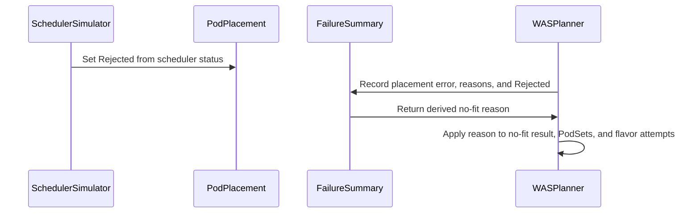

# PR #18835: improve-nofit-reason-for-WAS-deep-integration

**Summary**: improve-nofit-reason-for-WAS-deep-integration

**Sources**: https://github.com/kubernetes-sigs/kueue/pull/18835

**Last updated**: 2026-11-16T10:40:02Z

---

## Metadata

- **State**: open
- **Author**: [@Huangpinhan](https://github.com/Huangpinhan)
- **Branch**: `improve-nofit-reason-for-WAS-deep-integration` → `main`
- **Created**: 2026-11-16T08:15:32Z
- **Updated**: 2026-11-16T10:40:02Z
- **Merged**: —
- **Closed**: —
- **Labels**: `release-note`, `size/L`, `ok-to-test`, `cncf-cla: yes`, `area/tas`, `area/was`
- **Assignees**: _none_
- **Requested reviewers**: [@kannon92](https://github.com/kannon92), [@mykysha](https://github.com/mykysha)
- **Changed files**: 9   **+214 / -14**

## Description

#### What type of PR is this?


/area tas
/area was

#### What this PR does / why we need it?

With `SchedulerLibraryDeepIntegration`, every placement failure from the scheduler-library simulation was reported as the generic `SchedulingSimulationFailed`, hiding the real admission blocke

This PR classifies the failures of the last simulation:

| Failed Pods | Reason |
|---|---|
| All rejected by the scheduler (`fwk.Status.IsRejected()`) | `TopologyPlacementFailed` |
| Any plugin error or skipped Pod | `SchedulingSimulationFailed` (fallback) |

The classification is done once per workload and applied to every failed PodSet: an error in one Pod makes the scheduler reject the other Pods of the same pod group hierarchy, so their rejection is not a placement failure either.

To make this possible, `simulator.PodPlacement` now carries `Rejected`. Before, the status code was dropped in `toSchedulingResult`.

Fixes #17281 

#### Useful notes for your reviewer

- No new reason, no API change. `TopologyPlacementFailed` matches what the native planner reports for the same case.
- Only the reason changes; which cases become `NoFit` does not. Failure details and PodSet context in the message are unchanged.


**AI disclosure:** Parts of the code in this PR were generated with the help of Claude. I reviewed all of the changes myself.

#### Release note

```release-note
TAS: With SchedulerLibraryDeepIntegration enabled, a workload whose Pods are rejected by the scheduler simulation now gets the QuotaReserved reason "TopologyPlacementFailed" instead of "SchedulingSimulationFailed".
```

<!-- This is an auto-generated comment: release notes by coderabbit.ai -->

<!-- coderabbit-ai-generated:v1 -->

## AI summary

This PR changes the `WorkloadQuotaReserved` NoFit reason for `SchedulerLibraryDeepIntegration` in the WAS planner.

- Scheduler-library placement failures now set the reason per workload. If every failed Pod was rejected by the scheduler, the reason is `TopologyPlacementFailed`.
- If any failed Pod had a plugin error or was skipped, the reason stays `SchedulingSimulationFailed`.
- `simulator.PodPlacement` has a new `Rejected` field. It is populated from `status.IsRejected()`.
- The reason applies to every failed PodSet. With unadmitted-workload observability enabled, it also applies to each attempted flavor.
- The PR does not change which cases produce `NoFit`, the failure details, or the PodSet context.
- The PR adds no API change and no new reason.
- Unit tests in `was_planner_test.go`, `scheduler_tas_schedlib_test.go`, and `scheduler_simulator_test.go` cover the new classification. Two e2e expectations change to `TopologyPlacementFailed`.
- The linked issue (`#17281`) also asks for a design doc and docs update. This PR does not report either artifact.
- Test results are not available for this summary.

## Suggested release note

```text
WorkloadAwareScheduler: Improved the NoFit reason for Workloads that fail scheduler-library placement in the WAS deep integration. Kueue now reports `TopologyPlacementFailed` when the scheduler rejects every failed Pod. It keeps `SchedulingSimulationFailed` when a Pod fails with a plugin error or is skipped.
```

The feature gate that controls this behavior, if any, is not confirmed from the evidence reviewed.

<!-- end of auto-generated comment: release notes by coderabbit.ai -->

## Discussion

### Comment by [@netlify[bot]](https://github.com/apps/netlify) — 2026-11-16T08:15:36Z

### <span aria-hidden="true">👷</span> Deploy request for *kubernetes-sigs-kueue* pending review.
[Visit the deploys page to approve it](https://app.netlify.com/projects/kubernetes-sigs-kueue/deploys)

|  Name | Link |
|:-:|------------------------|
|<span aria-hidden="true">🔨</span> Latest commit | 92cf3a8a04a52b978266e4682a4c1362311ab384 |

### Comment by [@kubernetes-prow[bot]](https://github.com/apps/kubernetes-prow) — 2026-11-16T08:15:43Z

Hi @Huangpinhan. Thanks for your PR.

I'm waiting for a [kubernetes-sigs](https://github.com/orgs/kubernetes-sigs/people) member to verify that this patch is reasonable to test. If it is, they should reply with `/ok-to-test` on its own line. Until that is done, I will not automatically test new commits in this PR, but the usual testing commands by org members will still work.

>[!TIP]
>**We noticed you've done this a few times! Consider [joining the org](https://git.k8s.io/community/community-membership.md#member) to skip this step and gain `/lgtm` and other bot rights.** We recommend asking approvers on your previous PRs to sponsor you.

Once the patch is verified, the new status will be reflected by the `ok-to-test` label.

I understand the commands that are listed [here](https://go.k8s.io/bot-commands?repo=kubernetes-sigs%2Fkueue).

<details>

Instructions for interacting with me using PR comments are available [here](https://git.k8s.io/community/contributors/guide/pull-requests.md).  If you have questions or suggestions related to my behavior, please file an issue against the [kubernetes-sigs/prow](https://github.com/kubernetes-sigs/prow/issues/new?title=Prow%20issue:) repository.
</details>

### Comment by [@kubernetes-prow[bot]](https://github.com/apps/kubernetes-prow) — 2026-11-16T08:15:53Z

[APPROVALNOTIFIER] This PR is **NOT APPROVED**

This pull-request has been approved by: *<a href="https://github.com/kubernetes-sigs/kueue/pull/18835#" title="Author self-approved">Huangpinhan</a>*
**Once this PR has been reviewed and has the lgtm label**, please assign [mbobrovskyi](https://github.com/mbobrovskyi), [tenzen-y](https://github.com/tenzen-y) for approval. For more information see [the Code Review Process](https://git.k8s.io/community/contributors/guide/owners.md#the-code-review-process).

The full list of commands accepted by this bot can be found [here](https://go.k8s.io/bot-commands?repo=kubernetes-sigs%2Fkueue).

<details open>
Needs approval from an approver in each of these files:

- **[OWNERS](https://github.com/kubernetes-sigs/kueue/blob/main/OWNERS)**

Approvers can indicate their approval by writing `/approve` in a comment
Approvers can cancel approval by writing `/approve cancel` in a comment
</details>
<!-- META={"approvers":["mbobrovskyi","tenzen-y"]} -->

### Comment by [@coderabbitai[bot]](https://github.com/apps/coderabbitai) — 2026-11-16T08:16:11Z

<!-- coderabbit-ai-generated:v1 -->

<!-- This is an auto-generated comment: summarize by coderabbit.ai -->
<!-- review_stack_entry_start -->

<a href="https://app.coderabbit.ai/change-stack/kubernetes-sigs/kueue/pull/18835?scope=ghh_OusAJGA4HG8ljoOV0wJvVx8NmnZIjc2DdjmxOu0xZWA&amp;cs_source=review_comment"><picture><source media="(prefers-color-scheme: dark)" srcset="https://storage.googleapis.com/coderabbit_public_assets/review-stack-buttons-v1/explain-change-dark.svg"><source media="(prefers-color-scheme: light)" srcset="https://storage.googleapis.com/coderabbit_public_assets/review-stack-buttons-v1/explain-change.svg"></picture></a>

<!-- review_stack_entry_end -->
<!-- recent_review_status_start -->

No actionable comments were generated in the recent review.

<!-- recent_review_status_end -->
<!-- walkthrough_start -->

<details>
<summary><strong>Walkthrough</strong></summary>
<dl>
<dd>
<br>

The WAS simulator now records whether a failed Pod placement was rejected by the scheduler. The planner uses that status to report `TopologyPlacementFailed` when all failures are rejections, and `SimulationFailed` when any failure is not a rejection.

**Changes: WAS no-fit classification**

|Layer / File(s)|Summary|
|:---|:---|
|**Propagate scheduler rejection status** <br> `pkg/cache/scheduler/simulator/types.go`, `pkg/cache/scheduler/was/scheduler_simulator.go`, `pkg/cache/scheduler/was/scheduler_simulator_test.go`|`PodPlacement` now records scheduler rejection status. The simulator sets this field from the scheduler status. Tests distinguish rejected placements from plugin errors.|
|**Classify simulation no-fit reasons** <br> `pkg/scheduler/assignment/was/placement_summary.go`, `pkg/scheduler/assignment/was/was_planner.go`|The failure summary returns `TopologyPlacementFailed` when all recorded failures are rejections, and `SimulationFailed` otherwise. The planner applies the derived reason to the no-fit result, PodSet statuses, and flavor attempts.|
|**Validate no-fit reason outcomes** <br> `pkg/scheduler/assignment/was/was_planner_test.go`, `pkg/scheduler/scheduler_tas_schedlib_test.go`, `test/e2e/singlecluster/tasapi/deepintegration/*`|Tests cover rejected, errored, mixed, and partially placed workloads. The end-to-end expectations use the placement failure reason.|

<!-- change_assessment_start -->


**Estimated code review effort:** 3 (Moderate) | ~20 minutes

<!-- change_assessment_commit:"92cf3a8a04a52b978266e4682a4c1362311ab384" -->
<!-- change_assessment_priority:{"version":1,"urgency":"p2","manual":false} -->
**Change:** Feature · **Severity of issue fixed:** Medium
<!-- change_assessment_end -->

### Sequence Diagram(s)



**Possibly related issues**

- kubernetes-sigs/kueue#17553: The issue describes missing granular scheduler rejection information in `PodPlacement` results, which this change carries into no-fit reason classification.

**Possibly related PRs**

- [kubernetes-sigs/kueue#18264](https://github.com/kubernetes-sigs/kueue/pull/18264): This PR also separates scheduling errors from rejected placements and propagates simulation no-fit reasons to Workload status.

**Suggested reviewers:** `singularity23x0`, `alien1403`, `amy`

</dd>
</dl>
</details>

<!-- walkthrough_end -->
<details>
<summary><strong>Merge Risk:</strong> <strong><picture></picture> Minimal</strong> · up to <code>92cf3</code></summary>
<dl>
<dd>
<br>

<!-- final_review_risk_start -->
<!-- final_review_risk_label
**Merge Risk:** **⚪ Minimal** · up to `92cf3`
-->
<!-- final_review_risk_coverage:{"sourceCommitId":"92cf3a8a04a52b978266e4682a4c1362311ab384","coveredCommitId":"92cf3a8a04a52b978266e4682a4c1362311ab384","kind":"reviewed"} -->

This change only refines the reason reported when a WAS workload does not fit. Which workloads are NoFit does not change. No actionable merge-blocking risk remains.
<!-- final_review_risk_end -->

</dd>
</dl>
</details>
<!-- pre_merge_checks_walkthrough_start -->

<details>
<summary><strong>Pre-merge checks: <sup><picture></picture></sup> 4</strong></summary>
<dl>
<dd>
<br>

|         Check name         |                                             Status                                             | Explanation                                                                                                                                                                                                     |
| :------------------------ | :--------------------------------------------------------------------------------------------: | :-------------------------------------------------------------------------------------------------------------------------------------------------------------------------------------------------------------- |
|      Description Check     |  | Check skipped - CodeRabbit’s high-level summary is enabled.                                                                                                                                                     |
|     Linked Issues check    |  | Issue `#17281` asks for specific NoFit reasons for scheduler-library failures in WAS deep integration, with a generic fallback and preserved failure details and PodSet context.<br><br>Evidence from the merge-… |
| Out of Scope Changes check |  | All changed areas connect to `#17281` or to supporting work for it:<br>- `pkg/cache/scheduler/simulator/types.go`: adds `Rejected` to `PodPlacement`, which the classification needs.<br>- `pkg/cache/scheduler/… |
|         Title check        |  | The title "improve-nofit-reason-for-WAS-deep-integration" names the main change: the NoFit failure reason for WAS deep integration is now classified more precisely. The changeset sets TopologyPlacemen…       |

<details>
<summary><strong>Full details: Linked Issues check</strong></summary>
<dl>
<dd>
<br>

**Explanation**

Issue `#17281` asks for specific NoFit reasons for scheduler-library failures in WAS deep integration, with a generic fallback and preserved failure details and PodSet context.

Evidence from the merge-base-to-head diff summary:
- Classification: `placement_summary.go` maps failures where every Pod was scheduler-rejected (`fwk.Status.IsRejected()`, carried as `PodPlacement.Rejected`) to `TopologyPlacementFailed`. This covers the TAS placement case described in the issue.
- Fallback: any plugin error or skipped Pod yields `SchedulingSimulationFailed`. This satisfies the fallback requirement.
- Details and context: the PR states that failure details and PodSet context are unchanged. The summary shows no change to message construction.
- Tests: `was_planner_test.go` covers all-rejected, mixed rejected/error, multi-PodSet, and empty-cluster retry cases. `scheduler_tas_schedlib_test.go` and the e2e tests were updated to the new reason.

Gaps:
- Only one new specific reason is added. The issue refers to plural reasons and to tests for "other classified failures". The diff summary shows no second classified failure type. Whether the scheduler library exposes other classifiable failure types was not verified with repository inspection.
- The issue's design doc, API change, and docs artifacts are non-coding and are not assessed.

The coding requirements for the classified and fallback paths are met. The PR scope is narrower than the broadest reading of the issue.

</dd>
</dl>
</details>

<details>
<summary><strong>Full details: Out of Scope Changes check</strong></summary>
<dl>
<dd>
<br>

**Explanation**

All changed areas connect to `#17281` or to supporting work for it:
- `pkg/cache/scheduler/simulator/types.go`: adds `Rejected` to `PodPlacement`, which the classification needs.
- `pkg/cache/scheduler/was/scheduler_simulator.go`: populates `Rejected` from `status.IsRejected()` in `toSchedulingResult`.
- `pkg/scheduler/assignment/was/placement_summary.go` and `was_planner.go`: derive and apply the NoFit reason per workload and PodSet.
- Unit tests in `scheduler_simulator_test.go`, `was_planner_test.go`, and `scheduler_tas_schedlib_test.go`: verify the new behavior.
- E2E tests `basic_fit_test.go` and `tas_requirements_test.go`: updated expectations for the new reason.

No unrelated change was identified in the diff summary. The PR description states no API change, which matches the summary (no exported declaration changes other than the internal `PodPlacement` field).

</dd>
</dl>
</details>

<details>
<summary><strong>Full details: Title check</strong></summary>
<dl>
<dd>
<br>

**Explanation**

The title "improve-nofit-reason-for-WAS-deep-integration" names the main change: the NoFit failure reason for WAS deep integration is now classified more precisely. The changeset sets TopologyPlacementFailed when all failed Pods are scheduler rejections, and keeps SimulationFailed otherwise, and it carries the Rejected flag through simulator.PodPlacement. The title is a branch-style slug, not a plain sentence, and it uses hyphens instead of spaces, which hurts readability in history, but it is specific and on-topic.

</dd>
</dl>
</details>

</dd>
</dl>
</details>

<!-- pre_merge_checks_walkthrough_end -->
<!-- finishing_touch_checkbox_start -->

<details>
<summary><strong>Finishing Touches</strong></summary>
<dl>
<dd>
<br>

<details open>
<summary><strong>Generate unit tests (beta)</strong></summary>
<dl>
<dd>
<br>

- [ ] <!-- {"checkboxId": "f47ac10b-58cc-4372-a567-0e02b2c3d479", "radioGroupId": "utg-output-choice-group-unknown_comment_id"} --> Create a new PR

</dd>
</dl>
</details>

</dd>
</dl>
</details>

<!-- finishing_touch_checkbox_end -->

<!-- autopilot:start -->
- [ ] <!-- {"checkboxId":"2708ad07-9f24-4260-9c11-7dc76a49f2e3"} --> <strong title="Keep fixing CodeRabbit findings and required CI, and resolving merge conflicts">Autofix</strong> · Keep fixing CodeRabbit findings and required CI, and resolving merge conflicts
<!-- autopilot:end -->
<!-- recent_review_start -->

<h6>
<details>
<summary><strong><picture></picture> Recent review info</strong></summary>
<dl>
<dd>
<br>

<!-- review_info_content -->
<details>
<summary><strong><picture><source media="(prefers-color-scheme: dark)" srcset="https://storage.googleapis.com/coderabbit_public_assets/review-comment-icons-v1/cog-dark.svg"></picture> Run configuration</strong></summary>
<dl>
<dd>
<br>

- **Source mode**: Auto
- **Repository**: [kubernetes-sigs/kueue](<https://github.com/kubernetes-sigs/kueue>)
- **Branch**: [main](<https://github.com/kubernetes-sigs/kueue/tree/main>)
- **File**: [.coderabbit.yaml](<https://github.com/kubernetes-sigs/kueue/blob/31a8411e3c701b140baebf82ba3dbcdd1ee98cc6/.coderabbit.yaml>)
- **Commit**: [31a8411](<https://github.com/kubernetes-sigs/kueue/commit/31a8411e3c701b140baebf82ba3dbcdd1ee98cc6>)
- **Layers**: Repository YAML
- **Review profile**: CHILL
- **Plan**: Advanced
- **Run ID**: `709532eb-1af9-47ff-ad72-6c7300e865bd`

</dd>
</dl>
</details>

<details>
<summary><strong><picture><source media="(prefers-color-scheme: dark)" srcset="https://storage.googleapis.com/coderabbit_public_assets/review-comment-icons-v1/git-commit-horizontal-dark.svg"></picture> Commits</strong></summary>
<dl>
<dd>
<br>

Reviewing files that changed from the base of the PR and between 31a8411e3c701b140baebf82ba3dbcdd1ee98cc6 and 92cf3a8a04a52b978266e4682a4c1362311ab384.

</dd>
</dl>
</details>

<details>
<summary><strong><picture><source media="(prefers-color-scheme: dark)" srcset="https://storage.googleapis.com/coderabbit_public_assets/review-comment-icons-v1/file-plus-corner-dark.svg"></picture> Files selected for processing: 9</strong></summary>
<dl>
<dd>
<br>

* `pkg/cache/scheduler/simulator/types.go`
* `pkg/cache/scheduler/was/scheduler_simulator.go`
* `pkg/cache/scheduler/was/scheduler_simulator_test.go`
* `pkg/scheduler/assignment/was/placement_summary.go`
* `pkg/scheduler/assignment/was/was_planner.go`
* `pkg/scheduler/assignment/was/was_planner_test.go`
* `pkg/scheduler/scheduler_tas_schedlib_test.go`
* `test/e2e/singlecluster/tasapi/deepintegration/basic_fit_test.go`
* `test/e2e/singlecluster/tasapi/deepintegration/tas_requirements_test.go`

</dd>
</dl>
</details>

**Included review availability:** This review used your included allowance. Your plan provides up to 8 included reviews per hour; 7 remain after this review.

</dd>
</dl>
</details>
</h6>

<!-- recent_review_end -->

### Comment by [@pajakd](https://github.com/pajakd) — 2026-11-16T10:39:57Z

/ok-to-test
