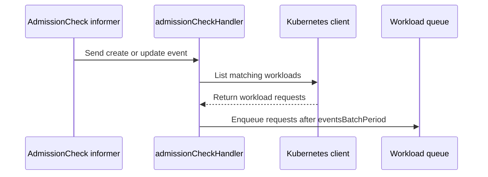

# PR #18949: MultiKueue: queue the initial-list admission check workloads at low priority

**Summary**: MultiKueue: queue the initial-list admission check workloads at low priority

**Sources**: https://github.com/kubernetes-sigs/kueue/pull/18949

**Last updated**: 2026-11-18T19:21:45Z

---

## Metadata

- **State**: closed (merged)
- **Author**: [@kevin85421](https://github.com/kevin85421)
- **Branch**: `mk-ac-initial-list-low-priority` → `main`
- **Created**: 2026-11-17T06:22:55Z
- **Updated**: 2026-11-18T19:21:45Z
- **Merged**: 2026-11-18T15:14:20Z
- **Closed**: 2026-11-18T15:14:20Z
- **Labels**: `kind/bug`, `release-note`, `size/L`, `lgtm`, `approved`, `cncf-cla: yes`, `area/multikueue`
- **Assignees**: [@vladikkuzn](https://github.com/vladikkuzn)
- **Requested reviewers**: [@kshalot](https://github.com/kshalot), [@vladikkuzn](https://github.com/vladikkuzn), [@reruno](https://github.com/reruno), [@j-skiba](https://github.com/j-skiba)
- **Changed files**: 3   **+97 / -53**

## Description

<!-- Thank you for contributing! Check CONTRIBUTING.md for details. -->

#### What type of PR is this?

/kind bug

/area multikueue

#### What this PR does / why we need it?

When the MultiKueue workload controller starts, the AdmissionCheck informer reports every existing AdmissionCheck as created. `admissionCheckHandler.Create` then queues every Workload that uses the MultiKueue AdmissionCheck, at the default priority. The controller reconciles one Workload at a time, so after a manager restart new Workloads wait until all of these Workloads are reconciled.

This PR replaces the hand-written AdmissionCheck event handler with controller-runtime's `handler.EnqueueRequestsFromMapFunc`. The handler keeps its event filters and passes the remaining events to the map function, which returns the Workloads to reconcile. Like other controller-runtime handlers, it queues the Workloads of initial-list events at `handler.LowPriority`, so new Workloads are dispatched first. A real AdmissionCheck creation, and a change of its MultiKueueConfig, still queue the Workloads at the default priority.

The Workloads of AdmissionCheck events are now queued immediately instead of after `eventsBatchPeriod`. AdmissionChecks rarely change, so batching their events has no practical effect. The MultiKueueConfig event handler is unchanged.

Fixes #18938

Part of #18466

#### Useful notes for your reviewer

Benchmark on a production MultiKueue manager with about 250 unfinished Workloads and 3 workers, comparing two manager restarts. The image without #18949 is upstream main at `72af8ddd1` plus #18407; the image with #18949 is upstream main at `71c236e4d` plus this PR (#19012). Both images also carry an unrelated cluster-targeting patch.

`workqueue_depth{name="multikueue_workload"}` after the restart, by priority, and how long new Workloads waited to be dispatched:

| | priority 0 (default) | priority -100 (`handler.LowPriority`) | new Workload wait |
|---|---|---|---|
| without #18949 | peak 247; 202 after 40 s, 103 after 1.5 min, 0 after 3.5 min | peak 2445 | up to 3.5 min, until the default-priority backlog drained |
| with #18949 | peak 3 in the first 5 min, each time 0 again within 30 s | peak 2562 | 0-3 s (22 probe Jobs) |

The Workloads queued by the AdmissionCheck initial list moved from the default priority to the low priority.

During the restart with #18949, a small probe Job was created every 10 s for 4 min, starting when the new manager container started. All 22 probes were dispatched to a worker within 0-3 s and admitted within 2-5 s, while more than 2,000 low-priority requests were queued.

AI disclosure: written with the help of Claude Code and reviewed by the author.

#### Release note

```release-note
MultiKueue: Fixed a bug where restarting the manager could delay dispatching new Workloads until all unfinished Workloads were reconciled. Kueue now queues those Workloads at low priority when the controller starts.
```

🤖 Generated with [Claude Code](https://claude.com/claude-code)


<!-- This is an auto-generated comment: release notes by coderabbit.ai -->
<!-- coderabbit-ai-generated:v1 -->

## AI summary

The MultiKueue AdmissionCheck handler now delegates its queueing to `handler.EnqueueRequestsFromMapFunc`. It handles only two events:
- AdmissionCheck create events for checks whose `ControllerName` is the MultiKueue controller.
- AdmissionCheck update events where both old and new checks use the MultiKueue controller and the MultiKueueConfig name changed.

The map function lists the Workloads that use the check through `workloadRequestsForAdmissionCheck`. The handler then enqueues them. The diff does not set `handler.LowPriority` in `workload.go`. Low priority for initial-list events therefore depends on controller-runtime's map handler behavior, which the diff does not show. Errors from the map function are logged, not returned.

The MultiKueueConfig handler (`configHandler`) keeps its behavior. It now calls the same helper and calls `q.AddAfter` directly. It collects lookup errors and continues with the remaining checks.

The changes are in three files, with 97 lines added and 53 removed:
- `pkg/controller/admissionchecks/multikueue/workload.go`: removes the `admissionCheckHandler` struct and its methods. Adds the `admissionCheckHandler(c client.Client) handler.EventHandler` constructor and the `workloadRequestsForAdmissionCheck` helper. Updates the watch registration.
- `pkg/controller/admissionchecks/multikueue/workload_test.go`: updates handler tests to use the new constructor and checks queued priorities.
- `pkg/util/testing/workqueue.go`: adds `MockPriorityQueue`, which records each request and its priority. `GetWithPriority` panics with `"not implemented"`.

Test and CI results are not available. The supplied evidence includes only a `/test all` request in the PR comments and no completed check results for the current head.

## Suggested release note

```text
MultiKueue: Fixed a bug that caused new Workloads to wait behind unfinished Workloads after a MultiKueue manager restart. Now Kueue queues the Workloads that are re-listed at the AdmissionCheck informer's initial list at low priority, so new Workloads are dispatched first.
```
<!-- end of auto-generated comment: release notes by coderabbit.ai -->

## Discussion

### Comment by [@netlify[bot]](https://github.com/apps/netlify) — 2026-11-17T06:22:59Z

### <span aria-hidden="true">👷</span> Deploy request for *kubernetes-sigs-kueue* pending review.
[Visit the deploys page to approve it](https://app.netlify.com/projects/kubernetes-sigs-kueue/deploys)

|  Name | Link |
|:-:|------------------------|
|<span aria-hidden="true">🔨</span> Latest commit | a03d9caf7d24c673a6b2052be2f8d40b1353b34b |

### Comment by [@coderabbitai[bot]](https://github.com/apps/coderabbitai) — 2026-11-17T06:23:30Z

<!-- coderabbit-ai-generated:v1 -->

<!-- This is an auto-generated comment: summarize by coderabbit.ai -->
<!-- review_stack_entry_start -->

<a href="https://app.coderabbit.ai/change-stack/kubernetes-sigs/kueue/pull/18949?scope=ghh_OusAJGA4HG8ljoOV0wJvVx8NmnZIjc2DdjmxOu0xZWA&amp;cs_source=review_comment"><picture><source media="(prefers-color-scheme: dark)" srcset="https://storage.googleapis.com/coderabbit_public_assets/review-stack-buttons-v1/explain-change-dark.svg"><source media="(prefers-color-scheme: light)" srcset="https://storage.googleapis.com/coderabbit_public_assets/review-stack-buttons-v1/explain-change.svg"></picture></a>

<!-- review_stack_entry_end -->
<!-- recent_review_status_start -->

No actionable comments were generated in the recent review.

<!-- recent_review_status_end -->
<!-- walkthrough_start -->

<details>
<summary><strong>Walkthrough</strong></summary>
<dl>
<dd>
<br>

MultiKueue AdmissionCheck handling now uses a function-based handler and shared workload lookup. Tests verify that initial-list create events use low priority and ordinary creates use default priority.

**Changes: MultiKueue AdmissionCheck events**

|Layer / File(s)|Summary|
|:---|:---|
|**Event handling and workload lookup** <br> `pkg/controller/admissionchecks/multikueue/workload.go`|A function-based handler handles MultiKueue AdmissionCheck creates and qualifying updates. A shared helper lists matching workloads for event handling and config updates.|
|**Priority tests and queue mock** <br> `pkg/controller/admissionchecks/multikueue/workload_test.go`, `pkg/util/testing/workqueue.go`|Create-event tests check default priority for ordinary creates and low priority for initial-list creates. The new priority queue mock records requests and priorities.|

<!-- change_assessment_start -->


**Estimated code review effort:** 2 (Simple) | ~10 minutes

<!-- change_assessment_commit:"a03d9caf7d24c673a6b2052be2f8d40b1353b34b" -->
<!-- change_assessment_priority:{"version":1,"urgency":"p2","manual":false} -->
**Change:** Bug fix · **Severity of issue fixed:** Medium
<!-- change_assessment_end -->

### Sequence Diagram(s)



**Suggested reviewers:** `matteofari`, `olekzabl`

</dd>
</dl>
</details>

<!-- walkthrough_end -->
<details>
<summary><strong>Merge Risk:</strong> <strong><picture></picture> Minimal</strong> · up to <code>a03d9</code></summary>
<dl>
<dd>
<br>

<!-- final_review_risk_start -->
<!-- final_review_risk_label
**Merge Risk:** **⚪ Minimal** · up to `a03d9`
-->
<!-- final_review_risk_coverage:{"sourceCommitId":"a03d9caf7d24c673a6b2052be2f8d40b1353b34b","coveredCommitId":"a03d9caf7d24c673a6b2052be2f8d40b1353b34b","kind":"reviewed"} -->

This change queues MultiKueue Workloads from the AdmissionCheck initial list at low priority, so new Workloads are dispatched sooner after a manager restart. It has no known merge-blocking risk and is covered by new tests.
<!-- final_review_risk_end -->

</dd>
</dl>
</details>
<!-- pre_merge_checks_walkthrough_start -->

<details>
<summary><strong>Pre-merge checks: <sup><picture></picture></sup> 3 · <sup><picture></picture></sup> 1</strong></summary>
<dl>
<dd>
<br>

<strong><sup><picture></picture></sup> Failed checks: 1 inconclusive</strong>

|      Check name     |                                                   Status                                                   | Explanation                                                                                                                                                                                               | Resolution                                                                                                                                                                                                                                        |
| :----------------- | :--------------------------------------------------------------------------------------------------------: | :-------------------------------------------------------------------------------------------------------------------------------------------------------------------------------------------------------- | :------------------------------------------------------------------------------------------------------------------------------------------------------------------------------------------------------------------------------------------------ |
| Linked Issues check |  | Requirement from `#18938`: Workloads queued only by the AdmissionCheck initial list must use low priority. Real AdmissionCheck creation and MultiKueueConfig changes must keep the default priority. The p… | Confirm that the controller-runtime version used by this repository maps IsInInitialList in EnqueueRequestsFromMapFunc.Create to priorityqueue.AddOpts{Priority: handler.LowPriority} when the queue is a priorityqueue.PriorityQueue. Confirm t… |

<details>
<summary><strong><sup><picture></picture></sup> Passed checks: 3 passed</strong></summary>
<dl>
<dd>
<br>

|         Check name         |                                             Status                                             | Explanation                                                                                                                                                                                               |
| :------------------------ | :--------------------------------------------------------------------------------------------: | :-------------------------------------------------------------------------------------------------------------------------------------------------------------------------------------------------------- |
|         Title check        |  | The title names the main change: Workloads queued because of the AdmissionCheck initial list are queued at low priority. The raw summary shows the handler change, the new MockPriorityQueue test helper… |
| Out of Scope Changes check |  | The changes relate to `#18938`. admissionCheckHandler is rebuilt on EnqueueRequestsFromMapFunc. That change supplies the initial-list priority path. workloadRequestsForAdmissionCheck is a shared helper … |
|      Description Check     |  | Check skipped - CodeRabbit’s high-level summary is enabled.                                                                                                                                               |

<details>
<summary><strong>Full details: Title check</strong></summary>
<dl>
<dd>
<br>

**Explanation**

The title names the main change: Workloads queued because of the AdmissionCheck initial list are queued at low priority. The raw summary shows the handler change, the new MockPriorityQueue test helper, and the updated create tests, all matching this objective. The title is specific and concise, and it avoids vague terms.

</dd>
</dl>
</details>

<details>
<summary><strong>Full details: Out of Scope Changes check</strong></summary>
<dl>
<dd>
<br>

**Explanation**

The changes relate to `#18938`. admissionCheckHandler is rebuilt on EnqueueRequestsFromMapFunc. That change supplies the initial-list priority path. workloadRequestsForAdmissionCheck is a shared helper for the Create path and for configHandler.queueWorkloadsForConfig. configHandler still calls AddAfter(req, eventsBatchPeriod) at the default priority, and it still collects lookup errors and continues. The test changes cover the initial-list and ordinary create cases, and the update case. MockPriorityQueue in pkg/util/testing/workqueue.go records priorities for those assertions. The commit-message summary says the MultiKueue config handler is unchanged. The diff shows that its queueWorkloadsForConfig body changed. Its behavior is preserved, so this is a documentation mismatch, not an out-of-scope change. No unrelated behavior was identified.

</dd>
</dl>
</details>

</dd>
</dl>
</details>

<details>
<summary><strong>Full details: Linked Issues check</strong></summary>
<dl>
<dd>
<br>

**Explanation**

Requirement from `#18938`: Workloads queued only by the AdmissionCheck initial list must use low priority. Real AdmissionCheck creation and MultiKueueConfig changes must keep the default priority. The previous assessment relied on an IsInInitialList branch that set priority in admissionCheckHandler.Create. That branch is absent at the reviewed head a03d9caf. The diff of pkg/controller/admissionchecks/multikueue/workload.go replaces the struct handler with admissionCheckHandler(c), built on handler.EnqueueRequestsFromMapFunc. The CreateFunc passes the whole event, including IsInInitialList, to enq.Create. The priority for initial-list events therefore depends on controller-runtime, which the diff does not show. The Update path calls enq.Update with a non-initial-list event, so it keeps the default priority. The updated workload_test.go case 'multikueue admission check in the initial list' expects handler.LowPriority for IsInInitialList true, and expects 0 otherwise, using MockPriorityQueue. That test shows intent. It does not show the test passes. The head code also changed the Create path from AddAfter(eventsBatchPeriod) to the mapping path. The diff does not show whether that path still applies the batch delay. Missing evidence: the controller-runtime version in go.mod and its EnqueueRequestsFromMapFunc source, which must honor IsInInitialList by calling AddWithOpts with LowPriority on a priorityqueue.PriorityQueue. Also needed: the controller queue type, and a passing run of TestAdmissionCheckHandlerCreate. The production benchmark in the PR description is reported, not verified here.

**Resolution**

Confirm that the controller-runtime version used by this repository maps IsInInitialList in EnqueueRequestsFromMapFunc.Create to priorityqueue.AddOpts{Priority: handler.LowPriority} when the queue is a priorityqueue.PriorityQueue. Confirm that the controller workqueue implements priorityqueue.PriorityQueue. Provide a passing run of TestAdmissionCheckHandlerCreate and TestAdmissionCheckHandlerUpdate at the head. Confirm whether the initial-list path still applies eventsBatchPeriod, or document that the delay was removed.

</dd>
</dl>
</details>

</dd>
</dl>
</details>

<!-- pre_merge_checks_walkthrough_end -->
<!-- finishing_touch_checkbox_start -->

<details>
<summary><strong>Finishing Touches</strong></summary>
<dl>
<dd>
<br>

<details open>
<summary><strong>Generate unit tests (beta)</strong></summary>
<dl>
<dd>
<br>

- [ ] <!-- {"checkboxId": "f47ac10b-58cc-4372-a567-0e02b2c3d479", "radioGroupId": "utg-output-choice-group-unknown_comment_id"} --> Create a new PR

</dd>
</dl>
</details>

</dd>
</dl>
</details>

<!-- finishing_touch_checkbox_end -->

<!-- autopilot:start -->
- [ ] <!-- {"checkboxId":"2708ad07-9f24-4260-9c11-7dc76a49f2e3"} --> <strong title="Keep fixing CodeRabbit findings and required CI, and resolving merge conflicts">Autofix</strong> · Keep fixing CodeRabbit findings and required CI, and resolving merge conflicts
<!-- autopilot:end -->
<!-- recent_review_start -->

<h6>
<details>
<summary><strong><picture></picture> Recent review info</strong></summary>
<dl>
<dd>
<br>

<!-- review_info_content -->
<details>
<summary><strong><picture><source media="(prefers-color-scheme: dark)" srcset="https://storage.googleapis.com/coderabbit_public_assets/review-comment-icons-v1/cog-dark.svg"></picture> Run configuration</strong></summary>
<dl>
<dd>
<br>

- **Source mode**: Auto
- **Repository**: [kubernetes-sigs/kueue](<https://github.com/kubernetes-sigs/kueue>)
- **Branch**: [main](<https://github.com/kubernetes-sigs/kueue/tree/main>)
- **File**: [.coderabbit.yaml](<https://github.com/kubernetes-sigs/kueue/blob/3133ceb5c07a1eda22a213358505e0564b940119/.coderabbit.yaml>)
- **Commit**: [3133ceb](<https://github.com/kubernetes-sigs/kueue/commit/3133ceb5c07a1eda22a213358505e0564b940119>)
- **Layers**: Repository YAML
- **Review profile**: CHILL
- **Plan**: Advanced
- **Run ID**: `85474512-060a-410f-bf34-04b6776a84d3`

</dd>
</dl>
</details>

<details>
<summary><strong><picture><source media="(prefers-color-scheme: dark)" srcset="https://storage.googleapis.com/coderabbit_public_assets/review-comment-icons-v1/git-commit-horizontal-dark.svg"></picture> Commits</strong></summary>
<dl>
<dd>
<br>

Reviewing files that changed from the base of the PR and between ca792511549ede6cfb2949abcf44f2e57d4ef80b and a03d9caf7d24c673a6b2052be2f8d40b1353b34b.

</dd>
</dl>
</details>

<details>
<summary><strong><picture><source media="(prefers-color-scheme: dark)" srcset="https://storage.googleapis.com/coderabbit_public_assets/review-comment-icons-v1/file-plus-corner-dark.svg"></picture> Files selected for processing: 3</strong></summary>
<dl>
<dd>
<br>

* `pkg/controller/admissionchecks/multikueue/workload.go`
* `pkg/controller/admissionchecks/multikueue/workload_test.go`
* `pkg/util/testing/workqueue.go`

</dd>
</dl>
</details>

**Included review availability:** This review used your included allowance. Your plan provides up to 8 included reviews per hour; 7 remain after this review.

</dd>
</dl>
</details>
</h6>

<!-- recent_review_end -->

### Comment by [@kevin85421](https://github.com/kevin85421) — 2026-11-18T01:07:21Z

/test all

### Comment by [@vladikkuzn](https://github.com/vladikkuzn) — 2026-11-18T09:45:30Z

/lgtm

### Comment by [@kubernetes-prow[bot]](https://github.com/apps/kubernetes-prow) — 2026-11-18T09:45:41Z

LGTM label has been added.  <details>Git tree hash: b765e0055f050701e112075b6bfd40a49cb3bd52</details>

### Comment by [@mimowo](https://github.com/mimowo) — 2026-11-18T14:58:38Z

/cherrypick release-0.20
/cherrypick release-0.19
Awesome, thanks for making Mk faster!

### Comment by [@k8s-infra-cherrypick-robot](https://github.com/k8s-infra-cherrypick-robot) — 2026-11-18T14:58:43Z

@mimowo: once the present PR merges, I will cherry-pick it on top of `release-0.19`, `release-0.20` in new PRs and assign them to you.

<details>

In response to [this](https://github.com/kubernetes-sigs/kueue/pull/18949#issuecomment-6982270439):

>/cherrypick release-0.20
>/cherrypick release-0.19
>Awesome, thanks for making Mk faster!


Instructions for interacting with me using PR comments are available [here](https://git.k8s.io/community/contributors/guide/pull-requests.md).  If you have questions or suggestions related to my behavior, please file an issue against the [kubernetes-sigs/prow](https://github.com/kubernetes-sigs/prow/issues/new?title=Prow%20issue:) repository.
</details>

### Comment by [@mimowo](https://github.com/mimowo) — 2026-11-18T14:58:46Z

/approve

### Comment by [@kubernetes-prow[bot]](https://github.com/apps/kubernetes-prow) — 2026-11-18T14:59:02Z

[APPROVALNOTIFIER] This PR is **APPROVED**

This pull-request has been approved by: *<a href="https://github.com/kubernetes-sigs/kueue/pull/18949#" title="Author self-approved">kevin85421</a>*, *<a href="https://github.com/kubernetes-sigs/kueue/pull/18949#issuecomment-6982274155" title="Approved">mimowo</a>*

The full list of commands accepted by this bot can be found [here](https://go.k8s.io/bot-commands?repo=kubernetes-sigs%2Fkueue).

The pull request process is described [here](https://git.k8s.io/community/contributors/guide/owners.md#the-code-review-process)

<details >
Needs approval from an approver in each of these files:

- ~~[pkg/controller/admissionchecks/multikueue/OWNERS](https://github.com/kubernetes-sigs/kueue/blob/main/pkg/controller/admissionchecks/multikueue/OWNERS)~~ [mimowo]
- ~~[pkg/util/testing/OWNERS](https://github.com/kubernetes-sigs/kueue/blob/main/pkg/util/testing/OWNERS)~~ [mimowo]

Approvers can indicate their approval by writing `/approve` in a comment
Approvers can cancel approval by writing `/approve cancel` in a comment
</details>
<!-- META={"approvers":[]} -->

### Comment by [@k8s-infra-cherrypick-robot](https://github.com/k8s-infra-cherrypick-robot) — 2026-11-18T15:15:09Z

@mimowo: #18949 failed to apply on top of branch "release-0.20":
```
Applying: MultiKueue: queue the initial-list admission check workloads at low priority
Using index info to reconstruct a base tree...
M	pkg/controller/admissionchecks/multikueue/workload.go
M	pkg/controller/admissionchecks/multikueue/workload_test.go
Falling back to patching base and 3-way merge...
Auto-merging pkg/controller/admissionchecks/multikueue/workload.go
Auto-merging pkg/controller/admissionchecks/multikueue/workload_test.go
Applying: Queue MultiKueue admission check and config workloads with EnqueueRequestsFromMapFunc
Using index info to reconstruct a base tree...
M	pkg/controller/admissionchecks/multikueue/workload.go
M	pkg/controller/admissionchecks/multikueue/workload_test.go
Falling back to patching base and 3-way merge...
Auto-merging pkg/controller/admissionchecks/multikueue/workload.go
CONFLICT (content): Merge conflict in pkg/controller/admissionchecks/multikueue/workload.go
Auto-merging pkg/controller/admissionchecks/multikueue/workload_test.go
error: Failed to merge in the changes.
hint: Use 'git am --show-current-patch=diff' to see the failed patch
hint: When you have resolved this problem, run "git am --continue".
hint: If you prefer to skip this patch, run "git am --skip" instead.
hint: To restore the original branch and stop patching, run "git am --abort".
hint: Disable this message with "git config set advice.mergeConflict false"
Patch failed at 0002 Queue MultiKueue admission check and config workloads with EnqueueRequestsFromMapFunc

```

<details>

In response to [this](https://github.com/kubernetes-sigs/kueue/pull/18949#issuecomment-6982270439):

>/cherrypick release-0.20
>/cherrypick release-0.19
>Awesome, thanks for making Mk faster!


Instructions for interacting with me using PR comments are available [here](https://git.k8s.io/community/contributors/guide/pull-requests.md).  If you have questions or suggestions related to my behavior, please file an issue against the [kubernetes-sigs/prow](https://github.com/kubernetes-sigs/prow/issues/new?title=Prow%20issue:) repository.
</details>

### Comment by [@k8s-infra-cherrypick-robot](https://github.com/k8s-infra-cherrypick-robot) — 2026-11-18T15:15:46Z

@mimowo: #18949 failed to apply on top of branch "release-0.19":
```
Applying: MultiKueue: queue the initial-list admission check workloads at low priority
Using index info to reconstruct a base tree...
M	pkg/controller/admissionchecks/multikueue/workload.go
M	pkg/controller/admissionchecks/multikueue/workload_test.go
Falling back to patching base and 3-way merge...
Auto-merging pkg/controller/admissionchecks/multikueue/workload.go
CONFLICT (content): Merge conflict in pkg/controller/admissionchecks/multikueue/workload.go
Auto-merging pkg/controller/admissionchecks/multikueue/workload_test.go
CONFLICT (content): Merge conflict in pkg/controller/admissionchecks/multikueue/workload_test.go
error: Failed to merge in the changes.
hint: Use 'git am --show-current-patch=diff' to see the failed patch
hint: When you have resolved this problem, run "git am --continue".
hint: If you prefer to skip this patch, run "git am --skip" instead.
hint: To restore the original branch and stop patching, run "git am --abort".
hint: Disable this message with "git config set advice.mergeConflict false"
Patch failed at 0001 MultiKueue: queue the initial-list admission check workloads at low priority

```

<details>

In response to [this](https://github.com/kubernetes-sigs/kueue/pull/18949#issuecomment-6982270439):

>/cherrypick release-0.20
>/cherrypick release-0.19
>Awesome, thanks for making Mk faster!


Instructions for interacting with me using PR comments are available [here](https://git.k8s.io/community/contributors/guide/pull-requests.md).  If you have questions or suggestions related to my behavior, please file an issue against the [kubernetes-sigs/prow](https://github.com/kubernetes-sigs/prow/issues/new?title=Prow%20issue:) repository.
</details>

### Comment by [@kevin85421](https://github.com/kevin85421) — 2026-11-18T19:21:45Z

@mimowo

* CP for 0.20 https://github.com/kubernetes-sigs/kueue/pull/19094
* This PR doesn’t need to be cherry-picked to release-0.19: the MultiKueue workload controller there doesn’t watch AdmissionChecks, because [kubernetes-sigs/kueue#10229](https://github.com/kubernetes-sigs/kueue/pull/10229) (which added the watch) isn’t in release-0.19.

## Reviews

### Review by [@kevin85421](https://github.com/kevin85421) (commented) — 2026-11-18T01:01:16Z

- **pkg/controller/admissionchecks/multikueue/workload_test.go:4403** by [@kevin85421](https://github.com/kevin85421) — 2026-11-18T01:01:16Z
```diff
@@ -4383,6 +4386,21 @@ func TestAdmissionCheckHandlerCreate(t *testing.T) {
 					Obj(),
 			},
 			expectedQueuedWLs: []string{"wl1"},
+			wantPriorities:    []int{0},
+		},
+		"multikueue admission check in the initial list - workloads queued at low priority": {
+			admissionCheck: utiltestingapi.MakeAdmissionCheck("ac1").
+				ControllerName(kueue.MultiKueueControllerName).
+				Parameters(kueue.SchemeGroupVersion.Group, "MultiKueueConfig", "config1").
+				Obj(),
+			isInInitialList: true,
+			workloads: []kueue.Workload{
+				*utiltestingapi.MakeWorkload("wl1", TestNamespace).
+					AdmissionCheck(kueue.AdmissionCheckState{Name: "ac1", State: kueue.CheckStatePending}).
+					Obj(),
+			},
+			expectedQueuedWLs: []string{"wl1"},
+			wantPriorities:    []int{handler.LowPriority},
```

  https://github.com/kubernetes-sigs/controller-runtime/blob/v0.25.2/pkg/handler/eventhandler.go#L124-L141
