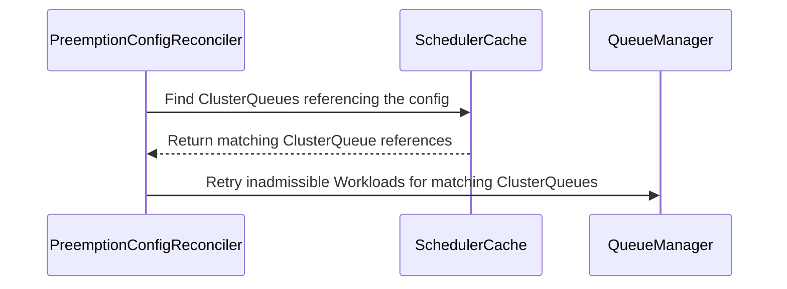

# PR #19011: ConfigurablePreemptions: Retry inadmissible workloads when a PreemptionConfig changes

**Summary**: ConfigurablePreemptions: Retry inadmissible workloads when a PreemptionConfig changes

**Sources**: https://github.com/kubernetes-sigs/kueue/pull/19011

**Last updated**: 2026-11-20T14:21:24Z

---

## Metadata

- **State**: closed (merged)
- **Author**: [@bodyhedia44](https://github.com/bodyhedia44)
- **Branch**: `preemptionconfig-requeue-inadmissible` → `main`
- **Created**: 2026-11-17T23:37:22Z
- **Updated**: 2026-11-20T14:21:24Z
- **Merged**: 2026-11-20T10:20:29Z
- **Closed**: 2026-11-20T10:20:29Z
- **Labels**: `kind/bug`, `release-note`, `size/L`, `lgtm`, `approved`, `ok-to-test`, `cncf-cla: yes`
- **Assignees**: [@dkaluza](https://github.com/dkaluza)
- **Requested reviewers**: [@mykysha](https://github.com/mykysha), [@dkaluza](https://github.com/dkaluza), [@apullo777](https://github.com/apullo777)
- **Changed files**: 5   **+361 / -0**

## Description

#### What type of PR is this?

/kind bug

#### What this PR does / why we need it?

When a ClusterQueue references a PreemptionConfig, a workload that cannot be admitted under its rules moves to the inadmissible list. Creating, deleting, or editing that PreemptionConfig did not retry it, so the workload stayed pending until an unrelated event woke the ClusterQueue up.

This PR adds a PreemptionConfig controller, registered only when `ConfigurablePreemptions` is enabled. On create, on delete, and on updates that change `metadata.generation` (spec changes), it retries the inadmissible workloads of the ClusterQueues that reference the PreemptionConfig. Label- and annotation-only updates are ignored. The controller only touches in-memory queues, so it runs on every replica (`NeedLeaderElection: false`), like the ResourceSlice controller.

Refreshing the rule-derived preemptor hash fields from #18492 is left for a follow-up PR.

Part of #18726

#### Useful notes for your reviewer

| Behavior | Level | Command and result | Not run and why |
|---|---|---|---|
| Reconcile retries only the ClusterQueues referencing the PreemptionConfig | unit | `go test ./pkg/controller/core/ -run TestPreemptionConfigReconciler` — pass | |
| Unreferenced PreemptionConfig retries nothing | unit | same — pass | |
| Gate off: nothing is retried | unit | same — pass | |
| Predicates: create/delete pass, update only on generation change, generic ignored | unit | same — pass | |
| Pending workload is admitted after its PreemptionConfig is edited, without being recreated | integration | `INTEGRATION_TARGET='./test/integration/singlecluster/scheduler/configurablepreemptions/...' make test-integration` | Not run locally: envtest binaries could not be installed. Selected by the singlecluster integration presubmit. |

Gate: ConfigurablePreemptions
Default: false
PreRelease: Alpha
Version: 0.20
Off-path test: `TestPreemptionConfigReconciler_Reconcile/ConfigurablePreemptions_disabled_requeues_nothing`

#### Release note

```release-note
ConfigurablePreemptions: Fixed a bug where workloads that could not be admitted under a PreemptionConfig stayed pending after that PreemptionConfig was created, deleted, or its rules changed. Kueue now retries those workloads.
```
The AI is used for writing tests

<!-- This is an auto-generated comment: release notes by coderabbit.ai -->
<!-- coderabbit-ai-generated:v1 -->

## AI summary

This PR adds a `PreemptionConfig` controller. The controller runs only when the `ConfigurablePreemptions` feature gate is enabled.

- The controller watches `PreemptionConfig` objects.
- On create or delete, it requeues inadmissible workloads in ClusterQueues that reference the configuration.
- On update, it requeues only when `metadata.generation` changes. Label and annotation changes are ignored.
- Generic events are ignored.
- The controller runs on every replica (`NeedLeaderElection: false`) because it acts on in-memory queues.
- `Cache.ClusterQueuesUsingPreemptionConfig(name)` returns the cached ClusterQueues whose `PreemptionConfigName` matches the given name.
- `SetupControllers` registers the reconciler when the gate is enabled. A setup failure returns the `"PreemptionConfig"` name and the error.
- Unit tests cover reconciliation for referenced and unreferenced configurations, the disabled gate, and the event predicates.
- An integration test checks that a high-priority workload stays pending until the selector includes mid-priority workloads, then gets admitted after eviction.

Refreshing rule-derived preemptor hash fields (`#18492`) is deferred to a follow-up PR.

Test status:
- Author reports that the unit test `TestPreemptionConfigReconciler` passes locally. This summary did not verify that result.
- The integration test was not run locally because envtest binaries could not be installed. Its result is not available.

### Suggested release note

```text
Scheduling: Kueue now retries inadmissible Workloads in ClusterQueues that reference a PreemptionConfig when that PreemptionConfig is created, deleted, or its spec changes. This behavior is gated by the ConfigurablePreemptions feature gate.
```
<!-- end of auto-generated comment: release notes by coderabbit.ai -->

## Discussion

### Comment by [@netlify[bot]](https://github.com/apps/netlify) — 2026-11-17T23:37:27Z

### <span aria-hidden="true">👷</span> Deploy request for *kubernetes-sigs-kueue* pending review.
[Visit the deploys page to approve it](https://app.netlify.com/projects/kubernetes-sigs-kueue/deploys)

|  Name | Link |
|:-:|------------------------|
|<span aria-hidden="true">🔨</span> Latest commit | 245233f2a6e37b4f9ab00ebb7c908af20e55ba89 |

### Comment by [@kubernetes-prow[bot]](https://github.com/apps/kubernetes-prow) — 2026-11-17T23:37:33Z

Hi @bodyhedia44. Thanks for your PR.

I'm waiting for a [kubernetes-sigs](https://github.com/orgs/kubernetes-sigs/people) member to verify that this patch is reasonable to test. If it is, they should reply with `/ok-to-test` on its own line. Until that is done, I will not automatically test new commits in this PR, but the usual testing commands by org members will still work.

>[!TIP]
>**We noticed you've done this a few times! Consider [joining the org](https://git.k8s.io/community/community-membership.md#member) to skip this step and gain `/lgtm` and other bot rights.** We recommend asking approvers on your previous PRs to sponsor you.

Once the patch is verified, the new status will be reflected by the `ok-to-test` label.

I understand the commands that are listed [here](https://go.k8s.io/bot-commands?repo=kubernetes-sigs%2Fkueue).

<details>

Instructions for interacting with me using PR comments are available [here](https://git.k8s.io/community/contributors/guide/pull-requests.md).  If you have questions or suggestions related to my behavior, please file an issue against the [kubernetes-sigs/prow](https://github.com/kubernetes-sigs/prow/issues/new?title=Prow%20issue:) repository.
</details>

### Comment by [@coderabbitai[bot]](https://github.com/apps/coderabbitai) — 2026-11-17T23:37:58Z

<!-- coderabbit-ai-generated:v1 -->

<!-- This is an auto-generated comment: summarize by coderabbit.ai -->
<!-- review_stack_entry_start -->

<a href="https://app.coderabbit.ai/change-stack/kubernetes-sigs/kueue/pull/19011?scope=ghh_OusAJGA4HG8ljoOV0wJvVx8NmnZIjc2DdjmxOu0xZWA&amp;cs_source=review_comment"><picture><source media="(prefers-color-scheme: dark)" srcset="https://storage.googleapis.com/coderabbit_public_assets/review-stack-buttons-v1/explain-change-dark.svg"><source media="(prefers-color-scheme: light)" srcset="https://storage.googleapis.com/coderabbit_public_assets/review-stack-buttons-v1/explain-change.svg"></picture></a>

<!-- review_stack_entry_end -->
<!-- recent_review_status_start -->

No actionable comments were generated in the recent review.

<!-- recent_review_status_end -->
<!-- walkthrough_start -->

<details>
<summary><strong>Walkthrough</strong></summary>
<dl>
<dd>
<br>

The change adds a scheduler-cache lookup and a feature-gated PreemptionConfig controller. The controller requests retries for inadmissible Workloads in referencing ClusterQueues when the configuration is created, deleted, or updated with a generation change. Unit and integration tests cover these behaviors.

**Changes: PreemptionConfig reconciliation**

|Layer / File(s)|Summary|
|:---|:---|
|**Find ClusterQueues by configuration** <br> `pkg/cache/scheduler/cache.go`|The cache returns ClusterQueues whose non-nil PreemptionConfig name matches the requested name.|
|**Reconcile configuration changes** <br> `pkg/controller/core/preemptionconfig_controller.go`, `pkg/controller/core/core.go`|When `ConfigurablePreemptions` is enabled, setup registers the controller. The controller requests retries for inadmissible Workloads in matching ClusterQueues. Create and delete events pass; updates pass only when generation changes.|
|**Validate reconciliation and selector changes** <br> `pkg/controller/core/preemptionconfig_controller_test.go`, `test/integration/singlecluster/scheduler/configurablepreemptions/cases_test.go`|Unit tests cover reconciliation results and event predicates. The integration test verifies admission after the priority-class candidate selector changes.|

<!-- change_assessment_start -->
**Estimated code review effort:** 3 (Moderate) | ~20 minutes

<!-- change_assessment_commit:"245233f2a6e37b4f9ab00ebb7c908af20e55ba89" -->
<!-- change_assessment_priority:{"version":1,"urgency":"p2","manual":false} -->
**Change:** Bug fix
<!-- change_assessment_end -->

### Sequence Diagram(s)



**Possibly related issues**

- kubernetes-sigs/kueue#18726: This change retries inadmissible Workloads for ClusterQueues that reference a changed PreemptionConfig. The issue also requests refreshing rule-derived preemptor fields, which this change does not cover.
- kubernetes-sigs/kueue#15892: This change adds controller behavior gated by `ConfigurablePreemptions`, which is part of the feature tracked by this umbrella issue.
- kubernetes-sigs/kueue#14386: The new controller sets `NeedLeaderElection` to false, so it runs on every replica, as described in this issue.

**Possibly related PRs**

- [kubernetes-sigs/kueue#18492](https://github.com/kubernetes-sigs/kueue/pull/18492): This PR also changes ConfigurablePreemptions behavior, including workload requeues and PreemptionConfig-derived hash fields.

**Suggested reviewers:** `tenzen-y`

</dd>
</dl>
</details>

<!-- walkthrough_end -->
<details>
<summary><strong>Merge Risk:</strong> <strong><picture></picture> Minimal</strong> · up to <code>24523</code></summary>
<dl>
<dd>
<br>

<!-- final_review_risk_start -->
<!-- final_review_risk_label
**Merge Risk:** **⚪ Minimal** · up to `24523`
-->
<!-- final_review_risk_coverage:{"sourceCommitId":"245233f2a6e37b4f9ab00ebb7c908af20e55ba89","coveredCommitId":"245233f2a6e37b4f9ab00ebb7c908af20e55ba89","kind":"reviewed"} -->

This adds a feature-gated controller that retries pending workloads when a referenced PreemptionConfig changes. The gate is off by default and the behavior is limited to in-memory queue retries, so merge risk is low.
<!-- final_review_risk_end -->

</dd>
</dl>
</details>
<!-- pre_merge_checks_walkthrough_start -->

<details>
<summary><strong>Pre-merge checks: <sup><picture></picture></sup> 4</strong></summary>
<dl>
<dd>
<br>

|         Check name         |                                             Status                                             | Explanation                                                                                                                                                                                               |
| :------------------------ | :--------------------------------------------------------------------------------------------: | :-------------------------------------------------------------------------------------------------------------------------------------------------------------------------------------------------------- |
|      Description Check     |  | Check skipped - CodeRabbit’s high-level summary is enabled.                                                                                                                                               |
|         Title check        |  | The title names the main change: a PreemptionConfig change now retries inadmissible workloads under the ConfigurablePreemptions feature. The raw summary confirms a new PreemptionConfigReconciler that … |
|     Linked Issues check    |  | Check skipped because no linked issues were found for this pull request.                                                                                                                                  |
| Out of Scope Changes check |  | Check skipped because no linked issues were found for this pull request.                                                                                                                                  |

<details>
<summary><strong>Full details: Title check</strong></summary>
<dl>
<dd>
<br>

**Explanation**

The title names the main change: a PreemptionConfig change now retries inadmissible workloads under the ConfigurablePreemptions feature. The raw summary confirms a new PreemptionConfigReconciler that requeues inadmissible workloads for ClusterQueues referencing a PreemptionConfig on create, delete, and spec-generation updates. The title is specific and matches the changeset.

</dd>
</dl>
</details>

</dd>
</dl>
</details>

<!-- pre_merge_checks_walkthrough_end -->
<!-- finishing_touch_checkbox_start -->

<details>
<summary><strong>Finishing Touches</strong></summary>
<dl>
<dd>
<br>

<details open>
<summary><strong>Generate unit tests (beta)</strong></summary>
<dl>
<dd>
<br>

- [ ] <!-- {"checkboxId": "f47ac10b-58cc-4372-a567-0e02b2c3d479", "radioGroupId": "utg-output-choice-group-unknown_comment_id"} --> Create a new PR

</dd>
</dl>
</details>

</dd>
</dl>
</details>

<!-- finishing_touch_checkbox_end -->

<!-- autopilot:start -->
- [ ] <!-- {"checkboxId":"2708ad07-9f24-4260-9c11-7dc76a49f2e3"} --> <strong title="Keep fixing CodeRabbit findings and required CI, and resolving merge conflicts">Autofix</strong> · Keep fixing CodeRabbit findings and required CI, and resolving merge conflicts
<!-- autopilot:end -->
<!-- recent_review_start -->

<h6>
<details>
<summary><strong><picture></picture> Recent review info</strong></summary>
<dl>
<dd>
<br>

<!-- review_info_content -->
<details>
<summary><strong><picture><source media="(prefers-color-scheme: dark)" srcset="https://storage.googleapis.com/coderabbit_public_assets/review-comment-icons-v1/cog-dark.svg"></picture> Run configuration</strong></summary>
<dl>
<dd>
<br>

- **Source mode**: Auto
- **Repository**: [kubernetes-sigs/kueue](<https://github.com/kubernetes-sigs/kueue>)
- **Branch**: [main](<https://github.com/kubernetes-sigs/kueue/tree/main>)
- **File**: [.coderabbit.yaml](<https://github.com/kubernetes-sigs/kueue/blob/71c236e4df4a1d725256ecb028477e0766b892b4/.coderabbit.yaml>)
- **Commit**: [71c236e](<https://github.com/kubernetes-sigs/kueue/commit/71c236e4df4a1d725256ecb028477e0766b892b4>)
- **Layers**: Repository YAML
- **Review profile**: CHILL
- **Plan**: Advanced
- **Run ID**: `29b22d09-7ca2-4aee-94c8-060bda34e10f`

</dd>
</dl>
</details>

<details>
<summary><strong><picture><source media="(prefers-color-scheme: dark)" srcset="https://storage.googleapis.com/coderabbit_public_assets/review-comment-icons-v1/git-commit-horizontal-dark.svg"></picture> Commits</strong></summary>
<dl>
<dd>
<br>

Reviewing files that changed from the base of the PR and between bbbe5dd1c4064f241d47208734f484bdd3025142 and 245233f2a6e37b4f9ab00ebb7c908af20e55ba89.

</dd>
</dl>
</details>

<details>
<summary><strong><picture><source media="(prefers-color-scheme: dark)" srcset="https://storage.googleapis.com/coderabbit_public_assets/review-comment-icons-v1/file-plus-corner-dark.svg"></picture> Files selected for processing: 1</strong></summary>
<dl>
<dd>
<br>

* `pkg/controller/core/preemptionconfig_controller_test.go`

</dd>
</dl>
</details>

**Included review availability:** This review used your included allowance. Your plan provides up to 8 included reviews per hour; 7 remain after this review.

</dd>
</dl>
</details>
</h6>

<!-- recent_review_end -->

### Comment by [@bodyhedia44](https://github.com/bodyhedia44) — 2026-11-18T00:49:57Z

Hi @dkaluza, here is the first part of the issue

### Comment by [@mbobrovskyi](https://github.com/mbobrovskyi) — 2026-11-18T06:21:03Z

/ok-to-test

### Comment by [@kubernetes-prow[bot]](https://github.com/apps/kubernetes-prow) — 2026-11-19T15:40:35Z

LGTM label has been added.  <details>Git tree hash: 84b564cc8295620657eae3a2b4567a9fd6593625</details>

### Comment by [@dkaluza](https://github.com/dkaluza) — 2026-11-19T16:39:15Z

Thanks for addressing the tests nitpicks
/lgtm

### Comment by [@kubernetes-prow[bot]](https://github.com/apps/kubernetes-prow) — 2026-11-19T16:39:25Z

LGTM label has been added.  <details>Git tree hash: 237f0ae50de7576783a64048b46418d0ecb33f1d</details>

### Comment by [@mimowo](https://github.com/mimowo) — 2026-11-20T10:03:39Z

/approve
/cherrypick release-0.20
Thanks!

### Comment by [@k8s-infra-cherrypick-robot](https://github.com/k8s-infra-cherrypick-robot) — 2026-11-20T10:03:42Z

@mimowo: once the present PR merges, I will cherry-pick it on top of `release-0.20` in a new PR and assign it to you.

<details>

In response to [this](https://github.com/kubernetes-sigs/kueue/pull/19011#issuecomment-7036714047):

>/approve
>/cherrypick release-0.20
>Thanks!


Instructions for interacting with me using PR comments are available [here](https://git.k8s.io/community/contributors/guide/pull-requests.md).  If you have questions or suggestions related to my behavior, please file an issue against the [kubernetes-sigs/prow](https://github.com/kubernetes-sigs/prow/issues/new?title=Prow%20issue:) repository.
</details>

### Comment by [@kubernetes-prow[bot]](https://github.com/apps/kubernetes-prow) — 2026-11-20T10:03:55Z

[APPROVALNOTIFIER] This PR is **APPROVED**

This pull-request has been approved by: *<a href="https://github.com/kubernetes-sigs/kueue/pull/19011#" title="Author self-approved">bodyhedia44</a>*, *<a href="https://github.com/kubernetes-sigs/kueue/pull/19011#issuecomment-7036714047" title="Approved">mimowo</a>*

The full list of commands accepted by this bot can be found [here](https://go.k8s.io/bot-commands?repo=kubernetes-sigs%2Fkueue).

The pull request process is described [here](https://git.k8s.io/community/contributors/guide/owners.md#the-code-review-process)

<details >
Needs approval from an approver in each of these files:

- ~~[OWNERS](https://github.com/kubernetes-sigs/kueue/blob/main/OWNERS)~~ [mimowo]

Approvers can indicate their approval by writing `/approve` in a comment
Approvers can cancel approval by writing `/approve cancel` in a comment
</details>
<!-- META={"approvers":[]} -->

### Comment by [@k8s-infra-cherrypick-robot](https://github.com/k8s-infra-cherrypick-robot) — 2026-11-20T10:21:11Z

@mimowo: #19011 failed to apply on top of branch "release-0.20":
```
Applying: Retry inadmissible workloads when a PreemptionConfig changes
Using index info to reconstruct a base tree...
M	pkg/cache/scheduler/cache.go
M	pkg/controller/core/core.go
M	test/integration/singlecluster/scheduler/configurablepreemptions/cases_test.go
Falling back to patching base and 3-way merge...
Auto-merging pkg/cache/scheduler/cache.go
Auto-merging pkg/controller/core/core.go
Auto-merging test/integration/singlecluster/scheduler/configurablepreemptions/cases_test.go
CONFLICT (content): Merge conflict in test/integration/singlecluster/scheduler/configurablepreemptions/cases_test.go
error: Failed to merge in the changes.
hint: Use 'git am --show-current-patch=diff' to see the failed patch
hint: When you have resolved this problem, run "git am --continue".
hint: If you prefer to skip this patch, run "git am --skip" instead.
hint: To restore the original branch and stop patching, run "git am --abort".
hint: Disable this message with "git config set advice.mergeConflict false"
Patch failed at 0001 Retry inadmissible workloads when a PreemptionConfig changes

```

<details>

In response to [this](https://github.com/kubernetes-sigs/kueue/pull/19011#issuecomment-7036714047):

>/approve
>/cherrypick release-0.20
>Thanks!


Instructions for interacting with me using PR comments are available [here](https://git.k8s.io/community/contributors/guide/pull-requests.md).  If you have questions or suggestions related to my behavior, please file an issue against the [kubernetes-sigs/prow](https://github.com/kubernetes-sigs/prow/issues/new?title=Prow%20issue:) repository.
</details>

### Comment by [@dkaluza](https://github.com/dkaluza) — 2026-11-20T12:34:07Z

@bodyhedia44 can you prepare the cherry pick when you have a moment for v0.20? automatic one failed

### Comment by [@bodyhedia44](https://github.com/bodyhedia44) — 2026-11-20T12:51:27Z

yes no problem

### Comment by [@bodyhedia44](https://github.com/bodyhedia44) — 2026-11-20T14:21:24Z

Opened #19214 for release-0.20

## Reviews

### Review by [@dkaluza](https://github.com/dkaluza) (commented) — 2026-11-19T15:40:23Z

Generally LGTM, added a few nitpicks.

/lgtm

- **pkg/controller/core/preemptionconfig_controller_test.go:44** by [@dkaluza](https://github.com/dkaluza) — 2026-11-19T15:23:19Z
```diff
@@ -0,0 +1,195 @@
+/*
+Copyright The Kubernetes Authors.
+
+Licensed under the Apache License, Version 2.0 (the "License");
+you may not use this file except in compliance with the License.
+You may obtain a copy of the License at
+
+    http://www.apache.org/licenses/LICENSE-2.0
+
+Unless required by applicable law or agreed to in writing, software
+distributed under the License is distributed on an "AS IS" BASIS,
+WITHOUT WARRANTIES OR CONDITIONS OF ANY KIND, either express or implied.
+See the License for the specific language governing permissions and
+limitations under the License.
+*/
+
+package core
+
+import (
+	"testing"
+
+	"github.com/google/go-cmp/cmp"
+	corev1 "k8s.io/api/core/v1"
+	"sigs.k8s.io/controller-runtime/pkg/event"
+	"sigs.k8s.io/controller-runtime/pkg/reconcile"
+
+	kueuealpha "sigs.k8s.io/kueue/apis/kueue/v1alpha1"
+	kueue "sigs.k8s.io/kueue/apis/kueue/v1beta2"
+	qcache "sigs.k8s.io/kueue/pkg/cache/queue"
+	schdcache "sigs.k8s.io/kueue/pkg/cache/scheduler"
+	"sigs.k8s.io/kueue/pkg/features"
+	preemptexpectations "sigs.k8s.io/kueue/pkg/scheduler/preemption/expectations"
+	utiltesting "sigs.k8s.io/kueue/pkg/util/testing"
+	utiltestingalpha "sigs.k8s.io/kueue/pkg/util/testing/v1alpha1"
+	utiltestingapi "sigs.k8s.io/kueue/pkg/util/testing/v1beta2"
+	"sigs.k8s.io/kueue/pkg/workload"
+)
+
+func TestPreemptionConfigReconciler_Reconcile(t *testing.T) {
+	allInadmissible := map[kueue.ClusterQueueReference][]workload.Reference{
+		"cq-a":    {workload.NewReference("ns", "wl-a")},
+		"cq-b":    {workload.NewReference("ns", "wl-b")},
+		"cq-none": {workload.NewReference("ns", "wl-none")},
+	}
```

  nit: This can be probably just a list of cq names since workloads are hardcoded.

- **pkg/controller/core/preemptionconfig_controller_test.go:48** by [@dkaluza](https://github.com/dkaluza) — 2026-11-19T15:25:42Z
```diff
@@ -0,0 +1,195 @@
+/*
+Copyright The Kubernetes Authors.
+
+Licensed under the Apache License, Version 2.0 (the "License");
+you may not use this file except in compliance with the License.
+You may obtain a copy of the License at
+
+    http://www.apache.org/licenses/LICENSE-2.0
+
+Unless required by applicable law or agreed to in writing, software
+distributed under the License is distributed on an "AS IS" BASIS,
+WITHOUT WARRANTIES OR CONDITIONS OF ANY KIND, either express or implied.
+See the License for the specific language governing permissions and
+limitations under the License.
+*/
+
+package core
+
+import (
+	"testing"
+
+	"github.com/google/go-cmp/cmp"
+	corev1 "k8s.io/api/core/v1"
+	"sigs.k8s.io/controller-runtime/pkg/event"
+	"sigs.k8s.io/controller-runtime/pkg/reconcile"
+
+	kueuealpha "sigs.k8s.io/kueue/apis/kueue/v1alpha1"
+	kueue "sigs.k8s.io/kueue/apis/kueue/v1beta2"
+	qcache "sigs.k8s.io/kueue/pkg/cache/queue"
+	schdcache "sigs.k8s.io/kueue/pkg/cache/scheduler"
+	"sigs.k8s.io/kueue/pkg/features"
+	preemptexpectations "sigs.k8s.io/kueue/pkg/scheduler/preemption/expectations"
+	utiltesting "sigs.k8s.io/kueue/pkg/util/testing"
+	utiltestingalpha "sigs.k8s.io/kueue/pkg/util/testing/v1alpha1"
+	utiltestingapi "sigs.k8s.io/kueue/pkg/util/testing/v1beta2"
+	"sigs.k8s.io/kueue/pkg/workload"
+)
+
+func TestPreemptionConfigReconciler_Reconcile(t *testing.T) {
+	allInadmissible := map[kueue.ClusterQueueReference][]workload.Reference{
+		"cq-a":    {workload.NewReference("ns", "wl-a")},
+		"cq-b":    {workload.NewReference("ns", "wl-b")},
+		"cq-none": {workload.NewReference("ns", "wl-none")},
+	}
+	testCases := map[string]struct {
+		disableGate      bool
+		config           string
+		wantInadmissible map[kueue.ClusterQueueReference][]workload.Reference
```

  nit: this can be just a list of cq names

- **pkg/controller/core/preemptionconfig_controller_test.go:48** by [@dkaluza](https://github.com/dkaluza) — 2026-11-19T15:27:09Z
```diff
@@ -0,0 +1,195 @@
+/*
+Copyright The Kubernetes Authors.
+
+Licensed under the Apache License, Version 2.0 (the "License");
+you may not use this file except in compliance with the License.
+You may obtain a copy of the License at
+
+    http://www.apache.org/licenses/LICENSE-2.0
+
+Unless required by applicable law or agreed to in writing, software
+distributed under the License is distributed on an "AS IS" BASIS,
+WITHOUT WARRANTIES OR CONDITIONS OF ANY KIND, either express or implied.
+See the License for the specific language governing permissions and
+limitations under the License.
+*/
+
+package core
+
+import (
+	"testing"
+
+	"github.com/google/go-cmp/cmp"
+	corev1 "k8s.io/api/core/v1"
+	"sigs.k8s.io/controller-runtime/pkg/event"
+	"sigs.k8s.io/controller-runtime/pkg/reconcile"
+
+	kueuealpha "sigs.k8s.io/kueue/apis/kueue/v1alpha1"
+	kueue "sigs.k8s.io/kueue/apis/kueue/v1beta2"
+	qcache "sigs.k8s.io/kueue/pkg/cache/queue"
+	schdcache "sigs.k8s.io/kueue/pkg/cache/scheduler"
+	"sigs.k8s.io/kueue/pkg/features"
+	preemptexpectations "sigs.k8s.io/kueue/pkg/scheduler/preemption/expectations"
+	utiltesting "sigs.k8s.io/kueue/pkg/util/testing"
+	utiltestingalpha "sigs.k8s.io/kueue/pkg/util/testing/v1alpha1"
+	utiltestingapi "sigs.k8s.io/kueue/pkg/util/testing/v1beta2"
+	"sigs.k8s.io/kueue/pkg/workload"
+)
+
+func TestPreemptionConfigReconciler_Reconcile(t *testing.T) {
+	allInadmissible := map[kueue.ClusterQueueReference][]workload.Reference{
+		"cq-a":    {workload.NewReference("ns", "wl-a")},
+		"cq-b":    {workload.NewReference("ns", "wl-b")},
+		"cq-none": {workload.NewReference("ns", "wl-none")},
+	}
+	testCases := map[string]struct {
+		disableGate      bool
+		config           string
+		wantInadmissible map[kueue.ClusterQueueReference][]workload.Reference
```

  nit: it would be probably more intuitive to have this formulated as "wantRequeues" and do the complement and check if the inadmissible are all - those

- **pkg/controller/core/preemptionconfig_controller_test.go:73** by [@dkaluza](https://github.com/dkaluza) — 2026-11-19T15:35:47Z
```diff
@@ -0,0 +1,195 @@
+/*
+Copyright The Kubernetes Authors.
+
+Licensed under the Apache License, Version 2.0 (the "License");
+you may not use this file except in compliance with the License.
+You may obtain a copy of the License at
+
+    http://www.apache.org/licenses/LICENSE-2.0
+
+Unless required by applicable law or agreed to in writing, software
+distributed under the License is distributed on an "AS IS" BASIS,
+WITHOUT WARRANTIES OR CONDITIONS OF ANY KIND, either express or implied.
+See the License for the specific language governing permissions and
+limitations under the License.
+*/
+
+package core
+
+import (
+	"testing"
+
+	"github.com/google/go-cmp/cmp"
+	corev1 "k8s.io/api/core/v1"
+	"sigs.k8s.io/controller-runtime/pkg/event"
+	"sigs.k8s.io/controller-runtime/pkg/reconcile"
+
+	kueuealpha "sigs.k8s.io/kueue/apis/kueue/v1alpha1"
+	kueue "sigs.k8s.io/kueue/apis/kueue/v1beta2"
+	qcache "sigs.k8s.io/kueue/pkg/cache/queue"
+	schdcache "sigs.k8s.io/kueue/pkg/cache/scheduler"
+	"sigs.k8s.io/kueue/pkg/features"
+	preemptexpectations "sigs.k8s.io/kueue/pkg/scheduler/preemption/expectations"
+	utiltesting "sigs.k8s.io/kueue/pkg/util/testing"
+	utiltestingalpha "sigs.k8s.io/kueue/pkg/util/testing/v1alpha1"
+	utiltestingapi "sigs.k8s.io/kueue/pkg/util/testing/v1beta2"
+	"sigs.k8s.io/kueue/pkg/workload"
+)
+
+func TestPreemptionConfigReconciler_Reconcile(t *testing.T) {
+	allInadmissible := map[kueue.ClusterQueueReference][]workload.Reference{
+		"cq-a":    {workload.NewReference("ns", "wl-a")},
+		"cq-b":    {workload.NewReference("ns", "wl-b")},
+		"cq-none": {workload.NewReference("ns", "wl-none")},
+	}
+	testCases := map[string]struct {
+		disableGate      bool
+		config           string
+		wantInadmissible map[kueue.ClusterQueueReference][]workload.Reference
+	}{
+		"requeues only the ClusterQueues referencing the PreemptionConfig": {
+			config: "config-a",
+			wantInadmissible: map[kueue.ClusterQueueReference][]workload.Reference{
+				"cq-b":    {workload.NewReference("ns", "wl-b")},
+				"cq-none": {workload.NewReference("ns", "wl-none")},
+			},
+		},
+		"PreemptionConfig not referenced by any ClusterQueue requeues nothing": {
+			config:           "unused-config",
+			wantInadmissible: allInadmissible,
+		},
+		"ConfigurablePreemptions disabled requeues nothing": {
+			disableGate:      true,
+			config:           "config-a",
+			wantInadmissible: allInadmissible,
+		},
```

  nit: can we simulate the delete with reconcile of the config that is no longer in the APIServer/client?

### Review by [@dkaluza](https://github.com/dkaluza) (commented) — 2026-11-19T15:56:09Z

- **pkg/controller/core/preemptionconfig_controller.go:83** by [@dkaluza](https://github.com/dkaluza) — 2026-11-19T15:56:10Z
```diff
@@ -0,0 +1,99 @@
+/*
+Copyright The Kubernetes Authors.
+
+Licensed under the Apache License, Version 2.0 (the "License");
+you may not use this file except in compliance with the License.
+You may obtain a copy of the License at
+
+    http://www.apache.org/licenses/LICENSE-2.0
+
+Unless required by applicable law or agreed to in writing, software
+distributed under the License is distributed on an "AS IS" BASIS,
+WITHOUT WARRANTIES OR CONDITIONS OF ANY KIND, either express or implied.
+See the License for the specific language governing permissions and
+limitations under the License.
+*/
+
+package core
+
+import (
+	"context"
+
+	"k8s.io/apimachinery/pkg/util/sets"
+	ctrl "sigs.k8s.io/controller-runtime"
+	"sigs.k8s.io/controller-runtime/pkg/builder"
+	"sigs.k8s.io/controller-runtime/pkg/controller"
+	"sigs.k8s.io/controller-runtime/pkg/event"
+	"sigs.k8s.io/controller-runtime/pkg/handler"
+	"sigs.k8s.io/controller-runtime/pkg/predicate"
+	"sigs.k8s.io/controller-runtime/pkg/reconcile"
+	"sigs.k8s.io/controller-runtime/pkg/source"
+
+	kueuealpha "sigs.k8s.io/kueue/apis/kueue/v1alpha1"
+	qcache "sigs.k8s.io/kueue/pkg/cache/queue"
+	schdcache "sigs.k8s.io/kueue/pkg/cache/scheduler"
+	"sigs.k8s.io/kueue/pkg/util/roletracker"
+)
+
+// PreemptionConfigReconciler retries the inadmissible Workloads of the
+// ClusterQueues that reference a PreemptionConfig when that PreemptionConfig
+// is created, deleted, or its rules change.
+type PreemptionConfigReconciler struct {
+	qManager    *qcache.Manager
+	cache       *schdcache.Cache
+	roleTracker *roletracker.RoleTracker
+}
+
+var _ reconcile.Reconciler = (*PreemptionConfigReconciler)(nil)
+var _ predicate.TypedPredicate[*kueuealpha.PreemptionConfig] = (*PreemptionConfigReconciler)(nil)
+
+func NewPreemptionConfigReconciler(qManager *qcache.Manager, cache *schdcache.Cache, roleTracker *roletracker.RoleTracker) *PreemptionConfigReconciler {
+	return &PreemptionConfigReconciler{
+		qManager:    qManager,
+		cache:       cache,
+		roleTracker: roleTracker,
+	}
+}
+
+func (r *PreemptionConfigReconciler) Reconcile(ctx context.Context, req ctrl.Request) (ctrl.Result, error) {
+	log := ctrl.LoggerFrom(ctx)
+	log.V(3).Info("Reconcile PreemptionConfig", "preemptionConfig", req.Name)
+	if cqNames := r.cache.ClusterQueuesUsingPreemptionConfig(req.Name); len(cqNames) > 0 {
+		qcache.NotifyRetryInadmissible(r.qManager, sets.New(cqNames...))
+	}
+	return ctrl.Result{}, nil
+}
+
+func (r *PreemptionConfigReconciler) Create(event.TypedCreateEvent[*kueuealpha.PreemptionConfig]) bool {
+	return true
+}
+
+// Update only lets through spec changes. PreemptionConfig has no status
+// subresource, so the generation changes only when the rules change.
+func (r *PreemptionConfigReconciler) Update(e event.TypedUpdateEvent[*kueuealpha.PreemptionConfig]) bool {
+	return e.ObjectOld.Generation != e.ObjectNew.Generation
+}
+
+func (r *PreemptionConfigReconciler) Delete(event.TypedDeleteEvent[*kueuealpha.PreemptionConfig]) bool {
+	return true
+}
+
+func (r *PreemptionConfigReconciler) Generic(event.TypedGenericEvent[*kueuealpha.PreemptionConfig]) bool {
+	return false
+}
```

  nit: I'm not sure if we need those for now, probably just regular `	For(&kueuealpha.PreemptionConfig{}, builder.WithPredicates(predicate.GenerationChangedPredicate{})).` in the builder instead of `WatchesRawSource` would work fine for now.
  
  Then we can probably also avoid testing the predicates explicitly, as we would be just using the built in predicate.
  
  But since majority of Kueue is implementing those, I'm also fine with leaving them as is
