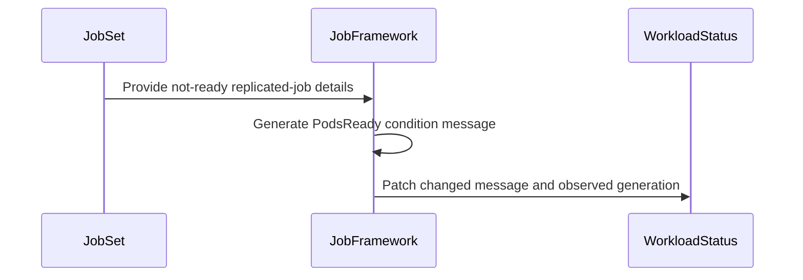

# PR #19117: JobSet: name not-ready replicatedJobs in the PodsReady condition message

**Summary**: JobSet: name not-ready replicatedJobs in the PodsReady condition message

**Sources**: https://github.com/kubernetes-sigs/kueue/pull/19117

**Last updated**: 2026-11-23T21:15:29Z

---

## Metadata

- **State**: open
- **Author**: [@chethanuk](https://github.com/chethanuk)
- **Branch**: `fix/7783-jobset-podsready-message` → `main`
- **Created**: 2026-11-19T06:46:49Z
- **Updated**: 2026-11-23T21:15:29Z
- **Merged**: —
- **Closed**: —
- **Labels**: `kind/feature`, `release-note`, `size/XL`, `ok-to-test`, `cncf-cla: yes`, `area/integrations`
- **Assignees**: _none_
- **Requested reviewers**: [@mykysha](https://github.com/mykysha), [@sohankunkerkar](https://github.com/sohankunkerkar)
- **Changed files**: 6   **+492 / -20**

## Description

<!-- Thank you for contributing! Check CONTRIBUTING.md for details. -->

#### What type of PR is this?

/kind feature
/area integrations

#### What this PR does / why we need it?

When a JobSet hits the PodsReady timeout, the PodsReady=False message only says "Not all pods are ready or succeeded", so you have to read the JobSet status to find the stuck replicatedJob.

jobframework gets an optional `JobWithPodsNotReadyDetails` interface. When a job implements it, the details it returns are appended to the PodsReady=False message (WaitForStart, WaitForScheduling and WaitForRecovery). JobSet lists, in spec order, the replicatedJobs whose `ready + succeeded` is below `replicas`, the same check as `PodsReady()`:

```
Not all pods are ready or succeeded; replicatedJobs not ready: workers, driver
```

Other integrations are unchanged.

Fixes #7783

#### Useful notes for your reviewer

The condition used to be rewritten only when its status or reason changed. It is now also patched when only the message changes, keeping the previous `lastTransitionTime` because the recovery timeout is measured from it. The message lists names without counts, so that patch happens only when the set of not-ready replicatedJobs changes (a Workload has at most 8 podSets), not on every ready-count change. Once the Workload is evicted or no longer admitted the patch is skipped, so teardown costs no extra writes and, after a WaitForStart timeout eviction, the details stay on the condition. A Workload evicted from WaitForRecovery or WaitForScheduling still switches to WaitForStart with the plain message when it loses admission, as it does today.

The "Exceeded the PodsReady timeout" eviction message is unchanged, and pod-level detail, which the issue also mentions, is not included because it needs listing Pods.

| behavior | level | command and result | not run |
|---|---|---|---|
| message names not-ready replicatedJobs, refreshed only when the set changes, LTT kept, no write once evicted | unit | `go test ./pkg/controller/jobframework/ -run TestReconcileJobSetPodsReadyMessage` and `go test ./pkg/controller/jobs/jobset/ -run TestPodsNotReadyDetails`: new cases fail on main and pass with the change. Dropping the eviction guard fails the evicted-but-admitted case. `go test ./pkg/controller/jobframework/... ./pkg/controller/jobs/jobset/... ./pkg/workload/...` and `make ci-lint` pass. | e2e |
| JobSet PodsReady condition with waitForPodsReady, including one replicatedJob becoming ready (message drops it, LTT unchanged) | integration | `make test-integration-run INTEGRATION_TARGET=./test/integration/singlecluster/controller/jobs/jobset/...`: 17 of 17 specs pass. With the message-only patch disabled, the new entry fails. | |
| repo checks | verify | `make verify`: everything passes except `verify-release-utils-test` (no PyYAML 6.0.3 wheel for my local Python 3.15) and `verify-artifacts` (local /tmp ran out of space). `verify-artifacts` passes on a rerun with a disk-backed temp dir. | `verify-release-utils-test` |

I used an AI assistant while preparing this PR.

#### Release note

```release-note
JobSet: The PodsReady=False condition message now lists the replicatedJobs that are not ready.
```


<!-- This is an auto-generated comment: release notes by coderabbit.ai -->
<!-- coderabbit-ai-generated:v1 -->

## AI summary

This change adds replicated-job detail to the JobSet `PodsReady=False` condition message. It addresses the Job-level request in `#7783`. Pod-level detail is not included, because it would require listing Pods.

- **Shared interface:** `pkg/controller/jobframework/interface.go` adds the optional `JobWithPodsNotReadyDetails` interface, with `PodsNotReadyDetails() string`. It returns a deterministic description of the unready parts, or an empty string.
- **Reconciler:** `pkg/controller/jobframework/reconciler.go` appends non-empty details to the not-ready message in the `WaitForStart`, `WaitForScheduling`, and `WaitForRecovery` cases. These cases now share one condition path.
- **Message-only updates:** When only the message changes, the reconciler updates the condition. It keeps `lastTransitionTime` and sets the current generation. It skips the update when the message is unchanged, or when the Workload is evicted or no longer admitted.
- **JobSet:** `JobSet` implements `PodsNotReadyDetails()`. It lists replicated-job names in spec order when `ready + succeeded` is below `replicas`. A replicated job with no status counts as zero ready. Zero-replica jobs are omitted. Other integrations are unchanged.
- **Eviction message:** The "Exceeded the PodsReady timeout" message is unchanged.
- **Tests:** The PR adds `TestReconcileJobSetPodsReadyMessage` and `TestPodsNotReadyDetails`, and updates the JobSet wait-for-pods-ready integration spec. The author reports that the targeted unit tests and the 17 JobSet integration specs pass.
- **Not verified:** E2E tests were not run. `verify-release-utils-test` remains untested. The author reports that `verify-artifacts` passes on rerun with a disk-backed temp directory.

### Suggested release note

```text
JobSet: Improved the `PodsReady=False` condition message to list the replicated jobs that are not ready while waiting for pods to become ready. The message updates when that set changes, and the condition keeps its last transition time.
```
<!-- end of auto-generated comment: release notes by coderabbit.ai -->

## Discussion

### Comment by [@netlify[bot]](https://github.com/apps/netlify) — 2026-11-19T06:46:54Z

### <span aria-hidden="true">👷</span> Deploy request for *kubernetes-sigs-kueue* pending review.
[Visit the deploys page to approve it](https://app.netlify.com/projects/kubernetes-sigs-kueue/deploys)

|  Name | Link |
|:-:|------------------------|
|<span aria-hidden="true">🔨</span> Latest commit | 02f88326b214118e03651c93f4b4bf6dcd5db944 |

### Comment by [@kubernetes-prow[bot]](https://github.com/apps/kubernetes-prow) — 2026-11-19T06:47:01Z

Hi @chethanuk. Thanks for your PR.

I'm waiting for a [kubernetes-sigs](https://github.com/orgs/kubernetes-sigs/people) member to verify that this patch is reasonable to test. If it is, they should reply with `/ok-to-test` on its own line. Until that is done, I will not automatically test new commits in this PR, but the usual testing commands by org members will still work.

Regular contributors should [join the org](https://git.k8s.io/community/community-membership.md#member) to skip this step.

Once the patch is verified, the new status will be reflected by the `ok-to-test` label.

I understand the commands that are listed [here](https://go.k8s.io/bot-commands?repo=kubernetes-sigs%2Fkueue).

<details>

Instructions for interacting with me using PR comments are available [here](https://git.k8s.io/community/contributors/guide/pull-requests.md).  If you have questions or suggestions related to my behavior, please file an issue against the [kubernetes-sigs/prow](https://github.com/kubernetes-sigs/prow/issues/new?title=Prow%20issue:) repository.
</details>

### Comment by [@kubernetes-prow[bot]](https://github.com/apps/kubernetes-prow) — 2026-11-19T06:47:18Z

[APPROVALNOTIFIER] This PR is **NOT APPROVED**

This pull-request has been approved by: *<a href="https://github.com/kubernetes-sigs/kueue/pull/19117#" title="Author self-approved">chethanuk</a>*
**Once this PR has been reviewed and has the lgtm label**, please assign [mimowo](https://github.com/mimowo) for approval. For more information see [the Code Review Process](https://git.k8s.io/community/contributors/guide/owners.md#the-code-review-process).

The full list of commands accepted by this bot can be found [here](https://go.k8s.io/bot-commands?repo=kubernetes-sigs%2Fkueue).

<details open>
Needs approval from an approver in each of these files:

- **[OWNERS](https://github.com/kubernetes-sigs/kueue/blob/main/OWNERS)**

Approvers can indicate their approval by writing `/approve` in a comment
Approvers can cancel approval by writing `/approve cancel` in a comment
</details>
<!-- META={"approvers":["mimowo"]} -->

### Comment by [@coderabbitai[bot]](https://github.com/apps/coderabbitai) — 2026-11-19T06:47:28Z

<!-- coderabbit-ai-generated:v1 -->

<!-- This is an auto-generated comment: summarize by coderabbit.ai -->
<!-- review_stack_entry_start -->

<a href="https://app.coderabbit.ai/change-stack/kubernetes-sigs/kueue/pull/19117?scope=ghh_OusAJGA4HG8ljoOV0wJvVx8NmnZIjc2DdjmxOu0xZWA&amp;cs_source=review_comment"><picture><source media="(prefers-color-scheme: dark)" srcset="https://storage.googleapis.com/coderabbit_public_assets/review-stack-buttons-v1/explain-change-dark.svg"><source media="(prefers-color-scheme: light)" srcset="https://storage.googleapis.com/coderabbit_public_assets/review-stack-buttons-v1/explain-change.svg"></picture></a>

<!-- review_stack_entry_end -->
<!-- recent_review_status_start -->

No actionable comments were generated in the recent review.

<!-- recent_review_status_end -->
<!-- walkthrough_start -->

<details>
<summary><strong>Walkthrough</strong></summary>
<dl>
<dd>
<br>

JobSet now reports names of replicated jobs that are not ready. The job framework appends these details to `PodsReady=False` messages and updates changed messages without changing the condition transition time.

**Changes: PodsReady condition details**

|Layer / File(s)|Summary|
|:---|:---|
|**Report JobSet not-ready replicated jobs** <br> `pkg/controller/jobframework/interface.go`, `pkg/controller/jobs/jobset/jobset_controller.go`, `pkg/controller/jobs/jobset/jobset_controller_test.go`|The framework defines an optional interface for not-ready details. JobSet lists replicated jobs below their desired ready-and-succeeded replica count. Unit tests check the reported details.|
|**Add details to PodsReady reconciliation** <br> `pkg/controller/jobframework/reconciler.go`, `pkg/controller/jobframework/reconciler_test.go`, `test/integration/singlecluster/controller/jobs/jobset/jobset_controller_test.go`|The framework appends not-ready details to condition messages. It updates changed messages while retaining the transition time. Reconciliation and integration tests cover message changes, transition times, and skipped writes.|

<!-- change_assessment_start -->
**Estimated code review effort:** 3 (Moderate) | ~20 minutes

<!-- change_assessment_commit:"02f88326b214118e03651c93f4b4bf6dcd5db944" -->
<!-- change_assessment_priority:{"version":1,"urgency":"p2","manual":false} -->
**Change:** Feature · **Severity of issue fixed:** Medium
<!-- change_assessment_end -->

### Sequence Diagram(s)



**Suggested reviewers:** `mbobrovskyi`, `henry3260`

</dd>
</dl>
</details>

<!-- walkthrough_end -->
<details>
<summary><strong>Merge Risk:</strong> <strong><picture></picture> Minimal</strong> · up to <code>02f88</code></summary>
<dl>
<dd>
<br>

<!-- final_review_risk_start -->
<!-- final_review_risk_label
**Merge Risk:** **⚪ Minimal** · up to `02f88`
-->
<!-- final_review_risk_coverage:{"sourceCommitId":"02f88326b214118e03651c93f4b4bf6dcd5db944","coveredCommitId":"02f88326b214118e03651c93f4b4bf6dcd5db944","kind":"reviewed"} -->

This change appends the names of JobSet replicated jobs that are not ready to the PodsReady=False message and updates the message when that set changes. The change is diagnostic and limited to JobSet. The supplied evidence shows no concrete merge-blocking risk.
<!-- final_review_risk_end -->

</dd>
</dl>
</details>
<!-- pre_merge_checks_walkthrough_start -->

<details>
<summary><strong>Pre-merge checks: <sup><picture></picture></sup> 4</strong></summary>
<dl>
<dd>
<br>

|         Check name         |                                             Status                                             | Explanation                                                                                                                                                                                               |
| :------------------------ | :--------------------------------------------------------------------------------------------: | :-------------------------------------------------------------------------------------------------------------------------------------------------------------------------------------------------------- |
|      Description Check     |  | Check skipped - CodeRabbit’s high-level summary is enabled.                                                                                                                                               |
|         Title check        |  | The title names the main change: JobSet not-ready replicatedJobs are now listed in the PodsReady condition message. The changeset adds the JobWithPodsNotReadyDetails interface, implements it for JobSe… |
|     Linked Issues check    |  | Directly linked issue `#7783` asks that the PodsReady condition or event identify the JobSet Jobs that are not ready. Pod-level detail is marked as ideal but needs Pod listing, and the PR excludes it op… |
| Out of Scope Changes check |  | All described changes relate to `#7783`. The jobframework interface JobWithPodsNotReadyDetails is the extension point used by the JobSet method. The reconciler change patches message-only PodsReady chan… |

<details>
<summary><strong>Full details: Title check</strong></summary>
<dl>
<dd>
<br>

**Explanation**

The title names the main change: JobSet not-ready replicatedJobs are now listed in the PodsReady condition message. The changeset adds the JobWithPodsNotReadyDetails interface, implements it for JobSet, and appends the details to the PodsReady=False message, matching the title. The title is concise, specific, and free of file lists or vague terms.

</dd>
</dl>
</details>

<details>
<summary><strong>Full details: Linked Issues check</strong></summary>
<dl>
<dd>
<br>

**Explanation**

Directly linked issue `#7783` asks that the PodsReady condition or event identify the JobSet Jobs that are not ready. Pod-level detail is marked as ideal but needs Pod listing, and the PR excludes it openly. At the reviewed head, pkg/controller/jobs/jobset/jobset_controller.go implements JobSet.PodsNotReadyDetails(). It lists replicatedJob names in spec order when ready+succeeded is below replicas, and returns 'replicatedJobs not ready: &lt;names&gt;'. A missing status counts as zero ready. The interface assertion var _ jobframework.JobWithPodsNotReadyDetails is present. The per-job check differs from the total-based PodsReady() in form, but it only adds names when at least one replicatedJob is short, so the message stays consistent with the not-ready condition. The reconciler.go wiring (appending details for WaitForStart, WaitForScheduling and WaitForRecovery, and patching message-only changes with lastTransitionTime kept) could not be read: changed blobs are missing from the checkout. That part rests on the change summary and the PR's reported test results (TestReconcileJobSetPodsReadyMessage and integration specs). This is a limitation, not a failure.

</dd>
</dl>
</details>

<details>
<summary><strong>Full details: Out of Scope Changes check</strong></summary>
<dl>
<dd>
<br>

**Explanation**

All described changes relate to `#7783`. The jobframework interface JobWithPodsNotReadyDetails is the extension point used by the JobSet method. The reconciler change patches message-only PodsReady changes, which keeps the new names current. It keeps lastTransitionTime because the recovery timeout uses it. It skips the patch for evicted or unadmitted Workloads. The JobSet method and its tests, the reconciler unit test, and the integration test expectations all cover this message feature. The 'Exceeded the PodsReady timeout' eviction message is unchanged. No unrelated change is described. Limitation: reconciler.go and test diffs could not be read directly, so this verdict relies on the change summary and PR description for those files.

</dd>
</dl>
</details>

</dd>
</dl>
</details>

<!-- pre_merge_checks_walkthrough_end -->
<!-- finishing_touch_checkbox_start -->

<details>
<summary><strong>Finishing Touches</strong></summary>
<dl>
<dd>
<br>

<details open>
<summary><strong>Generate unit tests (beta)</strong></summary>
<dl>
<dd>
<br>

- [ ] <!-- {"checkboxId": "f47ac10b-58cc-4372-a567-0e02b2c3d479", "radioGroupId": "utg-output-choice-group-unknown_comment_id"} --> Create a new PR

</dd>
</dl>
</details>

</dd>
</dl>
</details>

<!-- finishing_touch_checkbox_end -->

<!-- autopilot:start -->
- [ ] <!-- {"checkboxId":"2708ad07-9f24-4260-9c11-7dc76a49f2e3"} --> <strong title="Keep fixing CodeRabbit findings and required CI, and resolving merge conflicts">Autofix</strong> · Keep fixing CodeRabbit findings and required CI, and resolving merge conflicts
<!-- autopilot:end -->
<!-- recent_review_start -->

<h6>
<details>
<summary><strong><picture></picture> Recent review info</strong></summary>
<dl>
<dd>
<br>

<!-- review_info_content -->
<details>
<summary><strong><picture><source media="(prefers-color-scheme: dark)" srcset="https://storage.googleapis.com/coderabbit_public_assets/review-comment-icons-v1/cog-dark.svg"></picture> Run configuration</strong></summary>
<dl>
<dd>
<br>

- **Source mode**: Auto
- **Repository**: [kubernetes-sigs/kueue](<https://github.com/kubernetes-sigs/kueue>)
- **Branch**: [main](<https://github.com/kubernetes-sigs/kueue/tree/main>)
- **File**: [.coderabbit.yaml](<https://github.com/kubernetes-sigs/kueue/blob/2c4a0051f3832decce6dca4e09a4e3fc1f87c908/.coderabbit.yaml>)
- **Commit**: [2c4a005](<https://github.com/kubernetes-sigs/kueue/commit/2c4a0051f3832decce6dca4e09a4e3fc1f87c908>)
- **Layers**: Repository YAML
- **Review profile**: CHILL
- **Plan**: Advanced
- **Run ID**: `2d4f2c01-61f6-491f-94c1-a0e3968e3046`

</dd>
</dl>
</details>

<details>
<summary><strong><picture><source media="(prefers-color-scheme: dark)" srcset="https://storage.googleapis.com/coderabbit_public_assets/review-comment-icons-v1/git-commit-horizontal-dark.svg"></picture> Commits</strong></summary>
<dl>
<dd>
<br>

Reviewing files that changed from the base of the PR and between d667c53ce7da315887ca65b8775b2b3e5006c5f9 and 02f88326b214118e03651c93f4b4bf6dcd5db944.

</dd>
</dl>
</details>

<details>
<summary><strong><picture><source media="(prefers-color-scheme: dark)" srcset="https://storage.googleapis.com/coderabbit_public_assets/review-comment-icons-v1/file-plus-corner-dark.svg"></picture> Files selected for processing: 1</strong></summary>
<dl>
<dd>
<br>

* `pkg/controller/jobs/jobset/jobset_controller_test.go`

</dd>
</dl>
</details>

<details>
<summary><strong><picture><source media="(prefers-color-scheme: dark)" srcset="https://storage.googleapis.com/coderabbit_public_assets/review-comment-icons-v1/file-similar-dark.svg"></picture> Files skipped from review as they are similar to previous changes: 1</strong></summary>
<dl>
<dd>
<br>

* pkg/controller/jobs/jobset/jobset_controller_test.go

</dd>
</dl>
</details>

**Included review availability:** This review used your included allowance. Your plan provides up to 8 included reviews per hour; 7 remain after this review.

</dd>
</dl>
</details>
</h6>

<!-- recent_review_end -->

### Comment by [@mbobrovskyi](https://github.com/mbobrovskyi) — 2026-11-19T09:11:17Z

/ok-to-test

## Reviews

### Review by [@henry3260](https://github.com/henry3260) (commented) — 2026-11-22T05:44:17Z

Overall looks good, need another pair of eyes

- **pkg/controller/jobs/jobset/jobset_controller_test.go:123** by [@henry3260](https://github.com/henry3260) — 2026-11-22T05:36:49Z
```diff
@@ -119,6 +119,72 @@ func TestPodsReady(t *testing.T) {
 	}
 }
 
+func TestPodsNotReadyDetails(t *testing.T) {
+	rj := func(name string, replicas int32) testingjobset.ReplicatedJobRequirements {
```

  Could `rj` be inlined, as in `TestPodsReady`?

- **test/integration/singlecluster/controller/jobs/jobset/jobset_controller_test.go:782** by [@henry3260](https://github.com/henry3260) — 2026-11-22T05:43:49Z
  I think we should replace this `ginkgo.DescribeTable `with separate `ginkgo.It ` blocks
  a follow-up cleanup (like #17762) is fine; not blocking for this PR.

### Review by [@mbobrovskyi](https://github.com/mbobrovskyi) (commented) — 2026-11-23T10:10:41Z

- **pkg/controller/jobframework/interface.go:229** by [@mbobrovskyi](https://github.com/mbobrovskyi) — 2026-11-23T10:10:41Z
```diff
@@ -219,6 +219,15 @@ type JobWithCustomWorkloadConditions interface {
 	CustomWorkloadConditions(wl *kueue.Workload) ([]metav1.Condition, bool)
 }
 
+// JobWithPodsNotReadyDetails is an optional interface that should be implemented
+// by generic jobs that can explain which of their parts are not ready yet.
+type JobWithPodsNotReadyDetails interface {
+	// PodsNotReadyDetails returns a short, deterministic description of the parts
+	// of the job that are not ready, or an empty string if there is nothing to add.
+	// It is appended to the PodsReady=False condition message.
+	PodsNotReadyDetails() string
+}
```

  Could `PodsReady()` return the details instead of adding a new interface? For example `PodsReady(...) (bool, string)`.
  
  @mimowo WDYT?
