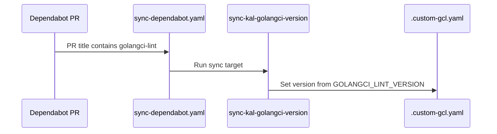

# PR #19118: Keep the KAL golangci-lint version in sync with hack/tools/go.mod

**Summary**: Keep the KAL golangci-lint version in sync with hack/tools/go.mod

**Sources**: https://github.com/kubernetes-sigs/kueue/pull/19118

**Last updated**: 2026-11-24T05:50:15Z

---

## Metadata

- **State**: open
- **Author**: [@chethanuk](https://github.com/chethanuk)
- **Branch**: `chore/sync-kal-golangci-version` → `main`
- **Created**: 2026-11-19T06:46:52Z
- **Updated**: 2026-11-24T05:50:15Z
- **Merged**: —
- **Closed**: —
- **Labels**: `release-note-none`, `size/M`, `kind/cleanup`, `ok-to-test`, `cncf-cla: yes`
- **Assignees**: [@yuluo-yx](https://github.com/yuluo-yx)
- **Requested reviewers**: [@mykysha](https://github.com/mykysha), [@kshalot](https://github.com/kshalot)
- **Changed files**: 5   **+91 / -4**

## Description

#### What type of PR is this?

/kind cleanup

#### What this PR does / why we need it?

`golangci-lint-kal` builds the API linter from the golangci-lint version written in `hack/testing/kal-linter/.custom-gcl.yaml`, while the main golangci-lint comes from `hack/tools/go.mod`. Dependabot only bumps go.mod, so the two have drifted: go.mod is at v2.15.0 and the KAL config still says v2.14.0.

This PR bumps the KAL config to v2.15.0 and keeps the two in sync after that:

- `make sync-kal-golangci-version` writes the go.mod version into `.custom-gcl.yaml`, like `sync-hugo-version` does for netlify.toml. It fails instead of writing an empty version if `go list` can't resolve one.
- `verify-kal-golangci-version` is part of `make verify` and fails when the two versions differ, with a message that points to the sync target.
- The Dependabot Version Sync workflow runs the sync target on golangci-lint bump PRs, and `.custom-gcl.yaml` is added to its patch allowlist.

Part of #7164

#### Useful notes for your reviewer

This covers only the version drift. Moving KAL itself into go.mod, or switching to the plugin mode suggested in the issue, can follow once you pick one; I'm happy to do either.

I made the verify step a read-only check instead of copying the hugo route (sync in the verify prereqs plus a `PATHS_TO_VERIFY` diff), because `verify-lint-api` reads `.custom-gcl.yaml` to build the KAL binary in the same parallel phase.

| behavior | command and result |
|---|---|
| check fails on main | `make verify-kal-golangci-version`: `ERROR: golangci-lint version in hack/testing/kal-linter/.custom-gcl.yaml (v2.14.0) does not match hack/tools/go.mod (v2.15.0); run make sync-kal-golangci-version` |
| sync restores a mismatched file | set `version: v2.0.0`, the check fails, `make sync-kal-golangci-version`, the check passes and only line 1 changes |
| KAL still builds at v2.15.0 | `make lint-api`: `0 issues.` |
| workflow | `actionlint .github/workflows/sync-dependabot.yaml` passes; the live Dependabot run is not tested |

I used an AI assistant while preparing this PR.

#### Release note

```release-note
NONE
```


<!-- This is an auto-generated comment: release notes by coderabbit.ai -->
<!-- coderabbit-ai-generated:v1 -->

## AI summary

This PR keeps the KAL golangci-lint version in `hack/testing/kal-linter/.custom-gcl.yaml` aligned with `hack/tools/go.mod`.

- `hack/testing/kal-linter/.custom-gcl.yaml`: Updates `version` from `v2.14.0` to `v2.15.0`.
- `Makefile`: Adds `sync-kal-golangci-version`. It writes `GOLANGCI_LINT_VERSION` to the config. That value comes from `module_version`, which stops the build if the lookup fails.
- `hack/make/verify.mk`: Adds `verify-kal-golangci-version` to `verify-checks`. It fails when the version is missing or differs from `GOLANGCI_LINT_VERSION`. Adds `verify-kal-golangci-version-test`, which runs `hack/testing/kal-golangci-version_test.sh`.
- `.github/workflows/sync-dependabot.yaml`: Handles golangci-lint Dependabot PRs. Sets up Go, runs the sync target, and allowlists the config file.

### Suggested release note

```text
NONE
```

This change affects only build tooling and CI for the KAL linter. It has no user-facing behavior change.
<!-- end of auto-generated comment: release notes by coderabbit.ai -->

## Discussion

### Comment by [@netlify[bot]](https://github.com/apps/netlify) — 2026-11-19T06:46:56Z

### <span aria-hidden="true">👷</span> Deploy request for *kubernetes-sigs-kueue* pending review.
[Visit the deploys page to approve it](https://app.netlify.com/projects/kubernetes-sigs-kueue/deploys)

|  Name | Link |
|:-:|------------------------|
|<span aria-hidden="true">🔨</span> Latest commit | 9bf4bb8c171c500aa9a722f9000f58c82a977022 |

### Comment by [@kubernetes-prow[bot]](https://github.com/apps/kubernetes-prow) — 2026-11-19T06:47:04Z

Hi @chethanuk. Thanks for your PR.

I'm waiting for a [kubernetes-sigs](https://github.com/orgs/kubernetes-sigs/people) member to verify that this patch is reasonable to test. If it is, they should reply with `/ok-to-test` on its own line. Until that is done, I will not automatically test new commits in this PR, but the usual testing commands by org members will still work.

Regular contributors should [join the org](https://git.k8s.io/community/community-membership.md#member) to skip this step.

Once the patch is verified, the new status will be reflected by the `ok-to-test` label.

I understand the commands that are listed [here](https://go.k8s.io/bot-commands?repo=kubernetes-sigs%2Fkueue).

<details>

Instructions for interacting with me using PR comments are available [here](https://git.k8s.io/community/contributors/guide/pull-requests.md).  If you have questions or suggestions related to my behavior, please file an issue against the [kubernetes-sigs/prow](https://github.com/kubernetes-sigs/prow/issues/new?title=Prow%20issue:) repository.
</details>

### Comment by [@kubernetes-prow[bot]](https://github.com/apps/kubernetes-prow) — 2026-11-19T06:47:16Z

[APPROVALNOTIFIER] This PR is **NOT APPROVED**

This pull-request has been approved by: *<a href="https://github.com/kubernetes-sigs/kueue/pull/19118#" title="Author self-approved">chethanuk</a>*
**Once this PR has been reviewed and has the lgtm label**, please assign [sohankunkerkar](https://github.com/sohankunkerkar) for approval. For more information see [the Code Review Process](https://git.k8s.io/community/contributors/guide/owners.md#the-code-review-process).

The full list of commands accepted by this bot can be found [here](https://go.k8s.io/bot-commands?repo=kubernetes-sigs%2Fkueue).

<details open>
Needs approval from an approver in each of these files:

- **[OWNERS](https://github.com/kubernetes-sigs/kueue/blob/main/OWNERS)**

Approvers can indicate their approval by writing `/approve` in a comment
Approvers can cancel approval by writing `/approve cancel` in a comment
</details>
<!-- META={"approvers":["sohankunkerkar"]} -->

### Comment by [@coderabbitai[bot]](https://github.com/apps/coderabbitai) — 2026-11-19T06:47:30Z

<!-- coderabbit-ai-generated:v1 -->

<!-- This is an auto-generated comment: summarize by coderabbit.ai -->
<!-- review_stack_entry_start -->

<a href="https://app.coderabbit.ai/change-stack/kubernetes-sigs/kueue/pull/19118?scope=ghh_OusAJGA4HG8ljoOV0wJvVx8NmnZIjc2DdjmxOu0xZWA&amp;cs_source=review_comment"><picture><source media="(prefers-color-scheme: dark)" srcset="https://storage.googleapis.com/coderabbit_public_assets/review-stack-buttons-v1/explain-change-dark.svg"><source media="(prefers-color-scheme: light)" srcset="https://storage.googleapis.com/coderabbit_public_assets/review-stack-buttons-v1/explain-change.svg"></picture></a>

<!-- review_stack_entry_end -->
<!-- walkthrough_start -->

<details>
<summary><strong>Walkthrough</strong></summary>
<dl>
<dd>
<br>

The Dependabot workflow now syncs the KAL linter configuration for golangci-lint PRs. A new verification check compares the configured version with `GOLANGCI_LINT_VERSION`. The configuration version changes to `v2.15.0`.

**Changes: KAL linter version synchronization**

|Layer / File(s)|Summary|
|:---|:---|
|**Sync target and Dependabot workflow** <br> `hack/testing/kal-linter/.custom-gcl.yaml`, `Makefile`, `.github/workflows/sync-dependabot.yaml`|The Make target sets the configured version from `GOLANGCI_LINT_VERSION`. For Dependabot PRs whose titles contain `golangci-lint`, the workflow runs the target and permits the configuration file in its push-job allowlist. The configuration version changes to `v2.15.0`.|
|**Version verification** <br> `hack/make/verify.mk`, `hack/testing/kal-golangci-version_test.sh`|`verify-checks` includes a check that fails if the configured version is empty or differs from `GOLANGCI_LINT_VERSION`. A fixture-based test covers matching versions, version drift, a missing version line, and an empty version.|

<!-- change_assessment_start -->
**Estimated code review effort:** 2 (Simple) | ~10 minutes

<!-- change_assessment_commit:"9bf4bb8c171c500aa9a722f9000f58c82a977022" -->
<!-- change_assessment_priority:{"version":1,"urgency":"p3","manual":false} -->
**Change:** Other
<!-- change_assessment_end -->

### Sequence Diagram(s)



**Possibly related PRs**

- [kubernetes-sigs/kueue#17981](https://github.com/kubernetes-sigs/kueue/pull/17981): Changes the Dependabot sync workflow’s generation and push path, which this change uses to update the KAL linter configuration.
- [kubernetes-sigs/kueue#17729](https://github.com/kubernetes-sigs/kueue/pull/17729): Changes the event types that trigger the same Dependabot version-sync workflow.
- [kubernetes-sigs/kueue#17736](https://github.com/kubernetes-sigs/kueue/pull/17736): Changes the trigger and token context of the Dependabot workflow that this change updates.

**Suggested reviewers:** `yuluo-yx`, `mbobrovskyi`

</dd>
</dl>
</details>

<!-- walkthrough_end -->
<details>
<summary><strong>Merge Risk:</strong> <strong><picture></picture> Low</strong> · up to <code>9bf4b</code></summary>
<dl>
<dd>
<br>

<!-- final_review_risk_start -->
<!-- final_review_risk_label
**Merge Risk:** **🔵 Low** · up to `9bf4b`
-->
<!-- final_review_risk_coverage:{"sourceCommitId":"9bf4bb8c171c500aa9a722f9000f58c82a977022","coveredCommitId":"9bf4bb8c171c500aa9a722f9000f58c82a977022","kind":"reviewed"} -->

The change keeps the KAL linter version in sync with the tools module and adds a verification check for drift. The one remaining concern is narrow: a developer who manually overrides the version variable can write a mismatched or empty version locally, and the standard verify check would catch it. This is mergeable with minor owner awareness.
<!-- final_review_risk_end -->

</dd>
</dl>
</details>
<!-- pre_merge_checks_walkthrough_start -->

<details>
<summary><strong>Pre-merge checks: <sup><picture></picture></sup> 4</strong></summary>
<dl>
<dd>
<br>

|         Check name         |                                             Status                                             | Explanation                                                                                                                                                                                               |
| :------------------------ | :--------------------------------------------------------------------------------------------: | :-------------------------------------------------------------------------------------------------------------------------------------------------------------------------------------------------------- |
|      Description Check     |  | Check skipped - CodeRabbit’s high-level summary is enabled.                                                                                                                                               |
|         Title check        |  | The title states the main change: keeping the KAL golangci-lint version in sync with hack/tools/go.mod. The changeset adds a sync target, a verify check, a Dependabot workflow step, and bumps the conf… |
|     Linked Issues check    |  | Check skipped because no linked issues were found for this pull request.                                                                                                                                  |
| Out of Scope Changes check |  | Check skipped because no linked issues were found for this pull request.                                                                                                                                  |

<details>
<summary><strong>Full details: Title check</strong></summary>
<dl>
<dd>
<br>

**Explanation**

The title states the main change: keeping the KAL golangci-lint version in sync with hack/tools/go.mod. The changeset adds a sync target, a verify check, a Dependabot workflow step, and bumps the config version, so the title matches the primary change. It is specific and concise, and it is not vague.

</dd>
</dl>
</details>

</dd>
</dl>
</details>

<!-- pre_merge_checks_walkthrough_end -->
<!-- finishing_touch_checkbox_start -->

<details>
<summary><strong>Finishing Touches</strong></summary>
<dl>
<dd>
<br>

<details open>
<summary><strong>Generate unit tests (beta)</strong></summary>
<dl>
<dd>
<br>

- [ ] <!-- {"checkboxId": "f47ac10b-58cc-4372-a567-0e02b2c3d479", "radioGroupId": "utg-output-choice-group-unknown_comment_id"} --> Create a new PR

</dd>
</dl>
</details>

</dd>
</dl>
</details>

<!-- finishing_touch_checkbox_end -->

<!-- autopilot:start -->
- [ ] <!-- {"checkboxId":"2708ad07-9f24-4260-9c11-7dc76a49f2e3"} --> <strong title="Keep fixing CodeRabbit findings and required CI, and resolving merge conflicts">Autofix</strong> · Keep fixing CodeRabbit findings and required CI, and resolving merge conflicts
<!-- autopilot:end -->

### Comment by [@mimowo](https://github.com/mimowo) — 2026-11-19T09:29:04Z

/ok-to-test

### Comment by [@yuluo-yx](https://github.com/yuluo-yx) — 2026-11-21T02:31:24Z

/assign

## Reviews

### Review by [@yuluo-yx](https://github.com/yuluo-yx) (commented) — 2026-11-21T03:14:17Z

- **.github/workflows/sync-dependabot.yaml:37** by [@yuluo-yx](https://github.com/yuluo-yx) — 2026-11-21T03:14:17Z
  The workflow currently executes `setup-go` only for `controller-tools` PRs; however, for `golangci-lint` artifacts, it runs `make sync-kal-golangci-version`. The `Makefile` executes this during data parsing:
  
  `cd hack/tools && go list -m -f '{{.Version}}' github.com/golangci/golangci-lint/v2
  `
  
  meanwhile, `hack/tools/go.mod` requires Go 1.27.0. When using Go 1.24.13 with `GOTOOLCHAIN=local`, this command fails outright:
  
  `go: go.mod requires go >= 1.27.0`.
  
  so, I think we can extend the conditions used for `setup-go` to `golangci-lint`, and use `hack/tools/go.mod` as the `go-version-file` to avoid relying on the runner's pre-installed version or an implicit toolchain download.  🤔

### Review by [@yuluo-yx](https://github.com/yuluo-yx) (commented) — 2026-11-21T03:17:44Z

- **hack/make/verify.mk:132** by [@yuluo-yx](https://github.com/yuluo-yx) — 2026-11-21T03:17:44Z
```diff
@@ -129,7 +129,7 @@ verify-checks: CI_LINT_GOMAXPROCS = $(VERIFY_CI_LINT_GOMAXPROCS)
 ## Read-only verification targets that should not mutate the repo.
 ## Add new check-only targets here.
 verify-checks: ## Phase 2 (parallel): checks that wait for their generated inputs.
-verify-checks: verify-artifacts verify-ci-lint verify-lint-api verify-fmt-verify verify-e2e-common-test verify-release-utils-test verify-milestone-pull-test verify-cherry-pick-pull-test verify-unit-test-selection verify-make-failure-summary verify-generation-order verify-ci-tools verify-retry-test verify-kustomization-set-image-test verify-kind-k8s-main-image-build verify-generate-code verify-merge-unit-coverage verify-image-build-test verify-shell-lint verify-helm-verify verify-helm-unit-test verify-npm-depcheck verify-kustomize-build verify-rbac-role-coverage verify-kustomization-resources verify-rbac verify-skills-lint verify-ray-version
```

  Also, I think we should add some tests?
  
  `hack/testing/verify-generation-order_test.sh` does not cover the `verify-checks` path.

### Review by [@coderabbitai[bot]](https://github.com/apps/coderabbitai) (commented) — 2026-11-23T21:32:03Z

<!-- coderabbit-ai-generated:v1 -->


<details>
<summary><picture><source media="(prefers-color-scheme: dark)" srcset="https://storage.googleapis.com/coderabbit_public_assets/review-comment-icons-v1/message-square-off-dark.svg"></picture> Additional comments: 1</summary><blockquote>
<dl>
<dd>
<br>

<details>
<summary>Makefile-239-239: 1</summary><blockquote>
<dl>
<dd>
<br>

`239-239`: **<picture></picture> Minor** · **Data Integrity & Integration** · **Quick win**

<picture></picture> **Unverified finding**
Verification ran but could not confirm this finding. It is shown for review, not as a verified issue.

**Read the version from the tools module for this target.**

`GOLANGCI_LINT_VERSION` uses `?=`, so an environment or command-line override bypasses `module_version`. For example, `GOLANGCI_LINT_VERSION=v2.14.0 make sync-kal-golangci-version` writes v2.14.0 while `hack/tools/go.mod` requires v2.15.0. An empty override also writes an empty version without an error. Resolve the module version directly for this target.

<!-- cr-comment:v1:b1d7c0b4760fd4bc73a8cc3c -->

</dd>
</dl>
</blockquote></details>

</dd>
</dl>
</blockquote></details>

<h6>
<details>
<summary><picture></picture> Review info</summary>
<dl>
<dd>
<br>

<details>
<summary><picture><source media="(prefers-color-scheme: dark)" srcset="https://storage.googleapis.com/coderabbit_public_assets/review-comment-icons-v1/cog-dark.svg"></picture> Run configuration</summary>
<dl>
<dd>
<br>

- **Source mode**: Auto
- **Repository**: [kubernetes-sigs/kueue](<https://github.com/kubernetes-sigs/kueue>)
- **Branch**: [main](<https://github.com/kubernetes-sigs/kueue/tree/main>)
- **File**: [.coderabbit.yaml](<https://github.com/kubernetes-sigs/kueue/blob/2ffca1c1153b0966e86bfa5b70e3e5874c7d3ff7/.coderabbit.yaml>)
- **Commit**: [2ffca1c](<https://github.com/kubernetes-sigs/kueue/commit/2ffca1c1153b0966e86bfa5b70e3e5874c7d3ff7>)
- **Layers**: Repository YAML
- **Review profile**: CHILL
- **Plan**: Advanced
- **Run ID**: `c5663955-22d1-4a42-bfb5-3e8cb0c9d35b`

</dd>
</dl>
</details>

<details>
<summary><picture><source media="(prefers-color-scheme: dark)" srcset="https://storage.googleapis.com/coderabbit_public_assets/review-comment-icons-v1/git-commit-horizontal-dark.svg"></picture> Commits</summary>
<dl>
<dd>
<br>

Reviewing files that changed from the base of the PR and between 94ba0f2a02c6d861097a8dc8e073ebd212c867e1 and 9bf4bb8c171c500aa9a722f9000f58c82a977022.

</dd>
</dl>
</details>

<details>
<summary><picture><source media="(prefers-color-scheme: dark)" srcset="https://storage.googleapis.com/coderabbit_public_assets/review-comment-icons-v1/file-plus-corner-dark.svg"></picture> Files selected for processing: 4</summary>
<dl>
<dd>
<br>

* `.github/workflows/sync-dependabot.yaml`
* `Makefile`
* `hack/make/verify.mk`
* `hack/testing/kal-golangci-version_test.sh`

</dd>
</dl>
</details>

**Included review availability:** This review used your included allowance. Your plan provides up to 8 included reviews per hour; 6 remain after this review.

</dd>
</dl>
</details>
</h6>

<!-- This is an auto-generated comment by CodeRabbit for review status -->

<!-- coderabbit-review-publication v1 publication=8ebff56a-5e2e-4d7e-b724-52f955262fd2 attempt=5d64bacb-0d2e-40d1-983e-3f2389300575 batch=1/1 -->
