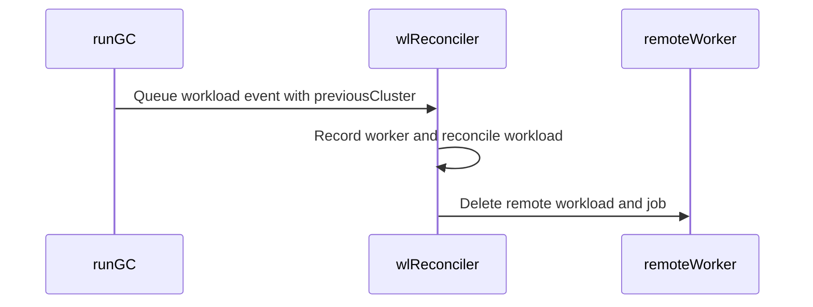

# PR #19173: MultiKueue: Delete remote workloads left on a worker removed from the MultiKueueConfig after a restart

**Summary**: MultiKueue: Delete remote workloads left on a worker removed from the MultiKueueConfig after a restart

**Sources**: https://github.com/kubernetes-sigs/kueue/pull/19173

**Last updated**: 2026-11-23T19:50:11Z

---

## Metadata

- **State**: closed (merged)
- **Author**: [@henry3260](https://github.com/henry3260)
- **Branch**: `mk-gc-previous-cluster-cleanup` → `main`
- **Created**: 2026-11-19T20:36:27Z
- **Updated**: 2026-11-23T19:50:11Z
- **Merged**: 2026-11-23T18:08:48Z
- **Closed**: 2026-11-23T18:08:48Z
- **Labels**: `kind/bug`, `release-note`, `size/L`, `lgtm`, `approved`, `cncf-cla: yes`, `area/multikueue`
- **Assignees**: [@vladikkuzn](https://github.com/vladikkuzn)
- **Requested reviewers**: [@vladikkuzn](https://github.com/vladikkuzn), [@j-skiba](https://github.com/j-skiba)
- **Changed files**: 5   **+231 / -20**

## Description

#### What type of PR is this?

/kind bug
/area multikueue

#### What this PR does / why we need it?

When a Workload admitted on a worker removed from the MultiKueueConfig is evicted, the workload reconciler remembers that worker only in memory (`previousClusterNames`). If Kueue restarts before the remote objects are deleted, for example because the worker is unreachable, nothing reads that worker again, and the remote Job keeps running after the Workload is dispatched to another worker.

The garbage collector already lists the remote Workloads of each worker. When the local Workload neither names nor nominates that worker, it now hands the worker to the workload reconciler, which deletes the remote objects through the existing cleanup of previous clusters. After a restart, the remote objects are deleted within one `gcInterval` of the worker being connected.

Part of #18440

#### Useful notes for your reviewer


#### Release note

```release-note
MultiKueue: Fixed a bug where restarting Kueue could leave the remote objects of an evicted Workload on a worker cluster removed from the MultiKueueConfig, so the job could keep running there after the Workload was dispatched to another worker. Kueue now deletes these remote objects once the MultiKueue garbage collector finds them.
```


<!-- This is an auto-generated comment: release notes by coderabbit.ai -->
<!-- coderabbit-ai-generated:v1 -->

## AI summary

This PR fixes a MultiKueue cleanup gap after a manager restart. A restart cleared the in-memory record of a worker removed from `MultiKueueConfig`. The remote Job for an evicted Workload could keep running after the Workload ran on another worker.

- `multikueuecluster.go`: The workload event carries an optional `previousCluster`. During garbage collection (GC), if the local Workload exists and is not being deleted, the controller queues low-priority cleanup for each worker that the Workload neither names nor nominates. The helper sends the workload and cluster name to the reconciler. It does not delete remote objects directly.
- `workload.go`: `previousClusterNames` records clusters that may hold remote objects. GC restores these entries after a restart. A new `addPreviousClusterName` helper adds names to the per-workload set. The event handler records the carried previous cluster before it enqueues the Workload. When reconciliation finds no Workload and no deleted-workload cache entry, it removes the previous-cluster record.
- Unit tests: `TestRemoteClientGC` checks that Workloads assigned to another cluster, or to no cluster, queue cleanup for `worker1`. Workloads that name or nominate `worker1` do not. `TestRemoveObjectsOnPreviousClusters` covers remote objects found by GC. Objects on a removed cluster are deleted. Pending cleanup is kept when the manager Workload is missing.
- Integration test (`test/integration/multikueue/jobs_test.go`): A new slow test removes a worker from the configuration, evicts its admitted Workload while the worker is unreachable, and restarts the manager. After the connection is restored, the test checks that the remote Workload and Job are removed.

Diff size: 5 files changed, 231 lines added, 20 lines removed.

Review findings: not available.
CI and test results: not available.

## Suggested release note

```text
MultiKueue: Fixed a bug that caused a remote Job to keep running after a manager restart when its worker was removed from MultiKueueConfig and the local Workload was evicted. Now Kueue deletes the remote Workload and Job on that worker within one gcInterval after the worker reconnects.
```
<!-- end of auto-generated comment: release notes by coderabbit.ai -->

## Discussion

### Comment by [@netlify[bot]](https://github.com/apps/netlify) — 2026-11-19T20:36:32Z

### <span aria-hidden="true">👷</span> Deploy request for *kubernetes-sigs-kueue* pending review.
[Visit the deploys page to approve it](https://app.netlify.com/projects/kubernetes-sigs-kueue/deploys)

|  Name | Link |
|:-:|------------------------|
|<span aria-hidden="true">🔨</span> Latest commit | 8490ebf8cdc3c86f0ed56efa77b18be0fc4bebb3 |

### Comment by [@coderabbitai[bot]](https://github.com/apps/coderabbitai) — 2026-11-19T20:36:50Z

<!-- coderabbit-ai-generated:v1 -->

<!-- This is an auto-generated comment: summarize by coderabbit.ai -->
<!-- review_stack_entry_start -->

<a href="https://app.coderabbit.ai/change-stack/kubernetes-sigs/kueue/pull/19173?scope=ghh_OusAJGA4HG8ljoOV0wJvVx8NmnZIjc2DdjmxOu0xZWA&amp;cs_source=review_comment"><picture><source media="(prefers-color-scheme: dark)" srcset="https://storage.googleapis.com/coderabbit_public_assets/review-stack-buttons-v1/explain-change-dark.svg"><source media="(prefers-color-scheme: light)" srcset="https://storage.googleapis.com/coderabbit_public_assets/review-stack-buttons-v1/explain-change.svg"></picture></a>

<!-- review_stack_entry_end -->
<!-- recent_review_status_start -->

No actionable comments were generated in the recent review.

<!-- recent_review_status_end -->
<!-- walkthrough_start -->

<details>
<summary><strong>Walkthrough</strong></summary>
<dl>
<dd>
<br>

Garbage collection now queues cleanup for remote workloads when the local workload no longer names or nominates that worker. The workload reconciler records the worker and handles cleanup, including after a manager restart.

**Changes: MultiKueue stale worker cleanup**

|Layer / File(s)|Summary|
|:---|:---|
|**Detect stale worker workloads** <br> `pkg/controller/admissionchecks/multikueue/multikueuecluster.go`, `pkg/controller/admissionchecks/multikueue/multikueuecluster_test.go`|Garbage collection skips workloads that still name or nominate the worker. Otherwise, it queues a low-priority event with the worker as `previousCluster`. Tests check the queued events and verify that workloads assigned to or nominating that worker remain.|
|**Reconcile and clean up remote objects** <br> `pkg/controller/admissionchecks/multikueue/workload.go`, `pkg/controller/admissionchecks/multikueue/workload_test.go`, `test/integration/multikueue/jobs_test.go`|The reconciler records previous clusters from events and handles cleanup. It clears the previous-cluster cache entry when the manager workload is missing. Tests cover GC-discovered cleanup. An integration test verifies cleanup after a manager restart and worker reconnection.|

<!-- change_assessment_start -->
**Estimated code review effort:** 3 (Moderate) | ~25 minutes

<!-- change_assessment_commit:"8490ebf8cdc3c86f0ed56efa77b18be0fc4bebb3" -->
<!-- change_assessment_priority:{"version":1,"urgency":"p2","manual":false} -->
**Change:** Bug fix
<!-- change_assessment_end -->

### Sequence Diagram(s)



**Possibly related issues**

- kubernetes-sigs/kueue#18512: The change queues cleanup when the local workload no longer names or nominates the worker, covering the stale worker-copy check described in the issue. It does not add the issue's adopt-or-remove tracking behavior.
- kubernetes-sigs/kueue#18440: Garbage collection can rediscover remote workloads after a manager restart and trigger cleanup. The change does not persist previous-cluster history in API state.

**Possibly related PRs**

- [kubernetes-sigs/kueue#16516](https://github.com/kubernetes-sigs/kueue/pull/16516): Both changes address remote workloads left on a worker after eviction, using different cleanup mechanisms.
- [kubernetes-sigs/kueue#16509](https://github.com/kubernetes-sigs/kueue/pull/16509): Both changes affect handling of remote workloads on removed workers during reconciliation.
- [kubernetes-sigs/kueue#18564](https://github.com/kubernetes-sigs/kueue/pull/18564): Both changes update garbage-collection decisions for stale remote workloads.

**Suggested reviewers:** `kevin85421`, `pbundyra`, `olekzabl`

</dd>
</dl>
</details>

<!-- walkthrough_end -->
<details>
<summary><strong>Merge Risk:</strong> <strong><picture></picture> Minimal</strong> · up to <code>8490e</code></summary>
<dl>
<dd>
<br>

<!-- final_review_risk_start -->
<!-- final_review_risk_label
**Merge Risk:** **⚪ Minimal** · up to `8490e`
-->
<!-- final_review_risk_coverage:{"sourceCommitId":"8490ebf8cdc3c86f0ed56efa77b18be0fc4bebb3","coveredCommitId":"8490ebf8cdc3c86f0ed56efa77b18be0fc4bebb3","kind":"reviewed"} -->

This change makes MultiKueue clean up remote jobs left on a removed worker after a manager restart. Cleanup happens within one GC interval of the worker reconnecting. No merge-blocking issues were identified, and tests cover the main scenarios.
<!-- final_review_risk_end -->

</dd>
</dl>
</details>
<!-- pre_merge_checks_walkthrough_start -->

<details>
<summary><strong>Pre-merge checks: <sup><picture></picture></sup> 4</strong></summary>
<dl>
<dd>
<br>

|         Check name         |                                             Status                                             | Explanation                                                                                                                                                                                               |
| :------------------------ | :--------------------------------------------------------------------------------------------: | :-------------------------------------------------------------------------------------------------------------------------------------------------------------------------------------------------------- |
|      Description Check     |  | Check skipped - CodeRabbit’s high-level summary is enabled.                                                                                                                                               |
|         Title check        |  | The title names the main change: MultiKueue now deletes remote workloads that remain on a worker removed from MultiKueueConfig after a Kueue restart. The raw summary describes garbage collection queui… |
|     Linked Issues check    |  | Check skipped because no linked issues were found for this pull request.                                                                                                                                  |
| Out of Scope Changes check |  | Check skipped because no linked issues were found for this pull request.                                                                                                                                  |

<details>
<summary><strong>Full details: Title check</strong></summary>
<dl>
<dd>
<br>

**Explanation**

The title names the main change: MultiKueue now deletes remote workloads that remain on a worker removed from MultiKueueConfig after a Kueue restart. The raw summary describes garbage collection queuing cleanup for previous clusters that no longer name or nominate the workload, and the objectives describe the same restart-recovery fix. The title is specific and matches the changeset.

</dd>
</dl>
</details>

</dd>
</dl>
</details>

<!-- pre_merge_checks_walkthrough_end -->
<!-- finishing_touch_checkbox_start -->

<details>
<summary><strong>Finishing Touches</strong></summary>
<dl>
<dd>
<br>

<details open>
<summary><strong>Generate unit tests (beta)</strong></summary>
<dl>
<dd>
<br>

- [ ] <!-- {"checkboxId": "f47ac10b-58cc-4372-a567-0e02b2c3d479", "radioGroupId": "utg-output-choice-group-unknown_comment_id"} --> Create a new PR

</dd>
</dl>
</details>

</dd>
</dl>
</details>

<!-- finishing_touch_checkbox_end -->

<!-- autopilot:start -->
- [ ] <!-- {"checkboxId":"2708ad07-9f24-4260-9c11-7dc76a49f2e3"} --> <strong title="Keep fixing CodeRabbit findings and required CI, and resolving merge conflicts">Autofix</strong> · Keep fixing CodeRabbit findings and required CI, and resolving merge conflicts
<!-- autopilot:end -->
<!-- recent_review_start -->

<h6>
<details>
<summary><strong><picture></picture> Recent review info</strong></summary>
<dl>
<dd>
<br>

<!-- review_info_content -->
<details>
<summary><strong><picture><source media="(prefers-color-scheme: dark)" srcset="https://storage.googleapis.com/coderabbit_public_assets/review-comment-icons-v1/cog-dark.svg"></picture> Run configuration</strong></summary>
<dl>
<dd>
<br>

- **Source mode**: Auto
- **Repository**: [kubernetes-sigs/kueue](<https://github.com/kubernetes-sigs/kueue>)
- **Branch**: [main](<https://github.com/kubernetes-sigs/kueue/tree/main>)
- **File**: [.coderabbit.yaml](<https://github.com/kubernetes-sigs/kueue/blob/abfae43efb7c93896f8808221ceebed6515d0886/.coderabbit.yaml>)
- **Commit**: [abfae43](<https://github.com/kubernetes-sigs/kueue/commit/abfae43efb7c93896f8808221ceebed6515d0886>)
- **Layers**: Repository YAML
- **Review profile**: CHILL
- **Plan**: Advanced
- **Run ID**: `6ec1e6f0-545f-451d-ba24-6dd703e5ff31`

</dd>
</dl>
</details>

<details>
<summary><strong><picture><source media="(prefers-color-scheme: dark)" srcset="https://storage.googleapis.com/coderabbit_public_assets/review-comment-icons-v1/git-commit-horizontal-dark.svg"></picture> Commits</strong></summary>
<dl>
<dd>
<br>

Reviewing files that changed from the base of the PR and between 48f6e5d1afc498d201868026f21b4e78a88262bc and 8490ebf8cdc3c86f0ed56efa77b18be0fc4bebb3.

</dd>
</dl>
</details>

<details>
<summary><strong><picture><source media="(prefers-color-scheme: dark)" srcset="https://storage.googleapis.com/coderabbit_public_assets/review-comment-icons-v1/file-plus-corner-dark.svg"></picture> Files selected for processing: 1</strong></summary>
<dl>
<dd>
<br>

* `pkg/controller/admissionchecks/multikueue/workload.go`

</dd>
</dl>
</details>

**Included review availability:** This review used your included allowance. Your plan provides up to 8 included reviews per hour; 7 remain after this review.

</dd>
</dl>
</details>
</h6>

<!-- recent_review_end -->

### Comment by [@henry3260](https://github.com/henry3260) — 2026-11-19T20:45:57Z

This recovers the cleanup from the workers instead of retaining `status.clusterName`. A retained name also pins the other LeaderWorkerSet groups and elastic Workloads to the old cluster, and blocks nomination once quota is reserved again. 
The trade-off: after a restart, the old execution can keep running for up to one `gcInterval`.

### Comment by [@henry3260](https://github.com/henry3260) — 2026-11-19T20:49:03Z

/test pull-kueue-test-e2e-multikueue-extended-shard-0-main

### Comment by [@henry3260](https://github.com/henry3260) — 2026-11-19T20:51:20Z

cc @mimowo

### Comment by [@henry3260](https://github.com/henry3260) — 2026-11-20T07:29:15Z

/retest

### Comment by [@henry3260](https://github.com/henry3260) — 2026-11-20T07:29:16Z

/retest

### Comment by [@vladikkuzn](https://github.com/vladikkuzn) — 2026-11-20T10:51:21Z

/lgtm

### Comment by [@kubernetes-prow[bot]](https://github.com/apps/kubernetes-prow) — 2026-11-20T10:51:31Z

LGTM label has been added.  <details>Git tree hash: bb365c78fb50303df9947cf09fb3483bd02823a9</details>

### Comment by [@henry3260](https://github.com/henry3260) — 2026-11-23T13:08:34Z

/cc @mimowo

### Comment by [@mimowo](https://github.com/mimowo) — 2026-11-23T17:53:35Z

/cherrypick release-0.20
/cherrypick release-0.19

### Comment by [@kubernetes-prow[bot]](https://github.com/apps/kubernetes-prow) — 2026-11-23T17:53:38Z

[APPROVALNOTIFIER] This PR is **APPROVED**

This pull-request has been approved by: *<a href="https://github.com/kubernetes-sigs/kueue/pull/19173#" title="Author self-approved">henry3260</a>*, *<a href="https://github.com/kubernetes-sigs/kueue/pull/19173#pullrequestreview-6026696072" title="Approved">mimowo</a>*

The full list of commands accepted by this bot can be found [here](https://go.k8s.io/bot-commands?repo=kubernetes-sigs%2Fkueue).

The pull request process is described [here](https://git.k8s.io/community/contributors/guide/owners.md#the-code-review-process)

<details >
Needs approval from an approver in each of these files:

- ~~[pkg/controller/admissionchecks/multikueue/OWNERS](https://github.com/kubernetes-sigs/kueue/blob/main/pkg/controller/admissionchecks/multikueue/OWNERS)~~ [mimowo]
- ~~[test/OWNERS](https://github.com/kubernetes-sigs/kueue/blob/main/test/OWNERS)~~ [mimowo]

Approvers can indicate their approval by writing `/approve` in a comment
Approvers can cancel approval by writing `/approve cancel` in a comment
</details>
<!-- META={"approvers":[]} -->

### Comment by [@k8s-infra-cherrypick-robot](https://github.com/k8s-infra-cherrypick-robot) — 2026-11-23T17:53:39Z

@mimowo: once the present PR merges, I will cherry-pick it on top of `release-0.19`, `release-0.20` in new PRs and assign them to you.

<details>

In response to [this](https://github.com/kubernetes-sigs/kueue/pull/19173#issuecomment-7109337124):

>/cherrypick release-0.20
>/cherrypick release-0.19


Instructions for interacting with me using PR comments are available [here](https://git.k8s.io/community/contributors/guide/pull-requests.md).  If you have questions or suggestions related to my behavior, please file an issue against the [kubernetes-sigs/prow](https://github.com/kubernetes-sigs/prow/issues/new?title=Prow%20issue:) repository.
</details>

### Comment by [@k8s-infra-cherrypick-robot](https://github.com/k8s-infra-cherrypick-robot) — 2026-11-23T18:09:33Z

@mimowo: #19173 failed to apply on top of branch "release-0.19":
```
Applying: MultiKueue: Delete remote workloads left on a removed worker after a restart
Using index info to reconstruct a base tree...
M	pkg/controller/admissionchecks/multikueue/multikueuecluster.go
M	pkg/controller/admissionchecks/multikueue/multikueuecluster_test.go
M	pkg/controller/admissionchecks/multikueue/workload.go
M	pkg/controller/admissionchecks/multikueue/workload_test.go
M	test/integration/multikueue/jobs_test.go
Falling back to patching base and 3-way merge...
Auto-merging pkg/controller/admissionchecks/multikueue/multikueuecluster.go
Auto-merging pkg/controller/admissionchecks/multikueue/multikueuecluster_test.go
CONFLICT (content): Merge conflict in pkg/controller/admissionchecks/multikueue/multikueuecluster_test.go
Auto-merging pkg/controller/admissionchecks/multikueue/workload.go
CONFLICT (content): Merge conflict in pkg/controller/admissionchecks/multikueue/workload.go
Auto-merging pkg/controller/admissionchecks/multikueue/workload_test.go
Auto-merging test/integration/multikueue/jobs_test.go
error: Failed to merge in the changes.
hint: Use 'git am --show-current-patch=diff' to see the failed patch
hint: When you have resolved this problem, run "git am --continue".
hint: If you prefer to skip this patch, run "git am --skip" instead.
hint: To restore the original branch and stop patching, run "git am --abort".
hint: Disable this message with "git config set advice.mergeConflict false"
Patch failed at 0001 MultiKueue: Delete remote workloads left on a removed worker after a restart

```

<details>

In response to [this](https://github.com/kubernetes-sigs/kueue/pull/19173#issuecomment-7109337124):

>/cherrypick release-0.20
>/cherrypick release-0.19


Instructions for interacting with me using PR comments are available [here](https://git.k8s.io/community/contributors/guide/pull-requests.md).  If you have questions or suggestions related to my behavior, please file an issue against the [kubernetes-sigs/prow](https://github.com/kubernetes-sigs/prow/issues/new?title=Prow%20issue:) repository.
</details>

### Comment by [@k8s-infra-cherrypick-robot](https://github.com/k8s-infra-cherrypick-robot) — 2026-11-23T18:10:09Z

@mimowo: #19173 failed to apply on top of branch "release-0.20":
```
Applying: MultiKueue: Delete remote workloads left on a removed worker after a restart
Using index info to reconstruct a base tree...
M	pkg/controller/admissionchecks/multikueue/multikueuecluster.go
M	pkg/controller/admissionchecks/multikueue/multikueuecluster_test.go
M	pkg/controller/admissionchecks/multikueue/workload.go
M	pkg/controller/admissionchecks/multikueue/workload_test.go
Falling back to patching base and 3-way merge...
Auto-merging pkg/controller/admissionchecks/multikueue/multikueuecluster.go
Auto-merging pkg/controller/admissionchecks/multikueue/multikueuecluster_test.go
Auto-merging pkg/controller/admissionchecks/multikueue/workload.go
CONFLICT (content): Merge conflict in pkg/controller/admissionchecks/multikueue/workload.go
Auto-merging pkg/controller/admissionchecks/multikueue/workload_test.go
error: Failed to merge in the changes.
hint: Use 'git am --show-current-patch=diff' to see the failed patch
hint: When you have resolved this problem, run "git am --continue".
hint: If you prefer to skip this patch, run "git am --skip" instead.
hint: To restore the original branch and stop patching, run "git am --abort".
hint: Disable this message with "git config set advice.mergeConflict false"
Patch failed at 0001 MultiKueue: Delete remote workloads left on a removed worker after a restart

```

<details>

In response to [this](https://github.com/kubernetes-sigs/kueue/pull/19173#issuecomment-7109337124):

>/cherrypick release-0.20
>/cherrypick release-0.19


Instructions for interacting with me using PR comments are available [here](https://git.k8s.io/community/contributors/guide/pull-requests.md).  If you have questions or suggestions related to my behavior, please file an issue against the [kubernetes-sigs/prow](https://github.com/kubernetes-sigs/prow/issues/new?title=Prow%20issue:) repository.
</details>

### Comment by [@sohankunkerkar](https://github.com/sohankunkerkar) — 2026-11-23T19:47:24Z

I think this PR made the MultiKueue extended e2e [flaky](https://prow.k8s.io/view/gs/kubernetes-ci-logs/pr-logs/pull/kubernetes-sigs_kueue/19296/pull-kueue-test-e2e-multikueue-extended-shard-0-main/2124945186130759680). The specs share one worker under several cluster names, so GC under one name deletes running remote Workloads that belong to the others (failed run).

@coderabbitai please open an issue for this regression, link it to this PR and the failed run, and assign it to @henry3260.

cc @mimowo

### Comment by [@coderabbitai[bot]](https://github.com/apps/coderabbitai) — 2026-11-23T19:49:26Z

<!-- coderabbit-ai-generated:v1 -->

<!-- This is an auto-generated reply by CodeRabbit -->
> [!TIP]
> For best results, initiate chat on the files or code changes.

<details>
<summary>Analysis chain</summary>
<dl>
<dd>
<br>

Script executed:

```shell
#!/bin/bash
set -u
printf '%s\n' '=== AGENTS.md files ==='
fd -HI -t f '^AGENTS\.md$' -E .git -E vendor . || true
if [ -f AGENTS.md ]; then
  printf '%s\n' '=== Root AGENTS.md ==='
  cat AGENTS.md
else
  printf '%s\n' 'No root AGENTS.md found.'
fi
printf '%s\n' '=== Request comment backlink ==='
gh api --paginate 'repos/kubernetes-sigs/kueue/issues/19173/comments?per_page=100' \
  --jq '.[] | select(.user.login == "sohankunkerkar" and (.body | contains("2124945186130759680"))) | {html_url, body}' || true
```

Length of output: 6971

---

Script executed:

```shell
#!/bin/bash
set -eu
cat cmd/experimental/skills/kueue-pr-issue-workflow/SKILL.md
```

Length of output: 9155

---

Script executed:

```shell
#!/bin/bash
set -u
printf '%s\n' '=== Issue templates ==='
fd -HI -t f . .github/ISSUE_TEMPLATE --exec sh -c 'printf "\n=== %s ===\n" "$1"; cat "$1"' sh {} \;
printf '\n%s\n' '=== Requester organization membership ==='
if config=$(gh api -H 'Accept: application/vnd.github.raw' repos/kubernetes/org/contents/config/kubernetes-sigs/org.yaml); then
  if printf '%s\n' "$config" | grep -qixE -- '- "?sohankunkerkar"?'; then
    echo 'Requester listed as a member.'
  else
    echo 'Requester not found in organization configuration.'
  fi
else
  echo 'Could not read organization configuration.'
fi
```

Length of output: 11102

---

Script executed:

```shell
#!/bin/bash
set -eu
body=$(cat <<'EOF'
**Which test is flaking?**:

`pull-kueue-test-e2e-multikueue-extended-shard-0-main`

**Link to failed CI job or steps to reproduce locally**:

https://prow.k8s.io/view/gs/kubernetes-ci-logs/pr-logs/pull/kubernetes-sigs_kueue/19296/pull-kueue-test-e2e-multikueue-extended-shard-0-main/2124945186130759680

**Failure message or logs**:

See the failed CI job above.

**Anything else we need to know?**:

The specs share a worker under multiple cluster names. The reported hypothesis is that GC under one name deletes running remote Workloads belonging to another after https://github.com/kubernetes-sigs/kueue/pull/19173.

Investigate the GC path in `pkg/controller/admissionchecks/multikueue/multikueuecluster.go` and prevent cleanup of active Workloads across cluster names. Preserve restart cleanup for removed workers and add regression coverage.

Requested by @sohankunkerkar: https://github.com/kubernetes-sigs/kueue/pull/19173#issuecomment-7112106998

Filed by CodeRabbit AI.
EOF
)
url=$(gh issue create --repo kubernetes-sigs/kueue \
  --title '🎲 MultiKueue extended e2e flakes with shared workers' \
  --body "$body" \
  --assignee henry3260)
printf 'Created issue: %s\n' "$url"
gh issue view "$url" --repo kubernetes-sigs/kueue --json url,title,assignees
```

Length of output: 1739

---

</dd>
</dl>
</details>

`@sohankunkerkar`

_Kueue Development (context canary, see AGENTS.md)_

Opened `#19392` and assigned it to `@henry3260`. The issue links to this PR and the failed run.

---

<details>
<summary>Learnings added</summary>
<dl>
<dd>
<br>

```
Learnt from: sohankunkerkar
URL: https://github.com/kubernetes-sigs/kueue/pull/19173

Timestamp: 2026-11-23T19:49:04.016Z
Learning: Within repository "kubernetes-sigs/kueue", only for files matching one of ["pkg/controller/admissionchecks/multikueue/workload.go"]: In MultiKueue, retaining `status.clusterName` to recover remote cleanup can pin other LeaderWorkerSet groups and elastic Workloads to the old cluster and block nomination after quota is reserved again. Do not assume retaining the field is a safe replacement for recovering cleanup from workers.
```

> Note: Learnings are effective only in the context of similar code segments. To apply general coding guidelines, please configure [review instructions](https://docs.coderabbit.ai/guides/review-instructions). You can manage existing learnings in the [app](https://app.coderabbit.ai/learnings).

</dd>
</dl>
</details>

<sub><i>You are interacting with an AI system.</i></sub>

### Comment by [@henry3260](https://github.com/henry3260) — 2026-11-23T19:49:48Z

> I think this PR made the MultiKueue extended e2e [flaky](https://prow.k8s.io/view/gs/kubernetes-ci-logs/pr-logs/pull/kubernetes-sigs_kueue/19296/pull-kueue-test-e2e-multikueue-extended-shard-0-main/2124945186130759680). The specs share one worker under several cluster names, so GC under one name deletes running remote Workloads that belong to the others (failed run).
> 
> [@coderabbitai](https://github.com/coderabbitai) please open an issue for this regression, link it to this PR and the failed run, and assign it to [@henry3260](https://github.com/henry3260).
> 
> cc [@mimowo](https://github.com/mimowo)

yes, I have the fix in local, I will open PR asap

### Comment by [@coderabbitai[bot]](https://github.com/apps/coderabbitai) — 2026-11-23T19:50:10Z

<!-- coderabbit-ai-generated:v1 -->

<!-- This is an auto-generated reply by CodeRabbit -->
> [!TIP]
> For best results, initiate chat on the files or code changes.

@henry3260 Thanks for the update. `#19392` tracks the regression. The fix is local, and a follow-up PR is planned.

<sub><i>You are interacting with an AI system.</i></sub>

## Reviews

### Review by [@mimowo](https://github.com/mimowo) (commented) — 2026-11-23T17:53:22Z

/approve
/cherrypick release-0.20
/cherrypick release-0.19
Thanks 👍
