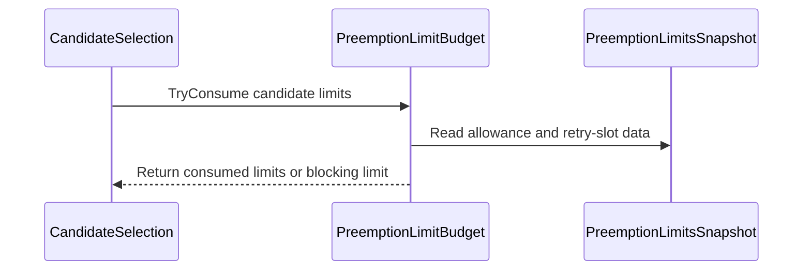

# PR #19660: Add PreemptionLimitBudget for PreemptionLimits

**Summary**: Add PreemptionLimitBudget for PreemptionLimits

**Sources**: https://github.com/kubernetes-sigs/kueue/pull/19660

**Last updated**: 2026-11-25T11:32:02Z

---

## Metadata

- **State**: open
- **Author**: [@danylott](https://github.com/danylott)
- **Branch**: `preemption-limits-budget` → `main`
- **Created**: 2026-11-25T11:26:34Z
- **Updated**: 2026-11-25T11:32:02Z
- **Merged**: —
- **Closed**: —
- **Labels**: `kind/feature`, `size/L`, `release-note-none`, `cncf-cla: yes`
- **Assignees**: _none_
- **Requested reviewers**: [@apullo777](https://github.com/apullo777), [@j-skiba](https://github.com/j-skiba)
- **Changed files**: 3   **+325 / -0**

## Description

#### What type of PR is this?
/kind feature

#### What this PR does / why we need it?
Adds `PreemptionLimitBudget` for KEP-16925 (`PreemptionLimits`, https://github.com/kubernetes-sigs/kueue/pull/17277), building on #19509 and #19644:

- Stores the `PreemptionLimitsSnapshot` on `PreemptionLimiter` and adds `(*PreemptionLimiter).NewBudget()` for one candidate-selection pass (a `nil` limiter imposes no limits).
- Implements `(*PreemptionLimitBudget).TryConsume(...)` to atomically take one preemption from every limit a candidate consumes, or reject the candidate without modifying the budget and return the strictest `policy.BlockingPreemptionLimit` (preferring a non-expiring limit with `RetryAt == nil`, otherwise the latest `RetryAt`).

Part of #16925

#### Useful notes for your reviewer
- `TryConsume` either consumes all applicable limits for a target or none, so a blocked candidate never leaves partial counts in `taken`.
- **AI disclosure:** this change was written with AI assistance, then reviewed and adjusted by me.

#### Release note
```release-note
NONE
```

<!-- This is an auto-generated comment: release notes by coderabbit.ai -->

<!-- coderabbit-ai-generated:v1 -->

## AI summary

This PR adds the preemption limit budget for KEP-16925 in `pkg/scheduler/preemption/limits/`.

- `budget.go` adds `PreemptionLimitBudget`, `(*PreemptionLimiter).NewBudget()`, and `(*PreemptionLimitBudget).TryConsume(...)`.
- `TryConsume` consumes one unit from each applicable limit, or consumes nothing and returns the blocking limit.
- When a candidate is blocked, a non-expiring limit (`RetryAt == nil`) takes precedence. Otherwise, the limit with the latest `RetryAt` is returned.
- `limiter.go` stores the `PreemptionLimitsSnapshot` on `PreemptionLimiter`.
- `budget_test.go` adds table-driven tests for `TryConsume`.

No scheduler call site uses the new budget in this PR. No test results are available.

### Suggested release note

```text
NONE
```

<!-- end of auto-generated comment: release notes by coderabbit.ai -->

## Discussion

### Comment by [@netlify[bot]](https://github.com/apps/netlify) — 2026-11-25T11:26:39Z

### <span aria-hidden="true">👷</span> Deploy request for *kubernetes-sigs-kueue* pending review.
[Visit the deploys page to approve it](https://app.netlify.com/projects/kubernetes-sigs-kueue/deploys)

|  Name | Link |
|:-:|------------------------|
|<span aria-hidden="true">🔨</span> Latest commit | 01aca0f004e9af0070b87b4a7ea0e09cdaddb805 |

### Comment by [@coderabbitai[bot]](https://github.com/apps/coderabbitai) — 2026-11-25T11:26:55Z

<!-- coderabbit-ai-generated:v1 -->

<!-- This is an auto-generated comment: summarize by coderabbit.ai -->
<!-- review_stack_entry_start -->

<a href="https://app.coderabbit.ai/change-stack/kubernetes-sigs/kueue/pull/19660?scope=ghh_OusAJGA4HG8ljoOV0wJvVx8NmnZIjc2DdjmxOu0xZWA&amp;cs_source=review_comment"><picture><source media="(prefers-color-scheme: dark)" srcset="https://storage.googleapis.com/coderabbit_public_assets/review-stack-buttons-v1/explain-change-dark.svg"><source media="(prefers-color-scheme: light)" srcset="https://storage.googleapis.com/coderabbit_public_assets/review-stack-buttons-v1/explain-change.svg"></picture></a>

<!-- review_stack_entry_end -->
<!-- recent_review_status_start -->

No actionable comments were generated in the recent review.

<!-- recent_review_status_end -->
<!-- walkthrough_start -->

<details>
<summary><strong>Walkthrough</strong></summary>
<dl>
<dd>
<br>

The limiter now retains its preemption-limits snapshot. A new per-pass budget checks allowances, tracks consumed limits, and reports a blocking limit when a candidate cannot be admitted.

**Changes: Preemption limit budget**

|Layer / File(s)|Summary|
|:---|:---|
|**Snapshot-backed budget checks** <br> `pkg/scheduler/preemption/limits/budget.go`, `pkg/scheduler/preemption/limits/limiter.go`, `pkg/scheduler/preemption/limits/budget_test.go`|`PreemptionLimiter` retains its snapshot. `PreemptionLimitBudget` checks remaining allowances, tracks consumed limits, and selects a blocking limit when an allowance is exhausted. Tests cover nil limiters, event and count limits, aggregation keys, in-progress preemptions, and retry-time selection.|

<!-- change_assessment_start -->
**Estimated code review effort:** 3 (Moderate) | ~20 minutes

<!-- change_assessment_commit:"01aca0f004e9af0070b87b4a7ea0e09cdaddb805" -->
<!-- change_assessment_priority:{"version":1,"urgency":"p2","manual":false} -->
**Change:** Feature
<!-- change_assessment_end -->

### Sequence Diagram(s)



**Possibly related issues**

- [kubernetes-sigs/kueue#19530](https://github.com/kubernetes-sigs/kueue/issues/19530): The budget implementation contributes to the ongoing PreemptionLimit feature work.
- [kubernetes-sigs/kueue#16925](https://github.com/kubernetes-sigs/kueue/issues/16925): The budget enforces preemption limits during candidate selection.

**Possibly related PRs**

- [kubernetes-sigs/kueue#19380](https://github.com/kubernetes-sigs/kueue/pull/19380): This PR uses the policy types introduced there to return consumed and blocking limits.
- [kubernetes-sigs/kueue#19644](https://github.com/kubernetes-sigs/kueue/pull/19644): This PR extends the `PreemptionLimiter` introduced there with snapshot storage and per-pass budget creation.
- [kubernetes-sigs/kueue#19509](https://github.com/kubernetes-sigs/kueue/pull/19509): The budget reads limit data from the snapshot type introduced there.

**Suggested reviewers:** `mimowo`

</dd>
</dl>
</details>

<!-- walkthrough_end -->
<details>
<summary><strong>Merge Risk:</strong> <strong><picture></picture> Minimal</strong> · up to <code>01aca</code></summary>
<dl>
<dd>
<br>

<!-- final_review_risk_start -->
<!-- final_review_risk_label
**Merge Risk:** **⚪ Minimal** · up to `01aca`
-->
<!-- final_review_risk_coverage:{"sourceCommitId":"01aca0f004e9af0070b87b4a7ea0e09cdaddb805","coveredCommitId":"01aca0f004e9af0070b87b4a7ea0e09cdaddb805","kind":"reviewed"} -->

This adds a per-pass preemption limit budget that nothing calls yet, so merging has no behavior change today. No concrete defect was found. Whoever wires the budget into candidate selection should make sure accepted candidates are not counted both in the recorded snapshot and in the budget's taken counts.
<!-- final_review_risk_end -->

</dd>
</dl>
</details>
<!-- pre_merge_checks_walkthrough_start -->

<details>
<summary><strong>Pre-merge checks: <sup><picture></picture></sup> 4</strong></summary>
<dl>
<dd>
<br>

|         Check name         |                                             Status                                             | Explanation                                                                                                                                                                                               |
| :------------------------ | :--------------------------------------------------------------------------------------------: | :-------------------------------------------------------------------------------------------------------------------------------------------------------------------------------------------------------- |
|      Description Check     |  | Check skipped - CodeRabbit’s high-level summary is enabled.                                                                                                                                               |
|         Title check        |  | The title "Add PreemptionLimitBudget for PreemptionLimits" matches the main change: the PR adds the PreemptionLimitBudget type, the NewBudget() constructor on PreemptionLimiter, and TryConsume(), with… |
|     Linked Issues check    |  | Check skipped because no linked issues were found for this pull request.                                                                                                                                  |
| Out of Scope Changes check |  | Check skipped because no linked issues were found for this pull request.                                                                                                                                  |

<details>
<summary><strong>Full details: Title check</strong></summary>
<dl>
<dd>
<br>

**Explanation**

The title "Add PreemptionLimitBudget for PreemptionLimits" matches the main change: the PR adds the PreemptionLimitBudget type, the NewBudget() constructor on PreemptionLimiter, and TryConsume(), with a supporting snapshot field on the limiter. It is short, specific, and names the primary exported type a reviewer would look for.

</dd>
</dl>
</details>

</dd>
</dl>
</details>

<!-- pre_merge_checks_walkthrough_end -->
<!-- finishing_touch_checkbox_start -->

<details>
<summary><strong>Finishing Touches</strong></summary>
<dl>
<dd>
<br>

<details open>
<summary><strong>Generate unit tests (beta)</strong></summary>
<dl>
<dd>
<br>

- [ ] <!-- {"checkboxId": "f47ac10b-58cc-4372-a567-0e02b2c3d479", "radioGroupId": "utg-output-choice-group-unknown_comment_id"} --> Create a new PR

</dd>
</dl>
</details>

</dd>
</dl>
</details>

<!-- finishing_touch_checkbox_end -->

<!-- autopilot:start -->
- [ ] <!-- {"checkboxId":"2708ad07-9f24-4260-9c11-7dc76a49f2e3"} --> <strong title="Keep fixing CodeRabbit findings and required CI, and resolving merge conflicts">Autofix</strong> · Keep fixing CodeRabbit findings and required CI, and resolving merge conflicts
<!-- autopilot:end -->
<!-- recent_review_start -->

<h6>
<details>
<summary><strong><picture></picture> Recent review info</strong></summary>
<dl>
<dd>
<br>

<!-- review_info_content -->
<details>
<summary><strong><picture><source media="(prefers-color-scheme: dark)" srcset="https://storage.googleapis.com/coderabbit_public_assets/review-comment-icons-v1/cog-dark.svg"></picture> Run configuration</strong></summary>
<dl>
<dd>
<br>

- **Source mode**: Auto
- **Repository**: [kubernetes-sigs/kueue](<https://github.com/kubernetes-sigs/kueue>)
- **Branch**: [main](<https://github.com/kubernetes-sigs/kueue/tree/main>)
- **File**: [.coderabbit.yaml](<https://github.com/kubernetes-sigs/kueue/blob/b75cd1fefb77b2082b2cf86368ebcee22fb2c26f/.coderabbit.yaml>)
- **Commit**: [b75cd1f](<https://github.com/kubernetes-sigs/kueue/commit/b75cd1fefb77b2082b2cf86368ebcee22fb2c26f>)
- **Layers**: Repository YAML
- **Review profile**: CHILL
- **Plan**: Advanced
- **Run ID**: `06c39dde-ca14-4dee-97a0-5f29de11b8d8`

</dd>
</dl>
</details>

<details>
<summary><strong><picture><source media="(prefers-color-scheme: dark)" srcset="https://storage.googleapis.com/coderabbit_public_assets/review-comment-icons-v1/git-commit-horizontal-dark.svg"></picture> Commits</strong></summary>
<dl>
<dd>
<br>

Reviewing files that changed from the base of the PR and between b75cd1fefb77b2082b2cf86368ebcee22fb2c26f and 01aca0f004e9af0070b87b4a7ea0e09cdaddb805.

</dd>
</dl>
</details>

<details>
<summary><strong><picture><source media="(prefers-color-scheme: dark)" srcset="https://storage.googleapis.com/coderabbit_public_assets/review-comment-icons-v1/file-plus-corner-dark.svg"></picture> Files selected for processing: 3</strong></summary>
<dl>
<dd>
<br>

* `pkg/scheduler/preemption/limits/budget.go`
* `pkg/scheduler/preemption/limits/budget_test.go`
* `pkg/scheduler/preemption/limits/limiter.go`

</dd>
</dl>
</details>

**Included review availability:** This review used your included allowance. Your plan provides up to 8 included reviews per hour; 7 remain after this review.

</dd>
</dl>
</details>
</h6>

<!-- recent_review_end -->

### Comment by [@kubernetes-prow[bot]](https://github.com/apps/kubernetes-prow) — 2026-11-25T11:26:57Z

[APPROVALNOTIFIER] This PR is **NOT APPROVED**

This pull-request has been approved by: *<a href="https://github.com/kubernetes-sigs/kueue/pull/19660#" title="Author self-approved">danylott</a>*
**Once this PR has been reviewed and has the lgtm label**, please assign [olekzabl](https://github.com/olekzabl), [tenzen-y](https://github.com/tenzen-y) for approval. For more information see [the Code Review Process](https://git.k8s.io/community/contributors/guide/owners.md#the-code-review-process).

The full list of commands accepted by this bot can be found [here](https://go.k8s.io/bot-commands?repo=kubernetes-sigs%2Fkueue).

<details open>
Needs approval from an approver in each of these files:

- **[OWNERS](https://github.com/kubernetes-sigs/kueue/blob/main/OWNERS)**

Approvers can indicate their approval by writing `/approve` in a comment
Approvers can cancel approval by writing `/approve cancel` in a comment
</details>
<!-- META={"approvers":["olekzabl","tenzen-y"]} -->
