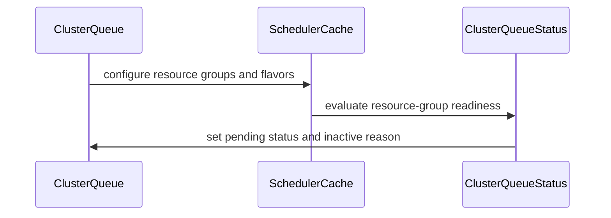

# PR #6110: feat(crd/clusterqueue): Allow empty ResourceGroups

**Summary**: feat(crd/clusterqueue): Allow empty ResourceGroups

**Sources**: https://github.com/kubernetes-sigs/kueue/pull/6110

**Last updated**: 2026-08-29T16:11:22Z

---

## Metadata

- **State**: open
- **Author**: [@mayooot](https://github.com/mayooot)
- **Branch**: `feat/update-resourcegroups-schema` → `main`
- **Created**: 2025-07-21T09:24:07Z
- **Updated**: 2026-08-29T16:11:22Z
- **Merged**: —
- **Closed**: —
- **Labels**: `kind/feature`, `size/L`, `release-note-action-required`, `do-not-merge/hold`, `ok-to-test`, `cncf-cla: yes`
- **Assignees**: _none_
- **Requested reviewers**: [@kannon92](https://github.com/kannon92), [@mbobrovskyi](https://github.com/mbobrovskyi)
- **Changed files**: 31   **+283 / -136**

## Description


#### What type of PR is this?
/kind feature


#### What this PR does / why we need it:
Allow empty ResourceGroups.

#### Which issue(s) this PR fixes:

Fixes #6022

#### Special notes for your reviewer:
None.
#### Does this PR introduce a user-facing change?
<!--
If no, just write "NONE" in the release-note block below.
If yes, a release note is required:
Enter your extended release note in the block below. If the PR requires additional action from users switching to the new release, include the string "action required".
-->
```release-note
I think the impact is very small, we're just adjusting the number of `ResourceGroups`, unless someone really doesn't wanna see null `ResourceGroups` field in ClusterQueue.

action required.
```

<!-- This is an auto-generated comment: release notes by coderabbit.ai -->
## Summary by CodeRabbit

* **New Features**
  * ClusterQueues can now be configured without resource groups or with resource groups that have no flavors.
  * Added clearer status reporting for missing resource groups and empty resource groups.

* **Bug Fixes**
  * ClusterQueues lacking required resource flavors or admission checks are now correctly marked as pending.
  * Pending queues are now treated as inactive for scheduling and status evaluation.
  * Updated validation to accept empty flavor lists in ClusterQueue and Cohort configurations.
<!-- end of auto-generated comment: release notes by coderabbit.ai -->

## Discussion

### Comment by [@netlify[bot]](https://github.com/apps/netlify) — 2025-07-21T09:24:13Z

### <span aria-hidden="true">✅</span> Deploy Preview for *kubernetes-sigs-kueue* canceled.


|  Name | Link |
|:-:|------------------------|
|<span aria-hidden="true">🔨</span> Latest commit | 329ce2083d5292836c69b9df61a475abcf6914da |
|<span aria-hidden="true">🔍</span> Latest deploy log | https://app.netlify.com/projects/kubernetes-sigs-kueue/deploys/694e3cf5e64972000818de2f |

### Comment by [@k8s-ci-robot](https://github.com/k8s-ci-robot) — 2025-07-21T09:24:16Z

Welcome @mayooot! <br><br>It looks like this is your first PR to <a href='https://github.com/kubernetes-sigs/kueue'>kubernetes-sigs/kueue</a> 🎉. Please refer to our [pull request process documentation](https://www.kubernetes.dev/docs/guide/pull-requests/) to help your PR have a smooth ride to approval. <br><br>You will be prompted by a bot to use commands during the review process. Do not be afraid to follow the prompts! It is okay to experiment. [Here is the bot commands documentation](https://go.k8s.io/bot-commands). <br><br>You can also check if kubernetes-sigs/kueue has [its own contribution guidelines](https://github.com/kubernetes-sigs/kueue/tree/master/CONTRIBUTING.md). <br><br>You may want to refer to our [testing guide](https://git.k8s.io/community/contributors/devel/sig-testing/testing.md) if you run into trouble with your tests not passing. <br><br>If you are having difficulty getting your pull request seen, please follow the [recommended escalation practices](https://www.kubernetes.dev/docs/guide/pull-requests/#why-is-my-pull-request-not-getting-reviewed). Also, for tips and tricks in the contribution process you may want to read the [Kubernetes contributor cheat sheet](https://www.kubernetes.dev/docs/contributor-cheatsheet/). We want to make sure your contribution gets all the attention it needs! <br><br>Thank you, and welcome to Kubernetes. :smiley:

### Comment by [@k8s-ci-robot](https://github.com/k8s-ci-robot) — 2025-07-21T09:24:17Z

Hi @mayooot. Thanks for your PR.

I'm waiting for a [kubernetes-sigs](https://github.com/orgs/kubernetes-sigs/people) member to verify that this patch is reasonable to test. If it is, they should reply with `/ok-to-test` on its own line. Until that is done, I will not automatically test new commits in this PR, but the usual testing commands by org members will still work. Regular contributors should [join the org](https://git.k8s.io/community/community-membership.md#member) to skip this step.

Once the patch is verified, the new status will be reflected by the `ok-to-test` label.

I understand the commands that are listed [here](https://go.k8s.io/bot-commands?repo=kubernetes-sigs%2Fkueue).

<details>

Instructions for interacting with me using PR comments are available [here](https://git.k8s.io/community/contributors/guide/pull-requests.md).  If you have questions or suggestions related to my behavior, please file an issue against the [kubernetes-sigs/prow](https://github.com/kubernetes-sigs/prow/issues/new?title=Prow%20issue:) repository.
</details>

### Comment by [@mimowo](https://github.com/mimowo) — 2025-07-21T09:29:37Z

/ok-to-test

### Comment by [@mimowo](https://github.com/mimowo) — 2025-07-21T09:34:47Z

@mayooot please add release note. Also, please check https://github.com/kubernetes-sigs/kueue/issues/6022#issuecomment-3095917285. I think it is better to make the CQ inactive to make it clear workloads will not get admitted.

### Comment by [@mayooot](https://github.com/mayooot) — 2025-07-21T10:16:58Z

> @mayooot please add release note. Also, please check [#6022 (comment)](https://github.com/kubernetes-sigs/kueue/issues/6022#issuecomment-3095917285). I think it is better to make the CQ inactive to make it clear workloads will not get admitted.

Ok, I'm done.

### Comment by [@kannon92](https://github.com/kannon92) — 2025-07-22T18:53:27Z

/hold

@mimowo has one suggestion about setting CQ to inactive if there are no resource flavors.

### Comment by [@LarsSven](https://github.com/LarsSven) — 2025-07-25T08:29:03Z

What is the status of this PR? We would love to have this change. Is there anything I can do to help?

### Comment by [@mimowo](https://github.com/mimowo) — 2025-07-25T08:33:38Z

@LarsSven sorry, I was busy reviewing enhancements already on my radar for the release, as 0.13 will be on Monday.

Do you want this to be included in 0.13? The change is small and sensible, so I'm good with that, but let me check with the other maintainer, as this is a late addition.

### Comment by [@mimowo](https://github.com/mimowo) — 2025-07-25T08:33:47Z

cc @tenzen-y wdyt?

### Comment by [@mimowo](https://github.com/mimowo) — 2025-07-25T08:34:30Z

Regarding this PR:
- please fix pull-kueue-verify-main, probably `make manifests` is enough, maybe also `make generate`

### Comment by [@mimowo](https://github.com/mimowo) — 2025-07-25T08:37:21Z

I'm on the fence regarding marking the CQ as inactive, because it seems useful, but additional work. 

The code pointers:
- https://github.com/kubernetes-sigs/kueue/blob/2d47a1ae1d8407bbf284a99da0d6ff974cb34053/pkg/cache/clusterqueue.go#L246
- https://github.com/kubernetes-sigs/kueue/blob/2d47a1ae1d8407bbf284a99da0d6ff974cb34053/pkg/cache/clusterqueue.go#L217-L226

This is a soft validation of the CQ which would make it Active=False, when there are no flavors. Such a CQ will not admit workloads, but this soft validation would be informative to the users "why".

However, maybe the messages on the workloads would be informative enough already - in that case no need for extra soft validation of CQ probably. 

To help with the decision, could you please add a unit test in scheduler_test.go, under TestSchedule which shows what is the message to the user (event) on workload when attempting to submit a workload to CQ without ResrourceGroups?

For code pointer, here is the example event emitted for workload which cannot get admitted (for another reason): https://github.com/kubernetes-sigs/kueue/blob/84114729173535a8f40eb7c7d50294b389890b71/pkg/scheduler/scheduler_test.go#L2679-L2694

### Comment by [@mayooot](https://github.com/mayooot) — 2025-07-25T08:53:34Z

@mimowo That sounds like it involves more work, but all we really need is just a useful feature to allow flavors to be empty.

### Comment by [@mimowo](https://github.com/mimowo) — 2025-07-25T08:56:33Z

@mayooot the new unit test shouldn't be much work I expect. If the message is reasonable, we can stay with that.

### Comment by [@mimowo](https://github.com/mimowo) — 2025-07-25T08:57:59Z

because by relaxing the validation we create new possibilities, so we want to have some sanity checks on how the scheduler will behave.

### Comment by [@mimowo](https://github.com/mimowo) — 2025-07-25T08:58:54Z

Is this something you tested manually end-to-end on your fork, or locally maybe?

### Comment by [@LarsSven](https://github.com/LarsSven) — 2025-07-25T11:47:59Z

> Do you want this to be included in 0.13? The change is small and sensible, so I'm good with that, but let me check with the other maintainer, as this is a late addition.

For us that would be absolutely lovely yeah, we would use it immediately.

### Comment by [@tenzen-y](https://github.com/tenzen-y) — 2025-07-25T12:40:39Z

> cc @tenzen-y wdyt?

The changing surface is very simple, but actually not simple since we need to check if assigner, TAS, scheduler could carefully handle null resourceGroup. Additionally, I think that we should deactivate the CQ when the cq does not have any rgs since in other non-runnable CQ situations, the CQ always report that, and the deacitivated state is propagated to lq status.

I don't think that we should break the window during the state handling.

### Comment by [@mayooot](https://github.com/mayooot) — 2025-07-28T02:58:32Z

> I'm on the fence regarding marking the CQ as inactive, because it seems useful, but additional work.
> 
> The code pointers:
> 
> * https://github.com/kubernetes-sigs/kueue/blob/2d47a1ae1d8407bbf284a99da0d6ff974cb34053/pkg/cache/clusterqueue.go#L246
> * https://github.com/kubernetes-sigs/kueue/blob/2d47a1ae1d8407bbf284a99da0d6ff974cb34053/pkg/cache/clusterqueue.go#L217-L226
> 
> This is a soft validation of the CQ which would make it Active=False, when there are no flavors. Such a CQ will not admit workloads, but this soft validation would be informative to the users "why".
> 
> However, maybe the messages on the workloads would be informative enough already - in that case no need for extra soft validation of CQ probably.
> 
> To help with the decision, could you please add a unit test in scheduler_test.go, under TestSchedule which shows what is the message to the user (event) on workload when attempting to submit a workload to CQ without ResrourceGroups?
> 
> For code pointer, here is the example event emitted for workload which cannot get admitted (for another reason):
> 
> https://github.com/kubernetes-sigs/kueue/blob/84114729173535a8f40eb7c7d50294b389890b71/pkg/scheduler/scheduler_test.go#L2679-L2694

Ok, I' ll finish it later.

### Comment by [@mayooot](https://github.com/mayooot) — 2025-08-04T09:46:15Z

@mimowo Could you give me some advice on how to handle this test case? I'm not very familiar with `schedule_test.go` 😢

The code is below:
~~~go
"workload submitted to CQ with missing ResourceFlavor": {
			additionalClusterQueues: []kueue.ClusterQueue{
				*utiltesting.MakeClusterQueue("other").
					QueueingStrategy(kueue.StrictFIFO).
					ResourceGroup().
					Obj(),
			},
			additionalLocalQueues: []kueue.LocalQueue{
				*utiltesting.MakeLocalQueue("other", "sales").ClusterQueue("other").Obj(),
			},
			workloads: []kueue.Workload{
				*utiltesting.MakeWorkload("new", "sales").
					Queue("other").
					PodSets(*utiltesting.MakePodSet("one", 1).
						Obj()).
					Obj(),
			},
			wantInadmissibleLeft: map[kueue.ClusterQueueReference][]workload.Reference{
				"other": {"sales/new"},
			},
			wantEvents: []utiltesting.EventRecord{
				{
					Key:       types.NamespacedName{Namespace: "sales", Name: "new"},
					Reason:    "QuotaReserved",
					EventType: corev1.EventTypeNormal,
					Message:   "couldn't assign flavors to pod set one: Can't admit new workloads: references missing ResourceFlavor(s): nonexistent-flavor.",
				},
			},
		},
~~~

output: 
~~~
=== RUN   TestSchedule
=== RUN   TestSchedule/workload_submitted_to_CQ_with_missing_ResourceFlavor
    resources.go:127: "msg"="Failed adjusting requests for LimitRanges" "error"="List on GroupVersionKind /v1, Kind=LimitRange specifies selector on field spec.hasContainerType, but no index with name spec.hasContainerType has been registered for GroupVersionKind /v1, Kind=LimitRange"
    manager.go:593: "level"=2 "msg"="Attempting to move workloads" "cohort"="eng" "root"="eng"
    manager.go:593: "level"=2 "msg"="Attempting to move workloads" "cohort"="eng" "root"="eng"
    manager.go:593: "level"=2 "msg"="Attempting to move workloads" "cohort"="lend" "root"="lend"
    manager.go:593: "level"=2 "msg"="Attempting to move workloads" "cohort"="lend" "root"="lend"
    scheduler.go:239: "level"=2 "msg"="Attempting to schedule workload" "schedulingCycle"=1 "workload"={"name"="new" "namespace"="sales"} "clusterQueue"={"name"="other"}
    scheduler.go:562: "level"=2 "msg"="Workload assumed in the cache" "schedulingCycle"=1 "workload"={"name"="new" "namespace"="sales"} "clusterQueue"={"name"="other"}
    scheduler.go:570: "level"=2 "msg"="Workload successfully admitted and assigned flavors" "schedulingCycle"=1 "workload"={"name"="new" "namespace"="sales"} "clusterQueue"={"name"="other"} "assignments"=[{"name"="one" "count"=1}]
    scheduler_test.go:3490: Unexpected scheduled workloads (-want,+got):
          map[workload.Reference]v1beta1.Admission{
        + 	"sales/new": {
        + 		ClusterQueue: "other",
        + 		PodSetAssignments: []v1beta1.PodSetAssignment{
        + 			{
        + 				Name:          "one",
        + 				Flavors:       map[v1.ResourceName]v1beta1.ResourceFlavorReference{},
        + 				ResourceUsage: v1.ResourceList{},
        + 				Count:         &1,
        + 			},
        + 		},
        + 	},
          }
    scheduler_test.go:3528: Unexpected assigned clusterQueues in cache (-want,+got):
          map[workload.Reference]v1beta1.Admission(
        - 	nil,
        + 	{
        + 		"sales/new": {ClusterQueue: "other", PodSetAssignments: []v1beta1.PodSetAssignment{{...}}},
        + 	},
          )
    scheduler_test.go:3537: Unexpected elements left in inadmissible workloads (-want,+got):
          map[v1beta1.ClusterQueueReference][]workload.Reference(
        - 	{"other": {"sales/new"}},
        + 	nil,
          )
    scheduler_test.go:3542: unexpected events (-want/+got):
          []testing.EventRecord{
          	{
          		Key:       {Namespace: "sales", Name: "new"},
          		EventType: "Normal",
          		Reason:    "QuotaReserved",
          		Message: strings.Join({
        - 			"couldn't assign flavors to pod set one: Can't admit new workload",
        - 			"s: references missing ResourceFlavor(s): nonexistent-flavor.",
        + 			"Quota reserved in ClusterQueue other, wait time since queued was",
        + 			" 9223372037s",
          		}, ""),
          	},
        + 	{
        + 		Key:       s"sales/new",
        + 		EventType: "Normal",
        + 		Reason:    "Admitted",
        + 		Message:   "Admitted by ClusterQueue other, wait time since reservation was 0s",
        + 	},
          }
--- FAIL: TestSchedule (0.01s)
    --- FAIL: TestSchedule/workload_submitted_to_CQ_with_missing_ResourceFlavor (0.01s)


FAIL
~~~

Maybe it doesn't accept cases when Flavor is null.

### Comment by [@mimowo](https://github.com/mimowo) — 2025-08-05T09:31:52Z

@mayooot the test itself looks good, but it seems the ClusterQueue in that configuration admits the workloads, which isn't the intention:
```
        + 	{
        + 		Key:       s"sales/new",
        + 		EventType: "Normal",
        + 		Reason:    "Admitted",
        + 		Message:   "Admitted by ClusterQueue other, wait time since reservation was 0s",
        + 	},
```
So, I think we should deactivate such a CQ, then it will naturally be excluded from scheduling [here](https://github.com/kubernetes-sigs/kueue/blob/22e4502335b0116300b3dcc63d237cf8b7ac759a/pkg/scheduler/scheduler.go#L417C18-L418). To deactivate the ClusterQueue the code pointers are in my previous [comment](https://github.com/kubernetes-sigs/kueue/pull/6110#issuecomment-3116913332). Let me know if more info is needed.

cc @gabesaba @mbobrovskyi who are also quite familiar with this code

### Comment by [@mayooot](https://github.com/mayooot) — 2025-08-06T06:08:01Z

I tried my best to fix this test case, but I still have a problem. Could you give me some advice? 
I already created an inactive CQ, why is it still admitted? 

I refer to the following:
https://github.com/kubernetes-sigs/kueue/blob/334b56b5ddd18bfacccc8b169c5cb71e608f2bac/pkg/cache/snapshot_test.go#L104-L110

The following is the error message from the failed test: 
~~~
=== RUN   TestSchedule
--- FAIL: TestSchedule (1.01s)
=== RUN   TestSchedule/workload_submitted_to_inactive_CQ_due_to_missing_ResourceFlavor
    resources.go:127: "msg"="Failed adjusting requests for LimitRanges" "error"="List on GroupVersionKind /v1, Kind=LimitRange specifies selector on field spec.hasContainerType, but no index with name spec.hasContainerType has been registered for GroupVersionKind /v1, Kind=LimitRange"
    manager.go:593: "level"=2 "msg"="Attempting to move workloads" "cohort"="eng" "root"="eng"
    manager.go:593: "level"=2 "msg"="Attempting to move workloads" "cohort"="eng" "root"="eng"
    manager.go:593: "level"=2 "msg"="Attempting to move workloads" "cohort"="lend" "root"="lend"
    manager.go:593: "level"=2 "msg"="Attempting to move workloads" "cohort"="lend" "root"="lend"
    scheduler_test.go:3542: Unexpected elements left in the queue (-want,+got):
          map[v1beta1.ClusterQueueReference][]workload.Reference(
        - 	nil,
        + 	{"flavor-nonexistent-cq-2": {"sales/wl"}},
          )
    scheduler_test.go:3546: Unexpected elements left in inadmissible workloads (-want,+got):
          map[v1beta1.ClusterQueueReference][]workload.Reference(
        - 	{"flavor-nonexistent-cq-2": {"sales/wl"}},
        + 	nil,
          )
    scheduler_test.go:3551: unexpected events (-want/+got):
          []testing.EventRecord(
        - 	{
        - 		{
        - 			Key:       s"sales/wl",
        - 			EventType: "Normal",
        - 			Reason:    "QuotaReserved",
        - 			Message:   "couldn't assign flavors to pod set main: Can't admit new workloa"...,
        - 		},
        - 	},
        + 	nil,
          )
    --- FAIL: TestSchedule/workload_submitted_to_inactive_CQ_due_to_missing_ResourceFlavor (1.01s)


FAIL
~~~

The full cole is [here](https://github.com/kubernetes-sigs/kueue/pull/6110/commits/d461597931cb4e6150d060b567fa1330fc185329)

### Comment by [@mimowo](https://github.com/mimowo) — 2025-08-06T06:24:23Z

> I already created an inactive CQ, why is it still admitted?

It does not look like Admitted, there is no event that quota is reserved.

```
    scheduler_test.go:3551: unexpected events (-want/+got):
          []testing.EventRecord(
        - 	{
        - 		{
        - 			Key:       s"sales/wl",
        - 			EventType: "Normal",
        - 			Reason:    "QuotaReserved",
        - 			Message:   "couldn't assign flavors to pod set main: Can't admit new workloa"...,
        - 		},
        - 	},
        + 	nil,
          )
```
also this assert indicates it stays in the queue:

```
    scheduler_test.go:3542: Unexpected elements left in the queue (-want,+got):
          map[v1beta1.ClusterQueueReference][]workload.Reference(
        - 	nil,
        + 	{"flavor-nonexistent-cq-2": {"sales/wl"}},
          )
```
One thing that I'm missing here is the event saying why it was not admitted actually.

### Comment by [@mayooot](https://github.com/mayooot) — 2025-08-06T07:15:44Z

/retest

### Comment by [@LarsSven](https://github.com/LarsSven) — 2025-08-26T18:08:35Z

Hello! What is the status of this PR? Is this still planned to be merged?

### Comment by [@kannon92](https://github.com/kannon92) — 2025-08-26T18:27:56Z

> Hello! What is the status of this PR? Is this still planned to be merged?

The verify job is failing so this won't go in without that fix.

### Comment by [@tenzen-y](https://github.com/tenzen-y) — 2025-08-26T18:43:17Z

> > Hello! What is the status of this PR? Is this still planned to be merged?
> 
> The verify job is failing so this won't go in without that fix.

As I mentioned in the above, the deactivation is must-have for this PR merge.

### Comment by [@linux-foundation-easycla[bot]](https://github.com/apps/linux-foundation-easycla) — 2025-08-29T06:47:55Z

<a href="https://easycla.lfx.linuxfoundation.org/#/?version=2"></a><br/><br />The committers listed above are authorized under a signed CLA.<ul><li>:white_check_mark: login: mayooot / name: Harry Li  (329ce2083d5292836c69b9df61a475abcf6914da)</li></ul>

### Comment by [@mayooot](https://github.com/mayooot) — 2025-08-29T08:00:51Z

/retest

### Comment by [@mayooot](https://github.com/mayooot) — 2025-08-29T09:25:56Z

@mimowo @gabesaba Could you please review the latest changes?

### Comment by [@gabesaba](https://github.com/gabesaba) — 2025-09-01T12:20:06Z

Can we add a test to make sure we are no longer rejecting an empty resource group? See https://github.com/kubernetes-sigs/kueue/blob/8f4f4e9bfdaab335fe0dead0e929b9df0afea744/test/integration/singlecluster/webhook/core/clusterqueue_test.go#L388-L409 for a starting point

### Comment by [@LarsSven](https://github.com/LarsSven) — 2025-09-17T14:00:04Z

Sorry to be a bother but is this still planned? We woul still be very interested in this feature and would love to have it.

### Comment by [@k8s-ci-robot](https://github.com/k8s-ci-robot) — 2025-12-26T07:42:14Z

[APPROVALNOTIFIER] This PR is **NOT APPROVED**

This pull-request has been approved by: *<a href="https://github.com/kubernetes-sigs/kueue/pull/6110#" title="Author self-approved">mayooot</a>*
**Once this PR has been reviewed and has the lgtm label**, please assign [tenzen-y](https://github.com/tenzen-y) for approval. For more information see [the Code Review Process](https://git.k8s.io/community/contributors/guide/owners.md#the-code-review-process).

The full list of commands accepted by this bot can be found [here](https://go.k8s.io/bot-commands?repo=kubernetes-sigs%2Fkueue).

<details open>
Needs approval from an approver in each of these files:

- **[OWNERS](https://github.com/kubernetes-sigs/kueue/blob/main/OWNERS)**

Approvers can indicate their approval by writing `/approve` in a comment
Approvers can cancel approval by writing `/approve cancel` in a comment
</details>
<!-- META={"approvers":["tenzen-y"]} -->

### Comment by [@k8s-triage-robot](https://github.com/k8s-triage-robot) — 2026-04-09T17:25:26Z

The Kubernetes project currently lacks enough contributors to adequately respond to all PRs.

This bot triages PRs according to the following rules:
- After 90d of inactivity, `lifecycle/stale` is applied
- After 30d of inactivity since `lifecycle/stale` was applied, `lifecycle/rotten` is applied
- After 30d of inactivity since `lifecycle/rotten` was applied, the PR is closed

You can:
- Mark this PR as fresh with `/remove-lifecycle stale`
- Close this PR with `/close`
- Offer to help out with [Issue Triage][1]

Please send feedback to sig-contributor-experience at [kubernetes/community](https://github.com/kubernetes/community).

/lifecycle stale

[1]: https://www.kubernetes.dev/docs/guide/issue-triage/

### Comment by [@k8s-ci-robot](https://github.com/k8s-ci-robot) — 2026-05-30T16:39:23Z

@mayooot: The following tests **failed**, say `/retest` to rerun all failed tests or `/retest-required` to rerun all mandatory failed tests:

Test name | Commit | Details | Required | Rerun command
--- | --- | --- | --- | ---
pull-kueue-test-integration-baseline-main | 329ce2083d5292836c69b9df61a475abcf6914da | [link](https://prow.k8s.io/view/gs/kubernetes-ci-logs/pr-logs/pull/kubernetes-sigs_kueue/6110/pull-kueue-test-integration-baseline-main/2004458417158098944) | true | `/test pull-kueue-test-integration-baseline-main`
pull-kueue-test-integration-extended-main | 329ce2083d5292836c69b9df61a475abcf6914da | [link](https://prow.k8s.io/view/gs/kubernetes-ci-logs/pr-logs/pull/kubernetes-sigs_kueue/6110/pull-kueue-test-integration-extended-main/2004458417225207808) | true | `/test pull-kueue-test-integration-extended-main`
pull-kueue-test-unit-main | 329ce2083d5292836c69b9df61a475abcf6914da | [link](https://prow.k8s.io/view/gs/kubernetes-ci-logs/pr-logs/pull/kubernetes-sigs_kueue/6110/pull-kueue-test-unit-main/2004458417065824256) | true | `/test pull-kueue-test-unit-main`
pull-kueue-verify-main | 329ce2083d5292836c69b9df61a475abcf6914da | [link](https://prow.k8s.io/view/gs/kubernetes-ci-logs/pr-logs/pull/kubernetes-sigs_kueue/6110/pull-kueue-verify-main/2004458426276515840) | true | `/test pull-kueue-verify-main`
pull-kueue-test-integration-multikueue-main | 329ce2083d5292836c69b9df61a475abcf6914da | [link](https://prow.k8s.io/view/gs/kubernetes-ci-logs/pr-logs/pull/kubernetes-sigs_kueue/6110/pull-kueue-test-integration-multikueue-main/2004458417321676800) | true | `/test pull-kueue-test-integration-multikueue-main`
pull-kueue-test-e2e-main-1-34 | 329ce2083d5292836c69b9df61a475abcf6914da | [link](https://prow.k8s.io/view/gs/kubernetes-ci-logs/pr-logs/pull/kubernetes-sigs_kueue/6110/pull-kueue-test-e2e-main-1-34/2004458417883713536) | true | `/test pull-kueue-test-e2e-main-1-34`
pull-kueue-test-e2e-main-1-32 | 329ce2083d5292836c69b9df61a475abcf6914da | [link](https://prow.k8s.io/view/gs/kubernetes-ci-logs/pr-logs/pull/kubernetes-sigs_kueue/6110/pull-kueue-test-e2e-main-1-32/2004458417401368576) | true | `/test pull-kueue-test-e2e-main-1-32`
pull-kueue-test-e2e-main-1-33 | 329ce2083d5292836c69b9df61a475abcf6914da | [link](https://prow.k8s.io/view/gs/kubernetes-ci-logs/pr-logs/pull/kubernetes-sigs_kueue/6110/pull-kueue-test-e2e-main-1-33/2004458417489448960) | true | `/test pull-kueue-test-e2e-main-1-33`
pull-kueue-test-e2e-main-1-35 | 329ce2083d5292836c69b9df61a475abcf6914da | [link](https://prow.k8s.io/view/gs/kubernetes-ci-logs/pr-logs/pull/kubernetes-sigs_kueue/6110/pull-kueue-test-e2e-main-1-35/2009665577295024128) | true | `/test pull-kueue-test-e2e-main-1-35`
pull-kueue-test-e2e-multikueue-sequential-main | 329ce2083d5292836c69b9df61a475abcf6914da | [link](https://prow.k8s.io/view/gs/kubernetes-ci-logs/pr-logs/pull/kubernetes-sigs_kueue/6110/pull-kueue-test-e2e-multikueue-sequential-main/2043973068082122752) | true | `/test pull-kueue-test-e2e-multikueue-sequential-main`
pull-kueue-test-e2e-sequential-baseline-main | 329ce2083d5292836c69b9df61a475abcf6914da | [link](https://prow.k8s.io/view/gs/kubernetes-ci-logs/pr-logs/pull/kubernetes-sigs_kueue/6110/pull-kueue-test-e2e-sequential-baseline-main/2047021680726904832) | true | `/test pull-kueue-test-e2e-sequential-baseline-main`
pull-kueue-test-e2e-baseline-main-1-34 | 329ce2083d5292836c69b9df61a475abcf6914da | [link](https://prow.k8s.io/view/gs/kubernetes-ci-logs/pr-logs/pull/kubernetes-sigs_kueue/6110/pull-kueue-test-e2e-baseline-main-1-34/2055310098238017536) | true | `/test pull-kueue-test-e2e-baseline-main-1-34`
pull-kueue-test-e2e-baseline-main-1-35 | 329ce2083d5292836c69b9df61a475abcf6914da | [link](https://prow.k8s.io/view/gs/kubernetes-ci-logs/pr-logs/pull/kubernetes-sigs_kueue/6110/pull-kueue-test-e2e-baseline-main-1-35/2055310098439344128) | true | `/test pull-kueue-test-e2e-baseline-main-1-35`
pull-kueue-test-e2e-baseline-main-1-33 | 329ce2083d5292836c69b9df61a475abcf6914da | [link](https://prow.k8s.io/view/gs/kubernetes-ci-logs/pr-logs/pull/kubernetes-sigs_kueue/6110/pull-kueue-test-e2e-baseline-main-1-33/2055310098036690944) | true | `/test pull-kueue-test-e2e-baseline-main-1-33`
pull-kueue-priority-booster-test-integration-main | 329ce2083d5292836c69b9df61a475abcf6914da | [link](https://prow.k8s.io/view/gs/kubernetes-ci-logs/pr-logs/pull/kubernetes-sigs_kueue/6110/pull-kueue-priority-booster-test-integration-main/2056929530756468736) | true | `/test pull-kueue-priority-booster-test-integration-main`
pull-kueue-test-e2e-main-1-36 | 329ce2083d5292836c69b9df61a475abcf6914da | [link](https://prow.k8s.io/view/gs/kubernetes-ci-logs/pr-logs/pull/kubernetes-sigs_kueue/6110/pull-kueue-test-e2e-main-1-36/2057937905258598400) | true | `/test pull-kueue-test-e2e-main-1-36`
pull-kueue-test-e2e-baseline-main-1-36 | 329ce2083d5292836c69b9df61a475abcf6914da | [link](https://prow.k8s.io/view/gs/kubernetes-ci-logs/pr-logs/pull/kubernetes-sigs_kueue/6110/pull-kueue-test-e2e-baseline-main-1-36/2059121252714418176) | true | `/test pull-kueue-test-e2e-baseline-main-1-36`
pull-kueue-test-integration-shard-2-main | 329ce2083d5292836c69b9df61a475abcf6914da | [link](https://prow.k8s.io/view/gs/kubernetes-ci-logs/pr-logs/pull/kubernetes-sigs_kueue/6110/pull-kueue-test-integration-shard-2-main/2059288807873712128) | true | `/test pull-kueue-test-integration-shard-2-main`
pull-kueue-test-integration-shard-0-main | 329ce2083d5292836c69b9df61a475abcf6914da | [link](https://prow.k8s.io/view/gs/kubernetes-ci-logs/pr-logs/pull/kubernetes-sigs_kueue/6110/pull-kueue-test-integration-shard-0-main/2059288807672385536) | true | `/test pull-kueue-test-integration-shard-0-main`
pull-kueue-test-integration-shard-1-main | 329ce2083d5292836c69b9df61a475abcf6914da | [link](https://prow.k8s.io/view/gs/kubernetes-ci-logs/pr-logs/pull/kubernetes-sigs_kueue/6110/pull-kueue-test-integration-shard-1-main/2059288807810797568) | true | `/test pull-kueue-test-integration-shard-1-main`
pull-kueue-test-e2e-sequential-baseline-shard-0-main | 329ce2083d5292836c69b9df61a475abcf6914da | [link](https://prow.k8s.io/view/gs/kubernetes-ci-logs/pr-logs/pull/kubernetes-sigs_kueue/6110/pull-kueue-test-e2e-sequential-baseline-shard-0-main/2059630660103966720) | true | `/test pull-kueue-test-e2e-sequential-baseline-shard-0-main`
pull-kueue-test-e2e-multikueue-extended-main | 329ce2083d5292836c69b9df61a475abcf6914da | [link](https://prow.k8s.io/view/gs/kubernetes-ci-logs/pr-logs/pull/kubernetes-sigs_kueue/6110/pull-kueue-test-e2e-multikueue-extended-main/2060762064359526400) | true | `/test pull-kueue-test-e2e-multikueue-extended-main`
pull-kueue-test-e2e-multikueue-baseline-main | 329ce2083d5292836c69b9df61a475abcf6914da | [link](https://prow.k8s.io/view/gs/kubernetes-ci-logs/pr-logs/pull/kubernetes-sigs_kueue/6110/pull-kueue-test-e2e-multikueue-baseline-main/2060762064271446016) | true | `/test pull-kueue-test-e2e-multikueue-baseline-main`

[Full PR test history](https://prow.k8s.io/pr-history?org=kubernetes-sigs&repo=kueue&pr=6110). [Your PR dashboard](https://prow.k8s.io/pr?query=is%3Apr%20state%3Aopen%20author%3Amayooot). Please help us cut down on flakes by [linking to](https://git.k8s.io/community/contributors/devel/sig-testing/flaky-tests.md#filing-issues-for-flaky-tests) an [open issue](https://github.com/kubernetes-sigs/kueue/issues?q=is:issue+is:open) when you hit one in your PR.

<details>

Instructions for interacting with me using PR comments are available [here](https://git.k8s.io/community/contributors/guide/pull-requests.md).  If you have questions or suggestions related to my behavior, please file an issue against the [kubernetes-sigs/prow](https://github.com/kubernetes-sigs/prow/issues/new?title=Prow%20issue:) repository. I understand the commands that are listed [here](https://go.k8s.io/bot-commands).
</details>
<!-- test report -->

### Comment by [@k8s-triage-robot](https://github.com/k8s-triage-robot) — 2026-06-29T16:50:49Z

The Kubernetes project currently lacks enough active contributors to adequately respond to all PRs.

This bot triages PRs according to the following rules:
- After 90d of inactivity, `lifecycle/stale` is applied
- After 30d of inactivity since `lifecycle/stale` was applied, `lifecycle/rotten` is applied
- After 30d of inactivity since `lifecycle/rotten` was applied, the PR is closed

You can:
- Mark this PR as fresh with `/remove-lifecycle rotten`
- Close this PR with `/close`
- Offer to help out with [Issue Triage][1]

Please send feedback to sig-contributor-experience at [kubernetes/community](https://github.com/kubernetes/community).

/lifecycle rotten

[1]: https://www.kubernetes.dev/docs/guide/issue-triage/

### Comment by [@mimowo](https://github.com/mimowo) — 2026-07-29T01:29:01Z

@mayooot is this something you want to continue working on, or should we close?

### Comment by [@mayooot](https://github.com/mayooot) — 2026-07-29T04:24:24Z

> @mayooot is this something you want to continue working on, or should we close?

Yes, I'd like to continue working on this. I'll sync with upstream and rebase my changes as soon as possible.

### Comment by [@netlify[bot]](https://github.com/apps/netlify) — 2026-08-03T03:37:34Z

### <span aria-hidden="true">✅</span> Deploy Preview for *kubernetes-sigs-kueue* ready!


|  Name | Link |
|:-:|------------------------|
|<span aria-hidden="true">🔨</span> Latest commit | 86e511b85bbc135825a16dd89f60d8ec724dd154 |
|<span aria-hidden="true">🔍</span> Latest deploy log | https://app.netlify.com/projects/kubernetes-sigs-kueue/deploys/6a8eba5d788ade0008f575da |
|<span aria-hidden="true">😎</span> Deploy Preview | [https://deploy-preview-6110--kubernetes-sigs-kueue.netlify.app](https://deploy-preview-6110--kubernetes-sigs-kueue.netlify.app) |
|<span aria-hidden="true">📱</span> Preview on mobile | <details><summary> Toggle QR Code... </summary><br /><br /><br /><br />_Use your smartphone camera to open QR code link._</details> |
---
<!-- [kubernetes-sigs-kueue Preview](https://deploy-preview-6110--kubernetes-sigs-kueue.netlify.app) -->
_To edit notification comments on pull requests, go to your [Netlify project configuration](https://app.netlify.com/projects/kubernetes-sigs-kueue/configuration/notifications#deploy-notifications)._

### Comment by [@coderabbitai[bot]](https://github.com/apps/coderabbitai) — 2026-08-03T03:38:18Z

<!-- This is an auto-generated comment: summarize by coderabbit.ai -->
<!-- review_stack_entry_start -->

[](https://app.coderabbit.ai/change-stack/kubernetes-sigs/kueue/pull/6110?utm_source=github_walkthrough&utm_medium=github&utm_campaign=change_stack)

<!-- review_stack_entry_end -->
<!-- This is an auto-generated comment: review paused by coderabbit.ai -->

> [!NOTE]
> ## Reviews paused
> 
> It looks like this branch is under active development. To avoid overwhelming you with review comments due to an influx of new commits, CodeRabbit has automatically paused this review. You can configure this behavior by changing the `reviews.auto_review.auto_pause_after_reviewed_commits` setting.
> 
> Use the following commands to manage reviews:
> - `@coderabbitai resume` to resume automatic reviews.
> - `@coderabbitai review` to trigger a single review.
> 
> Use the checkboxes below for quick actions:
> - [ ] <!-- {"checkboxId": "7f6cc2e2-2e4e-497a-8c31-c9e4573e93d1"} --> ▶️ Resume reviews
> - [ ] <!-- {"checkboxId": "e9bb8d72-00e8-4f67-9cb2-caf3b22574fe"} --> 🔍 Trigger review

<!-- end of auto-generated comment: review paused by coderabbit.ai -->
<!-- walkthrough_start -->

<details>
<summary>📝 Walkthrough</summary>

## Walkthrough

ClusterQueue and Cohort schemas now allow empty flavor lists. ClusterQueues without resource groups or with empty resource groups become pending, with distinct inactive reasons. Related tests update fixtures and status expectations.

### Changes

**ClusterQueue empty-flavor support**

|Layer / File(s)|Summary|
|---|---|
|**API and CRD validation contracts** <br> `apis/kueue/.../clusterqueue_types.go`, `config/components/crd/bases/*`|Resource group and Cohort schemas permit zero flavors. v1beta2 adds reasons for missing and empty resource groups.|
|**Pending status and inactive reasons** <br> `pkg/cache/scheduler/clusterqueue.go`|ClusterQueues without resource groups or with empty resource groups become pending and report distinct inactive reasons.|
|**Cache and snapshot status expectations** <br> `pkg/cache/scheduler/cache_test.go`, `pkg/cache/scheduler/snapshot_test.go`|Tests expect unavailable queues to be pending and included in inactive queue sets.|
|**Scheduler fixtures and API acceptance tests** <br> `pkg/cache/scheduler/clusterqueue_test.go`, `pkg/scheduler/*_test.go`, `test/integration/...`, `test/e2e/...`|Test fixtures add required resource groups and flavors. Webhook tests accept empty-flavor and no-resource-group ClusterQueues. Integration fixtures create and remove ResourceFlavors.|

**Estimated code review effort:** 3 (Moderate) | ~20 minutes

### Sequence Diagram(s)



**Possibly related PRs**

- [kubernetes-sigs/kueue#13545](https://github.com/kubernetes-sigs/kueue/pull/13545): Modifies ClusterQueue active-condition handling and related reason constants for a different inactive condition.

**Suggested labels:** `kind/api-change`

**Suggested reviewers:** `kannon92`, `mbobrovskyi`

</details>

<!-- walkthrough_end -->
<!-- pre_merge_checks_walkthrough_start -->

<details>
<summary>🚥 Pre-merge checks | ✅ 4 | ❌ 1</summary>

### ❌ Failed checks (1 warning)

|     Check name     | Status     | Explanation                                                                          | Resolution                                                                         |
| :----------------: | :--------- | :----------------------------------------------------------------------------------- | :--------------------------------------------------------------------------------- |
| Docstring Coverage | ⚠️ Warning | Docstring coverage is 0.00% which is insufficient. The required threshold is 80.00%. | Write docstrings for the functions missing them to satisfy the coverage threshold. |

<details>
<summary>✅ Passed checks (4 passed)</summary>

|         Check name         | Status   | Explanation                                                                                                                                  |
| :------------------------: | :------- | :------------------------------------------------------------------------------------------------------------------------------------------- |
|      Description Check     | ✅ Passed | Check skipped - CodeRabbit’s high-level summary is enabled.                                                                                  |
|         Title check        | ✅ Passed | The title clearly summarizes the primary change: allowing empty ResourceGroups in ClusterQueue resources.                                    |
|     Linked Issues check    | ✅ Passed | The changes satisfy the coding objectives in [`#6022`] by allowing zero flavors and keeping flavor-less ClusterQueues inactive for scheduling. |
| Out of Scope Changes check | ✅ Passed | The code, generated CRD, and test changes directly support empty ResourceGroups and their scheduling behavior.                               |

</details>

</details>

<!-- pre_merge_checks_walkthrough_end -->
<!-- finishing_touch_checkbox_start -->

<details>
<summary>✨ Finishing Touches</summary>

<details>
<summary>🧪 Generate unit tests (beta)</summary>

- [ ] <!-- {"checkboxId": "f47ac10b-58cc-4372-a567-0e02b2c3d479", "radioGroupId": "utg-output-choice-group-unknown_comment_id"} -->   Create PR with unit tests

</details>

</details>

<!-- finishing_touch_checkbox_end -->
<!-- tips_start -->

---

Thanks for using [CodeRabbit](https://coderabbit.ai?utm_source=oss&utm_medium=github&utm_campaign=kubernetes-sigs/kueue&utm_content=6110)! It's free for OSS, and your support helps us grow. If you like it, consider giving us a shout-out.

<details>
<summary>❤️ Share</summary>

- [X](https://twitter.com/intent/tweet?text=I%20just%20used%20%40coderabbitai%20for%20my%20code%20review%2C%20and%20it%27s%20fantastic%21%20It%27s%20free%20for%20OSS%20and%20offers%20a%20free%20trial%20for%20the%20proprietary%20code.%20Check%20it%20out%3A&url=https%3A//coderabbit.ai)
- [Mastodon](https://mastodon.social/share?text=I%20just%20used%20%40coderabbitai%20for%20my%20code%20review%2C%20and%20it%27s%20fantastic%21%20It%27s%20free%20for%20OSS%20and%20offers%20a%20free%20trial%20for%20the%20proprietary%20code.%20Check%20it%20out%3A%20https%3A%2F%2Fcoderabbit.ai)
- [Reddit](https://www.reddit.com/submit?title=Great%20tool%20for%20code%20review%20-%20CodeRabbit&text=I%20just%20used%20CodeRabbit%20for%20my%20code%20review%2C%20and%20it%27s%20fantastic%21%20It%27s%20free%20for%20OSS%20and%20offers%20a%20free%20trial%20for%20proprietary%20code.%20Check%20it%20out%3A%20https%3A//coderabbit.ai)
- [LinkedIn](https://www.linkedin.com/sharing/share-offsite/?url=https%3A%2F%2Fcoderabbit.ai&mini=true&title=Great%20tool%20for%20code%20review%20-%20CodeRabbit&summary=I%20just%20used%20CodeRabbit%20for%20my%20code%20review%2C%20and%20it%27s%20fantastic%21%20It%27s%20free%20for%20OSS%20and%20offers%20a%20free%20trial%20for%20proprietary%20code)

</details>


<sub>Comment `@coderabbitai help` to get the list of available commands.</sub>

<!-- tips_end -->

### Comment by [@mimowo](https://github.com/mimowo) — 2026-08-03T20:12:43Z

/remove-lifecycle rotten

### Comment by [@mayooot](https://github.com/mayooot) — 2026-08-05T06:44:33Z

/test pull-kueue-verify-main

### Comment by [@tenzen-y](https://github.com/tenzen-y) — 2026-08-23T19:53:41Z

@mayooot Are you able to rebase this PR onto the main branch?
Thank you for your patience.

### Comment by [@mayooot](https://github.com/mayooot) — 2026-08-24T02:40:39Z

> @mayooot Are you able to rebase this PR onto the main branch? Thank you for your patience.

OK, I've done it.

### Comment by [@kubernetes-prow[bot]](https://github.com/apps/kubernetes-prow) — 2026-08-24T02:45:19Z

[APPROVALNOTIFIER] This PR is **NOT APPROVED**

This pull-request has been approved by: *<a href="https://github.com/kubernetes-sigs/kueue/pull/6110#" title="Author self-approved">mayooot</a>*
**Once this PR has been reviewed and has the lgtm label**, please assign [sohankunkerkar](https://github.com/sohankunkerkar) for approval. For more information see [the Code Review Process](https://git.k8s.io/community/contributors/guide/owners.md#the-code-review-process).

The full list of commands accepted by this bot can be found [here](https://go.k8s.io/bot-commands?repo=kubernetes-sigs%2Fkueue).

<details open>
Needs approval from an approver in each of these files:

- **[OWNERS](https://github.com/kubernetes-sigs/kueue/blob/main/OWNERS)**

Approvers can indicate their approval by writing `/approve` in a comment
Approvers can cancel approval by writing `/approve cancel` in a comment
</details>
<!-- META={"approvers":["sohankunkerkar"]} -->

### Comment by [@mayooot](https://github.com/mayooot) — 2026-08-28T10:03:44Z

@tenzen-y Could you review these latest changes? I've fixed the related bugs.

## Reviews

### Review by [@mayooot](https://github.com/mayooot) (commented) — 2025-08-11T08:11:59Z

- **pkg/scheduler/scheduler_test.go:1** by [@mayooot](https://github.com/mayooot) — 2025-08-11T07:51:56Z
  @mimowo Could you take a look at this test case?

### Review by [@gabesaba](https://github.com/gabesaba) (commented) — 2025-08-13T12:47:25Z

- **pkg/scheduler/scheduler_test.go:2727** by [@gabesaba](https://github.com/gabesaba) — 2025-08-13T12:44:28Z
```diff
@@ -2720,6 +2720,34 @@ func TestSchedule(t *testing.T) {
 				},
 			},
 		},
+		"workload submitted to inactive CQ due to missing ResourceFlavor": {
+			additionalClusterQueues: []kueue.ClusterQueue{
+				*utiltesting.MakeClusterQueue("flavor-nonexistent-cq-2").
+					ResourceGroup(*utiltesting.MakeFlavorQuotas("nonexistent-flavor-2").
+						Resource(corev1.ResourceCPU, "100").Obj()).
```

  This test has a non-empty resource group. Isn't the goal to be testing the empty resource group?

- **pkg/scheduler/scheduler_test.go:2727** by [@gabesaba](https://github.com/gabesaba) — 2025-08-13T12:47:23Z
```diff
@@ -2720,6 +2720,34 @@ func TestSchedule(t *testing.T) {
 				},
 			},
 		},
+		"workload submitted to inactive CQ due to missing ResourceFlavor": {
+			additionalClusterQueues: []kueue.ClusterQueue{
+				*utiltesting.MakeClusterQueue("flavor-nonexistent-cq-2").
+					ResourceGroup(*utiltesting.MakeFlavorQuotas("nonexistent-flavor-2").
+						Resource(corev1.ResourceCPU, "100").Obj()).
```

  This will require the source code change @mimowo mentioned here: https://github.com/kubernetes-sigs/kueue/pull/6110#issuecomment-3116913332
  
  Let me know if you need additional pointers. The idea would be to check if the len(rg) == 0, and then deactivate the CQ. Then, we can see how this is surfaced to the user via this (modified) test.

### Review by [@gabesaba](https://github.com/gabesaba) (commented) — 2025-09-01T12:17:16Z

- **pkg/scheduler/scheduler_test.go:2473** by [@gabesaba](https://github.com/gabesaba) — 2025-09-01T12:17:02Z
```diff
@@ -2468,6 +2468,27 @@ func TestSchedule(t *testing.T) {
 					Obj(),
 			},
 		},
+		"workload submitted to a CQ with empty resource groups": {
+			additionalClusterQueues: []kueue.ClusterQueue{
+				*utiltesting.MakeClusterQueue("cq-with-empty-rg").
```

  Related to the other comment: should this be an _empty_ resource group (single resource group, with 0 flavors)? Right now, it is just a CQ with _no_ resource groups

- **pkg/cache/scheduler/clusterqueue.go:256** by [@gabesaba](https://github.com/gabesaba) — 2025-09-01T12:17:03Z
```diff
@@ -216,6 +216,7 @@ func (c *clusterQueue) updateQueueStatus(log logr.Logger) {
 	status := active
 	if c.isStopped ||
 		len(c.missingFlavors) > 0 ||
+		len(c.ResourceGroups) == 0 ||
```

  This is checking empty resource group, not empty flavors within resource group? From the change to the API, it looks like the latter is what we're targeting?

### Review by [@coderabbitai[bot]](https://github.com/apps/coderabbitai) (commented) — 2026-08-03T03:46:54Z

**Actionable comments posted: 3**

> [!CAUTION]
> Some comments are outside the diff and can’t be posted inline due to platform limitations.
> 
> 
> 
> <details>
> <summary>⚠️ Outside diff range comments (1)</summary><blockquote>
> 
> <details>
> <summary>apis/kueue/v1beta1/clusterqueue_types.go (1)</summary><blockquote>
> 
> `195-199`: _📐 Maintainability & Code Quality_ | _🟡 Minor_ | _⚡ Quick win_
> 
> **Keep the API descriptions consistent with `MinItems=0`.**
> 
> The source comments and generated CRD descriptions still say “The list cannot be empty,” while validation now accepts zero flavors. Update the source godoc and run `make manifests`.
> 
> - `apis/kueue/v1beta1/clusterqueue_types.go#L195-L199`: state that the flavor list may be empty.
> - `apis/kueue/v1beta2/clusterqueue_types.go#L275-L280`: make the same godoc correction.
> - `config/components/crd/bases/kueue.x-k8s.io_clusterqueues.yaml#L488-L488`: regenerate the v1beta1 ClusterQueue description.
> - `config/components/crd/bases/kueue.x-k8s.io_clusterqueues.yaml#L1322-L1322`: regenerate the v1beta2 ClusterQueue description.
> - `config/components/crd/bases/kueue.x-k8s.io_cohorts.yaml#L223-L223`: regenerate the v1beta1 Cohort description.
> - `config/components/crd/bases/kueue.x-k8s.io_cohorts.yaml#L497-L497`: regenerate the v1beta2 Cohort description.
> 
> As per path instructions, API godoc must clearly describe the supported contract.
> 
> <details>
> <summary>🤖 Prompt for AI Agents</summary>
> 
> ```
> Verify each finding against current code. Fix only still-valid issues, skip the
> rest with a brief reason, keep changes minimal, and validate.
> 
> In `@apis/kueue/v1beta1/clusterqueue_types.go` around lines 195 - 199, Update the
> flavor-list godoc near the ClusterQueue API definitions so it states that the
> list may be empty, in apis/kueue/v1beta1/clusterqueue_types.go:195-199 and
> apis/kueue/v1beta2/clusterqueue_types.go:275-280. Run make manifests to
> regenerate the corresponding descriptions in
> config/components/crd/bases/kueue.x-k8s.io_clusterqueues.yaml:488 and 1322, and
> config/components/crd/bases/kueue.x-k8s.io_cohorts.yaml:223 and 497, ensuring
> all generated CRD text matches the MinItems=0 contract.
> ```
> 
> </details>
> 
> <!-- cr-comment:v1:6b229979a563bdd4e5d9074c -->
> 
> _Source: Path instructions_
> 
> </blockquote></details>
> 
> </blockquote></details>

<details>
<summary>🤖 Prompt for all review comments with AI agents</summary>

```
Verify each finding against current code. Fix only still-valid issues, skip the
rest with a brief reason, keep changes minimal, and validate.

Inline comments:
In `@apis/kueue/v1beta2/clusterqueue_types.go`:
- Around line 278-282: The Flavors field in the relevant resource-group resource
type must preserve an explicitly empty list while remaining required: remove
omitempty from its JSON tag, regenerate the Kubernetes manifests, and add a
regression test confirming flavors: [] is serialized and accepted.

In `@pkg/cache/scheduler/clusterqueue.go`:
- Around line 256-257: Add regression cases to the table tests covering no
resource groups, a single resource group with an empty flavors list, and mixed
valid and empty resource groups. Exercise the createdResourceGroups path and
assert the expected pending status, both relevant reason constants, and the
complete inactive message for each empty-flavor ClusterQueue state.

In `@test/integration/singlecluster/webhook/core/clusterqueue_test.go`:
- Around line 401-425: Update the stale negative ClusterQueue validation entry
that calls ResourceGroup() so it no longer describes a missing-flavor failure.
Rename it and assert the covered-resource requirement by using a resource group
with flavors but no covered resources, while preserving the expected invalid
result; keep the existing positive empty-flavors and no-resource-groups entries
unchanged.

---

Outside diff comments:
In `@apis/kueue/v1beta1/clusterqueue_types.go`:
- Around line 195-199: Update the flavor-list godoc near the ClusterQueue API
definitions so it states that the list may be empty, in
apis/kueue/v1beta1/clusterqueue_types.go:195-199 and
apis/kueue/v1beta2/clusterqueue_types.go:275-280. Run make manifests to
regenerate the corresponding descriptions in
config/components/crd/bases/kueue.x-k8s.io_clusterqueues.yaml:488 and 1322, and
config/components/crd/bases/kueue.x-k8s.io_cohorts.yaml:223 and 497, ensuring
all generated CRD text matches the MinItems=0 contract.
```

</details>

<details>
<summary>🪄 Autofix (Beta)</summary>

Fix all unresolved CodeRabbit comments on this PR:

- [ ] <!-- {"checkboxId": "4b0d0e0a-96d7-4f10-b296-3a18ea78f0b9"} --> Push a commit to this branch (recommended)
- [ ] <!-- {"checkboxId": "ff5b1114-7d8c-49e6-8ac1-43f82af23a33"} --> Create a new PR with the fixes

</details>

---

<details>
<summary>ℹ️ Review info</summary>

<details>
<summary>⚙️ Run configuration</summary>

**Configuration used**: Path: .coderabbit.yaml

**Review profile**: CHILL

**Plan**: Pro Plus

**Run ID**: `65fd2c34-4a36-44d1-bcc8-cc123e135d1c`

</details>

<details>
<summary>📥 Commits</summary>

Reviewing files that changed from the base of the PR and between f26729e803e125082f2075b396445e59528c3944 and 689aece2b846f2339065a9a06ec063c7592b2ecf.

</details>

<details>
<summary>📒 Files selected for processing (12)</summary>

* `apis/kueue/v1beta1/clusterqueue_types.go`
* `apis/kueue/v1beta2/clusterqueue_types.go`
* `config/components/crd/bases/kueue.x-k8s.io_clusterqueues.yaml`
* `config/components/crd/bases/kueue.x-k8s.io_cohorts.yaml`
* `pkg/cache/scheduler/cache_test.go`
* `pkg/cache/scheduler/clusterqueue.go`
* `pkg/cache/scheduler/clusterqueue_test.go`
* `pkg/cache/scheduler/snapshot_test.go`
* `pkg/scheduler/preemption/preemption_hierarchical_test.go`
* `pkg/scheduler/preemption/preemption_test.go`
* `pkg/scheduler/scheduler_test.go`
* `test/integration/singlecluster/webhook/core/clusterqueue_test.go`

</details>

</details>

<!-- This is an auto-generated comment by CodeRabbit for review status -->

- **apis/kueue/v1beta2/clusterqueue_types.go:282** by [@coderabbitai[bot]](https://github.com/apps/coderabbitai) — 2026-08-03T03:46:53Z
```diff
@@ -275,7 +277,7 @@ type ResourceGroup struct {
 	// +listType=map
 	// +required
 	// +listMapKey=name
-	// +kubebuilder:validation:MinItems=1
+	// +kubebuilder:validation:MinItems=0
 	// +kubebuilder:validation:MaxItems=64
 	Flavors []FlavorQuotas `json:"flavors,omitempty"`
```

  _🗄️ Data Integrity & Integration_ | _🟠 Major_ | _⚡ Quick win_
  
  <details>
  <summary>🧩 Analysis chain</summary>
  
  🏁 Script executed:
  
  ```shell
  #!/bin/bash
  set -euo pipefail
  
  rg -n -C 3 'Flavors \[\]FlavorQuotas|json:"flavors' \
    apis/kueue/v1beta2/clusterqueue_types.go
  
  rg -n -C 4 'required:|minItems: 0' \
    config/components/crd/bases/kueue.x-k8s.io_clusterqueues.yaml \
    config/components/crd/bases/kueue.x-k8s.io_cohorts.yaml
  
  rg -n -C 3 'apis/kueue/v1beta[12]' \
    test/integration/singlecluster/webhook/core/clusterqueue_test.go
  ```
  
  Repository: kubernetes-sigs/kueue
  
  Length of output: 38857
  
  ---
  
  🏁 Script executed:
  
  ```shell
  #!/bin/bash
  set -euo pipefail
  
  printf '--- clusterqueue v1beta2 type excerpt ---\n'
  sed -n '260,290p' apis/kueue/v1beta2/clusterqueue_types.go
  
  printf '\n--- clusterqueue ClusterQueueSpec CRD requirements ---\n'
  python3 - <<'PY'
  import yaml, pathlib
  p = pathlib.Path('config/components/crd/bases/kueue.x-k8s.io_clusterqueues.yaml')
  data = yaml.safe_load(p.read_text())
  spec = None
  for v in data.get('spec','').get('versions', []):
      if v.get('name') == 'v1beta2':
          spec = v.get('schema','').get('openAPIV3Schema', {})
          break
  if not spec:
      raise SystemExit('v1beta2 schema not found')
  cohort = spec
  for path in ['properties.spec', 'properties.spec.properties.resourceGroups', 'items.properties.cohort', 'items.properties.cohort.properties.resources', 'items.properties.resources', 'items.properties.cohort.properties.resources']:
      for part in (path + '.'+ k) if path else k:
          pass
  cur = spec
  keys='properties.spec.properties.resourceGroups.items.properties.cohort.properties.resources.items.properties.resources'.split('.')
  try:
      for key in keys:
          cur = cur[key]
  except KeyError as e:
      print('missing key', e)
      raise
  print('resourceGroups.items.resources.required =', cur.get('required'))
  print('resourceGroups.items.resources.minItems =', cur.get('minItems'))
  PY
  
  printf '\n--- JSON omitempty behavior with empty slice ---\n'
  python3 - <<'PY'
  import json
  data = {"flavors": []}
  print("explicit:", json.dumps({"flavors": []}))
  class S: pass
  s = S()
  from dataclasses import dataclass
  PY
  
  printf '\n--- Search for empty flavors references ---\n'
  rg -n -C 3 'flavors:\s*\[\]|flavors: []|Flavors:\s*\[\]FlavorQuotas|flavors:\' test apis config | head -n 120
  ```
  
  Repository: kubernetes-sigs/kueue
  
  Length of output: 250
  
  ---
  
  🏁 Script executed:
  
  ```shell
  #!/bin/bash
  set -euo pipefail
  
  printf '%s\n' '--- v1beta2 resourceGroups.items.resources CRD schema excerpt ---'
  rg -n -C 5 'resourceGroups:|properties.resources:|required:|minItems: 0' config/components/crd/bases/kueue.x-k8s.io_clusterqueues.yaml | sed -n '1,180p'
  
  printf '%s\n' '--- Cohort resourceGroups.items.resources CRD schema excerpt ---'
  rg -n -C 5 'resources:|minItems: 0|required:' config/components/crd/bases/kueue.x-k8s.io_cohorts.yaml | sed -n '216,232p;492,504p'
  
  printf '%s\n' '--- APIs and tests references to ClusterQueue/ClusterQueueStatus flavors ---'
  rg -n -C 3 'Flavors\s+\[\]FlavorQuotas|FlavorsStatus|flavorsStatus|resources:\s*$|coveredResources|flavorQuotas' \
    apis/kueue/v1beta2 config test -g '*.go' -g '*.yaml' | sed -n '1,220p'
  
  printf '%s\n' '--- empty-flavor YAML/test/json samples ---'
  rg -n -C 4 'flavors:\s*\[\]|flavors:\s*$|coveredResources:\s*\[\]$|resources:\s*$' test apis config --glob '*.go' --glob '*.yaml' --glob '*.json' | sed -n '1,240p'
  ```
  
  Repository: kubernetes-sigs/kueue
  
  Length of output: 39935
  
  ---
  
  
  
  </details>
  
  **Make the empty `flavors` list match the `+required` field contract.**
  
  `v1beta2` marks `spec.resourceGroups[*].resources.flavors` as required and `minItems: 0`, so `flavors: []` is valid. `json:"flavors,omitempty"` drops that value from JSON, so typed clients can submit a ClusterQueue without `flavors`; the API then rejects it because `flavors` is absent.
  
  Remove `omitempty`, regenerate manifests, and add a regression test for `flavors: []`.
  
  <details>
  <summary>🤖 Prompt for AI Agents</summary>
  
  ```
  Verify each finding against current code. Fix only still-valid issues, skip the
  rest with a brief reason, keep changes minimal, and validate.
  
  In `@apis/kueue/v1beta2/clusterqueue_types.go` around lines 278 - 282, The Flavors
  field in the relevant resource-group resource type must preserve an explicitly
  empty list while remaining required: remove omitempty from its JSON tag,
  regenerate the Kubernetes manifests, and add a regression test confirming
  flavors: [] is serialized and accepted.
  ```
  
  </details>
  
  <!-- fingerprinting:phantom:poseidon:luna -->
  
  <!-- cr-indicator-types:potential_issue -->
  
  <!-- cr-comment:v1:6ab5c08cfcaf05ab55ca57f9 -->
  
  _Source: Path instructions_
  
  <!-- This is an auto-generated comment by CodeRabbit -->
  
  ✅ Addressed in commit 2059d13

- **pkg/cache/scheduler/clusterqueue.go:257** by [@coderabbitai[bot]](https://github.com/apps/coderabbitai) — 2026-08-03T03:46:53Z
```diff
@@ -253,6 +253,8 @@ func (c *clusterQueue) updateQueueStatus(log logr.Logger) {
 	status := active
 	if c.isStopped ||
 		len(c.missingFlavors) > 0 ||
+		len(c.ResourceGroups) == 0 ||
+		c.hasResourceGroupWithNoFlavors() ||
```

  _🎯 Functional Correctness_ | _🟡 Minor_ | _⚡ Quick win_
  
  <details>
  <summary>🧩 Analysis chain</summary>
  
  🏁 Script executed:
  
  ```shell
  #!/bin/bash
  set -euo pipefail
  
  rg -n -C 12 'func createdResourceGroups\b|createdResourceGroups\s*\(' --glob '*.go' .
  
  rg -n -C 8 'NoResourceGroups|EmptyResourceGroup|hasResourceGroupWithNoFlavors' \
    --glob '*_test.go' .
  ```
  
  Repository: kubernetes-sigs/kueue
  
  Length of output: 3624
  
  ---
  
  🏁 Script executed:
  
  ```shell
  #!/bin/bash
  set -euo pipefail
  
  echo "clusterqueue.go relevant sections:"
  sed -n '226,350p' pkg/cache/scheduler/clusterqueue.go | nl -ba -v226
  
  echo
  echo "Search constants and tests:"
  rg -n -C 8 'NoResourceGroups|EmptyResourceGroup|hasResourceGroupWithNoFlavors|NoFlavors|ResourceGroups|resourceGroups' \
     --glob '*.go' pkg/cache/scheduler tests pkg/apis/kueue v1beta1 2>/dev/null || true
  
  echo
  echo "Behavioral probe of createdResourceGroups conversion:"
  python3 - <<'PY'
  import re
  from pathlib import Path
  text = Path('pkg/cache/scheduler/clusterqueue.go').read_text()
  m = re.search(r'func createdResourceGroups\([^)]*\) \[[^]]*\]\{(?P<body>.*?)\n\}', text, re.S)
  print(m.group(0) if m else "createdResourceGroups not found")
  
  cases = [
      ("no_resource_groups", []),
      ("one_resource_group_with_no_flavors", [{"CoveredResources": ["cpu"], "Flavors": []}]),
      ("one_resource_group_with_flavor", [{"CoveredResources": ["cpu"], "Flavors": [{"Name": "default"}]}]),
      ("mixed_no_flavors_and_flavor", [{"CoveredResources": ["cpu"], "Flavors": []}, {"CoveredResources": ["memory"], "Flavors": [{"Name": "default"}]}]),
  ]
  for name, input_ in cases:
      converted_len = len(input_)
      flavor_len = len(input_[0]["Flavors"]) if converted_len != 0 else None
      has_no_flavors = any(len(flavor_len := r["Flavors"]) == 0 for r in input_)
      print(name, {"input_count": converted_len, "flavor_count_first": flavor_len, "has_no_flavors": has_no_flavors})
  PY
  ```
  
  Repository: kubernetes-sigs/kueue
  
  Length of output: 234
  
  ---
  
  🏁 Script executed:
  
  ```shell
  #!/bin/bash
  set -euo pipefail
  
  echo "clusterqueue.go relevant sections:"
  sed -n '226,350p' pkg/cache/scheduler/clusterqueue.go | awk '{printf "%6d\t%s\n", NR+225, $0}'
  
  echo
  echo "Search constants and tests:"
  rg -n -C 8 'NoResourceGroups|EmptyResourceGroup|hasResourceGroupWithNoFlavors|NoFlavors|ResourceGroups|resourceGroups' \
     --glob '*.go' pkg/cache/scheduler tests pkg/apis/kueue v1beta1 2>/dev/null || true
  
  echo
  echo "Behavioral probe of createdResourceGroups conversion:"
  python3 - <<'PY'
  # Read source as data only; parse the function body enough to show conversion invariants.
  from pathlib import Path
  text = Path('pkg/cache/scheduler/clusterqueue.go').read_text()
  start = text.find('func createdResourceGroups(')
  end = text.find('\n}', start)
  print(text[start:end+2] + "\n")
  
  cases = [
      ("no_resource_groups", []),
      ("one_resource_group_with_no_flavors", [{"CoveredResources": ["cpu"], "Flavors": []}]),
      ("one_resource_group_with_flavor", [{"CoveredResources": ["cpu"], "Flavors": [{"Name": "default"}]}]),
      ("mixed_no_flavors_and_flavor", [{"CoveredResources": ["cpu"], "Flavors": []}, {"CoveredResources": ["memory"], "Flavors": [{"Name": "default"}]}]),
  ]
  for name, kueueRgs in cases:
      output_len = len(kueueRgs)
      output_flavors = [len(r["Flavors"]) for r in kueueRgs]
      has_empty_flavor_group = any(len(r["Flavors"]) == 0 for r in kueueRgs)
      print(name, {"output_length": output_len, "output_flavor_counts": output_flavors, "has_empty_flavor_group": has_empty_flavor_group})
  PY
  ```
  
  Repository: kubernetes-sigs/kueue
  
  Length of output: 50377
  
  ---
  
  🏁 Script executed:
  
  ```shell
  #!/bin/bash
  set -euo pipefail
  
  echo "Find constants/test names in pkg/apis:"
  rg -n 'NoResourceGroups|EmptyResourceGroup|ClusterQueueActiveReason' pkg/apis pkg/cache/scheduler --glob '*.go' | head -80
  
  echo
  echo "Find tests mentioning ClusterQueue inactive status/reasons:"
  rg -n -C 5 'ClusterQueueActiveReasonEmptyResourceGroup|ClusterQueueActiveReasonNoResourceGroups|updateQueueStatus|inactiveReason|pending|resourceGroups' pkg/cache/scheduler tests --glob '*_test.go' | head -200
  ```
  
  Repository: kubernetes-sigs/kueue
  
  Length of output: 2517
  
  ---
  
  
  
  </details>
  
  **Add regression coverage for the empty-flavor ClusterQueue states.**
  
  `createdResourceGroups` preserves resource-group entries and tests `hasResourceGroupWithNoFlavors()`, but the table tests need cases for no resource groups, one resource group with `flavors: []`, and mixed valid and empty groups. Assert the pending status, both reason constants, and the full inactive message.
  
  <details>
  <summary>🤖 Prompt for AI Agents</summary>
  
  ```
  Verify each finding against current code. Fix only still-valid issues, skip the
  rest with a brief reason, keep changes minimal, and validate.
  
  In `@pkg/cache/scheduler/clusterqueue.go` around lines 256 - 257, Add regression
  cases to the table tests covering no resource groups, a single resource group
  with an empty flavors list, and mixed valid and empty resource groups. Exercise
  the createdResourceGroups path and assert the expected pending status, both
  relevant reason constants, and the complete inactive message for each
  empty-flavor ClusterQueue state.
  ```
  
  </details>
  
  <!-- fingerprinting:phantom:poseidon:luna -->
  
  <!-- cr-indicator-types:potential_issue -->
  
  <!-- cr-comment:v1:579d0cfc811bafe0c7e723ee -->
  
  <!-- This is an auto-generated comment by CodeRabbit -->
  
  ✅ Addressed in commits 4d3a307 to 0298557

- **test/integration/singlecluster/webhook/core/clusterqueue_test.go:421** by [@coderabbitai[bot]](https://github.com/apps/coderabbitai) — 2026-08-03T03:46:53Z
```diff
@@ -398,6 +398,31 @@ var _ = ginkgo.Describe("ClusterQueue Webhook", func() {
 					).
 					Obj(),
 				gomega.Succeed()),
+			ginkgo.Entry("Should allow to create clusterQueue with a resource group with empty flavors",
+				&kueue.ClusterQueue{
+					ObjectMeta: metav1.ObjectMeta{
+						Name: "cluster-queue",
+					},
+					Spec: kueue.ClusterQueueSpec{
+						ResourceGroups: []kueue.ResourceGroup{
+							{
+								CoveredResources: []corev1.ResourceName{corev1.ResourceCPU},
+								Flavors:          []kueue.FlavorQuotas{},
+							},
+						},
+					},
+				},
+				gomega.Succeed()),
+			ginkgo.Entry("Should allow to create clusterQueue with no resource groups",
+				&kueue.ClusterQueue{
+					ObjectMeta: metav1.ObjectMeta{
+						Name: "cluster-queue",
+					},
+					Spec: kueue.ClusterQueueSpec{
+						ResourceGroups: nil,
+					},
+				},
+				gomega.Succeed()),
```

  _🎯 Functional Correctness_ | _🟡 Minor_ | _⚡ Quick win_
  
  **Replace the stale “at least one flavor” negative case.**
  
  The existing entry at Line 232 still calls `ResourceGroup()` and expects an invalid object. The call provides neither covered resources nor flavors, so the failure no longer proves a flavor minimum. Rename it to test the covered-resource requirement, or replace it with a negative case that isolates another invalid condition.
  
  As per path instructions, integration tests must cover both positive and negative scenarios.
  
  <details>
  <summary>🤖 Prompt for AI Agents</summary>
  
  ```
  Verify each finding against current code. Fix only still-valid issues, skip the
  rest with a brief reason, keep changes minimal, and validate.
  
  In `@test/integration/singlecluster/webhook/core/clusterqueue_test.go` around
  lines 401 - 425, Update the stale negative ClusterQueue validation entry that
  calls ResourceGroup() so it no longer describes a missing-flavor failure. Rename
  it and assert the covered-resource requirement by using a resource group with
  flavors but no covered resources, while preserving the expected invalid result;
  keep the existing positive empty-flavors and no-resource-groups entries
  unchanged.
  ```
  
  </details>
  
  <!-- fingerprinting:phantom:poseidon:luna -->
  
  <!-- cr-indicator-types:potential_issue -->
  
  <!-- cr-comment:v1:18a5545693a10c111ca242ce -->
  
  _Source: Path instructions_
  
  <!-- This is an auto-generated comment by CodeRabbit -->
  
  ✅ Addressed in commit c2b7412

### Review by [@coderabbitai[bot]](https://github.com/apps/coderabbitai) (commented) — 2026-08-03T06:41:39Z

**Actionable comments posted: 1**

<details>
<summary>🤖 Prompt for all review comments with AI agents</summary>

```
Verify each finding against current code. Fix only still-valid issues, skip the
rest with a brief reason, keep changes minimal, and validate.

Inline comments:
In `@pkg/controller/core/workload_controller_test.go`:
- Around line 2125-2132: Update the synthetic resource group in the test fixture
to populate CoveredResources from its CPU flavor quota, using
utiltestingapi.ResourceGroup or setting the field explicitly. Preserve the
helper’s contract so the resource group passed to the quota and scheduler caches
includes CPU coverage.
```

</details>

<details>
<summary>🪄 Autofix (Beta)</summary>

Fix all unresolved CodeRabbit comments on this PR:

- [ ] <!-- {"checkboxId": "4b0d0e0a-96d7-4f10-b296-3a18ea78f0b9"} --> Push a commit to this branch (recommended)
- [ ] <!-- {"checkboxId": "ff5b1114-7d8c-49e6-8ac1-43f82af23a33"} --> Create a new PR with the fixes

</details>

---

<details>
<summary>ℹ️ Review info</summary>

<details>
<summary>⚙️ Run configuration</summary>

**Configuration used**: Path: .coderabbit.yaml

**Review profile**: CHILL

**Plan**: Pro Plus

**Run ID**: `e85e2c01-a93a-4ea0-89da-bd1c70dbfb46`

</details>

<details>
<summary>📥 Commits</summary>

Reviewing files that changed from the base of the PR and between 285c2784993e091417fc514054b3403a843088ba and a755d4a8475e309840ddf3ead514298673fc438b.

</details>

<details>
<summary>📒 Files selected for processing (3)</summary>

* `pkg/controller/core/workload_controller_test.go`
* `test/e2e/sequential/baseline/default_config_test.go`
* `test/e2e/sequential/baseline/visibility_server_test.go`

</details>

</details>

<!-- This is an auto-generated comment by CodeRabbit for review status -->

- **pkg/controller/core/workload_controller_test.go:2132** by [@coderabbitai[bot]](https://github.com/apps/coderabbitai) — 2026-08-03T06:41:38Z
```diff
@@ -2119,6 +2120,18 @@ func TestReconcileSyncAdmissionChecks(t *testing.T) {
 func setupClusterQueue(ctx context.Context, t *testing.T, cl client.Client, qManager *qcache.Manager, cqCache *schdcache.Cache, cq *kueue.ClusterQueue, shouldDelete bool) {
 	t.Helper()
 	testCq := cq.DeepCopy()
+	if apimeta.IsStatusConditionTrue(testCq.Status.Conditions, kueue.ClusterQueueActive) && len(testCq.Spec.ResourceGroups) == 0 {
+		const flavorName = "default"
+		testCq.Spec.ResourceGroups = []kueue.ResourceGroup{{
+			Flavors: []kueue.FlavorQuotas{{
+				Name: flavorName,
+				Resources: []kueue.ResourceQuota{{
+					Name: corev1.ResourceCPU,
+				}},
+			}},
+		}}
```

  _🗄️ Data Integrity & Integration_ | _🟠 Major_ | _⚡ Quick win_
  
  **Populate `CoveredResources` for the synthetic resource group.**
  
  Lines 2125-2132 set `Flavors`, but leave `CoveredResources` empty. The existing `utiltestingapi.ResourceGroup` helper in `pkg/util/testing/v1beta2/wrappers.go` derives `CoveredResources` from the flavor resources. This object is then passed directly to the quota and scheduler caches, so the synthetic CPU group can be cached without CPU coverage.
  
  Use the helper or set `CoveredResources` explicitly.
  
  <details>
  <summary>Proposed fix</summary>
  
  ```diff
  -	testCq.Spec.ResourceGroups = []kueue.ResourceGroup{{
  -		Flavors: []kueue.FlavorQuotas{{
  -			Name: flavorName,
  -			Resources: []kueue.ResourceQuota{{
  -				Name: corev1.ResourceCPU,
  -			}},
  -		}},
  -	}}
  +	testCq.Spec.ResourceGroups = []kueue.ResourceGroup{
  +		utiltestingapi.ResourceGroup(kueue.FlavorQuotas{
  +			Name: flavorName,
  +			Resources: []kueue.ResourceQuota{{
  +				Name: corev1.ResourceCPU,
  +			}},
  +		}),
  +	}
  ```
  
  </details>
  
  Based on learnings from the provided `ResourceGroup` helper contract, preserve `CoveredResources` when constructing this fixture.
  
  <!-- suggestion_start -->
  
  <details>
  <summary>📝 Committable suggestion</summary>
  
  > ‼️ **IMPORTANT**
  > Carefully review the code before committing. Ensure that it accurately replaces the highlighted code, contains no missing lines, and has no issues with indentation. Thoroughly test & benchmark the code to ensure it meets the requirements.
  
  ```suggestion
  		testCq.Spec.ResourceGroups = []kueue.ResourceGroup{
  			utiltestingapi.ResourceGroup(kueue.FlavorQuotas{
  				Name: flavorName,
  				Resources: []kueue.ResourceQuota{{
  					Name: corev1.ResourceCPU,
  				}},
  			}),
  		}
  ```
  
  </details>
  
  <!-- suggestion_end -->
  
  <details>
  <summary>🤖 Prompt for AI Agents</summary>
  
  ```
  Verify each finding against current code. Fix only still-valid issues, skip the
  rest with a brief reason, keep changes minimal, and validate.
  
  In `@pkg/controller/core/workload_controller_test.go` around lines 2125 - 2132,
  Update the synthetic resource group in the test fixture to populate
  CoveredResources from its CPU flavor quota, using utiltestingapi.ResourceGroup
  or setting the field explicitly. Preserve the helper’s contract so the resource
  group passed to the quota and scheduler caches includes CPU coverage.
  ```
  
  </details>
  
  <!-- fingerprinting:phantom:poseidon:luna -->
  
  <!-- cr-indicator-types:potential_issue -->
  
  <!-- cr-comment:v1:eb5ccdd89153f6e92f826419 -->
  
  <!-- This is an auto-generated comment by CodeRabbit -->
  
  ✅ Addressed in commits 93b42ef to 90bc025

### Review by [@mimowo](https://github.com/mimowo) (commented) — 2026-08-03T20:13:38Z

- **test/integration/multikueue/suite_test.go:81** by [@mimowo](https://github.com/mimowo) — 2026-08-03T20:13:38Z
```diff
@@ -61,15 +62,24 @@ import (
 	preemptexpectations "sigs.k8s.io/kueue/pkg/scheduler/preemption/expectations"
 	"sigs.k8s.io/kueue/pkg/util/kubeversion"
 	utiltesting "sigs.k8s.io/kueue/pkg/util/testing"
+	utiltestingapi "sigs.k8s.io/kueue/pkg/util/testing/v1beta2"
 	"sigs.k8s.io/kueue/pkg/webhooks"
 	"sigs.k8s.io/kueue/test/integration/framework"
 	"sigs.k8s.io/kueue/test/util"
 )
 
 const (
 	testingWorkerLostTimeout = 3 * time.Second
+	workerFlavorName         = "multikueue-worker-zero-quota"
 )
 
+func makeWorkerClusterQueue(name string) *kueue.ClusterQueue {
+	return utiltestingapi.MakeClusterQueue(name).
+		ResourceGroup(*utiltestingapi.MakeFlavorQuotas(workerFlavorName).
+			Resource(corev1.ResourceCPU, "0").Obj()).
+		Obj()
+}
```

  Let's avoid that. it blows diff for no reason

### Review by [@mayooot](https://github.com/mayooot) (commented) — 2026-08-04T12:46:44Z

- **test/integration/multikueue/suite_test.go:81** by [@mayooot](https://github.com/mayooot) — 2026-08-04T12:46:43Z
```diff
@@ -61,15 +62,24 @@ import (
 	preemptexpectations "sigs.k8s.io/kueue/pkg/scheduler/preemption/expectations"
 	"sigs.k8s.io/kueue/pkg/util/kubeversion"
 	utiltesting "sigs.k8s.io/kueue/pkg/util/testing"
+	utiltestingapi "sigs.k8s.io/kueue/pkg/util/testing/v1beta2"
 	"sigs.k8s.io/kueue/pkg/webhooks"
 	"sigs.k8s.io/kueue/test/integration/framework"
 	"sigs.k8s.io/kueue/test/util"
 )
 
 const (
 	testingWorkerLostTimeout = 3 * time.Second
+	workerFlavorName         = "multikueue-worker-zero-quota"
 )
 
+func makeWorkerClusterQueue(name string) *kueue.ClusterQueue {
+	return utiltestingapi.MakeClusterQueue(name).
+		ResourceGroup(*utiltestingapi.MakeFlavorQuotas(workerFlavorName).
+			Resource(corev1.ResourceCPU, "0").Obj()).
+		Obj()
+}
```

  Thanks, I've already removed it. Please take another look.

### Review by [@tenzen-y](https://github.com/tenzen-y) (commented) — 2026-08-25T18:07:13Z

- **apis/kueue/v1beta2/clusterqueue_types.go:282** by [@tenzen-y](https://github.com/tenzen-y) — 2026-08-25T18:02:55Z
```diff
@@ -275,9 +277,9 @@ type ResourceGroup struct {
 	// +listType=map
 	// +required
 	// +listMapKey=name
-	// +kubebuilder:validation:MinItems=1
+	// +kubebuilder:validation:MinItems=0
 	// +kubebuilder:validation:MaxItems=64
-	Flavors []FlavorQuotas `json:"flavors,omitempty"`
+	Flavors []FlavorQuotas `json:"flavors"`
```

  I don't think we should remove the omitempty tag since we don't distinguish between an empty slice and a null slice. Can you preserve this tag?

- **apis/kueue/v1beta2/clusterqueue_types.go:275** by [@tenzen-y](https://github.com/tenzen-y) — 2026-08-25T18:04:50Z
  Can you also update API comment?

- **apis/kueue/v1beta2/clusterqueue_types.go:47** by [@tenzen-y](https://github.com/tenzen-y) — 2026-08-25T18:05:18Z
```diff
@@ -43,6 +43,8 @@ const (
 	ClusterQueueActiveReasonMultiKueueAdmissionCheckAppliedPerFlavor = "MultiKueueAdmissionCheckAppliedPerFlavor"
 	ClusterQueueActiveReasonMultiKueueWithProvisioningRequest        = "MultiKueueWithProvisioningRequest"
 	ClusterQueueActiveReasonTopologyNotFound                         = "TopologyNotFound"
+	ClusterQueueActiveReasonNoResourceGroups                         = "NoResourceGroups"
+	ClusterQueueActiveReasonEmptyResourceGroup                       = "EmptyResourceGroup"
```

  Can you also add those enums to v1beta1?

- **pkg/controller/core/workload_controller_test.go:2245** by [@tenzen-y](https://github.com/tenzen-y) — 2026-08-25T18:07:10Z
```diff
@@ -2238,6 +2239,18 @@ func TestReconcileSyncAdmissionChecks(t *testing.T) {
 func setupClusterQueue(ctx context.Context, t *testing.T, cl client.Client, qManager *qcache.Manager, cqCache *schdcache.Cache, cq *kueue.ClusterQueue, shouldDelete bool) {
 	t.Helper()
 	testCq := cq.DeepCopy()
+	if apimeta.IsStatusConditionTrue(testCq.Status.Conditions, kueue.ClusterQueueActive) && len(testCq.Spec.ResourceGroups) == 0 {
+		const flavorName = "default"
+		testCq.Spec.ResourceGroups = []kueue.ResourceGroup{{
+			Flavors: []kueue.FlavorQuotas{{
```

  I guess we also should specify coveredResources.

### Review by [@mayooot](https://github.com/mayooot) (commented) — 2026-08-26T09:33:00Z

- **pkg/controller/core/workload_controller_test.go:2245** by [@mayooot](https://github.com/mayooot) — 2026-08-26T09:33:00Z
```diff
@@ -2238,6 +2239,18 @@ func TestReconcileSyncAdmissionChecks(t *testing.T) {
 func setupClusterQueue(ctx context.Context, t *testing.T, cl client.Client, qManager *qcache.Manager, cqCache *schdcache.Cache, cq *kueue.ClusterQueue, shouldDelete bool) {
 	t.Helper()
 	testCq := cq.DeepCopy()
+	if apimeta.IsStatusConditionTrue(testCq.Status.Conditions, kueue.ClusterQueueActive) && len(testCq.Spec.ResourceGroups) == 0 {
+		const flavorName = "default"
+		testCq.Spec.ResourceGroups = []kueue.ResourceGroup{{
+			Flavors: []kueue.FlavorQuotas{{
```

  Done.

### Review by [@tenzen-y](https://github.com/tenzen-y) (commented) — 2026-08-29T16:11:22Z

I was not sure the reason why we have to implemenet some mechanisms in cache layer.

I assumed we can implemenet activation and deactivation in https://github.com/kubernetes-sigs/kueue/blob/5887c9cb0da93321dadeeabe8aefdb1f2252ead6/pkg/controller/core/clusterqueue_controller.go#L513

- **.golangci-kal.yaml:98** by [@tenzen-y](https://github.com/tenzen-y) — 2026-08-29T16:05:33Z
```diff
@@ -93,8 +93,9 @@ linters:
     - text: "requiredfields: field .* has a valid zero value.*should be a pointer"
       path: "apis/kueue/v1beta2"
 
-    # Required fields that intentionally exclude omitempty
-    - text: "requiredfields: field (ControllerName|LastUpdate|Reason|UnderlyingCause|Message|WeightedShare|Value|ConsumedResources|Location) should have the omitempty tag."
+    # Required fields that intentionally exclude omitempty. Flavors must preserve
+    # an explicit empty list because empty flavor lists are valid API input.
+    - text: "requiredfields: field (ControllerName|LastUpdate|Reason|UnderlyingCause|Message|WeightedShare|Value|ConsumedResources|Location|Flavors) should have the omitempty tag."
```

  Do we still need this change? IIUC, this PR made the flavors field optional.

- **test/integration/multikueue/setup_test.go:1** by [@tenzen-y](https://github.com/tenzen-y) — 2026-08-29T16:06:58Z
  why do we need these changes?
  Is this just cleanup ( or refactoring)? If yes, can you avoid change these in this PR?

- **test/integration/multikueue/no_gc_test.go:1** by [@tenzen-y](https://github.com/tenzen-y) — 2026-08-29T16:07:07Z
  same question

- **test/integration/multikueue/external_job_test.go:1** by [@tenzen-y](https://github.com/tenzen-y) — 2026-08-29T16:07:14Z
  same

- **test/integration/multikueue/enabled_integration_test.go:1** by [@tenzen-y](https://github.com/tenzen-y) — 2026-08-29T16:07:17Z
  same

- **test/integration/multikueue/dra_test.go:1** by [@tenzen-y](https://github.com/tenzen-y) — 2026-08-29T16:07:20Z
  same

- **test/integration/multikueue/dispatcher_test.go:1** by [@tenzen-y](https://github.com/tenzen-y) — 2026-08-29T16:07:40Z
  same

- **test/integration/multikueue/cluster_role_sharing_test.go:1** by [@tenzen-y](https://github.com/tenzen-y) — 2026-08-29T16:07:54Z
  same
